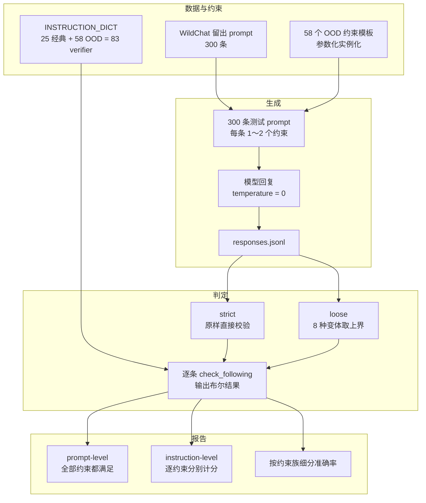

# IFBench

> 用「没见过的可验证输出约束」检验模型是否真的会精确遵循指令，而不是背下了 IFEval 的 25 道题。
> 发布：Allen Institute for AI，2025-07（NeurIPS 2025 Datasets & Benchmarks），arXiv:2507.02833

## 一句话定位

模型在 IFEval 那 25 个可程序验证的输出约束（「只回答 yes/no」「把某词提到 3 次」）上被反复训练与调参，分数虚高但换个没见过的约束就崩。IFBench 用 **58 个全新、留出域（OOD）的可验证约束**搭配未发布的 WildChat 真实提问，专门测这种精确指令遵循的**泛化能力**。判分不靠人评、不靠 LLM judge，全部由 Python 验证函数给出布尔结果。

## 评测机制

每条实例 = 一个留出集的 WildChat prompt + 1～2 条参数化约束。数据字段为 `key / prompt / instruction_id_list / kwargs`，其中 `kwargs` 携带约束参数（`min_words`、`keyword1`…）。验证器用 `build_description(**kwargs)` 还原约束，再用 `check_following(response)` 判定。



- **strict**：原始回复直接判定。
- **loose**：生成 8 个变体（原样、去掉 `*`，以及各自去掉首行 / 尾行 / 首尾行），任一变体通过即算通过，等价于给准确率一个上界；代价是可能引入假阳性。
- **两级指标**：`prompt-level` 要求该条所有约束同时满足，`instruction-level` 逐约束计分。论文主指标为 **prompt-level loose accuracy**。
- 论文评测一般用 `temperature = 0`；Deepseek R1 用 `0.6 / top_p 0.95`，o3 用 `1.0`。思考型模型放宽 max_tokens 后需剥离思维链再送入验证器。

与 IFEval 的关系：IFBench 把 Google IFEval 的 25 个经典验证器原样收进同一个 `INSTRUCTION_DICT`（共 83 个键），因此这个包可以同时作为两套约束注册表的 single source of truth。

## 数据规模

发布内容分三块，**300 只是单轮 test split**：

| 组成 | 规模 | 说明 |
| --- | --- | --- |
| OOD 测试约束 | 58 个约束 / 300 条 prompt | 约束模板 + 留出 WildChat prompt；另有独立的多轮测试集 |
| 多轮约束隔离 | 2 轮 | 第 1 轮给 prompt 与回复，第 2 轮才给约束，要求改写回复 |
| IF-RLVR 训练约束 | 29 个 | 人工标注的约束与验证函数，配 GRPO 训练数据 |

单轮测试集实测（本仓库 `data/IFBench_test.jsonl`）：300 条 prompt 全部唯一，覆盖 58 个唯一约束 id，合计 **344 个约束实例**（256 条单约束、44 条双约束）。按 registry 前缀统计实例分布：

| 前缀 | 实例数 | 典型玩法 |
| --- | --- | --- |
| `format:` | 98 | 嵌套括号 / 引号、缩进阶梯、CSV 列、子项目符号、输出模板 |
| `words:` | 89 | 回文、单元音段落、质数词长、首尾词衔接 |
| `count:` | 65 | 词数区间、数字 / 人名 / 代词计数、多关键词指定次数 |
| `ratio:` | 44 | 停用词占比、句型比例、n-gram 重叠度 |
| `sentence:` | 28 | 逐句递增词数、递增头韵 |
| `custom:` | 11 | 欧洲首都排序、日期列表、倒序输出 |
| `repeat:` | 9 | 先重复再改写、跨片段重复 |

⚠️ 上表是**约束实例数（344）**，论文 Appendix A 按**模板数（58）**分成 7 组（其中 `copy` 3 个模板，对应仓库的 `repeat:` 前缀），两者口径不同，不要混用。

## 成绩现状

口径统一为 **prompt-level loose accuracy**，来自论文 Table 3 / Table 6：

| 模型 | IFEval | IFBench | 备注 |
| --- | --- | --- | --- |
| Tülu-sft | 72.8 | 20.7 | Table 3 |
| Tülu-DPO | 81.1 | 25.5 | Table 3 |
| Tülu | 82.4 | 28.9 | Table 3 |
| IF-RLVR Tülu-DPO 8b | 92.2 | 44.6 | Table 3 |
| IF-RLVR qwen2.5 7b | 87.8 | 53.7 | Table 3 |

Table 6 的训练前后对照（同一口径）：`tulu3-dpo` 25.2 → 44.6（+19.4）、`qwen2.5` 31.3 → 45.9（+14.6）、`olmo2` 16.7 → 44.6（+27.9）。即 **IF-RLVR 用可验证奖励做 GRPO，把 IFBench 提升约 15～28 个百分点**，同时 IFEval 也涨到 89～92。论文 Figure 1 文字说明 GPT-4.1、Claude 3.7 Sonnet、Claude 4 Sonnet、Qwen3-32B 等前沿模型在 IFBench 上**低于 50%**，与 IFEval 上 80%+ 形成强烈反差。

⚠️ 口径提醒：论文 Introduction 写的是 28.9 → 45.9 与 54.7，Table 3 / Table 6 对应条目为 44.6 与 53.7，存在约 1 分的版本差异；引用时以表格为准并注明。仓库 `eval/` 里的 294 条样例结果是 loose 29.9% / strict 26.2%，**只是 `sample_output.jsonl` 的演示输出，不是任何论文模型的成绩**。

## 规模够不够：统计功效复核

论文只写「The final benchmark consists of 300 prompts」，**没有解释为什么是 300，也未讨论统计功效、方差、置信区间或规模局限**。能确认的成本约束是：58 个约束全部人工编写（部分来自作者之外的 LM 用户反馈）、每条配一个 Python 验证函数（约 2300 行）、每条实例都人工校验「约束与主任务是否兼容 / 是否互斥」、且必须用未见过的 prompt 与约束防污染。这些是 O(n) 人力，规模化会直接破坏它要测的东西——**瓶颈是约束，不是题目**。对比 IFEval：541 prompts / 25 约束 ≈ 21.6 条每约束；IFBench：344 实例 / 58 约束 ≈ **5.9 条每约束**，反而薄 3～4 倍。

以仓库自带样例结果（294 行，29.9%）做 bootstrap 复核：

| 统计口径 | 95% CI | 半宽 |
| --- | --- | --- |
| 把 300 条当独立 prompt（朴素二项） | [24.8%, 35.4%] | ±5.3pp |
| 按约束聚类重采样（57 个约束簇） | [20.6%, 39.9%] | ±9.7pp |
| 约束等权宏观均值（58 个约束） | 28.5%，[19.4%, 37.6%] | ±9.1pp |
| 双约束子集（44 条） | — | ±13.5pp |

样本并非 300 个独立证据，而是聚在 58 个约束下的重复测量，真实不确定性约为朴素估计的**两倍**。两个独立模型比较在 80% 功效下需要约 **10.5pp** 差距；同一批 prompt 做配对检验（McNemar / paired bootstrap）会好一些，但论文未报告显著性检验，也未说明重复评测次数。

每约束的实例数分布更成问题：

| 每约束实例数 | 约束个数 | 分辨率 |
| --- | --- | --- |
| 1 条 | 11（全是 `custom:`） | 单题决定 0 分或 100 分 |
| 2～3 条 | 3 | 每及格一次跳 33～50pp |
| 4～9 条 | 37（中位数 6） | 每跳 11～25pp |
| ≥10 条 | 7（最多 15） | 勉强能做趋势判断 |

样例结果中 **31/57 个约束的得分正好是 0 或 1**（完全饱和）；双约束 44 条只覆盖 18 种组合、单组合最多 5 条。

按用途判断：

| 用途 | 结论 |
| --- | --- |
| 模型粗分层、RLVR 大改动前后、回归烟测 | 够，10pp 以上差距信号稳定，生成成本低 |
| 同代模型榜单细排、宣称 2～5pp 提升 | 不够，低于可检测差异 |
| 按约束归因「模型不会哪类约束」 | 严重不够，见上表 |
| 支撑「泛化到未见约束」 | 方向性证据可以，精确量化不行；有效样本量是 58 个约束 |

单纯加 prompt 买不到外部效度：CI 半宽按 √n 收缩，300 → ±5.2pp、1000 → ±2.8pp、3000 → ±1.6pp，边际收益递减，且只提高「对固定 58 个约束的测量精度」。用现成 verifier 做参数实例化、换 prompt 扩样成本极低，但同一约束的多次实例化仍是重复测量，**约束间方差不会随 n 增大而消失**。

如果要自建评测，三条建议：

1. 报 paired bootstrap / McNemar + 约束级 cluster CI，不要只发一个点估计。
2. 主指标用**约束等权 macro 平均**：现在 `sentence:keyword`、`words:consonants` 各 15 条，11 个 `custom:` 各 1 条，加权方式会明显左右总分。
3. 扩集优先加约束数（58 → 150+），再把每约束补到 ≥20 条实例；多轮与双约束单独报，不混入总分。

## 已知缺陷

- **规模与功效**：见上一章。论文未给 CI、显著性检验、重复运行次数，也未讨论 300 条是否足够。
- **每约束样本量失衡**：11 个约束仅 1 条实例，样例中 31/57 个约束得分饱和，per-constraint 诊断几乎无意义。
- **范围窄且略显人为**：论文 Limitations 明确承认只覆盖「容易写出验证函数」的约束，现实中大量指令没有可验证 ground truth，因此部分约束看起来不自然。
- **口径可优化**：loose 的 8 变体清洗降低假阴性，但会引入假阳性；`strict` / `loose` 差值在样例里就有 3.7pp。
- **复现陷阱**：仓库 `config.py` 默认 `temperature = 0.6`、`max_tokens = 4096`，与论文评测的 `temperature = 0` 不一致；思考型模型还需剥离思维链。
- **数字一致性**：论文正文与表格存在约 1 分的版本差异，跨段引用前需对齐口径。

## 复现

```bash
uv sync
uv run python generate_responses.py --model <模型名> --api-base http://localhost:8000/v1
uv run python -m run_eval \
  --input_data=data/IFBench_test.jsonl \
  --input_response_data=data/<模型名>-responses.jsonl \
  --output_dir=eval
```

也可以只把包当验证器库用：

```python
from ifbench import instructions_registry, data_path

checker_cls = instructions_registry.INSTRUCTION_DICT["keywords:existence"]
checker = checker_cls("keywords:existence")
checker.build_description(keywords=["cat", "dog"])
checker.check_following("I saw a cat and a dog today.")  # True
```

`pip install ifbench` 可直接安装；测试集随 wheel 打包，用 `ifbench.data_path()` 定位。代码 Apache-2.0，数据 ODC-BY-1.0（仅研究与教育用途）。

## 结论

IFBench 把「精确指令遵循」从背题问题还原成泛化问题，83 个确定性验证器也让它成为可直接复用的判分工具，RLVR 提升 15～28pp 的结果很有说服力。但 300 条容易被误当成 300 个独立证据——它本质是 **58 个约束上的重复测量**：作为粗粒度分层基准够用，作为细粒度排行榜和 per-constraint 归因工具不够。用它出结论时应同时报告约束级置信区间，并把口径写清楚。

## 参考

- 论文：*Generalizing Verifiable Instruction Following*，arXiv:2507.02833，NeurIPS 2025 D&B
- 仓库：https://github.com/allenai/IFBench
- 数据集：https://huggingface.co/collections/allenai/ifbench-683f590687f61b512558cdf1
- IFEval：https://github.com/google-research/google-research/tree/master/instruction_following_eval
- RLVR 训练代码：https://github.com/allenai/open-instruct/blob/main/open_instruct/grpo_fast.py
