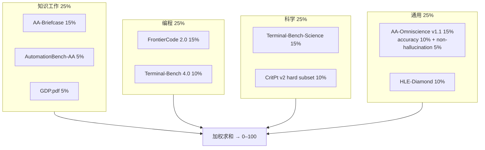

# Artificial Analysis Intelligence Index v5.0：跨四类能力的复合智能指数

> **核验说明**：v5.0 发布于 2026-10-27，官方方法页当前版本为 **v5.0.1**（2026-11），官网 LLM Leaderboard 于 2026-11-05 访问时标注 v5.0.1。本文把「v5.0 发布文分数」与「v5.0.1 现行榜单」分开写，不跨表比较。榜单前 10 与关键开源 / 成本档位已归档至 `sources/aa-intelligence-index-v5/leaderboard-v5.0.1-2026-11-05.csv`，可离线复核；入库边界见 `sources/aa-intelligence-index-v5/README.md`。

---

## 1. 一句话定义

**Artificial Analysis Intelligence Index v5.0**（下称 AA Intelligence Index v5）是 Artificial Analysis 于 2026-10-27 发布的复合能力指数：把 **9 项评测**按知识工作、编程、科学、通用四类**各 25%** 加权，得到 0–100 的单一分数。v5 的最大变化是 **60% 的权重来自私有测试集或留出答案**，官方称这是该指数首次由私有数据占多数，用于对抗基准污染。

它不是单一题库，而是一个加权聚合：同一模型的不同 effort 档位各占一行，分数必须绑定版本、effort 与 harness。与同时发布的 **Progress Index v1** 不同：后者把 2022-11 以来的模型放到一条连续能力尺度上，用于纵向比较；Intelligence Index 用于当前前沿的横向比较。

---

## 2. 版本定位与发布沿革

AA Intelligence Index 家族自 2024-01 的 v1.0 起持续迭代；v5 是 2026-01 v4 之后最大的一次改版。下表只列与 v5 口径直接相关的节点，完整历史见官方方法页的 Version History。

表 1 · 版本沿革（官方方法页口径）

| 版本 | 时间 | 关键变化 |
| --- | --- | --- |
| v4.0 | 2026-01 | 加入 GDPval-AA、AA-Omniscience、CritPt；移除 MMLU-Pro、LiveCodeBench、AIME 2025；四类各 25% |
| v4.1 | 2026-06 | GDPval-AA v2；Terminal-Bench 2.1；τ³-Banking；移除 IFBench；Agents 34% / Coding 24% / Scientific Reasoning 24% / General 18% |
| v4.2 | 2026-09 | 加入 AA-Briefcase、GDP.pdf；移除 [GPQA Diamond](gpqa.md)；AA-LCR 升至 v1.1 |
| v4.3 | 2026-09 | 加入 AutomationBench-AA、Terminal-Bench 4.0；移除 τ³-Banking、Terminal-Bench 2.1 |
| v4.3.1 / v4.3.2 | 2026-09 / 2026-10 | 刷新 pairwise 评委面板；AA-Briefcase 与 GDPval-AA 的 Elo 改用 Crowd-BT 拟合 |
| **v5.0** | **2026-10-27** | 加入 FrontierCode 2.0、Terminal-Bench-Science、HLE-Diamond；升级 AA-Omniscience v1.1、CritPt v2 hard subset；移除 GDPval-AA、SciCode、AA-LCR、HLE；四类改为各 25% |
| **v5.0.1** | **2026-11** | 按 CritPt 作者反馈改进评分稳健性，并用 CritPt v2 重跑全部模型 |

### 2.1 与 v4.3 的关系

v5 与 v4.3 不是同一把尺子：题目组合有 2 项新增（FrontierCode 2.0、Terminal-Bench-Science）、4 项移除、3 项升级（HLE-Diamond 替换 HLE、AA-Omniscience v1.1、CritPt v2），四类权重改为等权，且 60% 权重来自私有集。官方明示 v5 与 v4.3 分数不可直接比较；发布文用「开源模型差距从 3 分扩大到 12 分」描述 v4.3 → v5 的变化，这个对比只在官方同一叙述口径下成立，不能把单个模型的 v4.3 分数与 v5 分数直接相减。

v5.0.1 的版本记录是对 CritPt 的重新评分，但仍不应与 v5.0 发布分混用：官网当前榜首与 10 月发布文相差 1 分（详见 5.2 节）。

---

## 3. 数据与任务构造

### 3.1 九项评测与权重

表 2 · Intelligence Index v5.0.1 的九项评测（官方方法页口径）

| 类别 | 评测 | 权重 | 题量 | 重复 | 计分 | 工具 | 私有 |
| --- | --- | ---: | ---: | ---: | --- | :---: | :---: |
| 知识工作（25%） | AA-Briefcase v1.1 | 15% | 91（4 个场景） | 1 | rubric + pairwise 的 Combined Elo | ✓ | ✓ |
| 知识工作（25%） | AutomationBench-AA | 5% | 657 | 1 | objective 完成率；guardrail 违规记 0 | ✓ | ✓ |
| 知识工作（25%） | GDP.pdf | 5% | 100（10 个领域） | 5 | rubric 逐条判定，all-pass | ✗ | ✗ |
| 编程（25%） | FrontierCode 2.0 | 15% | 132 | 3 | 隐藏测试 + rubric；blocking check 失败记 0 | ✓ | ✓ |
| 编程（25%） | Terminal-Bench 4.0 | 10% | 66 | 3 | 测试套件 pass@1 | ✓ | ✗ |
| 科学（25%） | Terminal-Bench-Science 0.1.0 | 15% | 70（5 个领域） | 3 | 测试套件 pass@1 | ✓ | ✗ |
| 科学（25%） | CritPt v2 hard subset | 10% | 40（从 70 题中选） | 5 | 官方 grading server，pass@1 | ✓ | ✓ |
| 通用（25%） | AA-Omniscience v1.1 | 15% | 3,000 | 1 | accuracy 10% + 非幻觉率 5% | ✗ | ✓ |
| 通用（25%） | HLE-Diamond | 10% | 1,000（500 推理 + 500 知识） | 1 | equality checker LLM，pass@1 | ✗ | ✗ |

私有权重合计 **60%**：AA-Briefcase 15 + AutomationBench-AA 5 + FrontierCode 2.0 15 + CritPt 10 + AA-Omniscience 15。公开权重合计 40%：GDP.pdf 5 + Terminal-Bench 4.0 10 + Terminal-Bench-Science 15 + HLE-Diamond 10。

### 3.2 各项数据来源与构造

- **AA-Briefcase v1.1**：91 个任务分布在 4 个「多周」知识工作场景中，每场景每周 2–5 个任务；输入包含 Slack 导出、表格、PDF、访谈记录、市场研究、董事会材料等真实职业文件。Agent 在无网络的 E2B sandbox 中最多跑 500 轮，产出交付文件；评分由 rubric 二元判定与三评委 pairwise 比较合成 Combined Elo。完整 91 题不公开，Hugging Face 上的 `AA-Briefcase-Lite` 是示例 / 轻量版本，不是全量。
- **AutomationBench-AA**：Zapier AutomationBench 的 AA 实现，使用数据集 v1.0.6 的 **657 题私有留出 split**，覆盖 Finance、HR、Marketing、Operations、Sales、Support 六个领域；Agent 通过 REST API 工具完成 SaaS 工作流，最多 50 轮。objective 完成率计分，任一 guardrail 被破坏或任务报错该题记 0；不使用 LLM 评委。
- **GDP.pdf**：Surge AI 的 GDP.pdf 基准，AA 取 100 题、10 个职业领域、4,592 页 PDF、1,275 条评分标准；每题尝试 5 次，因此每个模型固定 500 次尝试。AA 用 LiteParse 2.5.0 + OCR 抽取全文，并向支持图像输入的模型发送页面图；GPT-5.6 Luna（medium）逐条判定，headline 为 **all-pass**。与 Surge AI 原始实现（直接传 PDF、Gemini 3.5 Flash 判分）不可直接比较。
- **FrontierCode 2.0**：Cognition 的私有编码基准，132 个真实开源仓库任务；每题 3 次尝试，Agent 在 Stirrup 中最多 500 轮。题目由 maintainer 视角的隐藏测试与 blocking / non-blocking rubric 判定；任一 blocking check 失败，或轨迹扫描发现模型查阅答案，该次记 0。GPT-6 Luna（medium）担任 LLM 评委。FrontierCode 2.0 本身的官方榜、5 次运行的发布方口径与版本沿革见 [frontiercode-v2.md](frontiercode-v2.md)；AA 这里是独立实现，46.4% 与官方 45.5% 不可直接比较。
- **Terminal-Bench 4.0**：66 道终端任务，覆盖软件工程、系统管理、数据处理、模型训练与安全；AA 用 **mini-swe-agent** 跑 3 次，pass@1，单题最多 500 步，任务自带测试全部通过才算通过。Terminal-Bench 4.0 本身的 66 题、官方每题 5 次 trial（330 trials）与版本沿革见 [terminal-bench-v4-0.md](terminal-bench-v4-0.md)；AA 的 3 次重复与官方榜、混合 harness 口径不同，不能直接比较。
- **Terminal-Bench-Science 0.1.0**：70 道科研工作流任务，5 个领域：生命 19、物理 17、数学 17、工程 9、地球 8；AA 用 mini-swe-agent 跑 3 次，pass@1，单题最多 1,000 步。上游仓库当前已增长到 83 题，v5 固定使用 0.1.0 的 70 题。
- **CritPt v2 hard subset**：CritPt v2 共 70 道研究级物理题；AA 取其中 **40 题**组成私有 hard subset，去掉的是发布时有 7 个前沿模型在 5 次尝试中全部答对的 30 题。模型在离线 Python sandbox 中作答，官方 grading server 判分，5 次 pass@1。
- **AA-Omniscience v1.1**：3,000 道开放答案题（v1 为 6,000 道）、42 个主题；v1.1 过滤了饱和题、移除了 v1 公开集的 600 题、补入新题并修订歧义 / 错误题。私有测试集用于排行；Hugging Face 上的 `AA-Omniscience-Public-v1.1` 是重新校准的公开子集。进入 Index 的是 **accuracy（10%）** 与 **1 − hallucination rate（5%）** 两个分量，不是该基准的 Net Score。
- **HLE-Diamond**：CAIS 与 Scale AI 的 Humanity's Last Exam 精炼版，1,000 题，推理与知识各 500；其中 272 题带图。数据集公开（gated auto）。不支持图像输入的模型只收到题目文本，但仍按全部 1,000 题计分。

---

## 4. 评测方式与计分链路

### 4.1 加权公式

各项先换算到 0–100 分，再按下列权重求和（权重之和为 1.00）：

```text
Index = 0.15 × AA-Briefcase
      + 0.05 × AutomationBench-AA
      + 0.05 × GDP.pdf
      + 0.15 × FrontierCode 2.0
      + 0.10 × Terminal-Bench 4.0
      + 0.15 × Terminal-Bench-Science
      + 0.10 × CritPt v2 hard subset
      + 0.10 × AA-Omniscience accuracy
      + 0.05 × AA-Omniscience non-hallucination
      + 0.10 × HLE-Diamond
```

其中 AA-Briefcase 的 Elo 先按 `clamp((Elo - 500) / 2000)` 归一化，再与其他组件放到同一 0–100 标尺；Elo 标尺锚定 GPT-5.5（medium）= 1000，该归一化在模型加入时冻结，官方保留在模型整体进步后更新参考参数的余地。其余组件直接使用百分比 / 通过率。



### 4.2 统一测试条件

- **Prompt**：zero-shot 指令提示，不使用 few-shot 示例；模型按官方 system prompt 作答。
- **温度**：非推理模型 0；推理模型 0.6（除非模型厂商另有推荐）。
- **输出上限**：非推理模型 16,384 tokens（上下文或厂商上限更小时下调）；推理模型使用厂商允许的最大输出。
- **重试**：API 失败最多重试 30 次；30 次仍失败的题目人工复核，持续失败的结果不发布。
- **pass@1**：多轮重复时按「总正确次数 / 总尝试次数」聚合，不取最好一次。
- **Harness**：AA-Briefcase、FrontierCode 2.0、CritPt 用 **Stirrup**；Terminal-Bench 4.0、Terminal-Bench-Science 用 **mini-swe-agent**。两者不是同一个 agent 循环，跨组件比较时要记住这一点。
- **Judge**：GDP.pdf、AA-Omniscience、HLE-Diamond 用 GPT-5.6 Luna（medium）；FrontierCode 2.0 用 GPT-6 Luna（medium）；AA-Briefcase 使用三评委面板。
- **Sandbox**：agentic 评测主要用 e2b；任务环境按各组件定义固定。

### 4.3 成本口径

Index 的 Cost per Task 使用模型 API 厂商回报的 token 数，并结合实时测量的缓存命中率，而不是一次性评测时的单次计量；厂商 token 计数缺失时才用 canonical tokenizer 兜底。GDP.pdf 的成本只覆盖参赛模型调用，不含 judge、PDF 解析与 OCR；因此它是模型成本，不是端到端评测成本。

---

## 5. 榜单结果与演进

> ⚠️ **不要跨口径比较**：v5.0.1、v5.0 与 v4.3 的题目组合、权重、私有 / 公开 split、私有集与评分脚本不同；同一模型不同 effort 档位也各占一行。以下分数均为 Artificial Analysis 独立运行（非厂商自报），但 Gemini 4 Carbon 尚未公开 API，官网标注为限量发布；其分数不能等同于公开可用版本的分数。引用时必须同时写明版本、effort 与 harness。

### 5.1 v5.0 发布窗口（2026-10-27 / 28）

v5.0 发布时，Claude Opus 5.5（max）以 **58** 居首，GPT-6 Astra（max）57、GPT-6.1 Sol（max）55、Gemini 4 Argon（high）50。次日 Gemini 4 Carbon（high）以 **59** 登顶，Opus 5.5 退居第二。发布文称 Anthropic 与 OpenAI 占据前五名模型；下表只列文中点名的头部与开源 / 成本档位，不是完整名次。

表 3 · v5.0 发布窗口的头部（官方发布文口径，2026-10-27 / 28）

| 模型（effort） | Index | 备注 |
| --- | ---: | --- |
| Gemini 4 Carbon（high） | 59 | 2026-10-28 登顶；尚未公开 API |
| Claude Opus 5.5（max） | 58 | 2026-10-27 发布日榜首 |
| GPT-6 Astra（max） | 57 |  |
| GPT-6.1 Sol（max） | 55 |  |
| Gemini 4 Argon（high） | 50 |  |
| Kimi K3.1 Pro | 46 | 权重未发布；官方称其为最高分开源模型 |
| Claude Haiku 5.5（max） | 36 | 高于所有已发布权重的开源模型 |
| DeepSeek V4.1 Flash 1017（max） | 32 | 已发布权重最高（发布文口径） |
| GLM-5.3（max） | 32 | 已发布权重最高（发布文口径） |

发布文的关键判断：

- 开源模型与榜首的差距从 v4.3 的 **3 分**扩大到 **12 分**（Opus 58 vs Kimi 46）；但 Kimi 权重尚未发布，已发布权重最高只有 32 分。
- **没有任何模型领先全部 9 项**。发布时 Opus 5.5 领先 3 项（FrontierCode 2.0、HLE-Diamond、AA-Omniscience），其余 6 项由 5 个不同模型领先。
- v5 在 9 项评测上都留有明显进步空间；头部约 60 分，不是饱和榜。

### 5.2 v5.0.1 现行榜单（2026-11-05）

官网 LLM Leaderboard 当前标注 **v5.0.1**，共 **96 个配置行**（同一模型不同 effort 各占一行），其中 **37 个开源权重行**。下表按官网显示的整数分数排列（同分并列），精确值见快照 CSV。

表 4 · v5.0.1 现行前 10（官方 LLM Leaderboard，2026-11-05 访问）

| 名次 | 模型（effort） | Index | Cost / task（USD） |
| ---: | --- | ---: | ---: |
| 1 | Gemini 4 Carbon（high） | 60 | $7.76 |
| 2 | Claude Opus 5.5（max） | 59 | $10.04 |
| 3 | Gemini 4 Carbon（medium） | 58 | $6.59 |
| 4 | Claude Opus 5.5（xhigh） | 57 | $6.05 |
| 4 | GPT-6 Astra（max） | 57 | $6.24 |
| 6 | GPT-6 Astra（xhigh） | 55 | $3.66 |
| 6 | GPT-6 Astra（high） | 55 | $3.24 |
| 6 | GPT-6.1 Sol（max） | 55 | $1.27 |
| 6 | Claude Sonnet 5.5（max） | 55 | $10.02 |
| 10 | Gemini 4 Carbon（low） | 54 | $7.19 |

表 5 · 开源与成本参考档位（同一 v5.0.1 榜单）

| 名次 | 模型（effort） | Index | Cost / task（USD） | 说明 |
| ---: | --- | ---: | ---: | --- |
| 14 | GPT-6.1 Terra（max） | 51 | $0.96 | 头部附近最便宜的档位之一 |
| 17 | Muse Wonder Full（max） | 50 | — | 官网未给 cost / time |
| 20 | Claude Fable 5.1（max） | 49 | $12.99 | 头部配置中最贵档位 |
| 23 | Kimi K3.1 Pro | 46 | $3.68 | 权重未发布，不计入已发布开源 |
| 34 | Claude Haiku 5.5（max） | 36 | $0.41 | 高于所有已发布权重开源模型 |
| 42 | DeepSeek V4.1 Flash 1017（max） | 33 | $0.60 | 已发布权重的最高开源模型 |
| 43 | GLM-5.3（max） | 32 | $5.01 |  |
| 49 | MiMo-V2.6-Pro | 30 | $0.26 |  |

v5.0.1 与 v5.0 发布分的差异：

- 官网当前榜首 Gemini 4 Carbon 为 **60**，Opus 5.5 为 **59**；发布文分别为 59 与 58。v5.0.1 的版本记录是对 CritPt v2 的重新评分，官方未逐项解释这 1 分差异，引用时必须绑定版本。
- CritPt 分项变化更明显：发布文写 GPT-6 Astra（high）72%、Opus 5.5（max）61%；v5.0.1 现行数据为 Astra（medium）72.0%、Astra（high）71.5%、Opus 5.5（max）68.0%。这说明 patch 级重跑足以改变分项结论，不能把两版分项混在同一张表里。
- 二手聚合平台的 v5.0 页面（LLMLearner、DataLearner）最后更新停留在 2026-10-29，仍是 59 / 58.4 的发布口径；官网已经是 60 / 59。二手页面不能当作 v5.0.1 的现行分数。
- 按当前榜单，榜首 60 与 Kimi 46 相差 14 分，与已发布权重最高的 DeepSeek 33 相差 27 分；发布文的「12 分」是 v5.0 发布时 Opus 58 vs Kimi 46 的口径，两者不要混用。

### 5.3 分项领先（v5.0.1 现行）

表 6 · 九项评测的当前领先者（v5.0.1 官网榜单；AA-Omniscience 拆为 accuracy / non-hallucination 两个分量）

| 类别 | 评测 | 领先者（effort） | 分数 | 说明 |
| --- | --- | --- | ---: | --- |
| 知识工作 | AA-Briefcase v1.1 | Claude Sonnet 5.5（max） | 1,813 Elo | Elo 标尺，不能与百分比并列比较 |
| 知识工作 | AutomationBench-AA | Gemini 4 Carbon（high） | 77.8% | Gemini 4 Argon（high）77.5% 紧随 |
| 知识工作 | GDP.pdf | Muse Wonder Full（max） | 32.6% | all-pass；GPT-6 Astra（xhigh）32.2% |
| 编程 | FrontierCode 2.0 | Claude Opus 5.5（max） | 46.4% | GPT-6 Astra（max）42.4% |
| 编程 | Terminal-Bench 4.0 | Kimi K3.1 Pro | 67.2% | Gemini 4 Carbon（high）65.2% |
| 科学 | Terminal-Bench-Science 0.1.0 | Gemini 4 Carbon（high） | 64.8% | GPT-6 Astra（max）63.3% |
| 科学 | CritPt v2 hard subset | GPT-6 Astra（medium） | 72.0% | 40 题私有子集；与 CritPt 官方 70 题榜不可比 |
| 通用 | AA-Omniscience accuracy（10%） | Claude Fable 5.1（max） | 68.4% | Opus 5.5（max）65.5% |
| 通用 | AA-Omniscience non-hallucination（5%） | Gemini 4 Carbon（medium） | 95.8% | Gemini 4 Argon（high）95.7% |
| 通用 | HLE-Diamond | Gemini 4 Carbon（high） | 69.1% | Opus 5.5（max）67.9% |

当前 **没有任何模型领先全部 9 项**：Gemini 4 Carbon 系列领先 4 项（AutomationBench-AA、Terminal-Bench-Science、非幻觉率、HLE-Diamond；非幻觉率为 medium 档，其余为 high 档），其余 5 项分别由 Claude Sonnet 5.5、Claude Opus 5.5、Muse Wonder Full、Kimi K3.1 Pro、GPT-6 Astra 领先。AA-Omniscience 的 Net Score 最高是 Gemini 4 Carbon 的 53.5，但 Net Score 不是 Index 的单一权重项；Index 只取 accuracy 与非幻觉率两个分量。

### 5.4 成本、effort 与 token

- 发布文所列 10 个最高分模型中，Cost per Task 相差超过 **13 倍**：GPT-6.1 Terra（max）$0.96 / 题，Claude Fable 5.1（max）$13.04 / 题（现行榜单 Fable 为 $12.99）。
- GPT-6.1 Sol（max）比 Opus 5.5（max）低约 4 分，但成本约为后者的 **1/8**（$1.27 vs $10.04）。
- effort 对分数的影响在 v5 更大（发布文口径）：Opus 5.5 从 low 的 35 到 max 的 58，成本从 $0.98 到 $10.04（约 10 倍）；Claude Sonnet 5.5 的 low→max 跨度 29 分，v4.3 为 20 分；GPT-6.1 Sol 的跨度从 10 分翻倍到 20 分。
- v5 的任务更耗 token：每个 Index 任务的中位输出从 v4.3 的 35k 升到 **59k**；agentic 评测占 55% 权重，却消耗约 **90%** 的输出 token；Terminal-Bench-Science 一项就约占 1/3。
- 因此「同分」不等于「同成本」：比较模型时必须同时看 effort、Cost per Task 与输出 token，不能只看 Index 一列。

### 5.5 从 v4.3 到 v5 的解读

- **更 agentic**：v5 的 9 项中有 6 项使用工具（AA-Briefcase、AutomationBench、FrontierCode、Terminal-Bench 4.0、Terminal-Bench-Science、CritPt），agentic 评测占 55% 权重。
- **更私有**：60% 权重来自私有集或留出答案，公开集只剩 40%。这提高了抗污染能力，也把「可外部复核」让渡给了发布方。
- **更等权**：四类各 25%，避免某一类（如通用知识）主导总分；但等权本身仍是编辑选择，不是从任务难度或产业重要性推导出来的。
- **更贵、更慢**：头部模型的 Cost per Task 从不到 1 美元到 13 美元，单任务时间 20–30 分钟量级；Index 已经不是「跑一遍便宜题库」的评测。

---

## 6. 已知缺陷

### 6.1 私有化与可审计性

60% 权重来自私有测试集或留出答案，外部无法检查题目、标准答案与判分细节。heise 的发布报道把这一点列为主要 trade-off：私有题能降低污染，但「outsiders can't review the nonpublic benchmarks; possible errors can't be found」。这是二手评论，但它指出了结构性问题：分数越重要，越难独立复核。完整 Index 没有公开的评测仓库、权重文件或私有题集，无法端到端复现。

### 6.2 复合指数的权重选择

四类各 25%、类内再按固定权重，是官方的手工配置。等权会压低或抬高某些能力：例如 agentic 评测占 55% 权重，但只集中在知识工作、编程、科学三类；通用类仍保留 25%。权重改变会改变排名，而官方没有给出「为什么是这些权重」的公开依据。AA-Briefcase 的 Elo 归一化在模型加入时冻结，官方保留更新参考参数的权利，这也会影响跨时间可比性。

### 6.3 effort、harness 与版本漂移

- 同一模型不同 effort 的分数差可达 20–29 分，成本差可达 10 倍；不写明 effort 的「模型分数」没有意义。
- 不同组件使用不同 harness（Stirrup vs mini-swe-agent），跨组件比较不是同一 agent 循环下的比较。
- 版本记录显示 v5.0.1 重跑了 CritPt，头部总分就出现 1 分变化，CritPt 分项出现 7 分变化（Opus 61 → 68）。patch 级更新也足以改变结论。
- Gemini 4 Carbon 尚未公开 API，官网标注限量发布；其分数不能直接等同于公开可用版本。

### 6.4 公开集污染与私有集不可复核

公开的 40% 仍有污染风险：Terminal-Bench 4.0、Terminal-Bench-Science、HLE-Diamond 的题目或测试公开，GDP.pdf 也以公开基准形式发布（AA 使用的数据集页面本次返回 401，未取到），模型厂商可以在训练中接触。AA 用私有集抵消一部分，但公开集与私有集的难度、领域分布并不完全相同；AA-Omniscience 官方也说明公开子集经过重新校准，公开集与私有集的 accuracy / hallucination 分布要分别看。

### 6.5 组件版本与上游不一致

- **CritPt**：AA 只用 40 题 hard subset，且去掉了发布时 7 个前沿模型 5 次全对的 30 题；CritPt 官方 70 题榜的 GPT-6 Astra 是 83.1%，AA 硬子集是 72.0%，两者不可比。
- **Terminal-Bench-Science**：v5 固定 0.1.0 的 70 题；上游仓库当前已增长到 83 题，直接跑 `@latest` 会得到不同题集。
- **AA-Omniscience v1.1**：与 v1 分数不可直接比较（官方称平均低 2 分、中位数低 0.6）；Index 只用 accuracy 与非幻觉率，不用 Net Score。
- **HLE-Diamond**：与原始 HLE（2,158 道文本题）不可比；HLE-Diamond 含 272 道图像题，不支持图像的模型只收到文本，但仍按 1,000 题计分，可能处于结构性劣势。
- **GDP.pdf**：AA 的文档输入（LiteParse + OCR + 页面图）与 judge（GPT-5.6 Luna）都与 Surge AI 原始实现不同，官方明说两边的分数不可直接比较。
- **AutomationBench-AA**：657 题是私有留出 split，不能与 Zapier 公开榜直接对比。
- **FrontierCode 2.0**：Cognition 的私有基准，题目与 verifier 不公开，AA 只负责运行；外部无法复核 blocking check 与 rubric。

### 6.6 二手聚合平台混用版本

- **BenchLM** 的 AA 条目是 display-only，明确说明「compiles reported index scores, which can come from different index versions」；同一张表可能混有 v4.x 与 v5.x 分数，不能当作 v5.0.1 榜单。
- **LLMLearner** 的 v5.0 页只有 37 个模型，最后一条结果 2026-10-29；**DataLearner** 的 v5.0 页 76 条，更新于 2026-10-29。两者都停在 v5.0 发布口径，未跟上 v5.0.1 的 96 行榜单。
- 二手平台的「最佳开源」标签也可能与 AA 的 `isOpenWeights` 口径不同：Kimi K3.1 Pro 在 AA 数据中不是 open weights（权重未发布），不能与 DeepSeek / GLM 的已发布权重并列。

### 6.7 成本与 token 口径

Cost per Task 的公开说明以模型调用 token 为主；GDP.pdf 方法页明确只覆盖参赛模型调用，不含 judge、PDF 解析与 OCR。其他组件也按模型 API token 计，不能当作端到端评测成本。不同模型的 token 计数来自各自 API provider，缓存命中率是实时测量值而非评测时的一次性值；因此成本会随供应商定价、缓存策略与 effort 变化。

### 6.8 覆盖范围

Index 主要是**英文、文本**评测；多模态与多语言能力由 AA 的其他指数单独报告，不进入 Intelligence Index。GDP.pdf 与 HLE-Diamond 含图像，但不支持图像的模型只收到文本；这使 Index 不是完全同条件的多模态比较。对中文、非英语或多模态场景，不能用 Index 直接下结论。

---

## 7. 复现 / 快速上手

### 7.1 公开资源

完整 Index 无法复现：60% 权重私有，AA 没有发布完整 harness、权重或私有题集。**Intelligence Index 本体未找到独立论文或公开评测仓库**；AA 开源了 Stirrup harness，并维护方法页与榜单。能复现的是组件级公开部分：

表 7 · 组件级公开资源与体积

| 组件 | 资源 | 体积 | 能复现什么 |
| --- | --- | ---: | --- |
| 通用 harness | Stirrup（GitHub / PyPI） | 仓库未称重 | AA-Briefcase、FrontierCode、CritPt 的 agent 循环与 sandbox 接口 |
| AA-Briefcase | `ArtificialAnalysis/AA-Briefcase-Lite`（HF） | 103 MB | 示例 / 轻量题与评分脚本，不是 91 题全量 |
| AA-Omniscience | `ArtificialAnalysis/AA-Omniscience-Public-v1.1`（HF） | 1.1 MB | 公开子集，不是 3,000 题私有集 |
| HLE-Diamond | `cais/hle-diamond`（HF，gated auto） | 224 MB | 1,000 题全量，需登录并接受条款 |
| Terminal-Bench 4.0 | GitHub + Harbor Hub | 未称重 | 66 题上游版本；AA 用 mini-swe-agent |
| Terminal-Bench-Science 0.1.0 | GitHub + Zenodo | 未称重 | 0.1.0 的 70 题；上游当前 83 题 |
| CritPt v2 | GitHub + HF | 330 KB | 70 题全量 + 官方评分服务器；40 题 hard subset 私有 |
| AutomationBench | GitHub + 论文 | 未称重 | 上游题集；AA 的 657 题私有 split 未发布 |
| GDP.pdf | 论文 + HF（访问 401） | 未取到 | 论文与 AA 方法页；数据需授权 / 未公开 |
| FrontierCode 2.0 | Cognition 公告 | — | 仅公告；132 题私有，无公开数据 |

### 7.2 复现命令

```bash
# 通用 agent harness
pip install 'stirrup[all]'

# 公开数据集（Hugging Face CLI）
huggingface-cli download ArtificialAnalysis/AA-Briefcase-Lite
huggingface-cli download ArtificialAnalysis/AA-Omniscience-Public-v1.1
huggingface-cli download cais/hle-diamond        # gated auto，需先登录并接受条款
huggingface-cli download CritPt-Benchmark/CritPt

# Terminal-Bench 4.0 / Science（Harbor；省略号处按各仓库 README 补 agent 参数）
uv tool install 'harbor[modal]'
harbor run -d terminal-bench/terminal-bench@latest ...

uv tool install 'harbor[modal,daytona]'
harbor run -d terminal-bench-science/terminal-bench-science@latest ...

# CritPt：生成 + 提交官方 grading server
git clone https://github.com/CritPt-Benchmark/CritPt.git
cd CritPt && pip install -r requirements.txt
```

注意：Terminal-Bench 的 `@latest` 不等于 AA 使用的固定版本；复现 v5 时必须按论文 / 仓库 release 锁定 4.0 与 0.1.0。CritPt 的 40 题 hard subset 不公开，公开仓库只能跑 70 题全量并提交官方服务器，不能复现 AA 的硬子集分数。

### 7.3 未入库边界

本仓库只归档了 `sources/aa-intelligence-index-v5/leaderboard-v5.0.1-2026-11-05.csv` 的 18 行（前 10 + 关键开源 / 成本档位），不收录：

- 官方 96 行完整榜单与组件全量矩阵；
- 私有题集、私有 split、评分脚本与模型输出；
- AA-Briefcase 全量 91 题、AA-Omniscience 私有 3,000 题、CritPt hard subset 40 题、FrontierCode 2.0 的 132 题；
- 各组件 Docker 镜像、轨迹与完整 trial 表；
- GDP.pdf 数据（HF 访问 401，未取到）。

---

## 8. 结论

v5 是 AA Intelligence Index 自 v4 以来最大的一次改版：更 agentic、更私有、四类等权，头部约 60 分，仍有明显进步空间。它适合回答「当前前沿模型在真实工作、编码、科研与通用知识上的综合位置」，也适合做成本—能力权衡；但不适合跨版本比较、单题归因或公开可复现的学术比较。

使用时至少锁定四件事：**版本（v5.0.1）、effort、harness、是否私有组件**。如果要看纵向能力变化，用 Progress Index v1；如果要看单能力，用对应组件榜并注意各自的版本与 harness。v5.0.1 的 patch 级重跑已经说明：即使题目不变，评分脚本的稳健性修正也足以改变分项结论，分数必须绑定日期。

---

## 9. 参考来源

1. 官方发布文（2026-10-27）：https://artificialanalysis.ai/articles/artificial-analysis-intelligence-index-v5 ；同文提及的 Progress Index v1 方法页（未按同样深度核验）：https://artificialanalysis.ai/methodology/progress-index
2. 官方方法页（Intelligence Index v5.0.1，访问 2026-11-05）：https://artificialanalysis.ai/methodology/intelligence-benchmarking
3. 官方 LLM Leaderboard（v5.0.1，访问 2026-11-05）：https://artificialanalysis.ai/leaderboards/models
4. 官方 Gemini 4 Carbon 登顶文（2026-10-28）：https://artificialanalysis.ai/articles/gemini-4-carbon-new-number-1
5. 官方 agent harness（GitHub）：https://github.com/ArtificialAnalysis/Stirrup
6. Terminal-Bench 4.0 仓库（GitHub）：https://github.com/harbor-framework/terminal-bench
7. Terminal-Bench 4.0 榜单（官方）：https://www.tbench.ai/
8. Terminal-Bench-Science 仓库（GitHub）：https://github.com/harbor-framework/terminal-bench-science
9. Terminal-Bench-Science 榜单（官方）：https://www.terminal-bench-science.ai/
10. Terminal-Bench-Science DOI（Zenodo）：https://doi.org/10.5281/zenodo.22110254
11. CritPt 仓库（GitHub）：https://github.com/CritPt-Benchmark/CritPt
12. CritPt 数据集（Hugging Face）：https://huggingface.co/datasets/CritPt-Benchmark/CritPt
13. CritPt 论文（arXiv:2509.26574，2025）：https://arxiv.org/abs/2509.26574
14. HLE 仓库（GitHub）：https://github.com/centerforaisafety/hle
15. HLE-Diamond 数据集（Hugging Face，gated auto）：https://huggingface.co/datasets/cais/hle-diamond
16. HLE-Diamond 公告（CAIS / Scale AI）：https://lastexam.ai/blog/hle-diamond
17. AutomationBench 仓库（GitHub）：https://github.com/zapier/AutomationBench
18. AutomationBench 论文（arXiv:2604.18934）：https://arxiv.org/abs/2604.18934
19. GDP.pdf 论文（arXiv:2607.11192）：https://arxiv.org/abs/2607.11192
20. GDP.pdf 数据集（Hugging Face，访问 401，未取到）：https://huggingface.co/datasets/surgeai/GDP.pdf
21. AA-Omniscience 论文（arXiv:2511.13029）：https://arxiv.org/abs/2511.13029
22. AA-Omniscience 公开子集 v1.1（Hugging Face）：https://huggingface.co/datasets/ArtificialAnalysis/AA-Omniscience-Public-v1.1
23. AA-Briefcase-Lite（Hugging Face）：https://huggingface.co/datasets/ArtificialAnalysis/AA-Briefcase-Lite
24. FrontierCode 2.0 公告（Cognition）：https://cognition.com/blog/frontier-code-2.0
25. 二手聚合（BenchLM，display-only，跨版本混排）：https://benchlm.ai/benchmarks/artificialanalysis
26. 二手聚合（LLMLearner v5.0，37 个模型，最后结果 2026-10-29）：https://llmlearner.com/rankings/aa-intelligence-index-v5-0
27. 二手聚合（DataLearner v5.0，76 条，2026-10-29 更新）：https://www.datalearner.com/benchmarks/aa-intelligence-index-v5-0
28. 二手评论（heise，2026-10，指出私有集不可外部复核）：https://www.heise.de/en/news/Artificial-Analysis-Index-v5-adds-more-secret-AI-benchmarks-11504788.html
