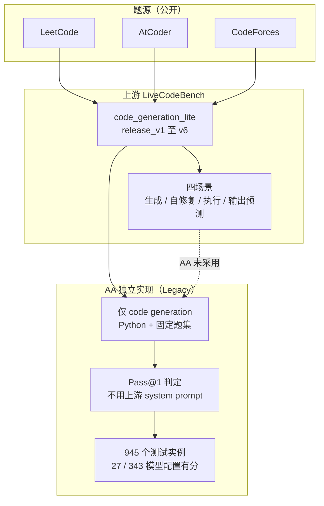

# Artificial Analysis LiveCodeBench：第三方独立运行的竞赛编程代码生成评测

> **核验说明**：本文只写 Artificial Analysis（下称 AA）独立运行的 LiveCodeBench 这条口径，不写上游 UC Berkeley / MIT / Cornell 团队的官方榜单（本仓库未单独成文）。官网评测页与方法页于 2026-11-06 访问；官网已把该评测标为 `Legacy`，方法页写明自 Intelligence Index v4.0 起移除并停止主动报分。官网 27 行分数、模型配置与发布日已归档至 `sources/aa-livecodebench/leaderboard-2026-11-06.csv`，入库边界见 `sources/aa-livecodebench/README.md`。二手聚合平台的数据与 AA 官网不一致之处在第 5.2 节与第 6 节分开处理。

---

## 1. 一句话定义

**Artificial Analysis LiveCodeBench**（下称 AA LiveCodeBench）是 Artificial Analysis 对上游 LiveCodeBench 的**独立运行实现**：用公开的 `code_generation_lite` 题集与自有的 Python / Pass@1 配置给模型打分，分数由 AA 独立测量，不是厂商自报，也不是上游官方榜单。它不是一个新题库，而是「同一批公开题、另一套评测配置」形成的独立口径。

BenchLM 为此单独开了一个 lane，理由原文是「Stored separately from the core LiveCodeBench lane because Artificial Analysis controls the evaluation configuration」。AA 自己则在方法页把它归入 **Legacy Evaluations**，原文「Removed from the Intelligence Index in v4.0. Retired from our active reporting.」

与 [aa-intelligence-index-v5.md](aa-intelligence-index-v5.md) 的关系：该文表 1 记录 v4.0（2026-01）「移除 MMLU-Pro、LiveCodeBench、AIME 2025」，与 AA 方法页原文一致；两篇互相印证，但 Index 分数与本文分数没有任何可比性。

---

## 2. 定位与版本沿革

表 1 · 关键节点（官方一手来源口径，标「未取到」者不做推断）

| 时间 | 节点 | 依据 |
| --- | --- | --- |
| 2024-03-12 | 上游论文 arXiv:2403.07974 v1 首发 | arXiv |
| 2024-06-06 | 论文 v2 修订（题量与时间窗口变化） | arXiv |
| 2024–2025 | 上游 `release_v1` – `release_v6`，400 → 1,055 题 | 上游官方仓库 README |
| **未取到** | AA 开始独立报告 LiveCodeBench 的日期 | AA 官网 / 方法页均未标注 |
| 2026-01（v4.0） | 从 Intelligence Index 移除 | AA 方法页 Legacy 小节；[aa-intelligence-index-v5.md](aa-intelligence-index-v5.md) 表 1 |
| 2026-11-06 | 官网仍保留 Legacy 榜，27 / 343 个模型有分 | AA 官网评测页 |

### 2.1 三种「LiveCodeBench」口径

1. **上游官方榜**（`livecodebench.github.io/leaderboard.html`）：按 `release_version` 与题目发布日期窗口滚动，表头为 Pass@1 / Easy / Medium / Hard，接受社区 PR 提交。
2. **AA LiveCodeBench**（本文）：AA 独立运行，固定配置，已标 Legacy、停止主动报分。
3. **厂商自报**：模型卡或发布博客引用的 LiveCodeBench 分数，各自绑定不同 effort、采样次数与时间窗口。

三者的题集版本、prompt、system prompt、temperature、采样次数、pass@1 与 pass@5 口径都不同（见第 4 节）。BenchLM 把第 2 种单独开栏；LLMLearner 与 DataLearner 把三种混进同一张 112 行榜，这是本文最主要的口径风险，详见第 6 节。

### 2.2 命名与归属

AA 的其他第三方实现（FrontierCode 2.0、APEX-Agents-AA、Code2Video-AA 等）在评测目录里明确写「Artificial Analysis' implementation of ...」并挂 GitHub 仓库图标；LiveCodeBench 条目只写「All evaluations are conducted independently by Artificial Analysis」，没有 `implementation` 字样，也没有 AA 侧仓库链接。因此 AA LiveCodeBench 更接近「AA 独立跑的上游基准」，而不是 AA 自有基准；四类资源链接里 GitHub 一类只有上游官方仓库（见第 7.1 节）。

---

## 3. 数据与任务构造

### 3.1 题源与场景

上游 LiveCodeBench 从 LeetCode、AtCoder、CodeForces 持续收集新题并标注发布日期，构造四个场景：code generation、self-repair、test output prediction、code execution。

AA 官网 Background 沿用上游措辞（「evaluating code generation, self-repair, and execution」），但方法页 Legacy 小节写的是「Python programming to solve programming scenarios derived from LeetCode, AtCoder, and Codeforces」，且把 LiveCodeBench 放在 **Prompt Templates → Code Generation Tasks** 目录下；官网 Example Tasks 的三道题也全是 LeetCode 代码生成题（3478 `check-if-the-rectangle-corner-is-reachable`、3261 `minimize-or-of-remaining-elements-using-operations`、3344 `minimize-manhattan-distances`）。据此判断：**AA 只跑 code generation 场景、只用 Python**；官网的四场景描述是基准介绍，不是 AA 的实际评测范围。

### 3.2 题集版本与题量口径

表 2 · 上游 `release_version` 一览（上游官方仓库 README 口径）

| 版本 | 题目发布日期窗口 | 题量 |
| --- | --- | ---: |
| `release_v1` | 2023-05 – 2024-03 | 400 |
| `release_v2` | 2023-05 – 2024-05 | 511 |
| `release_v3` | 2023-05 – 2024-07 | 612 |
| `release_v4` | 2023-05 – 2024-09 | 713 |
| `release_v5` | 2023-05 – 2025-01 | 880 |
| `release_v6` | 2023-05 – 2025-04 | 1,055 |

「题量」在一手来源之间并不一致，按 `AGENTS.md` §5 并列写出，不静默取其一：

- arXiv:2403.07974 **v2 摘要**：「four hundred high-quality coding problems ... between May 2023 and May 2024」。
- 上游 GitHub README 的 **Introduction**：400 题、2023-05 – 2024-03（对应 `release_v1` 的窗口）。
- **AA 官网评测页转载的摘要**：「over five hundred coding problems ... between May 2023 and May 2024」（对应 `release_v2` 的 511 题）。
- 上游官网 **Overview**：「over three hundred ... May 2023 and February 2024」，是更早期口径，页面未随 release 更新。
- **LLMLearner / DataLearner** 条目均标 511 题（二手）。
- **AA 官网未标注本条 lane 使用的 `release_version`，也未公开固定题量与重复次数**；方法页只给出数据集 URL `https://huggingface.co/datasets/livecodebench/code_generation_lite`。该数据集是上游剪枝测试用例后的精简版，默认启用，原版需 `--not_fast`。

从快照可反推的是「测试实例总数」而非「题量」：见第 4.4 节。

---

## 4. 评测方式与计分链路

### 4.1 AA 的专属配置

AA 方法页 Legacy 小节与 `#livecodebench-prompt` 小节给出的是本文最硬的一手配置：

- **Python 编程**；数据源 `livecodebench/code_generation_lite`；**Pass@1** 判定。
- **不使用上游的 custom system prompts**：原文「we do not apply the custom system prompts that the LiveCodeBench team uses - we do not use their generic system prompt nor their custom system prompts for certain models」，但题目 prompt 本身「used with no changes from the original implementation of the LiveCodeBench prompt by the original team」。
- 两套题面模板：带 starter code 与不带 starter code；后者要求从 stdin 读、向 stdout 写，并把 Python 代码包在分隔符内：

````text
### Question: {question.question_content}
### Format: Read the inputs from stdin solve the problem and write the answer to stdout
(do not directly test on the sample inputs). Enclose your code within delimiters as follows.
Ensure that when the python program runs, it reads the inputs, runs the algorithm and writes output to STDOUT.
```python
# YOUR CODE HERE
```
### Answer: (use the provided format with backticks)
````

- 代码提取正则：`(?<=```python\n)((?:\n|.)+?)(?=\n```)`。

### 4.2 通用参数与上游默认配置

AA 方法页 `General Testing Parameters` 是全局说明，不是 LiveCodeBench 专属段落，但适用于 AA 的全部评测：

- Temperature：非推理模型 **0**；推理模型 **0.6**（模型厂商另有推荐时从之）。
- 推理模型输出上限取厂商允许的最大值。
- `pass@1 = (1/k) Σ p_i`，`p_i` 为第 `i` 次尝试是否正确，`k` 为**所有 repeat 的测试实例总数**；多次重复时聚合全部尝试，不取最好一次。

上游官方仓库 README 的默认配置完全不同：`n=10`、`temperature=0.2`，同时计算 **pass@1 与 pass@5**，并说明超时可造成 `< 0.5` 分的波动。两者不是同一 harness，这是 AA 分数与上游榜不可直接比较的核心原因之一。

### 4.3 计分链路



### 4.4 从快照反推的 945 个测试实例

`sources/aa-livecodebench/leaderboard-2026-11-06.csv` 的 27 个 `score_raw` 全部可写成 `x/945`（榜首 867/945 = 0.917460...，其余如 802/945、754/945 亦然）。这说明 AA 的分数是**固定 945 个测试实例上的通过比例**，与方法页 pass@1 定义中「`k` 为所有 repeat 的测试实例总数」一致。

但 **945 不是官方公开的题量**：945 与 `release_v1` – `release_v6` 的任一题量都不成整数倍，AA 也未说明题量与重复次数如何拆分。本节是从快照数值反推的观察，**不是 AA 官方口径**；不得据此声称 AA 使用 `release_v2`、某个时间窗口或某个固定采样数。

---

## 5. 榜单结果与演进

> ⚠️ **不要跨口径比较**：以下为 Artificial Analysis **独立运行（非厂商自报）** 的 Legacy 榜，访问日期 2026-11-06；分数绑定 AA 的固定题集、Python + Pass@1 配置与模型的具体 effort 档位。不可与上游官方榜（按 `release_version` / 时间窗口滚动、pass@1 与 pass@5 并列）、厂商自报分数、BenchLM / LLMLearner / DataLearner 的混排表直接比较；也不可与 [aa-intelligence-index-v5.md](aa-intelligence-index-v5.md) 的 Index 分数比较——LiveCodeBench 自 v4.0 起已不在该指数内。

### 5.1 AA 官网现行 27 行

官网 Score 图注明「Independently benchmarked by Artificial Analysis / 27 of 343 models」，headline 前三名为 Gemini 3 Pro Preview (High) 91.7%、Gemini 3 Flash Preview (Reasoning) 90.8%、DeepSeek V3.2 Speciale 89.6%。

表 3 · AA LiveCodeBench 前 12（官网 RSC 内嵌数据，2026-11-06 抓取）

| 名次 | 模型（配置） | 分数 | 发布日 | 开源权重 |
| ---: | --- | ---: | --- | :---: |
| 1 | Gemini 3 Pro Preview (High) | 91.75% | 2025-11-18 | ✗ |
| 2 | Gemini 3 Flash Preview (Reasoning) | 90.79% | 2025-12-17 | ✗ |
| 3 | DeepSeek V3.2 Speciale | 89.63% | 2025-12-01 | ✓ |
| 4 | GLM-4.7 (Reasoning) | 89.42% | 2025-12-22 | ✓ |
| 4 | GPT-5.2 (Medium) | 89.42% | 2025-12-11 | ✗ |
| 6 | gpt-oss-120b (High) | 87.83% | 2025-08-05 | ✓ |
| 7 | Claude Opus 4.5 (Reasoning) | 87.09% | 2025-11-24 | ✗ |
| 8 | GPT-5.1 (High) | 86.77% | 2025-11-13 | ✗ |
| 8 | MiMo-V2-Flash (Reasoning) | 86.77% | 2025-12-16 | ✓ |
| 10 | DeepSeek V3.2 (Reasoning) | 86.24% | 2025-12-01 | ✓ |
| 11 | o4-mini (High) | 85.93% | 2025-04-16 | ✗ |
| 12 | Kimi K2 Thinking | 85.29% | 2025-11-06 | ✓ |

分数保留两位小数（官网 headline 只显示一位）；完整 27 行、精确浮点值与 `x/945` 分子见 `sources/aa-livecodebench/leaderboard-2026-11-06.csv`。

- **全部 27 行都是 2025 年发布的模型**，发布日在 2025-04-16 – 2025-12-23 之间，没有任何 2026 年模型；其中 **23 行在 AA 数据里 `deprecated=true`**，10 行为开源权重。这与「停止主动报分」一致。
- 全表区间 **79.79% – 91.75%**（跨度 11.96 点），前 10 跨度仅 **5.51 点**，区分度已明显收窄。
- 配置必须随分数一起写：AA 按 `(High)` / `(Reasoning)` / `(Medium)` 等档位分行，同名模型不同档位分数可差数点（二手平台上 GPT-5.2 的「思考中」89.4 与「极高」88.9 即为不同档位，属 DataLearner 口径，不作为 AA 一手分数引用）。

### 5.2 三个聚合平台的不同处理

表 4 · 聚合平台对照（**二手**，访问 2026-11-06）

| 平台 | 条目 | 行数 | 页面标注 | 分数来源构成 | 榜首 |
| --- | --- | ---: | --- | --- | ---: |
| BenchLM | `AA LiveCodeBench` 独立栏 | 13 | 2026-11-05；Current / Display only / 季度刷新 | 13 行全为 secondary reports | Gemini 3 Pro 91.7% |
| LLMLearner | 与上游合并的 `LiveCodeBench` | 112 | 末条结果 2026-10-23 | 12 独立测量 / 69 厂商自报 / 31 来源未记 | DeepSeek-V4-Pro 93.5% |
| DataLearner | 与上游合并的 `LiveCodeBench`（中文版） | 112（同表） | 2026-10-23 更新 | 同上；511 题 / Pass@K | DeepSeek-V4-Pro 93.50 |

- **BenchLM** 明确把 AA 与核心 LiveCodeBench 分栏，13 行标为 display-only、不参与总排名；其 13 个分数（91.7 / 89.4 / 87.8 / 87.1 / 86.8 / 85.9 / 84.6 / 83.8 / 83.2 / 82.2 / 81.9 / 80.8 / 80.1）取整到一位小数后，与 AA 官网 27 行中的对应档位基本一一吻合；但漏掉 90.8、89.6 等行，并把 89.4% 只归给 GLM-4.7（AA 官网同分还有 GPT-5.2 Medium），模型名规范化后丢失了 effort 信息。
- **LLMLearner / DataLearner** 把 AA 独立测量的行（条目标注来源 `Artificial Analysis`）与厂商自报、来源未记的行放在同一张 Pass@K 榜里按最高分排序，榜首 93.5% 是厂商自报的 DeepSeek-V4-Pro，不是 AA 的 91.7%。这两张表不能当 AA 榜单读。
- BenchLM 的 `Year 2026 / Current / Quarterly` 是**目录新鲜度元数据**，与 AA 官网 Legacy、27 行停在 2025 年模型的实际状态相矛盾；引用时以 AA 官网为准。

---

## 6. 已知缺陷

### 6.1 同名多口径

「LiveCodeBench」一个名字下有上游榜、AA 独立实现、厂商自报三种口径，题集版本、时间窗口、prompt、system prompt、采样次数、temperature、pass@1 与 pass@5 全不同。AA 方法页明说不用上游 custom system prompts，上游默认 `n=10` / `temperature=0.2`，AA 通用温度 0 / 0.6——这些差异足以改变分数，却常被二手平台压平成同一列。

### 6.2 元数据与实际状态矛盾

AA 官方 Legacy + 停止主动报分；BenchLM 标 Current / Quarterly / 2026。后者是目录标签，不代表分数仍在更新。27 行全部来自 2025 年模型、23 行已 deprecated，是最直接的反证。

### 6.3 AA 未公开的关键配置

未标注 `release_version`、固定题量、重复次数与题目时间窗口，也未发布 AA 侧评测仓库、权重文件或模型输出。945 个测试实例只能从分数反推。**完整端到端复现不可能**，可复现的只是上游公开部分（第 7 节）。

### 6.4 接近饱和且样本偏旧

79.79% – 91.75%，前 10 跨度 5.51 点；样本停在 2025 年，且多数模型已下线。作为 2026 年前沿模型的区分工具已失效，这也是 AA 把编码类权重转向 FrontierCode 2.0、Terminal-Bench 4.0 等组件的背景（见 [aa-intelligence-index-v5.md](aa-intelligence-index-v5.md) 第 3 节）。

### 6.5 题集版本漂移与污染

上游 `release_v1` – `release_v6` 题量从 400 增至 1,055，`code_generation_lite` 又剪枝过测试用例；不同 release 的分数不能比较。题目公开，污染风险随发布时间推移上升；AA 未说明所用窗口，无法判断其抗污染程度。上游官网 Overview 仍写「300+ 题 / 2023-05 – 2024-02」，与论文 v2、AA 页面、二手平台的 511 题并列存在（第 3.2 节）。

### 6.6 场景覆盖被描述夸大

官网 Background 沿用上游四场景措辞，但方法页与示例题显示 AA 只跑 Python code generation。用 AA 分数断言「自我修复 / 代码执行 / 测试输出预测」能力不成立。

### 6.7 effort 与模型名规范化

同一模型不同 effort 档分数可差数点；AA 榜单按配置分行，二手平台常抹掉配置名或改用自有标签，导致同名不同分。引用必须绑定「模型 + 配置 + 访问日期」。

---

## 7. 复现 / 快速上手

### 7.1 四类资源链接核验结论

表 5 · 四类链接与可复现边界

| 类型 | 结论 | 资源 |
| --- | --- | --- |
| 官方介绍 / 榜单 | ✓ 取到 | AA 评测页、AA 方法页 Legacy 小节 |
| GitHub | △ AA 侧**未找到**；仅上游官方仓库 | `LiveCodeBench/LiveCodeBench`、`LiveCodeBench/submissions` |
| 论文 | △ 仅上游论文，**AA 实现无独立论文** | arXiv:2403.07974 |
| 数据集 / 工具链 | ✓ 取到（HF 页面本次直接访问未取到） | `livecodebench/code_generation_lite`、`lcb_runner` 评测框架 |

AA 侧独立评测仓库、AA LiveCodeBench 专属论文均未找到；Hugging Face 数据集页面本次直接访问失败，但其 URL 由 AA 方法页与上游仓库 README 双向确认，不作为「链接不存在」处理，仅标注「未直接核验」。

### 7.2 上游复现命令

```bash
git clone https://github.com/LiveCodeBench/LiveCodeBench.git
cd LiveCodeBench
uv venv --python 3.11 && source .venv/bin/activate
uv pip install -e .

# 按 release 版本跑 code generation（上游默认 n=10 / temperature=0.2）
python -m lcb_runner.runner.main --model {model_name} --scenario codegeneration \
  --evaluate --release_version release_v2

# 按题目发布日期切片（论文口径：2023-09-01 之后）
python -m lcb_runner.evaluation.compute_scores \
  --eval_all_file {saved_eval_all_file} --start_date 2023-09-01
```

注意：`--release_version` 默认是 `release_latest`，而 AA 未公开它锁的是哪一版；照抄默认参数不会得到 AA 的 91.7%。上游默认使用精简版 `code_generation_lite`，原版需 `--not_fast`。四场景中只有 code generation 接受榜单提交。

### 7.3 未入库边界

`sources/aa-livecodebench/` 只存 27 行分数快照与来源说明，不收录：完整 343 模型矩阵、题目本体与测试用例、模型输出与轨迹、AA 内部 harness 与固定配置、二手平台全量榜单、上游数据集本体（体积大，复现命令见第 7.2 节）。

---

## 8. 结论

AA LiveCodeBench 是「第三方独立运行上游公开基准」的典型样本，价值在于**同一配置下的横向比较**：27 行都由 AA 自己跑，比厂商自报更可比。但它已在 v4.0 被移出 Intelligence Index 并停止主动报分，题集版本与重复次数不公开，分数集中在 79.79% – 91.75%，且模型全部是 2025 年发布的。

引用时至少锁定三件事：**AA 官网 + 访问日期 + 模型 effort 档位**。不要把它写成上游 LiveCodeBench 官方榜，不要与厂商自报或二手混排表比，也不要与 AA Intelligence Index 比。要看当前前沿编码能力，改用 [aa-intelligence-index-v5.md](aa-intelligence-index-v5.md) 第 3 节的 FrontierCode 2.0 / Terminal-Bench 4.0 组件口径。

---

## 9. 参考来源

1. 官方站（AA LiveCodeBench 榜单，`Legacy` 标签，`27 of 343 models`，访问 2026-11-06）：https://artificialanalysis.ai/evaluations/livecodebench
2. 官方站（Intelligence Benchmarking Methodology v5.0.1；Legacy Evaluations → LiveCodeBench、`#livecodebench-prompt`、General Testing Parameters，访问 2026-11-06）：https://artificialanalysis.ai/methodology/intelligence-benchmarking#livecodebench
3. 官方站（评测目录，`Legacy / Coding / Reasoning / Math` 标签，访问 2026-11-06）：https://artificialanalysis.ai/evaluations?skill=coding
4. 论文（arXiv:2403.07974，v1 2024-03-12 / v2 2024-06-06；上游基准论文，非 AA 实现专属）：https://arxiv.org/abs/2403.07974
5. GitHub（上游官方仓库，含 `release_v1` – `release_v6` 说明与 `lcb_runner` 用法）：https://github.com/LiveCodeBench/LiveCodeBench
6. GitHub（上游榜单提交仓库）：https://github.com/LiveCodeBench/submissions
7. 数据集（Hugging Face；URL 由 AA 方法页与上游仓库 README 双向确认，本次直接访问未取到）：https://huggingface.co/datasets/livecodebench/code_generation_lite
8. 数据集（Hugging Face，上游仓库 README 列出的另两个场景，未按同样深度核验）：https://huggingface.co/datasets/livecodebench/execution 、https://huggingface.co/datasets/livecodebench/test_generation
9. 官方站（上游 Overview，300+ 题 / 2023-05 – 2024-02，访问 2026-11-06）：https://livecodebench.github.io/
10. 官方榜（上游 leaderboard，动态加载，表头 Pass@1 / Easy / Medium / Hard，访问 2026-11-06）：https://livecodebench.github.io/leaderboard.html
11. 二手聚合（BenchLM，AA LiveCodeBench 独立栏，display-only，13 行，2026-11-05）：https://benchlm.ai/benchmarks/aalivecodebench
12. 二手聚合（LLMLearner，与上游合并的 112 行榜，末条 2026-10-23）：https://llmlearner.com/rankings/livecodebench
13. 二手聚合（DataLearner 中文条目，511 题 / Pass@K，2026-10-23 更新）：https://www.datalearner.com/benchmarks/livecodebench
14. 本仓库交叉引用（v4.0 移除 LiveCodeBench 的沿革）：[aa-intelligence-index-v5.md](aa-intelligence-index-v5.md)
15. **未找到 / 未取到**：AA 侧独立评测仓库、AA LiveCodeBench 专属论文、AA 使用的 `release_version` 与重复次数、题目时间窗口；Hugging Face 数据集页面与上游榜单的数据本体本次未直接取到。
