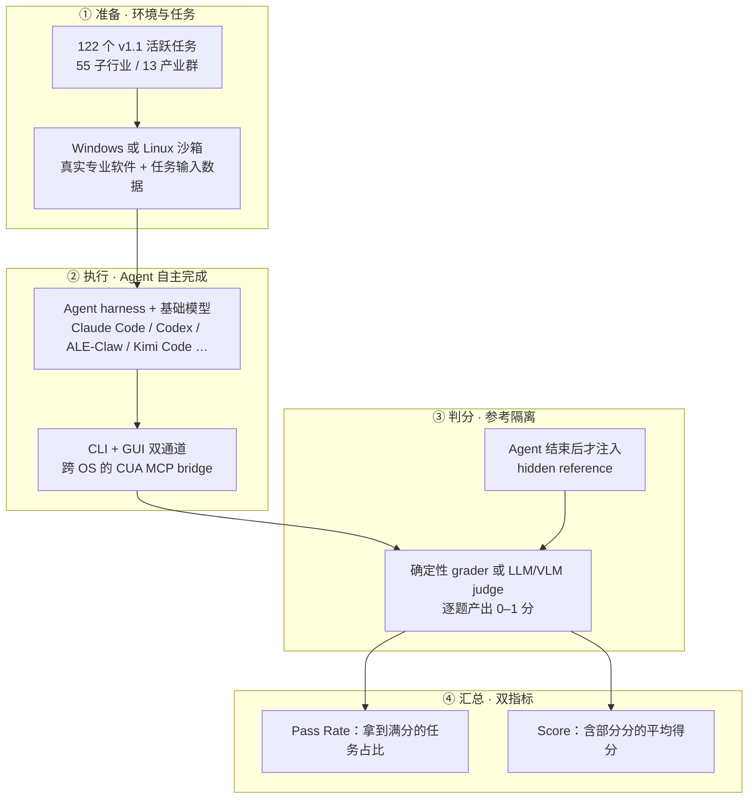

# Agents' Last Exam：面向真实专业工作流的长程可核验 Agent 评测

---

## 1. 一句话定义

**ALE**（Agents' Last Exam，UC Berkeley RDI × RDI Foundation 主导，论文 v1 于 2026-06-03 上线 arXiv）不考「模型能否答对难题」，而是把**完整的 Agent 系统**（harness + 基础模型 + 工具环境）放进带真实专业软件的 Windows / Linux 沙箱，只给一句任务描述，让它跑到完成，再对留下的**交付物**用隐藏参考 + 确定性 grader 判分。现行 v1.1 含 **122 个活跃任务**，覆盖按 O*NET / SOC 2018 组织的 **55 个子行业 / 13 个产业群**；官方榜 2026-11-05 更新的头名 Pass Rate 为 **45.9%**（ALE-Claw / Gemini 4 Carbon），远未饱和。

> **核验说明**：一手资料归档于 `sources/agents-last-exam/`，抓取与核验日期 `2026-11-06`。官网、官方 v1.1 / v1.0 两个榜单页、arXiv 摘要页、官方 GitHub 仓库与官方文档站均直连可达并逐页核对；`sources/agents-last-exam/leaderboard-v1-1-2026-11-05.csv` 与 `leaderboard-v1-legacy-overall-full.csv` 为榜单页的**人工转录**（官网未提供结构化下载端点）。Hugging Face 官方域名本次直连**全部失败**（HTTP 000），数据集卡片正文与元信息**未取到**，其存在与用途由官方博客、GitHub README 与 `docs/releases/v1.1.md` 交叉确认。详情与未入库边界见 `sources/agents-last-exam/README.md`。
>
> **路径与日期约定**：正文反引号中的 `ale_run/`、`docs/releases/…`、`selected_tasks/…`、`releases/v1.1/assets.json` 一律指**官方仓库** `rdi-berkeley/agents-last-exam` 内的路径；本仓库路径统一写作 `sources/…`、`benchmarks/…`。README 索引的「提出时间」取论文 v1 首发日 `2026-06-03`；官方博客公告 `2026-06-14`、仓库首个 `Initial public release` commit `2026-06-05` 是另外两个事件，不与论文首发日混用。

**slug 与拆分决策**：文件名取 `agents-last-exam`，避开正式名中的撇号，并与 [HLE](hle.md)、[Science's Last Exam](sciences-last-exam.md) 区分。官方同时维护 **v1.0（legacy）** 与 **v1.1（current）** 两个榜单，但按 `AGENTS.md` §2.1 逐条比对，两者差异属于「题量增减 + 题目刷新」：任务形态仍是 GUI + CLI 沙箱交付物、判定仍是 hidden reference + grader、计分仍是 Pass Rate / Score 双指标、构念仍是长程经济价值专业工作，官方也把滚动换题作为 ALE 的整体设计而非版本分界。五项判据中无可确认成立的两项，故**不拆成两个文档**，改在第 2.4 节作沿革注记，并在口径警示块中写明 **v1.0 与 v1.1 分数不可比**。

**命名警示（两个坑）**：① 缩写 **ALE** 与 **ALE-Bench** 在二手平台上被混用——BenchLM 把 ALE 的官方榜镜像条目命名为 `alebench`，而 Sakana AI × AtCoder 另有一个**完全无关**的 **ALE-Bench**（ALgorithm **E**ngineering Benchmark，AtCoder Heuristic Contest 优化题，arXiv:2506.09050，NeurIPS 2025 D&B）；② BenchLM 站内对同一个 ALE 建了**两个口径互斥的条目**（`agentslastexam` 厂商自报 / `alebench` 官方榜镜像）。逐项辨析见「附：命名与口径辨析」。

---

## 2. 数据与任务构造

### 2.1 规模：四个口径并列，不静默取一

官方在不同页面给出四组规模数字，按 `AGENTS.md` §5 全部保留并注明口径：

**表 1 · ALE 规模口径对照**

| 口径 | 数字 | 出处与含义 |
| --- | ---: | --- |
| 任务语料库 | 1,000+ / 1,500+ | 论文 v4 摘要写 `1K+ tasks`、Docs 写 `1,000+ task corpus`；官网首页与 2026-06-14 博客写 `1,500+ tasks collected`，目标 5,000。两者是**总语料库**，不是评测题集 |
| 公开题集 v1.0 | 147 / 152 | Snorkel AI 的 ALE-V1 页写 `147 public reference tasks`；官方 v1.0 legacy 榜与 LLMLearner 转录写 `152 tasks`（Overall/Full split）。官方未解释这 5 题之差 |
| 活跃题集 v1.1 | **122** | 官方现行榜 `All tasks 122`（Linux 86 / Windows 36）；`docs/releases/v1.1.md` 写「122 active tasks after 30 retirements」；Docs 与 GitHub README 一致 |
| 行业覆盖 | 55 / 13 | 55 个子行业（subdomains）分属 13 个产业群（industry clusters），参照 O*NET / SOC 2018 |

官网首页写 `300+ industry experts`，论文 v4 摘要写 `250+ industry experts`，Docs 写 `250+`；Snorkel 页面写 `300+ experts across 44 academic institutions`，博客写 `100+ institutions`。这类宣传性计数同样按口径并列，不用于重算任何分数。

### 2.2 任务形态与运行环境

每道题是一个真实职业工作流，由行业专家把本人完成过的项目改写成可核验的评测：给定 instruction 与真实输入文件，Agent 在装有实际专业软件的沙箱里产出交付物，grader 对照隐藏参考给 0–1 分。官方示例包括：把 SEC 10-K 报表解析成结构化财务 schema、用 Longstaff–Schwartz 回归实现美式期权定价基准、从原理图生成布好线的 KiCad PCB、跑全基因组变异检测并输出 VCF、在 Kubernetes 集群里定位支付 API 故障根因、按司法辖区规则从账单登记簿计算律师费、用 TCGA-LUAD 数据做 KRAS 分层生存分析。

不少任务需要商业软件（Adobe After Effects、Siemens NX、Unreal Engine、Moldex3D、Rhino 3D、FSLeyes 等）或受限数据，因此官方榜把任务按许可证分成 **Full**（含 license-gated 任务）与 **Unlicensed**（只保留用自由工具即可复现的子集）两种视图——这是同一版本内部的另一层口径，跨视图排序同样不能混用。v1.1 把 6 个原本依赖商业软件的任务改造成开源 Linux 工作流（Blender、FreeCAD、LinuxCNC / CAMotics、Kratos、MuseScore、Ardour），并移除 `engineering/mold-flow`（无经验证的开源替代）。

### 2.3 滚动评估与公开 / 私有边界

ALE 采用 **rolling evaluation**：约每 6 个月发布一批新的公开任务实例，私有任务轮换进公开池、退役的公开任务轮换出去，**held-out 私有任务用于官方计分**，以降低针对固定公开测试集训练的价值。公开题集只是总语料库的子集；依赖私有数据、商业许可软件或保留评估材料的题目始终留在私有池。这意味着任何「ALE 分数」都必须绑定题集版本与 split，否则无法复现。

另有 **ALE-CLI**：CLI-only 子集（v1.0 legacy 榜中标注 `linux task only`），覆盖 40 / 55 个子行业，供只在终端里工作的 Agent 使用。官方 2026-06-14 博客称其当时最好 Agent 通过率 25.2%，并对比 Terminal-Bench 82.0%、SWE-bench-Pro 59.1%——这是**子集分数**，与全量 ALE 榜不可比。

### 2.4 v1.0 → v1.1 沿革

`docs/releases/v1.1.md` 给出的精确变更：v1.1 从 152 题（官方榜口径）中退役 30 题、保留 122 题；其中 **57 题需重跑**、**65 题结果可保留**。按变更类型计数（可重叠）：Instruction 47 题、Verification 43 题、Environment 32 题、Data 23 题。CPU 覆盖提升到 119 题，另 3 题为 GPU 任务（列于 `selected_tasks/gpu.txt`）。

**表 2 · 版本沿革与可比性**

| 版本 | 状态 | 题量 | 榜单时点 | 与其他版本 |
| --- | --- | ---: | --- | --- |
| v1.0 | `legacy` | 152（Overall/Full split）；Snorkel 页记 147 | legacy 页单列 `Best per task — (Jul 4, 2026)`，Runtime 方法 2026-07-10 修订 | 官方要求用 v1 代码 + 旧镜像 + 全新日志复现 |
| v1.1 | `current` | 122（Linux 86 / Windows 36） | Results updated **2026-11-05**；Benchmark reference 2026-10-27 commit `2e91edd` | **不可与 v1.0 分数比较**；`run.json` 用 `task.revision` 哈希校验，哈希不符即重跑 |

`docs/releases/v1.1.md` 明确写「To reproduce v1 instead, follow the v1 run guide with original code, legacy images and fresh logs. **Do not reuse v1.1 logs for v1**」。此外官网榜注明 v1.1 的分数会随任务修订继续刷新（Results updated 与 Benchmark reference 是两个不同日期），引用数字时须同时记下这两个时点。

---

## 3. 评测方式

### 3.1 一次运行的六个阶段



隐藏参考**只在 Agent 运行结束后**才 stage 进沙箱，避免答案泄漏；`ale_run` 把每次运行规范化成统一 trajectory，连同原始日志、事件流、评分与产物一并留档，可完整回放审计。

### 3.2 两个指标

- **Pass Rate**：run 拿到**满分**的任务占比（严格成功）。现行榜定义为「the share of runs that earned a perfect score」。
- **Score**：所有任务的**平均部分得分**，允许部分完成也拿分。
- 两者都按所选任务集**全部题目**求平均；**缺失结果与失败 run 一律记 0**。超时的 run 保留已判分数。

官网榜同时给出 Total Runtime（各题 Agent 执行时间之和，不含环境准备与评测）、Output Tokens，v1.0 legacy 榜另给 Est. Cost、Input / Output Tokens，并有 Full / Unlicensed 许可视图与效率前沿图。注意 Snorkel 的 v1.1 方法页写「deterministic graders, **not** LLM-as-a-judge」，而官方 Docs 写「Deterministic **and judge-based** graders」——两处措辞不一致，按 §5 并列保留，本文不替官方消解。

### 3.3 评测对象是 model + harness 系统

官方反复强调 ALE 评的是「harness + 基础模型 + 工具 + 记忆 + 上下文管理 + 行动循环 + CLI/GUI 接口」组成的**完整配置**，不是裸模型。同一模型换 harness 或 effort 档位，分数会明显变化；官方榜每行是「Harness / Model / Effort」三元组，且默认展示该配对在全部任务上的**最强 effort**。Snorkel 的 v1.1 页注明官方参考 harness 为 Claude Code CLI 与仓库内置的 OpenClaw，榜单另收 Codex、Kimi Code、Muse Code、ZCode 与 ALE-Claw 等。

---

## 4. 榜单结果与演进

> ⚠️ **不要跨口径比较**：本节所有分数来自 **ALE 官网 leaderboard**，由官方评测发布（非厂商自报），均绑定「题集版本 + split + harness + 模型 + effort」配置。第 4.1 节为 **v1.1 现行榜（122 tasks，Results updated 2026-11-05，15 行）**，第 4.2 节为 **v1.0 legacy 榜（Overall/Full split，152 tasks，July 2026 口径）**，**两代分数不可比**，官方明确要求 v1 用旧代码、旧镜像、新日志另跑。二者也都**不可与** BenchLM 的 `agentslastexam`（20 行厂商自报）、LLMLearner / DataLearner 聚合榜、DeepSeek 等厂商发布对比表，或 [HLE](hle.md)、[Terminal-Bench 4.0](terminal-bench-v4-0.md)、[Science's Last Exam](sciences-last-exam.md) 等其他基准的数字并列。Pass Rate 与 Score 是两种不同指标，也不可互比。

### 4.1 v1.1 现行榜（122 tasks，Results updated 2026-11-05）

**表 3 · ALE v1.1 官方榜全 15 行**

| # | Harness | Model | Effort | Pass Rate | Score | Total Runtime | Output Tokens |
| ---: | --- | --- | --- | ---: | ---: | ---: | ---: |
| 1 | ALE-Claw | Gemini 4 Carbon | High | 45.9% | 77.4% | 156h 47m | 10.2M |
| 2 | Kimi Code | Kimi 3.1 Pro | Max | 43.4% | 74.4% | 61h 26m | 8.5M |
| 3 | Claude Code | claude-opus-5-5 | Max | 43.4% | 71.6% | 177h 11m | 21.5M |
| 4 | Codex | GPT-6 Astra | Max (Best) | 42.6% | 73.1% | 80h 12m | 5.1M |
| 5 | Codex | GPT-6.1 Terra | Max (Best) | 41.8% | 69.8% | 124h 36m | 5.5M |
| 6 | Claude Code | Tencent Hy4 | High | 41.0% | 70.3% | 104h 8m | 19.6M |
| 7 | ALE-Claw | Gemini 4 Argon | High | 40.2% | 69.0% | 87h 4m | 6.5M |
| 8 | Muse Code | Muse Wonder 1.0 | High | 38.5% | 68.4% | 116h 27m | 4.7M |
| 9 | OpenClaw | DeepSeek V4.1 Flash (1017) | High (Best) | 36.1% | 65.4% | 76h 51m | 9.3M |
| 10 | Kimi Code | Kimi K3 | Max | 35.2% | 63.0% | 107h 48m | 7.5M |
| 11 | Codex | gpt-5-6-sol | Max | 30.3% | 48.4% | 78h 22m | 3.1M |
| 12 | Codex | MiniMax-M3.1-Flash | Max | 29.5% | 58.9% | 117h 37m | 17.4M |
| 13 | Claude Code | MiniMax-M3.1-Flash | Max | 29.5% | 57.9% | 122h 12m | 18.1M |
| 14 | ZCode | GLM 5.3 | Max | 26.2% | 54.4% | 111h 10m | 17.4M |
| 15 | Codex | gpt-5-6-luna | Off | 5.7% | 26.5% | 40h 35m | 1.1M |

榜首 ALE-Claw / Gemini 4 Carbon（45.9%）与第 2、3 名（43.4%）只差 2.5 个百分点，官方未公布置信区间或重复运行次数，不宜当成稳定排序。**Score 普遍比 Pass Rate 高 25–35 个百分点**，说明大量任务能拿到部分分却达不到完整成功——这正是 ALE 想区分的「有用进展」与「可依赖的端到端交付」。第 15 行 `Codex / gpt-5-6-luna / Off` 的 5.7% 提示 effort 档位对结果影响极大。

### 4.2 v1.0 legacy 榜与二手镜像

**表 4 · ALE v1.0 legacy 榜前 6 行（Overall/Full split，Pass Rate）**

| # | Harness | Model | Effort | Pass Rate | Score | Est. Cost |
| ---: | --- | --- | --- | ---: | ---: | ---: |
| — | — | Best per task（Jul 4, 2026） | — | 56.6% | 78.8% | — |
| 2 | Claude Code | claude-opus-5-5 | Max | 38.2% | 63.2% | $1,340 |
| 3 | Codex | GPT-6 Astra | Max (Best) | 34.2% | 59.3% | $1,100 |
| 4 | Codex | gpt-6-sol | XHigh (Best) | 32.2% | 56.5% | $318 |
| 5 | Claude Code | claude-opus-5 | High (Best) | 32.2% | 55.9% | $1,108 |
| 6 | Codex | Muse Spark 1.3 | XHigh (Best) | 32.2% | 55.8% | $428 |

`Best per task` 是「每题取全体运行中最高分」的聚合口径，**不是任何单一 Agent 的成绩**，不能与逐行分数并列排名。legacy 榜还提供多个 split：Overall / ALE-CLI（linux task only）/ Near-term（partially solvable today）/ Full-Spectrum（50+ industries）/ Last-Exam（frontier difficulty），以及 Full / Unlicensed 许可视图；官方 2026-06-14 博客提到最难的 `Last-Exam` tier「最好 Agent 通过 2.6%」，同页另一段又写「包括 Fable 5 在内所有受测前沿 Agent 在该最难 tier 为 0% 成功率」——**两处数字并列保留，官方未解释差异**，引用时须注明 split 与图注。

**BenchLM 的 `alebench` 条目就是这张 v1.0 legacy 榜的镜像**：其头部三名 38.2% / 34.2% / 32.2% 与表 4 逐行吻合，标注为 `June 2026 API snapshot`、152 tasks、87 个 harness 行、`display only`（不参与 BenchLM 排名）。也就是说，该条目在 2026-11 时点展示的是**已标 legacy 的旧版本**，而官方现行榜已是 v1.1（122 tasks，2026-11-05）。LLMLearner 同样注明其 ALE 榜取自 `ALE v1.0 (legacy) Overall/Full, 152 tasks`，抓取于 2026-10-27。

### 4.3 同一模型在不同来源的分数冲突

**表 5 · 同一模型四类来源的数字（仅用于展示口径差，不构成排名）**

| 模型 | 官方 v1.1（2026-11-05） | 官方 v1.0 legacy | BenchLM `agentslastexam`（自报，2026-11-04） | 厂商发布对比表 |
| --- | ---: | ---: | ---: | ---: |
| GPT-6 Astra | 42.6%（Codex / Max） | 34.2%（Codex / Max） | 59.3% | 未取到 |
| GPT-6.1 Terra | 41.8%（Codex / Max） | 未列 | **60.0%**（榜首） | 未取到 |
| Kimi 3.1 Pro | 43.4%（Kimi Code / Max） | 未列 | 43.2% | 43.2%（Kimi 自报 2026-10-24） |
| DeepSeek V4 Flash 0731 | 未以此配置参评 | 未列 | 25.2% | 25.2%（DeepSeek 2026-07-31 更新日志） |

同一个 GPT-6.1 Terra 在官方 v1.1 榜是 41.8%、在 BenchLM 自报榜是 60.0%，相差 18.2 个百分点。BenchLM 未标注该 60.0% 的 harness、题集版本与 split，只说明「reported in DeepSeek's V4 Flash 0731 launch comparison」并标记 20 行**全部为厂商自报**；DeepSeek 自己的 2026-07-31 更新日志则写明公开 Code Agent 任务使用 `DeepSeek Harness` 极简模式、`max` 档、`top_p=0.95`、`temperature=1.0`。这类数字只能在同一 harness / 同一题集版本下做相对排序，不能与官方 harness 榜混排。

---

## 5. 已知缺陷与口径陷阱

> ⚠️ **不要跨口径比较**：本节出现的 45.9%、38.2%、60.0%、25.2%、2.6% 等数字分别来自 v1.1 官方榜、v1.0 legacy 榜、BenchLM 自报榜、厂商发布日志与官方博客的**不同题集版本与 split**，仅用于说明口径差异，不得拼接成时间序列或排名。

1. **版本与 split 是最大的坑。** v1.0（152 题）/ v1.1（122 题）分数不可比；同一版本内还有 Overall / ALE-CLI / Near-term / Full-Spectrum / Last-Exam 五种 split 与 Full / Unlicensed 两种许可视图。滚动评估每约 6 个月换一批题，连「v1.1」本身也随任务修订持续刷新（Results updated 与 Benchmark reference 日期不同）。
2. **官方自己给出的题量与专家数不一致。** 公开题集 147（Snorkel）vs 152（官方 legacy 榜 / LLMLearner），语料库 1,000+（论文 v4 / Docs）vs 1,500+（官网首页 / 博客），专家 250+（论文 / Docs）vs 300+（官网 / Snorkel / 博客），机构 44（Snorkel）vs 100+（博客）。本文按 §5 全部并列，未替官方统一。
3. **`Best per task` 不是 Agent 成绩。** legacy 榜首行 56.6% 是「每题取全局最好一次运行」的聚合上界，把它当作某个模型的历史最高分会高估约 18 个百分点。
4. **Pass Rate 与 Score 混用会严重误读。** 现行榜 Score 普遍高出 Pass Rate 25–35 个百分点；论文 v4 摘要称最难 tier「平均 full pass rate 低于 1%」，而博客称该 tier 最好 Agent 2.6%（另有 0% 表述）。「通过率」与「部分得分」是两把尺子。
5. **测的是完整系统，且默认只展示最优 effort。** 每行是 harness + model + effort 三元组，官方默认显示该配对在全部任务上的最强档；跨行比较同时混入 CLI 版本、工具循环、记忆与推理档位差异。第 15 行 `Off` 档 5.7% 说明 effort 影响可能远大于模型差异。
6. **独立复现门槛高、成本高。** 官方榜的 Total Runtime 普遍 60–180 小时，legacy 榜 Est. Cost 单配置可达 $1,340–$4,340；部分任务需商业 CAD / EDA 软件、受限数据或 GPU，v1.1 把 6 题改成开源流程后仍有 3 题需 GPU。官方不分发预构建镜像，需按 `releases/v1.1/assets.json` 拉固定镜像与数据 pin，并在 Ubuntu / Debian 主机上跑 `env/verify_host_env.sh`。
7. **二手平台把同一个 ALE 拆成两个条目，且其中一个已过期。** BenchLM `agentslastexam`（20 行全自报，计入 Agentic 综合分）与 `alebench`（v1.0 官方榜镜像，display only）并列存在；LLMLearner / DataLearner 又各自把官方榜行与厂商自报行混在同一张榜里（LLMLearner 标注 34 行中 28 行独立测量、6 行仅厂商自报，榜首 43.2 即自报）。三家都未以 v1.1 为准。详见附录。
8. **缩写撞名可能引向完全不同的基准。** `ALE-Bench` 在 Sakana AI 语境下指 AtCoder 启发式优化竞赛基准（40 题，分数制、可迭代改进），与 ALE 的「专业工作流交付物」构念、题量、判分方式都不同，分数毫无可比性。

---

## 6. 复现 / 快速上手

官方仓库 `rdi-berkeley/agents-last-exam` 是开放的 `ale_run` 评测框架（代码 Apache-2.0，数据 CC BY 4.0）。主机安装器支持 Ubuntu 22.04 / 24.04 / 26.04 与 Debian 12 / 13，会校验全部 122 个活跃任务入口、evaluator 导入、Python 版本（对照 `uv.lock`）以及 FFmpeg / ffprobe 等原生工具：

```bash
git clone https://github.com/rdi-berkeley/agents-last-exam.git
cd agents-last-exam
bash env/install_host_deps.sh
uv sync --all-packages --locked
bash env/verify_host_env.sh
cp -n secret/.env.example secret/.env
cp example_exp.yaml my_experiment.yaml
uv run python -m ale_run run my_experiment.yaml --dry-run
uv run python -m ale_run run my_experiment.yaml
```

v1.1 的镜像与数据必须按 release 配置**配套锁定**，否则与官方榜不可比：

```bash
IMAGE=$(jq -r '.docker.pinned_image' releases/v1.1/assets.json)
docker pull "$IMAGE"
REVISION=$(jq -r '.huggingface.archive.revision' releases/v1.1/assets.json)
SHA256=$(jq -r '.task_data.archive_sha256' releases/v1.1/assets.json)
scripts/fetch_task_data.sh --revision "$REVISION" --sha256 "$SHA256"
```

在 `my_experiment.yaml` 里选 provider：Google Cloud VMs（官方推荐的生产路径，支持 Ubuntu / Windows / GPU 镜像）、AWS EC2 + S3、Alibaba Cloud ECS + OSS、QEMU/KVM 本地虚拟机、本地 Docker（仅较轻的 Ubuntu 子集）、或已有的 CUA 沙箱。`run.json` 记录 `task.revision`（任务目录文件名、内容、可执行位、链接目标的 SHA-256），resume 只在哈希匹配且 `eval_result.json` 无错误、分数一致时跳过已完成单元，否则重跑。要复现 v1 请用 `docs/releases/v1.md` 的 v1 代码 + legacy 镜像 + 全新日志，**不要复用 v1.1 的日志或资产**。任务数据与沙箱镜像体积较大，按 `AGENTS.md` §1 不入库，本仓库只保存榜单转录。

---

## 7. 结论

ALE 把评测对象从「模型的答案」换成了「Agent 在真实工作环境中留下的交付物」：55 个子行业的真实软件与输入、CLI + GUI 双通道沙箱、运行结束后才注入的隐藏参考、可回放的统一 trajectory，这套约束比闭卷题集更难靠记忆或提示工程绕过，也让 Pass Rate 与 Score 的 25–35 个百分点落差成为有信息量的诊断——今天的 Agent 能推进大量工作，却仍难以可靠地端到端交付。

但它目前**不是一个可以直接读数的稳定榜单**。官方同时挂着 v1.0 legacy 与 v1.1 两代题集、五种 split、两种许可视图，题量与专家数在不同页面自相矛盾，滚动评估持续换题；三个聚合平台又各自把官方榜与厂商自报混排，BenchLM 甚至为同一基准建了两个口径互斥的条目，其中一个还停留在已标 legacy 的 v1.0。引用任何「ALE 分数」时，必须同时给出题集版本、Results updated 日期、split、许可视图、harness、模型与 effort，并确认它来自官方榜还是厂商自报；否则 41.8% 与 60.0% 这样的差异会被误读成模型能力差距。

---

## 附：命名与口径辨析

> ⚠️ **不要跨口径比较**：下表涉及的 60.0%、38.2%、43.2%、45.9% 分别来自厂商自报榜、v1.0 legacy 官方榜、LLMLearner 自报榜首与 v1.1 官方榜，题集版本、评测方与 harness 均不同，**不可横向比较、也不可拼接为演进序列**。

**表 6 · BenchLM 两个 ALE 条目对照（2026-11-06 访问）**

| 维度 | `/benchmarks/agentslastexam` | `/benchmarks/alebench` |
| --- | --- | --- |
| 条目标题 | Agents' Last Exam | Agents Last Exam (ALE-Bench) |
| 底层基准 | 同一个 ALE（Berkeley RDI / RDI Foundation） | 同一个 ALE |
| 行性质 | 20 行**全部厂商自报**，裸模型 | 87 行 model + harness，**镜像官方公共 leaderboard API** |
| 对应一手来源 | DeepSeek / OpenAI 等厂商发布对比表 | **官方 v1.0 legacy 榜**（38.2 / 34.2 / 32.2 逐行吻合） |
| 题集 | 页面未标注 | 152 个 ALE-V1 任务 / 13 个顶层领域 |
| 快照时点 | Data verified 2026-11-04 | June 2026 API snapshot |
| 榜首 | GPT-6.1 Terra 60.0% | claude_code(thinking-max) / opus-5-5 38.2% |
| 排名权重 | Agentic 类 3% 参考权重，计入综合分 | **Display only**，明示不参与排名 |

结论：**同一个基准，两套互不可比的分数口径**；后者还是过期版本。把两者当成两个不同 benchmark，或把 60.0% 当作 ALE 当前最好成绩，都是错的。

**表 7 · 与同名 ALE-Bench 的区分**

| | 本文的 ALE | Sakana AI × AtCoder 的 ALE-Bench |
| --- | --- | --- |
| 全称 | Agents' Last Exam | **AL**gorithm **E**ngineering Benchmark |
| 主导方 | UC Berkeley RDI × RDI Foundation | Sakana AI × AtCoder |
| 构念 | 长程、经济价值的真实专业工作流交付物 | AtCoder Heuristic Contest 的 NP-hard 优化题，长时迭代改分 |
| 规模 | v1.1 122 活跃任务 / 55 子行业 | 40 道 AHC 真题 |
| 判分 | hidden reference + deterministic / judge-based grader，0–1 | 优化目标得分，与人类选手同榜可比 |
| 论文 / 代码 | arXiv:2606.05405 · `rdi-berkeley/agents-last-exam` | arXiv:2506.09050（NeurIPS 2025 D&B）· `SakanaAI/ALE-Bench` |
| 数据集 | `agents-last-exam/agents-last-exam`（本次直连未取到） | `SakanaAI/ALE-Bench` |

两者仅缩写相近，**不是同一基准，也不是版本关系**，分数毫无可比性。BenchLM 用 `alebench` 作为 ALE 的条目 slug，是这一混淆的直接来源。

**表 8 · 三个聚合平台的交叉核对（2026-11-06 访问）**

| 平台 | 条目 URL | 口径 | 榜首 | 时点 |
| --- | --- | --- | --- | --- |
| BenchLM | `https://benchlm.ai/benchmarks/agentslastexam` | 20 行全自报，Agentic 3% 权重 | GPT-6.1 Terra 60.0% | 2026-11-04 |
| BenchLM | `https://benchlm.ai/benchmarks/alebench` | v1.0 官方榜镜像，display only | claude_code / opus-5-5 38.2% | June 2026 snapshot |
| LLMLearner | `https://llmlearner.com/rankings/agents-last-exam` | 34 行混合：28 独立测量 + 6 厂商自报；取自 `v1.0 legacy Overall/Full, 152 tasks` | Kimi K3.1 Pro 43.2（自报） | 抓取 2026-10-27 |
| DataLearner | `https://www.datalearner.com/benchmarks/agents-last-exam` | 中文条目，指标 `Pass rate; Score`，发布机构写 Berkeley RDI and RDI Foundation | Kimi K3.1 Pro 43.20 | 更新 2026-10-27 |

三家均以 v1.0 或厂商自报为准，**没有一家以官方现行 v1.1 榜为主口径**；它们只用于定位与交叉检查，不作为一手事实或分数来源。

---

## 8. 参考来源

1. 官方项目站（首页，55 子行业 / 1,500+ 任务 / 300+ 专家口径，访问 2026-11-06）：https://agents-last-exam.org/
2. 官方榜单 · v1.1 现行（122 tasks，`Results updated Nov 5, 2026`，Benchmark reference 2026-10-27 `2e91edd`，15 行；访问 2026-11-06）：https://agents-last-exam.org/leaderboard
3. 官方榜单 · v1.0 legacy（`Best per task — Jul 4, 2026`，五个 split 与 Full / Unlicensed 视图，46 行；访问 2026-11-06）：https://agents-last-exam.org/leaderboard/v1
4. 官方文档站（`ale_run` 框架、六阶段生命周期、250+ 专家 / 1,000+ 任务 / 122 活跃任务口径，访问 2026-11-06）：https://agents-last-exam.org/docs/ale/index.html
5. 官方发布公告（2026-06-14，ALE-CLI、Last-Exam tier、每任务成本，含四类资源链接清单）：https://agents-last-exam.org/blogs/job-ready-agents
6. 原始论文（arXiv:2606.05405，v1 2026-06-03 / v4 2026-10-25，仅更新作者与机构、科学内容未变）：https://arxiv.org/abs/2606.05405
7. 官方仓库（GitHub，`rdi-berkeley/agents-last-exam`，README / Quick Start / How ALE Works / License / Citation；最新 commit `2e91edd` 2026-10-27）：https://github.com/rdi-berkeley/agents-last-exam
8. 官方 v1.1 发布说明（122 题 / 30 退役 / 57 需重跑、变更分类计数、镜像与数据 pin、跨版本不可复用日志）：https://github.com/rdi-berkeley/agents-last-exam/blob/main/docs/releases/v1.1.md
9. 官方 v1 运行指南（复现 legacy 版本）：https://github.com/rdi-berkeley/agents-last-exam/blob/main/docs/releases/v1.md
10. 评测工具包（`ale_run` 主机安装与校验文档）：https://github.com/rdi-berkeley/agents-last-exam/blob/main/env/README.md
11. 数据集（Hugging Face，`agents-last-exam/agents-last-exam`；**本次直连未取到**，HTTP 000；存在与用途由第 5、7、8 条交叉确认，卡片元信息未核验）：https://huggingface.co/datasets/agents-last-exam/agents-last-exam
12. 合作方榜单 · ALE-V1（Snorkel AI Open Benchmarks Grants，147 public tasks / 55 industries、滚动评估与私有池、Pass Rate / Score 定义、主办与资助关系）：https://snorkel.ai/leaderboard/agents-last-exam-v1/
13. 合作方榜单 · ALE v1.1（122 reference tasks / 55 sub-industries、示例任务、参考 harness）：https://snorkel.ai/leaderboard/agents-last-exam/
14. 厂商自报（DeepSeek 更新日志，2026-07-31 V4-Flash-0731 `Agent Last Exam: 25.2` 与 V4 Pro GA `Agents' Last Exam: 25.7`，含 harness / effort 说明）：https://api-docs.deepseek.com/updates/
15. 二手聚合条目（BenchLM · `agentslastexam`，20 行全自报，2026-11-04）：https://benchlm.ai/benchmarks/agentslastexam
16. 二手聚合条目（BenchLM · `alebench`，v1.0 官方 API 镜像，display only，June 2026 snapshot）：https://benchlm.ai/benchmarks/alebench
17. 二手聚合条目（LLMLearner，34 行，`v1.0 legacy Overall/Full, 152 tasks`，抓取 2026-10-27）：https://llmlearner.com/rankings/agents-last-exam
18. 二手聚合条目（DataLearner 中文条目，更新 2026-10-27）：https://www.datalearner.com/benchmarks/agents-last-exam
19. 同名基准辨析用一手来源（Sakana AI × AtCoder，ALE-Bench = ALgorithm Engineering Benchmark；**与本文基准无关**）：https://arxiv.org/abs/2506.09050 · https://sakana.ai/ale-bench/ · https://github.com/SakanaAI/ALE-Bench
