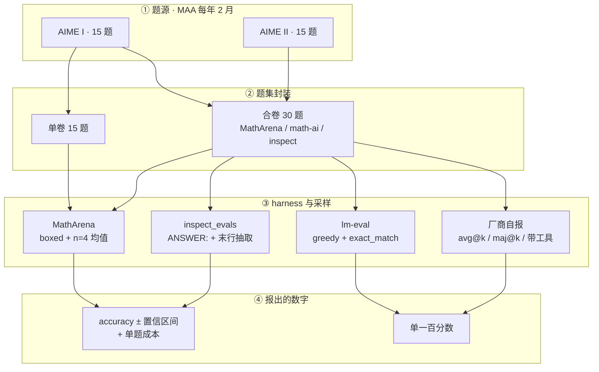

# AIME：每年换卷的竞赛数学短答案基准

---

## 1. 一句话定义

**AIME**（American Invitational Mathematics Examination）是美国数学协会（MAA）面向 AMC 10 / AMC 12 达标者的邀请制竞赛，每卷 15 题、答案恒为 0–999 的整数。AI 评测界把它当作**每年自动换卷、答案可机器精确判定、无法提前背答案**的短答案数学基准：AIME 2024 / 2025 / 2026 各自独立成榜，单卷 15 题、I + II 合卷 30 题。

它有两个特殊之处。其一，**AIME 不是论文提出的基准**，没有 origin paper；"AIME 基准"是一套围绕同一赛事的评测惯例，分数口径由各家 harness 自己定义，引用时必须写清 `年份 + 卷别（I/II）+ 题数（15/30）+ harness`。其二，它**已在前沿饱和**：2026 榜榜首并列 100%，MathArena 于 2026-05-12 公开宣告"最终答案类竞赛题不再是难基准的可靠来源"（第 4、5 节）。

> **核验说明**：赛制与日期取 MAA 官网原文；榜单数字取 MathArena 单模型页（一手）与三个聚合站（二手，已逐条标注）；题库元信息经 Hugging Face 数据集 API 读取（本机直连 `huggingface.co` 不通，实际走 `hf-mirror.com` 镜像，字段与许可与上游一致）。快照与边界见 `sources/aime/README.md`。

> **分类说明**：本仓 `category` 枚举无「数学」项，本篇按"短答案客观题"归入 `qa`，与 LiveBench v1 的处理一致。

---

## 2. 数据与任务构造

### 2.1 赛制（MAA 口径）

MAA 官网现行描述：AIME 是 **15 题**的考试，**分两部分、每部分 90 分钟**，每题答案为 **0 到 999 的整数**，难度高于 AMC 10 / 12；只向 AMC 10 / 12 达标者发出邀请，是 USAMO / USAJMO 选拔序列的第一环。

需要并列两个口径：2024–2026 赛季的赛事记录普遍写「15 题、**3 小时单场**」，而 MAA 现行页面（对应 2027 年 Pearson 机考）写「分两部分、各 90 分钟」。二者是否只是把同一场 3 小时拆成两段，官网未明说，**并列保留、不取其一**；引用"3 小时"时应注明赛季。

计分口径：**每题 1 分、答错与留空均 0 分、满分 15**，无部分分、无倒扣（该分值规则取自 AoPS 赛事记录与考点整理，属二手；MAA 的《AIME Policies》PDF 本次被 Cloudflare 拦截、未取到，见附录）。这一点直接决定了 AI 评测只能做精确匹配，也决定了后面所有"分数颗粒度"问题。

### 2.2 三个赛季的日期与题量

| 赛季 | AIME I | AIME II | 依据 |
| --- | --- | --- | --- |
| 2024 | 2024-02-01 | 2024-02-07 | AoPS Wiki 赛事记录（二手；MAA 该季公告未取到） |
| 2025 | 2025-02-06 | 2025-02-12 | MAA「2024-25 AIME 分数线」公告（一手） |
| 2026 | 2026-02-05 | 2026-02-11 | MAA「2025-26 AIME 分数线」公告（一手） |
| 2027 | 2027-02-05 至 2027-02-06（Pearson 机考、英文） | 同左 | MAA 赛事总览页（一手） |

I 卷与 II 卷是两套独立试题，考生只能选其一；作为评测题集时通常**合卷 30 题**，也有只用单卷 15 题的做法（第 3.2、5 节的不可比问题由此而来）。I 卷与 II 卷难度并不严格对等，单卷分数天然带一份"卷别偏差"。

### 2.3 题库与派生数据集

考试结束后，题目与答案在 AoPS 等社区与 MAA 渠道公开，并被整理成带解析的页面。学术评测常用的封装如下（元信息 2026-11-05 读取）：

| 数据集 | 条数 | 字段 | 许可 | 说明 |
| --- | ---: | --- | --- | --- |
| `MathArena/aime_2026` | 30 | `problem_idx` / `answer` / `problem` | CC BY-NC-SA 4.0 | 带 HF `benchmark:official` 标签；2026-10-19 更新 |
| `MathArena/aime_2025` | 30 | `problem_idx` / `problem` / `answer` / `problem_type` | CC BY-NC-SA 4.0 | 多一列 `problem_type`，可按题型切分 |
| `math-ai/aime26` | 30 | `problem` / `answer` / `id` | Apache-2.0 | `inspect_evals` 的 `aime2026` 用（pin 到固定 revision） |
| `math-ai/aime25` | 30 | `problem` / `answer` / `id` | Apache-2.0 | `inspect_evals` 的 `aime2025` 用 |
| `project-numina/aimo-validation-aime` | 90 | `id` / `problem` / `solution` / `answer` / `url` | Apache-2.0 | 原 `AI-MO/` 命名空间已重定向到此；含解析 |
| `Maxwell-Jia/AIME_2024` | — | 未逐字段核验 | MIT | 早期 AIME 2024 事实标准；`lm-eval` 的 `aime24` 引用链上 |
| `gneubig/aime-1983-2024` | 未取到 | 未逐字段核验 | CC0 | `lm-eval` 的 `aime` 任务数据源，覆盖 1983–2024 全部年份 |

三点注意：同一年的题在不同数据集里可能 15 条也可能 30 条；`aimo-validation-aime` 的 90 条按"三年 × 30 题"推算为 2022–2024，卡片本身没有年份字段，**属推算而非声明**；`gneubig/aime-1983-2024` 覆盖 42 年公开题，是最容易被训练数据吃进去的一份，用它跑分等于把污染面开到最大。

---

## 3. 评测方式

### 3.1 判定：整数精确匹配

所有 harness 的做法一致：从模型输出的末尾抽出那个整数，与官方答案逐字比对。差异全在"怎么抽"。`\boxed{123}`、`ANSWER: 123`、裸数字、以及以 `$$` 收尾的 `\boxed` 块，都要求解析器各自处理；小于 100 的答案要写成 `007` 还是 `7`，各 harness 容错程度不同。AIME 没有部分分，抽错一次就是整题归零——**解析失败与算错在最终分数上不可区分**，这是本基准最容易被忽略的噪声来源。

### 3.2 四类 harness 的口径分歧

| harness | 题数 | 末行格式要求 | 采样与聚合 | 指标 | 依据 |
| --- | ---: | --- | --- | --- | --- |
| MathArena | 30 | `\boxed{}`，并声明答案是 0–999 整数 | 每题 **4 次**，报 4 次均值 + 置信区间 + 单题成本 + 输出 token | accuracy | `configs/competitions/aime/aime_2026.yaml`（快照） |
| inspect_evals | 30 | `ANSWER: $ANSWER`，明确说"不必用 `\boxed`" | 默认单次；取最后一行实质内容，先把 `\boxed{...}` 拆掉再匹配 | accuracy + stderr | `utils/aime_common.py` |
| lm-evaluation-harness | 按数据集切（`aime` = 1983–2024，另有 `aime24` / `aime25`） | `Question: ...\nAnswer:` | **greedy**（`do_sample: false`，温度 0），`max_gen_toks: 32768` | exact_match | `lm_eval/tasks/aime/aime.yaml`（快照） |
| 厂商自报 | 15 或 30 不定 | 各家自己的 prompt | avg@k / maj@k / 是否带工具 / 是否并行思考，常不写全 | accuracy | 各家 model card，逐条不同 |



同一条 `15 题` 链条与 `30 题` 链条之间，单题权重差一倍；同一条 `n=4 均值` 与 `greedy 单次` 之间，差的是一次采样的运气。图里 ①→④ 任何一条换掉，分数就不再是同一个量。

### 3.3 分数的单位是"一次作答"

30 题 × 4 次 = **120 个作答**，1 个作答 = **0.83 分**；单卷 15 题时，1 题 = **6.67 分**。这意味着：

- 用 15 题单卷报分，一个模型答对 14 题就是 93.3%，答对 13 题是 86.7%——相邻名次的差距被强行量化成 6.67 分的台阶。
- 用 30 题合卷报分，台阶降到 3.33 分；MathArena 再按 4 次平均，最小可见差异 0.83 分，但代价是**置信区间同步变宽**（第 4.2 节实测 ±2.29 到 ±3.21）。

> ⚠️ **不要跨口径比较**：本节只描述"题数与采样如何决定分数台阶"，不比较任何模型。同一个模型在 15 题单卷、30 题合卷、avg@4、maj@64、带/不带工具下的分数互不可比；引用任何 AIME 数字前先确认 `年份 + 卷别 + 题数 + 采样方式 + 是否用工具`。

---

## 4. 榜单结果与演进

### 4.1 三个赛季的最好成绩轨迹

| 赛季 | 代表模型 | 分数 | 口径 | 来源 |
| --- | --- | ---: | --- | --- |
| 2024 | OpenAI o1 | 74.4（pass@1，11.1/15） | 官方评测；30 题按"每卷 15 题"为单位报 | OpenAI 一手 |
| 2024 | OpenAI o1 | 83.3（cons@64） | 64 样本多数投票，同一次官方评测 | OpenAI 一手 |
| 2024 | OpenAI o4-mini | 98.7 | thinking + 工具，厂商自报，经聚合站转述 | 二手（LLMLearner） |
| 2025 | GPT-5 (high) | 95.00 ± 3.90（8/61） | MathArena 4 次平均、无工具 | MathArena 一手 |
| 2025 | GPT-5-Pro | 100.0 | thinking + 工具，厂商自报 | 二手（LLMLearner / DataLearner） |
| 2026 | GPT-5.5 (xhigh) | 100.00 ± 0.00（1/32） | MathArena 4 次平均、无工具 | MathArena 一手 |
| 2026 | Claude-Opus-4.8 (max) | 100.00 ± 0.00（1/32） | 同上 | MathArena 一手 |
| 2026 | GLM-5.2 | 99.2 | 厂商/模型卡自报，经聚合站转述 | 二手（LLMLearner） |

> ⚠️ **不要跨口径比较**：本表横向不可读成一条曲线。2024 行是官方 pass@1 与 cons@64；2025/2026 的 MathArena 行是"4 次平均、无工具、30 题"；带"二手"的行是厂商自报经聚合站转述，题数与工具设置多未写全（`GPT-5-Pro 100.0` 就是 thinking + 工具档）。同一模型在不同 setting 下可以相差极大——聚合站记录 GPT-5 在 AIME 2025 上 `Normal (No Tools) 61.9` 与 `Thinking (With Tools) 99.6`，两个数字都属二手、口径不同，**不能当作能力区间来引用**。

轨迹本身很直白：2024 年 o1 的 74.4% 是"推理模型越过 AIME"的里程碑——同一页面上 GPT-4o 只有 12%（1.8/15）；到 2025 年，独立复跑的 GPT-5 已经 95%，厂商自报档普遍 100%；2026 年独立复跑也出现了两个 100%。**从 74 到 100 用了约 20 个月。**

### 4.2 MathArena AIME 2026 的实测明细

MathArena 对 2026 年 I + II 合卷 30 题、每题 4 次、无工具、`\boxed{}` 收尾，2026-11-05 读取的头部如下：

| 模型（档位） | 发布日 | accuracy | 名次 | 单题成本 | 输出 token（单题） |
| --- | --- | ---: | ---: | ---: | ---: |
| GPT-5.5 (xhigh) | 2026-04-24 | 100.00% ± 0.00% | 1/32 | $0.16 | 5,219 |
| Claude-Opus-4.8 (max) | 2026-05-28 | 100.00% ± 0.00% | 1/32 | $0.54 | 90,207 |
| Gemini 3.1 Pro Preview | 2026-02-19 | 98.33% ± 2.29% | 4/32 | $0.17 | 23,924 |
| DeepSeek-v4-Pro (Max) | 2026-04-24 | 96.67% ± 3.21% | 6/32 | $0.082 | 70,851 |

> ⚠️ **不要跨口径比较**：以上为**同一 harness（MathArena，4 次平均、无工具、30 题）内部**的数字，可与同表其他行比较，但不能与厂商自报的 `100.0`、也不能与 2024 年 o1 的 `74.4 pass@1` 相减。名次分母 32 是 MathArena 该榜的模型数，其他聚合站记 31 或 23（见附录）。四个模型的发布日均晚于 2026-02-11（II 卷考完），按 MathArena 的规则属"可能污染"标记范围。

两个细节值得记住。**一是 100% 已经不含信息量**：同为满分，GPT-5.5 单题 5,219 token、Opus 4.8 单题 90,207 token，成本差 3.4 倍——AIME 满分不再区分"解得漂亮"与"穷举到对"。**二是名次差小于误差**：98.33 ± 2.29 与 96.67 ± 3.21 区间大幅重叠，把它们排成第 4 与第 6 名，是把噪声当成了差异。

---

## 5. 已知缺陷

| # | 问题 | 一手依据 |
| --- | --- | --- |
| 1 | **前沿饱和**：2026 榜榜首并列 100%，前六 ≥96.67% | MathArena 单模型页；`no_final_answer` 明示最终答案类竞赛不再能区分前沿模型 |
| 2 | **题量太少、颗粒度粗**：15 题单卷 1 题 = 6.67 分；30 题合卷 1 题 = 3.33 分 | 赛制 15 题，见 2.1 |
| 3 | **置信区间宽于名次差**：±2.29 与 ±3.21 的区间重叠，名次不可解读 | MathArena 单模型页直接给出 ± |
| 4 | **污染不可排除**：题目与解析长期在 AoPS 公开，训练截止晚于考期即可能记住；MathArena 对"发布晚于考题公开"的模型打 ⚠️ | MathArena 榜单页标记规则；四个头部模型发布日均晚于 2026-02-11 |
| 5 | **harness 不可比**：prompt、答案抽取、采样次数、greedy/采样、是否带工具、重试策略全都不同 | `sources/aime/` 的四份配置（对应三个 harness）对照 |
| 6 | **厂商自选最优档**：同一模型 `Normal (No Tools) 61.9` 与 `Thinking (With Tools) 99.6` 都被称为"AIME 2025 成绩" | 二手（LLMLearner），未经一手核验 |
| 7 | **15 / 30 题混用**：聚合站多在条目页写"15 problems"，harness 实际跑 30 题 | LLMLearner / DataLearner 条目 vs `MathArena/aime_2026` 的 30 条 |
| 8 | **I 卷与 II 卷难度不对等**：单卷分数自带卷别偏差 | 赛制（两套独立试题）；逐卷难度差未取到官方统计 |
| 9 | **榜单退役后事实冻结**：`deprecated` 后 MathArena 不再为该榜补跑新模型——2026-10-13 发布的 Gemini 4 Argon 模型页已无任何 AIME 行，新模型只能看自报 | MathArena competitions 页逐条标 `Deprecated`；`/models/gemini_gemini_4_argon` 无 AIME 行 |
| 10 | **赛制在变**：2027 起 Pearson 机考、官网写"分两部分各 90 分钟"，与 2024–2026 的"3 小时单场"口径不完全同构 | MAA 赛事总览页；见 2.1 |

第 9 条最容易被忽略：榜单一退役，**分母就停止增长**。今天引用"AIME 2026 最好成绩"时，看到的是 2026 年 5 月前后那批模型的横截面，而不是当下的能力上限。

---

## 6. 复现与快速上手

本地已有四份 harness 配置快照，可离线比对 prompt 与采样设置：

```bash
cd /path/to/llm-benchmarks
cat sources/aime/matharena-aime-2026.yaml    # 30 题、boxed、n=4
cat sources/aime/lm-eval-aime.yaml           # greedy、exact_match、max_gen_toks 32768
cat sources/aime/inspect-evals-aime2026.yaml # 30 样本、数据集 pin
```

用 MathArena（与第 4.2 节同口径）复跑：

```bash
git clone https://github.com/eth-sri/matharena && cd matharena
uv sync
uv run python scripts/run.py --comp aime/aime_2026 --models openai/gpt-5.5 --n 4
uv run python scripts/run.py --comp aime/aime_2025 --models openai/gpt-5.5 --n 4
```

换 harness 会换口径，二者不可混着报：

```bash
# lm-evaluation-harness：greedy 单次，exact_match
lm_eval --model openai-chat-completions --model_args model=gpt-5.5 \
  --tasks aime25 --num_fewshot 0

# inspect_evals：ANSWER: 末行抽取，默认单次
inspect eval inspect_evals/aime2026 --model openai/gpt-5.5
```

本机直连 `huggingface.co` 不通，拉数据集前设 `export HF_ENDPOINT=https://hf-mirror.com`；`inspect_evals` 的 `aime2025/2026` 都 pin 了固定 revision，换镜像不影响数据一致性。

| 快照文件 | 用途 |
| --- | --- |
| `sources/aime/matharena-aime-2025.yaml` | AIME 2025 的 prompt、题数、`date: 2025-02-12` |
| `sources/aime/matharena-aime-2026.yaml` | AIME 2026 的 prompt、题数、`date: 2026-02-06` |
| `sources/aime/lm-eval-aime.yaml` | lm-eval `aime` 任务的数据集、greedy 设置、指标 |
| `sources/aime/inspect-evals-aime2026.yaml` | inspect_evals `aime2026` 的 30 样本与数据集 pin |

---

## 7. 结论

AIME 的价值不在"难"，而在**便宜、客观、每年自动换新**：30 道整数题，不需要 judge、不需要 Docker、不需要人工评分，考试一结束就能跑。2023–2025 年它确实是最好用的数学推理标尺，o1 的 74.4% 与 GPT-5 的 95% 都是这条尺子上读出来的。

但它作为**前沿基准**的寿命已经结束。MathArena 用 176 道新竞赛题做了对照实验：Gemini 3.1 Pro 四试全对 162 道，其余 14 道至少对一次，**没有一道满足"难到能筛前沿模型"的门槛**。这不是某个模型的偶然，而是"公开题库 + 每年换卷"这条设计在模型能力越过某条线之后必然的结局——题目一旦公开就进入下一轮训练语料，换卷速度追不上训练速度。

所以正确的用法是把它降级：**做中小模型的能力 floor check、做新方法的快速 sanity check、做成本/效率的对照题面**（同等满分下 5K token 与 90K token 是真实的工程差异）。要区分前沿的数学能力，得换赛道：证明题、研究级 arXiv 题、Lean 形式化——这三条 MathArena 已经各自铺开，AIME 的分数在那里只作背景。

---

## 附：口径差异与未核验项

| 项 | 一种口径 | 另一种口径 | 处理 |
| --- | --- | --- | --- |
| AIME 时长 | MAA 现行页：15 题、分两部分、每部分 90 分钟 | 2024–2026 赛季记录：15 题、3 小时单场 | 并列保留；引用注明赛季 |
| 2026 榜模型数 | MathArena competitions 页：32 models | BenchLeader：31 个配置；Respan：26；evals.report：23+ | 并列保留；名次分母随平台变 |
| AIME 2024 日期 | 2024-02-01 / 2024-02-07（AoPS 记录） | MAA 该季公告未取到 | 标为二手 |
| `aimo-validation-aime` 年份 | 90 条，按三年 × 30 题推算 2022–2024 | 卡片无年份字段 | 标为推算 |
| 2026 榜污染标记数 | MathArena 规则：发布晚于考题公开即标 ⚠️ | 二手统计：31 行中 22 行带标记 | 规则取一手，行数标二手 |
| 厂商自报的"100" | 常见为 thinking + 工具档 | 同模型无工具档可低至 60 上下 | 不合并，分档并列 |

**未取到 / 未按同样深度核验**：MAA 2023-24 赛季 AIME 日期原公告；MAA《2026-27 AIME Policies》PDF（Cloudflare 拦截，分值规则因此只能标二手）；AIME 官方题目 PDF 与答案键（版权归 MAA，未入库）；MathArena 榜单的静态表格导出（前端异步加载，只能逐模型页读）；`gneubig/aime-1983-2024` 的条数与字段；`Maxwell-Jia/AIME_2024` 的字段结构；I 卷 / II 卷的官方难度统计。

---

## 8. 参考来源

1. **一手**：MAA 邀请赛总览（AIME 赛制、2027 年 Pearson 机考日期）：https://maa.org/maa-invitational-competitions/
2. **一手**：MAA「2024-25 AIME 分数线」（AIME I 2025-02-06 / AIME II 2025-02-12）：https://maa.org/news/aime-thresholds-are-available/
3. **一手**：MAA「2025-26 AIME 分数线」（AIME I 2026-02-05 / AIME II 2026-02-11）：https://maa.org/?p=17675
4. **一手**：MathArena 公告 *Farewell to Final-Answer Competition Problems as Frontier Benchmarks*（2026-05-12，176 题对照实验）：https://matharena.ai/no_final_answer
5. **一手**：论文 *Beyond Benchmarks: MathArena as an Evaluation Platform for Mathematics with LLMs*（arXiv:2605.00674，v1 2026-05-01 / v2 2026-05-15；NeurIPS D&B '25 平台延续）：https://arxiv.org/abs/2605.00674
6. **一手**：评测框架仓库 `eth-sri/matharena`（MIT；`--n` 默认 4；AIME 配置目录）：https://github.com/eth-sri/matharena
7. **一手**：MathArena 单模型页（accuracy ± CI、名次、单题成本、输出 token）：https://matharena.ai/models/openai_gpt_55 、https://matharena.ai/models/anthropic_opus_48_max、https://matharena.ai/models/gemini_gemini_31_pro、https://matharena.ai/models/deepseek_deepseek_v4_pro、https://matharena.ai/models/openai_gpt_5
8. **一手**：数据集 `MathArena/aime_2026`（30 条）/ `MathArena/aime_2025`（30 条）：https://huggingface.co/datasets/MathArena/aime_2026
9. **一手**：数据集 `math-ai/aime26` / `math-ai/aime25`（各 30 条，Apache-2.0）：https://huggingface.co/datasets/math-ai/aime26
10. **一手**：数据集 `project-numina/aimo-validation-aime`（90 条，Apache-2.0）：https://huggingface.co/datasets/project-numina/aimo-validation-aime
11. **一手**：评测工具包 `EleutherAI/lm-evaluation-harness` 的 `aime` / `aime24` / `aime25` 任务：https://github.com/EleutherAI/lm-evaluation-harness/tree/main/lm_eval/tasks/aime
12. **一手**：评测工具包 `UKGovernmentBEIS/inspect_evals` 的 `aime2024` / `aime2025` / `aime2026`：https://github.com/UKGovernmentBEIS/inspect_evals/tree/main/src/inspect_evals/aime2026
13. **一手**：OpenAI *Learning to reason with LLMs*（AIME 2024：o1 pass@1 74.4 / cons@64 83.3）：https://openai.com/index/learning-to-reason-with-llms/
14. **二手聚合**：BenchLM AIME 2025 条目（显示用、不计入其加权分）：https://benchlm.ai/benchmarks/aime2025
15. **二手聚合**：LLMLearner AIME 2025 榜（86 个配置、按最佳 setting 排名）：https://llmlearner.com/rankings/aime-2025
16. **二手聚合**：DataLearner AIME 2026 条目（模式标签与平行思考说明）：https://www.datalearner.com/ai-benchmarks/aime-2026
17. **二手**：AoPS Wiki「AMC historical results」（AIME 2024 日期与历年分数线）：https://artofproblemsolving.com/wiki/index.php/AMC_historical_results
