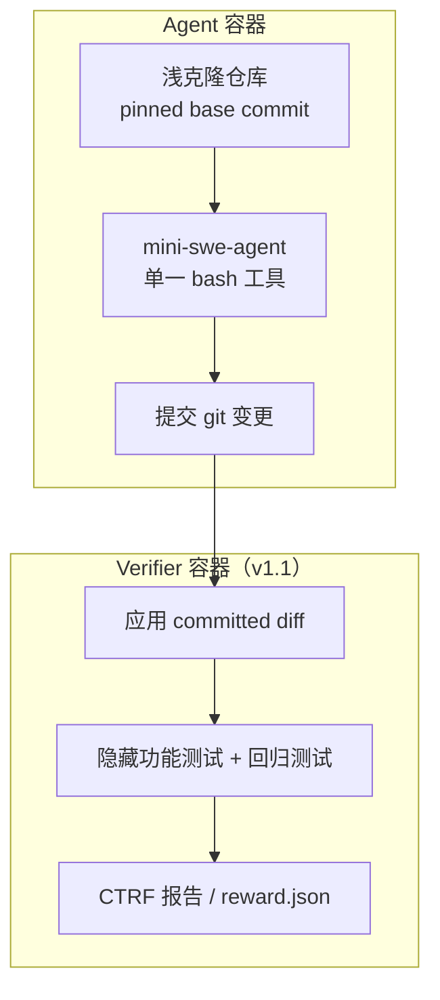

# DeepSWE：原创长程工程任务的编码 Agent 基准

---

## 1. 一句话定义

DeepSWE 是 Datacurve 发布的编码 Agent 基准：给 Agent 一段简短的功能需求，让它在真实开源仓库里自主定位、跨文件修改并提交补丁，再由人工编写的功能验证器判断行为是否正确。它针对 SWE-bench 系的两个结构性问题——题目从已合并 PR 挖取（可能进过预训练），以及判分沿用 PR 自带测试（只认一种实现）。

名称注意：它与 Agentica / Together 在 2025-07 发布的 DeepSWE-Preview 模型同名，二者没有关系；后者是一个基于 Qwen3-32B 的开源编码 Agent 模型。

---

## 2. 数据与任务构造

v1.1 共 **113 个任务**，来自 **91 个活跃开源仓库**，覆盖 5 种语言：TypeScript、Go、Python、JavaScript、Rust。仓库需公开、持续维护、至少 500 GitHub stars、使用宽松开源许可证；每个任务钉在不可变 commit 上，中位数仓库只贡献 1 个任务，避免单一仓库主导榜单。

任务**从零编写**，不复制或改编已有 PR / commit；部分题目受未解决的 GitHub issue 启发，但修复本身是新写的，且从不合并回上游，因此参考解不在公开 commit 与 PR 记录里。

表 1 · 语料规模对比（发布博客 2026-05-26 口径）

| 指标 | SWE-Bench Verified | SWE-Bench Pro | DeepSWE |
| --- | ---: | ---: | ---: |
| Prompt 平均字符数 | 1,700 | 4,614 | 2,158 |
| 参考解平均新增行数 | 10 | 120 | 668 |
| 参考解平均修改文件数 | 1 | 5 | 7 |

即 prompt 约为 SWE-Bench Pro 的一半，参考解却多 5.5 倍代码、约 2 倍输出 token，平均触及 7 个文件。

每个任务是一份 Harbor 格式的目录，含三类产物：

| 产物 | 作用 |
| --- | --- |
| `instruction.md` | Agent 看到的 prompt，只有功能描述，不给接口定义块 |
| `tests/` | 功能验证器，扩展仓库自身测试设施，只通过公开 API 与可观察输出断言 |
| `solution/` | 参考解，仅用于人工复核，判分时从不使用 |

验证器在编写阶段会连跑 3 次，结果不稳定的标记为 flaky 并退回修改；每次评测还同时跑仓库既有测试与新增回归测试，实现了新功能但弄坏无关功能的补丁同样判失败。任务入库前需通过 LLM 辅助分析与独立人工复核，复核维度为：prompt 与验证器的双射（不多测也不少测）、接受面宽度（不绑定参考实现的结构）、真实性（prompt 像开发者日常说话，任务像维护者会接受的贡献）、环境清洁度。

---

## 3. 评测方式

所有模型跑在同一个 **mini-swe-agent**（固定 commit `adfe2023`）上：单一 `bash` 工具、共享 system prompt、无模型专属编辑原语。容器内只有目标仓库在 base commit 的浅克隆，任务默认断网；Pier 通过 per-agent 网络白名单只放行模型 API。rollout 在 Agent 提交补丁、耗尽原生上下文或超时（9,000 秒 / 2.5 小时）时结束，后两者计为失败；不设步数或成本上限。



计分口径：

| 指标 | 定义 |
| --- | --- |
| pass@1 | 每任务 4 次 rollout，先算单任务通过率，再对 113 个任务等权取宏平均 |
| pass@4 | 4 次 rollout 中至少 1 次通过的任务占比 |
| 置信区间 | 以整榜重跑的分数波动估计标准差，报告 95% CI（沿用 Terminal-Bench 做法） |

上下文耗尽与 Agent 超时计为失败；provider 错误、验证器 / 判分错误、网络错误从分子和分母中一起剔除，且不重采样。v1 共 7,174 次计分 rollout，仅 67 次（0.9%）触及 2.5 小时上限；榜单结果于 2026-05 收集，论文评测 16 个前沿配置。

**v1.1 的判分改动**：Agent 在 `main` 分支上正常提交，未来 git 历史被删除；验证器在独立容器里只应用 committed diff，再跑隐藏测试并输出 CTRF 结构化报告。这样 Agent 无法 monkey-patch 测试框架，删测试或提前退出会显示为缺失 / 失败结果。同时修复了依赖漂移与部分 flaky 测试。

---

## 4. 榜单结果与版本演进

### 4.1 v1 榜单（2026-05-26）

> ⚠️ **不要跨口径比较**：v1 榜单全部由 Datacurve 用 mini-swe-agent 在全部 113 题上官方跑分（无 train/test split，非厂商自报），但在 Agent 容器内判分，与 v1.1 的独立 verifier 容器口径不同；下表只展示发布博客给出的 16 个配置中的 12 个，且各模型 reasoning effort 不完全一致。v1 与 v1.1 的分数不可直接比较。

| 配置 | pass@1 | ±（95% CI） |
| --- | ---: | ---: |
| GPT-5.5 [xhigh] | 70% | 3 |
| GPT-5.4 [xhigh] | 56% | 2 |
| Claude Opus 4.7 [max] | 54% | 5 |
| Claude Sonnet 4.6 [high] | 32% | 2 |
| Gemini 3.5 Flash [medium] | 28% | 4 |
| GPT-5.4 Mini [xhigh] | 24% | 3 |
| Kimi K2.6 | 24% | 2 |
| MiMo v2.5 Pro | 19% | 2 |
| GLM-5.1 | 18% | 1 |
| Gemini 3.1 Pro | 10% | 3 |
| DeepSeek-V4 Pro | 8% | 3 |
| Gemini 3 Flash | 5% | 2 |

论文（arXiv 2607.07946v1，2026-07-08）报告的是同一批 v1 结果：GPT-5.5 为 70.0%（95% CI [67.2, 72.9]），GPT-5.4 55.5% [53.4, 57.7]，Claude Opus 4.7 54.2% [49.5, 58.9]；论文称 DeepSWE 把 8 个有公开 SWE-Bench Pro 成绩的模型拉开到 **69.8 个百分点**的区间，而 SWE-Bench Pro 上只有 **29.7 个百分点**。

### 4.2 v1.1 现行榜单（2026-09-22 更新）

> ⚠️ **不要跨口径比较**：下表为官网 v1.1 榜单默认视图（每模型最佳 reasoning effort，21/28），在全部 113 题上由 Datacurve 用 mini-swe-agent 官方跑分（无 train/test split，非厂商自报）。不同 effort、v1 历史分数、厂商自报与第三方重跑（如 Mercor 的 500 步 / 2 小时配置）均不可与表中数字直接比较。分数按整数百分点发布，± 为 95% CI 半宽。

| # | 配置 | pass@1 | ± | 单任务均价 | 输出 token | 步数 |
| ---: | --- | ---: | ---: | ---: | ---: | ---: |
| 1 | GPT-6 Astra [xhigh] | 74% | 3 | $4.43 | 30k | 29 |
| 2 | Gemini 3.8 Flash [high] | 74% | 1 | $2.36 | 143k | 166 |
| 3 | Claude Opus 5 [max] | 74% | 4 | $11.84 | 118k | 99 |
| 4 | GPT-5.6 Sol [max] | 73% | 3 | $6.46 | 60k | 61 |
| 5 | Claude Fable 5 [xhigh] | 70% | 3 | $13.41 | 80k | 68 |
| 6 | GLM-5.3 [max] | 69% | 3 | $3.99 | 80k | 124 |
| 7 | Kimi K3 [max] | 69% | 5 | $4.65 | 81k | 98 |
| 8 | Grok 4.6 [medium] | 67% | 2 | $3.45 | 50k | 70 |
| 9 | GPT-5.6 Luna [max] | 67% | 4 | $0.61 | 73k | 102 |
| 10 | GPT-5.5 [xhigh] | 67% | 6 | $7.23 | 46k | 82 |
| 11 | Gemini 3.7 Flash [medium] | 65% | 3 | $2.03 | 94k | 117 |
| 12 | GLM-5.3 Flash [max] | 63% | 4 | $0.24 | 73k | 123 |
| 13 | DeepSeek-V4 Pro [max] | 63% | 6 | $1.67 | 106k | 155 |
| 14 | Claude Opus 4.8 [max] | 59% | 2 | $13.22 | 135k | 120 |
| 15 | Qwen3.8 Max [xhigh] | 57% | 3 | $3.73 | 95k | 111 |
| 16 | Muse Spark 1.2 [xhigh] | 55% | 2 | $3.70 | 99k | 101 |
| 17 | Claude Sonnet 5 [max] | 54% | 4 | $26.40 | 214k | 268 |
| 18 | DeepSeek-V4 Flash [max] | 53% | 4 | $0.46 | 108k | 153 |
| 19 | Gemini 3.6 Flash [high] | 47% | 4 | $2.21 | 96k | 117 |
| 20 | GLM-5.2 [max] | 44% | 2 | $3.92 | 78k | 129 |
| 21 | Gemini 3.5 Flash [high] | 36% | 4 | $3.45 | 76k | 105 |

官网该视图只显示 21 个模型；站点共记录 **28 个模型 / 70 个 effort 配置**。头部三名同为 74% 且 CI 完全重叠（±1 至 ±4），不能据此排出 1–3 名。成本与通过率也基本脱钩：最便宜的 GLM-5.3 Flash 为 63%（$0.24/任务），而 Claude Sonnet 5 花 $26.40 只拿到 54%。

第三方快照的差异仅来自抓取时点：BenchLM 镜像 2026-09-01 快照，记为 Gemini 3.8 Flash 73.8%、Claude Opus 5 73.6%、GPT-6 Astra 73.2%，并明确「不做排名」；LLMLearner 记为 GPT-6 Astra 74.1、Gemini 3.8 Flash 73.8、Claude Opus 5 73.7。中文聚合站 DataLearner 把厂商自报成绩（如 Meta 的 Muse Wonder Full 79.00）与官方跑分混排在同一榜，引用前须按来源过滤。

### 4.3 v1 → v1.1 的同配置变化

> ⚠️ **不要跨口径比较**：v1.1 改的是执行与判分链路（独立 verifier 容器、只认 committed diff、CTRF 报告），题目与指标不变，但同一配置在两版之间的分数不可互换。官网公布分差处于同一 harness 下的版本内对照，不代表能力随时间的变化。

| 配置 | v1 | v1.1 | Δ（百分点） |
| --- | ---: | ---: | ---: |
| GPT-5.5 [xhigh] | 70% | 67% | −3.0 |
| GPT-5.5 [high] | 62% | 64% | +2.4 |
| GPT-5.5 [medium] | 48% | 54% | +6.0 |
| Claude Opus 4.8 [max] | 58% | 59% | +0.8 |
| Claude Opus 4.8 [xhigh] | 58% | 54% | −3.4 |
| Claude Opus 4.8 [high] | 51% | 52% | +1.1 |
| Claude Opus 4.8 [medium] | 47% | 49% | +1.3 |
| GPT-5.4 [xhigh] | 56% | 52% | −3.8 |
| Claude Sonnet 4.6 [high] | 32% | 30% | −1.8 |

官方说法是「排序不变、多数配置在几个百分点内」；任务级波动则大得多，例如 `narwhals-rolling-window-suite` 从 33% 升到 100%（+66.7），`vulture-persistent-analysis-cache` 从 83% 降到 17%（−66.7）。因此 v1 / v1.1 的分数既不能跨版本比较，也不宜按任务做细粒度解读。

---

## 5. 已知缺陷

- **第三方审计判为 Flawed**：Epoch AI 2026-09-07 的评审对全部 113 个任务用 Opus 5 与 Sol 5.6 扫描，人工确认 **至少 23/113（>20.3%）** 个任务存在误判，结论为 Flawed。其中 18/23（78%）来自同一机制：验证器在应用补丁前会丢弃 Agent 对既有测试文件的修改，再放入隐藏测试；如果 Agent 也定义了同名测试函数，或其它测试文件引用了被丢弃的 helper，整个测试包会编译失败，验证器把正确解判为失败。Epoch 明确说明只查了 false negative，查到 23 个即停止，未审查其它错误类型。
- **两套审计结论相互张力**：Datacurve 自己的 LLM-judge 审计（论文口径，v1；每基准 30 任务 × 9 配置 × 3 rollout）称验证器与裁判的分歧率仅 1.4%（735 次 rollout），远低于 SWE-Bench Pro 的 32.4%（789 次）。但该审计衡量的是「与另一个 LLM 裁判的分歧」，不是人工确认的 ground truth；DeepSWE 侧的 1.4% 只对应 2 个假阳性 + 8 个假阴性，样本极小。Epoch 的人工复核则直接给出了系统性假阴性机制。
- **二值奖励，无部分分**：通过 / 不通过之外没有「差多少」的信息，少实现一个需求的补丁与根本编译不过的补丁同分；pass@1 / pass@4 不能当作平滑的能力刻度。
- **只测功能正确性**：不评代码质量、可读性、性能、错误处理或文档；两个都能过验证器的补丁被视为等价，哪怕一个可维护、另一个很脆。
- **单一 harness**：所有模型都经 mini-swe-agent 的单一 `bash` 工具与共享 prompt，绕开了厂商原生产品（Claude Code、Codex CLI、Cursor、Gemini CLI）的编辑原语；论文的 10 题 pilot 只能排除「大幅系统性劣势」，不足以给 harness 排序。各家族的 reasoning effort 设置也不统一（部分为默认档）。
- **统计功效有限**：CI 只反映重跑波动，不含「换一批 113 题」的任务抽样波动；头部 ±1 至 ±6 个百分点，前三名重叠。论文自己的 Wilson 区间示例：GPT-5.5 [65.6, 74.1]，比报告的重跑区间 [67.2, 72.9] 更宽。
- **Prompt 处于「中等规格」**：平均约 2,000 字符，比 SWE-Bench Pro 短，但仍比开发者日常对 Agent 说的话更完整；真正欠定、需要追问的请求，以及非编码类 Agent 用途（评审、解释、调试对话）不在测量范围内。
- **污染只在评测时成立**：任务发布后，prompt、验证器与轨迹都可能进入后续训练语料；抗污染依赖「尚未公开 + 可持续补新题」，不是永久属性。
- **「长程」是结构定义**：指参考解大、跨文件多、prompt 短，需要探索后重建隐含规格；不等于人类工程师要花几小时或几天。
- **口径混用风险高**：v1 与 v1.1 同模型可差数个百分点；厂商自报常标「DeepSWE 1.0 / 1.1」而不写 harness；Mercor 的 APEX 重跑用 500 步 / 2 小时上限（官方为无步数上限 / 2.5 小时），其榜首 Muse Wonder 1.0 为 75.2%，与官方榜首 74% 不可直接比较。
- **个别运行缺口**：官网注明 Claude Fable 5 的 2,260 次 trial 中有 73 次因「美国政府指令暂停访问」未完成，通过率按已完成 trial 计算。

---

## 6. 复现 / 快速上手

仓库公开（Apache-2.0），题目同时发布在 Hugging Face（`datacurve/deep-swe`，gated auto）。官方评测框架是 Harbor 的 fork **Pier**，榜单分数由 Pier 在 Modal 上并行跑 mini-swe-agent 得到。

```bash
git clone https://github.com/datacurve-ai/deep-swe
uv tool install datacurve-pier

# 单模型全量（以 Claude Opus 4.8 为例）
export ANTHROPIC_API_KEY=...
pier run -p deep-swe/tasks --agent mini-swe-agent --model anthropic/claude-opus-4-8

# 113 题中固定种子的 10 题子集
pier run -p deep-swe/tasks --agent mini-swe-agent --n-tasks 10 --sample-seed 0
```

需要 Docker；加 `--env modal` 可并行沙箱。每个任务也可单独跑：

```bash
pier run -p deep-swe/tasks/<task-id> --agent mini-swe-agent
```

一次全量是 113 题 × 4 rollout；按官网「单任务均价」列，同一套题的成本从 GLM-5.3 Flash 的 $0.24/任务到 Claude Sonnet 5 的 $26.40/任务不等，全量预算需按此量级自行外推。做对比实验时务必固定 `mini-swe-agent` commit、effort 档位与版本号（v1.1），否则结果不可比。

---

## 7. 结论

DeepSWE 是目前少有的、从任务生成到验证器都重做一遍的长程编码基准：原创题目切断了「背下已合并 PR」的捷径，功能验证器则试图接受任意正确实现。它在 v1.1 上把前沿 Agent 拉开到 36%–74% 的区间，比 SWE-Bench Pro 的拥挤头部更有区分度。

但它的可信度取决于验证器，而这恰恰是争议所在：Datacurve 自审称分歧率 1.4%，Epoch AI 的人工复核却在 20%+ 的任务上发现系统性假阴性（测试文件被丢弃导致编译冲突）。在验证器修复之前，DeepSWE 适合作为「同一 harness 下的相对排序 + 失败模式分析」信号，不适合当作绝对能力分或跨版本、跨 harness 的对比依据。

---

## 8. 参考来源

1. 官方站与榜单（Leaderboard v1.1，页面标注 updated 2026-09-22；访问 2026-11-05）：https://deepswe.datacurve.ai/
2. 原始论文（arXiv:2607.07946v1，2026-07-08 提交，32 页；对应 v1；截至核验日未见正式会议版本）：https://arxiv.org/abs/2607.07946
3. 官方仓库（GitHub，Apache-2.0；2026-08-26 最后推送）：https://github.com/datacurve-ai/deep-swe
4. 数据集（Hugging Face，gated auto；2026-06-01 创建）：https://huggingface.co/datasets/datacurve/deep-swe
5. 评测轨迹与完整 trial 记录（Hugging Face，CC-BY-4.0；2026-06-09 更新）：https://huggingface.co/datasets/datacurve/deep-swe-leaderboard
6. 评测工具 Pier（GitHub，Apache-2.0）：https://github.com/datacurve-ai/pier
7. 发布博客 v1（2026-05-26）：https://deepswe.datacurve.ai/blog/deepswe
8. 发布博客 v1.1（2026-06-14）：https://deepswe.datacurve.ai/blog/deepswe-v1-1
9. 第三方审计（Epoch AI，Reviewed 2026-09-07，verdict Flawed）：https://epoch.ai/benchmarks/deepswe/review
10. 第三方重跑（Mercor APEX，v1.1，mini-swe-agent 500 步 / 2 小时）：https://www.mercor.com/apex/oss-benchmarks/oss-deep-swe-leaderboard/
11. 二手聚合（BenchLM，2026-09-01 快照）：https://benchlm.ai/benchmarks/deepswe
12. 二手聚合（LLMLearner，2026-09-22 快照）：https://llmlearner.com/rankings/deepswe
13. 二手聚合（DataLearner，2026-11-05 访问）：https://www.datalearner.com/benchmarks/deepswe
