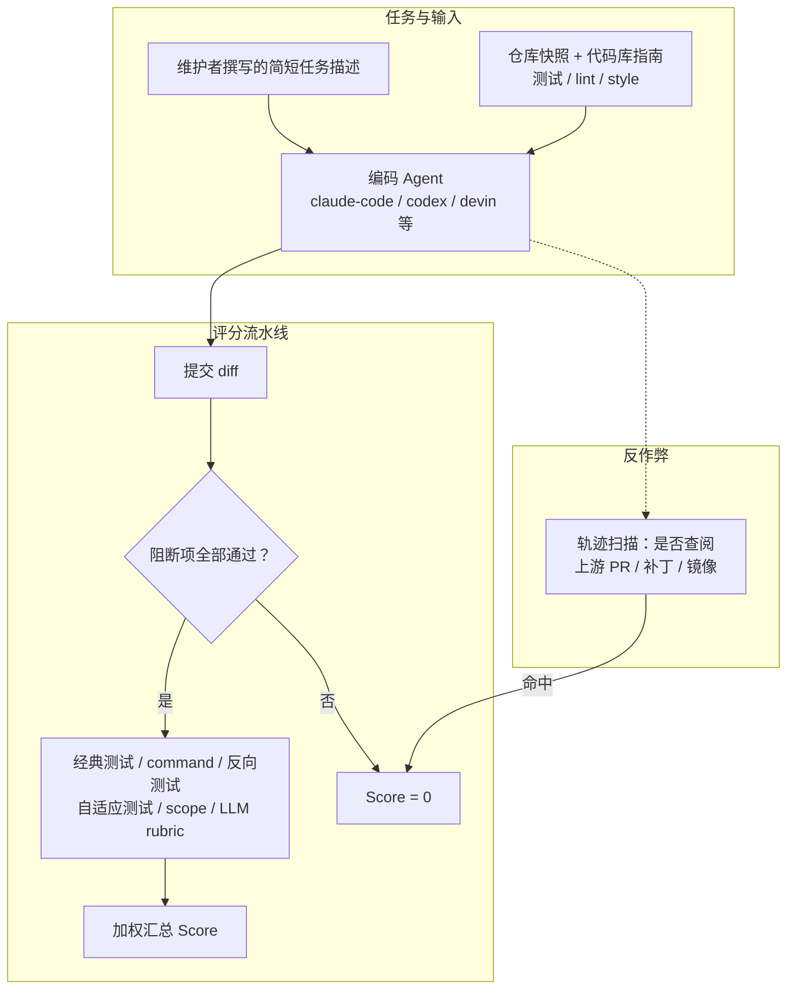

# FrontierCode 2.0：以 PR 可合并性为标准的编码 Agent 基准

---

## 1. 一句话定义

FrontierCode 2.0 是 Cognition 于 2026-10-27 发布的编码 Agent 基准，也是 FrontierCode 系列的第二代主版本。它给 Agent 一份由开源维护者撰写的、刻意简短的仓库任务说明，要求 Agent 在真实代码库中完成修改；评分不问「单元测试是否通过」这一件事，而问「维护者是否愿意合并这个 PR」——即 **mergeability**。评分由单元测试、rubric 与多种 verifier 组成的集成流水线给出：任一阻断项（blocking criterion）失败，该次运行直接记 0；全部通过后，再按 rubric 项加权汇总为 Score。

它针对的是编码基准的两个常见失真：题目被过度规格化，模型只需照做；以及只看功能正确性，不看测试质量、改动范围、仓库约定与「把同类问题一次修完」的彻底性。FrontierCode 2.0 换了新的 132 题题集并加严评分，因此 2.0 与 1.1 的分数不可直接比较。

文件名 `frontiercode-v2.md` 对应官方版本号 2.0（按 AGENTS.md §2.1 的 `-v<N>` 约定）；本仓库尚未单独收录 1.1 版本。

---

## 2. 数据与任务构造

FrontierCode 2.0 是单一 **Main 子集、132 个私有任务**。任务来自 20 多位一线开源维护者，每人针对自己维护的仓库、每题投入 40 小时以上构建；官方称 2.0 覆盖的仓库数比 1.1 多 55%，并新增安全补丁、性能优化等类别。1.0 公布过 36 个旗舰仓库，2.0 未给出仓库与语言的绝对数。

与 1.1 相比，2.0 的参考解平均多改 **67% 的文件、89% 的行数**，所在代码库平均大 **25%**；在 **80%** 的任务中，参考解与上游 PR 不同（1.0 为 60%），官方称这是加强 prompt、参考解与评分标准审计的结果。

任务说明由两部分组成：

| 组成部分 | 内容 |
| --- | --- |
| 任务描述 | 像真实用户/维护者口吻的简短说明，不给出完整实现规格；1.0 称其长度约为 SWE-Bench Pro 的三分之一 |
| 代码库指南 | 测试、lint、style 等通用约定，类似仓库里的 `AGENTS.md` / `CONTRIBUTING.md` |

任务全部私有，公开页面只展示两个完整走查样例：Mock Service Worker 的 `resetHandlers()` 生成器重启问题，以及 PostHog Android SDK 的离线事件顺序问题。题目、参考解、rubric 与 verifier 均不公开。

**彻底性（thoroughness）** 是 2.0 的重点。官方给出的两类典型阻断项：

- **修完同一 bug 的所有实例**：prompt 只指出一条代码路径上的 bug，但同一 bug 在兄弟路径也存在；只修 prompt 提到的那一处会被阻断。
- **补齐同类支持**：prompt 只要求支持一种输入类型，但代码库中同类逻辑已支持其他类型；只实现被点名的那一种会被阻断。

表 1 · 阻断项分类计数（官方博客，1.1 vs 2.0）

| 类别 | FrontierCode 1.1 | FrontierCode 2.0 |
| --- | ---: | ---: |
| Thoroughness | 168 | 501 |
| Core behavior | 399 | 353 |
| Avoiding regressions | 174 | 259 |
| Effective test writing | 202 | 213 |
| Lint / format / typecheck | 112 | 183 |
| Scope | 56 | 123 |
| Backwards compatibility | 85 | 76 |
| Compilation | 86 | 69 |
| Test integrity | 48 | 48 |
| Docs / metadata | 6 | 17 |
| Implementation detail | 9 | 11 |

按表中逐项相加，1.1 为 1,345 条、2.0 为 1,853 条，增幅 **37.8%**；博客正文称阻断项增加 **43%**。官方未解释两者口径差异，引用时以正文的 43% 为官方表述、以表内计数为可复核明细。

---

## 3. 评测方式



### 3.1 两个指标

| 指标 | 定义 |
| --- | --- |
| Pass rate | 满足全部阻断项的 trial 比例；官方 `data.json` 字段名为 `correct` |
| Score | 通过全部阻断项后，按 rubric 项加权汇总；任一阻断项失败则该 trial 记 0；官方字段名为 `new_score` |

阻断项是维护者会在 code review 中视为硬性拒绝条件的标准，既包括正确性，也包括性能、scope 等非功能要求；非阻断项则是代码风格、类型安全、可读性等质量信号，不直接决定是否记 0。

### 3.2 评分方法

FrontierCode 的评分不只看单元测试。官方 1.0 博客列出的方法体系在 2.0 中基本沿用：

表 2 · 评分方法（官方 1.0 博客，2.0 沿用）

| 评估维度 | 方法 | 做法 | 通过条件 |
| --- | --- | --- | --- |
| 行为正确性 | classical | 把测试文件注入仓库、运行、清理 | 注入测试全部通过 |
| 机械清洁度、回归安全 | command | 运行 shell 命令（build / lint / test） | 退出码为 0 |
| 测试正确性 | reverse-classical | 把 Agent 自己写的测试跑在原始 broken 代码上 | 测试必须失败，证明测试确实能捕获问题 |
| 复杂任务的行为正确性 | adaptive classical | 用 LLM 把参考测试或应用代码适配到 Agent 的实现细节，再运行 | 适配后的测试通过 |
| 改动范围 | scope | 文件边界、diff 大小、可选的语义局部性检查 | diff 在约束内 |
| 代码质量 | prompt / LLM rubric | LLM 按自然语言 rubric 审阅 diff | rubric 分数达到阈值 |

其中 adaptive classical（内部工具 `mutagent`）用于接受函数名、错误措辞等表面差异下的其他正确实现；scope 检查则防止 Agent 顺手重构无关文件。2.0 放宽了 scope 标准：官方称 scope 阻断项的平均失败率从 1.1 的 9.0% 降到 3.8%，以容纳「出乎意料但可接受」的改动。

### 3.3 联网与反作弊

FrontierCode 允许 Agent 像工程师一样上网查文档、搜报错，但禁止查阅任何可能泄露答案的来源（上游 PR、补丁、镜像、包含修复的包版本等）。1.1 起采用两道防护：在 prompt 中明确「公平联网」的边界，并用轨迹扫描器检测违规；被标记的运行记 0。2.0 沿用该规则。官方称 prompt 本身已能把违规率压到很低，扫描器用于兜底。

### 3.4 运行与计分口径

- **运行次数**：沿用 1.0 的协议，每个模型在每个可用 reasoning effort 上跑 **5 次**，先对 5 次取平均，再报告该模型表现最好的 effort。2.0 博客没有重新列出该协议，只称「大体沿用 1.0 的方法学」。
- **模型 + harness**：榜单每一行是「模型 + 指定 Agent harness」的组合，harness 包括 `claude-code`、`codex`、`devin`、`devin-cli`、`grok-build`、`muse`、`vibe`、`devin-cli-swe1` 等。官方在 changelog 中明确「Points are shaped by evaluation harness」，因此分数不能当作纯模型能力。
- **成本**：官方按 list API 价格计算每次 rollout 的平均美元支出，包含公开折扣；不是订阅价、批处理价或实际谈判价，也不是「每个被解决任务的成本」。
- **Judge**：官方未公布 prompt / rubric 评判所用 LLM 的型号、温度与重试策略；第三方独立实现（Artificial Analysis）则披露使用 GPT-6 Luna (medium) 作为 judge。

---

## 4. 榜单结果与演进

### 4.1 现行官方榜单（2026-11-05 快照）

> ⚠️ **不要跨口径比较**：下表来自 Cognition 官方 `data.json`（2026-11-05 抓取，last-modified 2026-11-05T05:14:51Z），单一 Main 子集 132 题；每行是「模型 + 官方指定 harness」在各自最佳 reasoning effort 下的 5 次均值，属**发布方自报**，不是独立复现。不同 harness 的分数不能当作纯模型能力对比；2.0 与 1.1 的题集和评分标准不同，分数不可跨版本比较。

官方页面是 Score vs Cost 散点图，不公布名次；下表名次按官方 `data.json` 的 `new_score` 重排。

表 3 · FrontierCode 2.0 现行榜单（官方 data.json，28 个 model-agent 行）

| 排名 | 模型 | Harness | 最佳 effort | Score | Pass rate | 平均成本 / rollout |
| ---: | --- | --- | --- | ---: | ---: | ---: |
| 1 | Claude Opus 5.5 | claude-code | max | 45.5% | 49.7% | $12.82 |
| 2 | GPT-6 Astra | codex | max | 42.8% | 46.2% | $6.68 |
| 3 | Claude Sonnet 5.5 | claude-code | max | 41.0% | 45.0% | $19.94 |
| 4 | Gemini 4 Carbon | devin-cli | medium | 40.0% | 44.3% | $4.04 |
| 5 | GPT-6.1 Sol | codex | max | 39.0% | 42.3% | $1.03 |
| 6 | GPT-6 Sol | codex | max | 34.2% | 37.6% | $2.35 |
| 7 | Claude Fable 5.1 | claude-code | xhigh | 32.4% | 35.8% | $8.68 |
| 8 | Grok 4.7 | grok-build | xhigh | 28.6% | 32.0% | $14.36 |
| 9 | Claude Haiku 5.5 | claude-code | max | 27.7% | 30.5% | $0.37 |
| 10 | GPT-5.6 Sol | codex | max | 27.6% | 30.6% | $5.50 |
| 11 | Claude Opus 5 | claude-code | xhigh | 26.7% | 29.8% | $11.09 |
| 12 | Gemini 4 Argon | devin-cli | high | 26.3% | 29.1% | $6.51 |
| 13 | Muse Wonder 1.0 | muse | high | 24.3% | 27.4% | $3.14 |
| 14 | SWE-2 Flash | devin | max | 24.0% | — | $0.20 |
| 15 | SWE-2 | devin | max | 23.8% | 26.7% | $1.26 |
| 16 | GPT-5.5 | codex | xhigh | 22.6% | 25.3% | $5.28 |
| 17 | GPT-6 Luna | codex | max | 21.9% | 24.2% | $0.17 |
| 18 | Mistral Large 4 | vibe | high | 19.7% | 22.0% | $1.55 |
| 19 | DeepSeek V4.1 Flash 1017 | devin-cli | max | 19.3% | 21.8% | $0.38 |
| 20 | GLM 5.3 | devin-cli | max | 17.8% | 20.2% | $7.52 |
| 21 | Kimi K3 | devin-cli | high | 17.7% | 19.8% | $4.47 |
| 22 | SWE-1.7 | devin-cli-swe1 | — | 16.2% | 18.9% | $3.52 |
| 23 | Claude Opus 4.8 | claude-code | max | 14.7% | 16.4% | $12.13 |
| 24 | GLM 5.3 Flash | devin-cli | max | 14.2% | 15.9% | $0.79 |
| 25 | Muse Spark Open | devin-cli | xhigh | 6.2% | — | $9.16 |
| 26 | Inkling Small | devin-cli | max | 3.2% | 3.8% | $3.68 |
| 27 | Beam 1.0 | devin-cli | max | 2.9% | 3.3% | $1.30 |
| 28 | SWE-1.6 | devin-cli-swe1 | — | 1.3% | 1.5% | $1.36 |

几点观察：

- **头部**：前三分差 4.5 个百分点（45.5 → 41.0），第 1 与第 10 差 17.9 个百分点；榜首仍只有 45.5%，官方明确称远未饱和。
- **成本-性能**：GPT-6.1 Sol 以 $1.03/rollout 拿到 39.0%，是性价比最突出的点；GPT-6 Luna（21.9% / $0.17）与 Claude Haiku 5.5（27.7% / $0.37）位于低成本端；Claude Sonnet 5.5 的 $19.94 是榜首附近最贵的一行。
- **开源权重**：DeepSeek V4.1 Flash 1017 是榜单上最高的开源权重行（19.3%，BenchLM 标注 Open）；Kimi K3 为 17.7%。官方博客称开源模型仍有明显差距，「西方开源模型」差距更大。
- **最佳 effort 不总是最高档**：Gemini 4 Carbon 在 medium 上拿到 40.0%，高于 high 的 37.5%；这说明「取最佳 effort」会放大非单调性，也意味着不同模型的 effort 档位数量不同会造成不完全对等的比较。
- **0.2 分差**：SWE-2 Flash（24.0%）与 SWE-2（23.8%）只差 0.2 个百分点；官方未公布置信区间，无法判断这是真实差距还是运行噪声。

### 4.2 与 1.1 的分数落差

> ⚠️ **不要跨口径比较**：该表是官方博客给出的同模型两代对比，均为发布方自报、各自最佳 effort；2.0 换了 132 题的新题集并加严评分，绝对分下降不代表模型退步，两列不可直接当作能力变化幅度。SWE-2 的 2.0 值在官方对比表为 23.9%，官方 `data.json` 当前快照为 23.8%，差异来自四舍五入或快照时点。

表 4 · 同模型在 FrontierCode 1.1 与 2.0 上的分数（官方博客）

| 模型 | 1.1 | 2.0 | 变化（百分点） |
| --- | ---: | ---: | ---: |
| Claude Opus 5.5 | 54.6% | 45.5% | −9.1 |
| GPT-6 Astra | 53.3% | 42.8% | −10.5 |
| Grok 4.7 | 47.6% | 28.6% | −19.0 |
| Gemini 4 Argon | 47.5% | 26.3% | −21.2 |
| Muse Wonder 1.0 | 47.0% | 24.3% | −22.7 |
| SWE-2 | 50.0% | 23.9% | −26.1 |
| DeepSeek V4.1 Flash | 43.9% | 19.3% | −24.6 |
| Kimi K3 | 44.2% | 17.7% | −26.5 |

官方把落差归因于三件事：新的 132 题题集更难、评分标准更严（尤其彻底性）、任务范围更大。2.0 同时也放宽了 scope 标准，所以落差不是单一方向的「全面加严」，而是评分权重的重新分配。

### 4.3 第三方独立实现（Artificial Analysis）

> ⚠️ **不要跨口径比较**：AA 用自研 Stirrup harness 跑全部 132 题、每题 3 次、500 轮上限、GPT-6 Luna (medium) 判分，与 Cognition 官方 harness、运行次数与 judge 不同；46.4% 与官方 45.5% 不可直接比较，只能看同一 AA harness 内的相对排序。

表 5 · AA 独立实现的前三（访问 2026-11-05）

| 配置 | AA Score |
| --- | ---: |
| Claude Opus 5.5 (max) | 46.4% |
| Claude Opus 5.5 (xhigh) | 43.8% |
| GPT-6 Astra (max) | 42.4% |

AA 的页面显示其榜单覆盖 111 个模型中的 28 个有 FrontierCode 2.0 结果。它把不同 effort 当作独立条目，而不是「每模型取最佳 effort」；这与官方口径不同，也解释了为什么 Opus 5.5 会同时出现 max 与 xhigh 两行。AA 的价值在于提供了一条独立于 Cognition harness 的复现路径，但它同样不公开题目，仍不是可完全离线复核的评测。

AA 同时把 FrontierCode 2.0 作为 Artificial Analysis Intelligence Index v5.0 的编程类组件（权重 15%）；复合指数的四类权重与版本口径见 [aa-intelligence-index-v5.md](aa-intelligence-index-v5.md)。

### 4.4 版本演进

表 6 · FrontierCode 版本沿革

| 版本 | 日期 | 题集 | 关键变化 | 可比性 |
| --- | --- | --- | --- | --- |
| 1.0 | 2026-06-08 | Extended 150 / Main 100 / Diamond 50 | 首次提出 mergeability；36 个旗舰仓库；20+ 维护者、每题 40+ 小时；官方称假阳性比 SWE-Bench Pro 低 81% | 与 1.1、2.0 均不可直接比较 |
| 1.1 | 2026-07-07 | Main / Extended；Diamond 废弃 | 明确「公平联网」prompt + 轨迹扫描；审计 1,000+ 条标准，降级 75 条过严阻断项；Diamond 因噪声废弃 | 与 1.0 方法学修订，绝对分有变化 |
| 2.0 | 2026-10-27 | 132 题单一 Main | 新题集；仓库多 55%；阻断项多 43%（官方口径）；参考解多 67% 文件 / 89% 行；代码库大 25%；新增安全补丁、性能优化 | 与 1.0 / 1.1 不可比较 |

1.1 与 1.0 的 Main/Extended 榜单仍在 Cognition 的各自博客与榜单页维护；本仓库尚未为 1.1 单独建文档。

---

## 5. 已知缺陷

> ⚠️ **不要跨口径比较**：本节引用的分数均来自第 4 节，口径同前；社区审计与二手评论中的数字不是官方榜单分数，不可与官方 Score 混用。

- **私有题集使外部不可复核**：132 个任务、rubric、verifier、参考解与逐题结果都不公开，官方只发布聚合 `data.json`。这换来了较强的抗污染能力，代价是第三方无法重跑、无法检查单题判分，也无法验证「81% 更低假阳性」等官方结论。社区审计称，其 11 项方法学检查中有 6 项因题集私有而结构性无法执行。
- **证据链单一**：截至 2026-11-05，未找到官方 arXiv / 会议论文，也未找到官方 GitHub 仓库、公开数据集或可下载的 eval harness；可核验的一手材料只有官网榜单、三篇博客和聚合 `data.json`。GitHub 检索仅命中一个社区审计仓库，arXiv 检索「FrontierCode」为 0 条。
- **模型与 harness 混淆**：每行是「模型 + harness」的组合，官方自己提示分数受 harness 影响；不同厂商使用不同 harness（claude-code / codex / devin / grok-build 等），因此不能把差距全部归给模型。同一模型换 harness 的对照没有公开。
- **统计不确定性未披露**：官方每个 effort 跑 5 次并取均值，但只公布均值与「最佳 effort」，不公布方差、置信区间或逐次结果。0.2 分的 SWE-2 Flash vs SWE-2、1.0 分的头部相邻名次，都无法与运行噪声区分；外部评论据此认为小分差不应被当成真实排序。
- **「最佳 effort」选择偏差**：官方报告每个模型表现最好的 effort，而不是固定 effort 或全 effort 平均。可用 effort 档位越多的模型，越有机会在某个档位达到高点；SWE-1.6 / SWE-1.7 甚至没有 effort 档（数据中记为 `na`），与其他模型不完全对等。Gemini 4 Carbon 的最佳成绩出现在 medium 而非 high，就是这种非单调性的例子。
- **rubric 与 judge 不透明**：官方未公布 rubric 评判所用 LLM 的型号、温度、重试策略，也未公布阻断项与 rubric 项的具体权重；官方称有对抗测试、校准与多阶段人工复核，但外部无法核验。2.0 还放宽了 scope 标准，官方称这是为了容纳「出乎意料但可接受」的改动，但这也会改变「什么算过度改动」的边界。
- **构造效度争议**：社区审计（`kimjune01/frontiercode-audit`，未经同行评审）认为 FrontierCode 只评 diff，而真实 merge 决策还包含社交层（AI 身份、模板合规、维护者关系）与生态层（被维护者修复取代、重复 PR、过期）；其对 2026-07-18 一次 GitHub PR 抽样的复核称，59 个可自信编码的关闭案例中至少 52 个（88%）由 rubric 六轴之外的原因决定。该抽样的总体是「一个 AI 辅助贡献者的公开活动」，存在选择偏差；审计自己也注明，在 FrontierCode 这种高难度任务上，diff 正确性可能先于社交层成为约束。因此这是一条「构念覆盖不全」的质疑，而不是对 2.0 题目判分的直接证伪。
- **发布方与参评方身份重叠**：Cognition 同时维护 FrontierCode 并发布 SWE-2、SWE-2 Flash、SWE-1.7、SWE-1.6 等参评模型；官方榜单页未在分数旁披露利益冲突。社区审计把「未披露的冲突 + 不可复核的私有题集」列为最强质疑之一。
- **联网检测仍有假阳/假阴风险**：违规运行被记 0，但扫描器本身不公开；官方 `data.json` 中非空 `flagged_rate` 从 0.0% 到 6.1% 不等（Inkling Small 最高），不同模型的被标记率差异较大。被误标一次就会显著拉低该次运行，外部无法复核标记是否准确。
- **覆盖与代表性未公开**：官方只给出「仓库多 55%、新增安全补丁与性能优化」等相对描述，没有公布语言分布、任务类别分布、仓库规模分布或难度分层；132 题的规模也意味着单题权重较高，难以支撑细粒度排名。
- **版本与镜像口径易混**：BenchLM 镜像的是 2026-10-28 的 20 行发布快照，官方 `data.json` 当前为 28 行（2026-11-05 抓取）；二手页面与媒体报道常只写「FrontierCode 2.0 45.5%」而不带 harness、effort、日期与版本。引用时必须回到官方 `data.json` 并注明快照时间。
- **官方内部统计有一处不一致**：博客正文称阻断项增加 43%，但按同一篇博客的分类计数表逐项相加，1.1 为 1,345 条、2.0 为 1,853 条，增幅 37.8%。官方未解释差异，引用时需并列注明。

---

## 6. 复现 / 快速上手

**不能重跑的任务。** 截至 2026-11-05，官方没有公开任务包、verifier、评测 harness 或提交入口；第三方只能复算官方聚合结果，不能独立重跑 132 题。官方页面提供两个完整样例走查（Mock Service Worker、PostHog Android SDK），可用于理解 prompt、阻断项与评分流程，但不构成可执行评测。

**可以离线复核的部分。** 官方发布了一个聚合结果 JSON，本仓库已保存快照：

```bash
curl -sS https://cognition.com/data/frontier-code-2.0/data.json \
  -o frontiercode-2.0-data.json
```

快照文件：`sources/frontiercode-v2/data.json`（36,234 字节，SHA-256 `45cf65e47f1c02f4a35e08a141471e044bff06b6128b87af9124d4f778d8c8b3`）。字段层级为 `data[model][effort][subset]`，当前只有 `main` 子集，包含 `new_score`、`correct`、`cost`、`tokens`、`flagged_rate` 等字段。

按官方「每模型取最佳 effort」口径复算榜单：

```python
import json

with open("frontiercode-2.0-data.json", encoding="utf-8") as f:
    d = json.load(f)

rows = []
for model, efforts in d["data"].items():
    best_effort, best = max(
        efforts.items(), key=lambda kv: kv[1]["main"]["new_score"]
    )
    rows.append((best["main"]["new_score"], model, best_effort))

for score, model, effort in sorted(rows, reverse=True):
    print(f"{score * 100:5.1f}%  {model}  [{effort}]")
```

**做对比实验时**：不要拿官方 Score 与 Artificial Analysis 的 Stirrup 分数直接比；不要把 1.1 与 2.0 的分数当同一刻度；不要在未注明 harness、effort、快照日期的情况下引用单个数字。

**如果需要可公开复现的编码基准**，可看本仓库的 [SWE-bench](swe-bench.md) 与 [DeepSWE](deepswe.md)；FrontierCode 更适合作为「维护者视角的 mergeability 信号」，与这些公开基准并列使用，而不是替代它们。

---

## 7. 结论

FrontierCode 2.0 把编码基准的判分标准从「测试是否通过」推进到「维护者是否愿意合并」，并用维护者撰写的 rubric、彻底性阻断项、scope 检查与私有题集，构造了一个比 SWE-bench 系更接近真实 code review 的评测。132 题、头部仅 45.5%，官方统计的四个前沿模型在 high effort 下彻底性阻断项失败率仍达 19.2%，都说明它尚未饱和，且确实在测量一些公开基准测不到的东西。

但它不是可独立复现的基准：题目、rubric、verifier 与逐题结果全部私有，分数由发布方自报，每行还是「模型 + harness」的组合；官方不公布置信区间，小分差无法与噪声区分。它适合作为「同一官方 harness 下的相对排序 + 失败模式分析」信号，以及理解「mergeability 到底难在哪」的案例库；不适合当作绝对能力分、跨版本刻度，或不经说明就写进模型发布材料的单一数字。

---

## 8. 参考来源

1. 官方榜单（FrontierCode Leaderboard，访问 2026-11-05；changelog 2026-11-04）：https://cognition.com/frontiercode
2. 官方发布博客（FrontierCode 2.0，2026-10-27）：https://cognition.com/blog/frontier-code-2.0
3. 官方方法学前身（Introducing FrontierCode，2026-06-08）：https://cognition.com/blog/frontier-code
4. 官方 1.1 修订（FrontierCode 1.1，2026-07-07）：https://cognition.com/blog/frontier-code-1.1
5. 官方聚合结果数据（`data.json`，last-modified 2026-11-05T05:14:51Z；快照见 `sources/frontiercode-v2/data.json`）：https://cognition.com/data/frontier-code-2.0/data.json
6. 第三方独立实现（Artificial Analysis，访问 2026-11-05）：https://artificialanalysis.ai/evaluations/frontiercode-2-0
7. 二手聚合（BenchLM，2026-10-28 的 20 行快照）：https://benchlm.ai/benchmarks/frontiercode-2
8. 二手聚合（DataLearner，访问 2026-11-05）：https://www.datalearner.com/benchmarks/frontiercode-2-0
9. 二手聚合（LLMLearner）：未取到 2.0 独立条目；仅有 1.1 Main 榜单 https://llmlearner.com/rankings/frontiercode-v1-1-main
10. 社区审计（GitHub，未经同行评审，2026-07-18 数据）：https://github.com/kimjune01/frontiercode-audit
11. 二手评论（OrcaRouter，2026-11-04）：https://www.orcarouter.ai/blog/swe-2-flash-vs-swe-2
12. GitHub 官方仓库：**未找到**。GitHub 仓库检索「FrontierCode benchmark」仅命中社区审计仓库（2026-11-05）；官方未在博客或榜单页链出代码仓库。
13. 论文：**未找到**。arXiv API 检索 `all:FrontierCode` 返回 0 条（2026-11-05）；官方博客未引用论文。
14. 数据集 / 评测工具包：**未公开**。官方只发布聚合 `data.json`（见参考来源第 5 条）；132 个任务、参考解、rubric、verifier 与 harness 均未公开。
