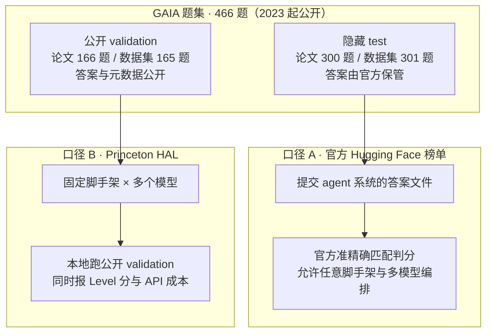

# GAIA（2023）：对人简单、对 AI 难的通用助手基准

---

## 1. 一句话定义

**GAIA**（General AI Assistants；Mialon 等，Meta FAIR / Hugging Face / AutoGPT，arXiv 2023-11-21，ICLR 2024）用 466 道「人类几分钟就能查到、AI 却要串起网页搜索、文件解析、计算与多步推理」的真实问题评测通用助手：每题只有一个无歧义短答案，用准精确匹配自动判分，其中约 300 题的答案不公开、由 Hugging Face 官方榜单保管。它的设计哲学刻意逆潮流——不追求「对人类越来越难」，而追求「对人简单、对 AI 难」；论文基线是人类 92%、带插件的 GPT-4 仅 15%。

本文只覆盖 2023 年这一版（文件名按 `AGENTS.md` §2.1 带 `-v1` 后缀）。2025-09 发布的后继 **Gaia2** 是读写型、异步环境的另一个评测构念，按 §2.1 判定应另立 `gaia-v2.md`，本次未建立，见第 7 节；**两版分数不可比**。

> **核验说明**：论文 HTML 全文、三个聚合平台条目、Princeton HAL 榜单与两篇后继论文均已按一手页面核验（2026-11-06）。**Hugging Face 官方榜单页、数据集卡片、机构页与 Meta AI 发布页本次直连全部失败**（页面抓取 `fetch failed`，本机 `curl` 返回 `CONNECT tunnel 502`），因此这些 URL 虽经论文与多处交叉确认存在，其页面内容与 2026 年官方榜单一手分数均**未取到**；第 4.2 节的官方榜数字一律标注为二手转述或厂商自报。未核验清单见附录。

---

## 2. 数据与任务构造

### 2.1 题集规模与难度分级

| 项 | 一手口径 | 依据 |
| --- | --- | --- |
| 总题数 | 466 道人工设计并标注的问题 | 论文 Abstract / §3.1 / §3.3 |
| 全量按 Level 分布 | Level 1 **146** / Level 2 **245** / Level 3 **75**（合计 466） | 论文 Appendix D.1 `Table 4: Score and average time to answer for various baselines on GAIA in %.` 的 `Number of questions` 行 |
| 答案形式 | 一个字符串（一两词）、一个数字，或逗号分隔的字符串 / 浮点列表；每题只有一个正确答案 | 论文 §3.2 Evaluation |
| 附件 | 题目以文本为主，部分附图片、电子表格等文件，需读取后才能作答 | 论文 §3.1 / Figure 1 |
| 提问方式 | 零样本提问 + 附证据文件；system / prefix prompt 指定输出格式 | 论文 §3.1 / §3.2 |

三级难度按「解题步数 + 用到几种工具」松散划分，论文明确说明这不是硬约束，并以标注者制题时的步数 / 工具数作为代理：

| Level | 论文 §3.3 原文定义 | 人类平均用时（Table 4） |
| --- | --- | ---: |
| 1 | 通常不需要工具，或最多 1 种工具且不超过 5 步 | 6.8 分钟 |
| 2 | 约 5–10 步，且需要组合不同工具 | 10.5 分钟 |
| 3 | 面向「近乎完美的通用助手」，任意长的动作序列、任意数量工具、可访问外部世界 | 17.7 分钟 |

### 2.2 公开 dev 与隐藏 test：两套并存的数字

同一件事在论文与上线后的数据集 / 榜单里出现了**两组不同的行数**，本仓库按 `AGENTS.md` §5 并列写出，不静默取其一：

| 口径来源 | 公开 split | 隐藏答案 split | 说明 |
| --- | --- | --- | --- |
| 原始论文（arXiv v1，一手） | developer set **166** 题，含答案与元数据 | **300** 题不发布答案，用于榜单 | Abstract：「retaining answers to 300 of them」；§1：「a developer set of 166 annotated questions」 |
| Hugging Face 数据集 / HAL / 聚合平台（页面或二手转述） | validation **165** 题 | test **301** 题 | HAL 榜写明「We evaluate on the public validation set of 165 questions」；厂商自报 93.36% 对应「281 / 301 tasks」；数据集卡片二手摘录为 165 / 301 |

HAL 可靠性页进一步给出 165 题 validation 的 Level 分布：**Level 1 53 / Level 2 86 / Level 3 26**（53 + 86 + 26 = 165），可用于判断分级别分数的统计功效。论文 Table 4 的 146 / 245 / 75 是**全量 466 题**的分布，不是任一 split 的分布，两者不可混用。

### 2.3 四条设计原则

论文 §1 与 §3.1 实际列出**四条**（不少二手文章只提前三条）：真实世界且对 AI 有挑战的问题、易解释性（少量精选题 + 可检查的推理轨迹 + 人类 92%）、抗刷榜 / 抗记忆（答案按设计不以纯文本形式存在于预训练数据，必须真的走完步骤）、易用性（简单 prompt、零样本、短答案、自动判分）。

代价写在 §3.4 与 §6：制题需设计者 + 两名补充标注者独立作答的两轮验证，单题约 **2 小时**标注工时，只有 **68%** 的题目一次通过、其余需修正或剔除，且作者承认「possible ambiguities remain」。

---

## 3. 评测方式

### 3.1 准精确匹配

论文 §3.2 原文：答案是「a string (one or a few words), a number, or a comma separated list of strings or floats」，「There is only one correct answer」，评测是模型答案与 ground truth 之间的 **quasi exact match**，「up to some normalization that is tied to the "type" of the ground truth」。判分是「automated, fast, and factual」——**没有 LLM 裁判、没有部分得分、不评估推理轨迹**。论文未列出归一化细则（大小写、单位、列表顺序、浮点容差等），只说评分函数随榜单一起提供（`https://huggingface.co/gaia-benchmark`）。§6 明确把「不评 trace」列为局限：不同路径可通向同一答案，无法简单给路径打分。

### 3.2 两套榜单的口径分叉

同一份题集在 2026 年演化为两条互不相干的报分链路，这是引用 GAIA 分数时最容易踩的坑：



- **口径 A（官方 test 榜）**：题目答案保密，提交的是整套 agent 系统的答案，评测方给分。前列几乎都是多模型编排系统，分数衡量的是「系统集成工程」，不是底层模型能力。
- **口径 B（HAL）**：Princeton 的第三方统一脚手架榜，在**公开的 165 题 validation** 上跑固定脚手架（HAL Generalist Agent / HF Open Deep Research），共 32 次评测（2 种脚手架 × 17 个模型），同时报准确率、Level 分与美元成本。优点是消融了脚手架差异，缺点是公开答案易被训练 / 调参污染。

---

## 4. 榜单结果与演进

> ⚠️ **不要跨口径比较**：本节三张表分别是**论文基线**（2023，全量 466 题按 Level 报分，非 dev/test split；GPT-4 + plugins 为人工选插件的 oracle）、**官方 test 榜**（隐藏答案 split，任意脚手架，系统提交，2026 年数字全部来自二手转述 / 厂商自报，本次未一手核验）与 **HAL validation 榜**（公开 165 题 split，2 种统一脚手架，Princeton 第三方复测）。三者题集、判分环境、是否自报都不同，跨表数字不可直接相减或排序；第 4.4 节 BenchLM 的 95.1% 是口径未披露的厂商自报，更不可与另两家并列比较。

### 4.1 论文基线（2023 年 11 月）

| 方法 | Level 1 | Level 2 | Level 3 | 备注 |
| --- | ---: | ---: | ---: | --- |
| 人类标注者 | 93.9 | 91.8 | 87.3 | 验证阶段在有效题目上的正确率 |
| GPT-4 + plugins（oracle） | 30.3 | 9.7 | 0 | 插件按题目人工挑选，论文自承「cannot be reproduced exactly」 |
| AutoGPT（GPT-4 后端） | 14.4 | 0.4 | 0 | 平均耗时 7.6 / 11.7 分钟 |
| GPT-4 Turbo | 13.0±2.1 | 5.5±1.4 | 0 | 直连 API 跑 3 次取平均 |
| GPT-4 | 9.1±2.5 | 2.6±0.6 | 0 | 直连 API 跑 3 次取平均 |
| 搜索引擎（人工基线） | 7.4 | 0 | 0 | 非模型基线 |

数值来自论文 Appendix D.1 `Table 4`，单位是 %。**摘要的「人类 92% vs GPT-4 + 插件 15%」是 overall 口径**，与上表按 Level 的 30.3 / 9.7 / 0 并不矛盾：前者聚合、后者分级；§1 另写「GPT-4 在最易任务上不超过 30%、最难任务 0%」。引用 15% 时必须带上「人工选插件的 oracle、不可精确复现」这层限定。

> ⚠️ **不要跨口径比较**：本表为论文自报的 2023 年基线，按全量 466 题的 Level 1/2/3 分别统计，**不是** 166 dev 或 300 test 的 split 分数；与 4.2、4.3 节的 2026 年榜单分数不可比。

### 4.2 官方 test 榜（2026 年，二手转述）

官方 Space 页面本次未取到，以下两个时间切片来自第三方对官方 `results_public` 数据的转述，**均非一手核验**：

**2026-07-15 快照**（Klu 转录，单位 %，Overall 为 test 集准精确匹配准确率）：

| Agent 系统 | 机构 | Overall | Level 1 | Level 2 | Level 3 | 提交日期 |
| --- | --- | ---: | ---: | ---: | ---: | --- |
| CustomGPT.ai Research Lab v44 | CustomGPT.ai | 93.3555 | 97.8495 | 91.8239 | 89.7959 | 2026-06-03 |
| Co-Sight Pro v1.0.1 | ZTE-AICloud | 93.0233 | 97.8495 | 91.8239 | 87.7551 | 2026-05-16 |
| DDDD1111 | 未披露 | 93.0233 | 96.7742 | 91.8239 | 89.7959 | 2026-07-08 |
| OPS-Agentic-Search | Alibaba Cloud | 92.3588 | 98.9247 | 90.5660 | 85.7143 | 2026-03-11 |
| CustomGPT.ai Research Lab V42 | CustomGPT.ai | 92.0266 | 96.7742 | 89.9371 | 89.7959 | 2026-05-22 |

**2026-10-13 复查**（DecodeTheFuture 转述）：榜首换成 **Shadow Harness V8.01 94.0%**（2026-10-12 提交），其后 Ops-Agentic-Search-2.0 93.7%（2026-09-22）、CustomGPT.ai v44 93.4%。该文同时指出明显的「爬榜」痕迹：同一团队在 2026-09-09 至 10-12 之间提交了 **29 个 Shadow 版本**，分数从 73.4% 抬到 94.0%，反复提交会抬高对隐藏 test 集过拟合的风险。Klu 另称官方结果数据集末次更新为 2026-10-07、Space 仍在运行，同样为二手描述。

厂商自报方面，CustomGPT.ai 官方博客（2026-06）自述 93.36%（281 / 301 题）、Level 3 89.80%，并声明未接触私有答案、由 GAIA 维护方评分；该数字属**厂商自报**，与第三方转录的 93.3555% 一致但口径表述不同。

> ⚠️ **不要跨口径比较**：本表全部为**二手转述或厂商自报**，来自官方隐藏 test 榜（301 题口径），评测方为 GAIA 维护者，脚手架不受限且多为多模型系统；本次**未从官方页面一手核验**，与 4.3 节 HAL 的 165 题公开 validation 分数不可比，也与 4.4 节 BenchLM 的厂商自报分数不可比。引用时须写明快照日期。

### 4.3 HAL validation 榜（第三方统一脚手架）

HAL 页面自述 GAIA 共 450 题（与论文 466 题口径不同，见附录）、「We evaluate on the public validation set of 165 questions」，共 32 次评测（2 种脚手架、17 个模型）。以下为页面读取的前列行：

| 脚手架 | 模型 | Overall | Level 1 | Level 2 | Level 3 | API 成本 | runs |
| --- | --- | ---: | ---: | ---: | ---: | ---: | ---: |
| HAL Generalist Agent | Claude Sonnet 4.5 | 74.55 | 82.07 | 72.68 | 65.39 | $178.20 | 2 |
| HAL Generalist Agent | Claude Sonnet 4.5 High | 70.91 | 77.36 | 74.42 | 46.15 | $179.86 | 1 |
| HAL Generalist Agent | Claude Opus 4.1 High | 68.48 | 71.70 | 70.93 | 53.85 | $562.24 | 1 |
| HF Open Deep Research | GPT-5 Medium | 62.80 | 73.58 | 62.79 | 38.46 | $359.83 | 1 |
| HAL Generalist Agent | o4-mini Low | 58.18 | 71.70 | 51.16 | 53.85 | $73.26 | 1 |

最有价值的不是名次，而是**同一模型换脚手架的落差**：Claude Sonnet 4.5 在 HAL Generalist 下 74.55%，换到 HF Open Deep Research 只有 30.91%；Claude Opus 4 则是 30.30% 对 57.58%。这直接说明 GAIA 分数里脚手架的贡献可与模型差异同量级。HAL 已暂停新增模型，其 harness 仓库 `princeton-pli/hal-harness` 的 README 明确写着不再通过该 harness 更新榜单、仓库归档供历史参考（可见最后提交 2026-07-01）。

> ⚠️ **不要跨口径比较**：本表为 Princeton HAL 以 **2 种标准脚手架**在**公开 165 题 validation** 上的第三方复测，**非厂商自报**；其中成本为 HAL 自报，HAL 于 2026-10-05 说明部分模型的成本数字高估最多 2×。与 4.2 节官方隐藏 test 榜（301 题、任意脚手架、系统提交）不可比；与 4.4 节 BenchLM 的两行厂商自报也不可比。

### 4.4 三个聚合平台条目（二手）

| 平台 | 条目 URL | 本次读到的内容 | 状态标注 |
| --- | --- | --- | --- |
| BenchLM | `https://benchlm.ai/benchmarks/gaia` | GAIA 2024、466 tasks、Version `GAIA 2024`；**2 行全是厂商自报**：Sage-A1.5 与 Agents-A1-4B（InternScience）均 95.1%；数据核验 2026-11-05 | `Refreshing` + `Display only`，不参与排名；自述「Too few rows to judge saturation」、未被标为 current |
| LLMLearner | `https://llmlearner.com/rankings/gaia` | 11 个模型、Accuracy、466 problems；榜首 Claude Sonnet 4.5 **74.5**；最后结果 2026-10-22 | `Thin field`；明确标注来源为 HAL GAIA validation 榜快照（含页面 sha256） |
| DataLearner | `https://www.datalearner.com/benchmarks/gaia` | 466 题、Meta AI / Hugging Face、Advanced、Accuracy；榜首 Claude Sonnet 4.5 **74.55**；更新 2026-10-22 | 中文条目，相关资源指向 HAL 榜与 Meta 官方发布页 |

三者分数不同不是「数据打架」：LLMLearner 与 DataLearner 复述的是 HAL validation 口径，BenchLM 收的是两家未披露评测细节的厂商自报。按 `AGENTS.md` §6.1，聚合平台只用于定位与交叉检查，**不作为分数口径的一手来源**。

### 4.5 饱和判断

二手分析（DecodeTheFuture，2026-10-13）判定：test 榜约 94% 已越过论文人类基线 92%，GAIA 作为前沿 agent 的排名工具已饱和，「Level-3 accuracy and cost per task are still worth comparing」；HAL 侧也已冻结。**本仓库判断**（非官方结论）：GAIA v1 目前更适合作为 agent 系统的最低能力门槛、脚手架消融与成本对照，不宜再作为 2026 年前沿模型的选型主指标。

---

## 5. 已知缺陷

| # | 问题 | 依据与口径 |
| --- | --- | --- |
| 1 | **分数测的是系统不是模型**：官方榜前列均为多模型编排；HAL 上同一模型换脚手架落差可达 20–44 分 | HAL GAIA 榜（一手读取）；官方榜结构为二手转述 |
| 2 | **公开 validation 已被污染**：题目自 2023 年公开且答案公开，HAL 用的正是这个 split，厂商也可针对性调参 | HAL 页面自述 165 题公开 validation；论文 §5 预警静态基准污染 |
| 3 | **隐藏 test 也挡不住反复提交**：29 次 Shadow 提交把分数从 73.4% 抬到 94.0%，存在对隐藏集过拟合 | DecodeTheFuture（二手，2026-10-13） |
| 4 | **准精确匹配脆**：只认短答案，等价写法、单位、列表顺序、浮点容差都可能误判；论文未公开归一化细则，评分函数随榜单提供 | 论文 §3.2、§6 |
| 5 | **静态网页与闭源 API 会漂移**：论文记录 GPT-4 官方搜索工具因可绕过付费墙被下架又恢复；作者自承「Static benchmarks are broken benchmarks in the making」，闭源 API 能力随时间变化使时点评测不可复现 | 论文 §5 Discussion（Reproducibility / Static versus dynamic） |
| 6 | **不评推理轨迹**：不同路径可通向同一答案，无法区分「做对了」与「蒙对了」 | 论文 §6 Missing evaluations |
| 7 | **题量小、Level 3 尤其小**：全量 L3 仅 75 题，HAL validation 的 L3 只有 26 题，分级别分数置信区间很宽 | 论文 Table 4；HAL 可靠性页（53 / 86 / 26） |
| 8 | **语言与文化单一**：全部为标准英语、标注者均在美国、大量依赖英文网页；论文明确说不能证明对非英语人群的通用性 | 论文 §6 / Appendix B Datacard |
| 9 | **制题成本高且仍有歧义**：约 2 小时 / 题，两轮标注，68% 一次通过 | 论文 §3.4、§6 |
| 10 | **捷径与环境隔离**：HAL 的日志分析发现 agent 会在评测中搜索基准本身而非解题；该结论来自 HAL 论文级工作的二手转述，未按一手深度核验 | 二手（HAL 相关研究报道） |

---

## 6. 复现 / 快速上手

**取数据**：官方数据集为 gated，需登录并接受条款；附件（图片、表格等）需单独获取。

```python
from datasets import load_dataset
# config 名 "2023_all" 取自社区教程，官方 dataset card 本次未取到，须按官方页面核对
ds = load_dataset("gaia-benchmark/GAIA", "2023_all")
```

**本地判分**：公开 validation 的答案随数据集发布，可按论文 §3.2 自己做准精确匹配；评分函数的官方实现随榜单提供（论文页首 `Code: https://huggingface.co/gaia-benchmark`），本次未取到。隐藏 test 的答案不公开，只能在官方 Space 提交答案文件由维护方给分——**这意味着官方 test 分数无法离线复算**。

**统一脚手架复现**：Princeton HAL 提供加密的完整 agent traces（`hal-decrypt`）与成本记录，可用于核对第 4.3 节的数字。注意 `princeton-pli/hal-harness` 已归档、README 声明不再接收新结果提交，且当前 README 的 `--benchmark` 正式列表不含 `gaia`（GAIA 只出现在 commit history 的可靠性评测配置里），因此**不建议照抄 `hal-eval --benchmark gaia`**，需自行核对历史版本。

| 快照文件 | 用途 |
| --- | --- |
| `sources/gaia-v1/arxiv-2311.12983v1-extract.md` | 论文原文逐段摘录：题量、split、Level 定义、Table 4 基线、设计原则、局限性，供离线复核第 2、4.1、5 节 |
| `sources/gaia-v1/hal-gaia-2026-11-06.md` | HAL GAIA 榜文本快照片段（统计数字、前列行、Level 分与成本），供复核第 4.3 节；相对 GAIA 官方属第三方口径 |

完整的来源版本、抓取日期与未入库边界见 `sources/gaia-v1/README.md`。

---

## 7. 与 Gaia2 的关系（拆分判定）

2025-09，Meta 与 Hugging Face 发布后继 **Gaia2**（ARE 平台 `arXiv:2509.17158` v1 2025-09-21 / v2 2025-12-10；Gaia2 论文 `arXiv:2602.11964` 2026-02-12，ICLR 2026 Oral）。按 `AGENTS.md` §2.1 的五条判据逐项对照：

| # | 判据 | 是否满足 | 证据 |
| --- | --- | --- | --- |
| 1 | 题集 / 任务形态重做 | ✓ | 静态单轮信息检索 → 模拟手机多 app 环境、异步事件、多轮交互 |
| 2 | 判定方式变化 | ✓ | 准精确匹配 → 每题配 **write-action verifier** 逐个核对状态变更动作，部分任务用 model-as-judge |
| 3 | 计分口径变化 | ✓ | accuracy → `pass@1` + 预算扩展曲线 + 成本维度 |
| 4 | 评测构念变化 | ✓ | 「只读检索出答案」→「读写、时间约束、歧义、噪声、agent 间协作」 |
| 5 | 证据链 / 更新节奏不同 | ✓ | 论文 + Hugging Face Space 榜 ↔ ARE 开源框架 + 官方博客 + 独立论文，且持续可扩展 |

五条全中，远超「满足任意 2 项」门槛。因此按 §2.1 **应拆为 `gaia-v1.md` 与 `gaia-v2.md` 两篇**、不保留无版本后缀的 `gaia.md`、各自单一口径 front matter、互相交叉引用，并在两篇的口径警示块写明分数不可比。

**本次调研输入仅为 GAIA（2023），故只落 `gaia-v1.md`；`gaia-v2.md` 未建立，README 索引亦未新增 v2 行**，属于按规范识别出的待补缺口（见附录）。在补齐前，本文不叙述 Gaia2 的榜单与成绩。

> ⚠️ **不要跨口径比较**：Gaia2 论文摘要报 GPT-5 (high) **42% pass@1**、Kimi-K2 **21% pass@1**（统一 ReAct 脚手架、模拟环境；场景数在不同来源间有 800 / 1,000 / 1,120 三种说法，超出本文范围未核验），与第 4.2 节官方 test 榜 93–94% 或第 4.3 节 HAL validation 榜 74.55% 分属不同基准、题集与判分方式，任何数字对比都无意义。

---

## 8. 结论

GAIA v1 的历史贡献是把「可验证短答案 + 必须真的调用工具链」带进 Agent 评测，并用隐藏答案榜单抑制刷分。但到 2026 年，它的分数已主要由脚手架工程决定：官方隐藏 test 榜 93–94%（二手）、统一脚手架的公开 validation 榜 74.55%、厂商自报 95.1% 三套口径并存，而题集自 2023 年公开。引用时**必须**写明 split、评测 harness 与是否自报；用它做选型时应看 Level 3 分与每题成本，或转向后继基准。基准本身的缺陷与后继版本拆分要求，见第 5 节与第 7 节。

---

## 附：口径差异与未核验项

| 项 | 口径 A | 口径 B | 本仓库处理 |
| --- | --- | --- | --- |
| 题量与 split | 论文 466 / 166 dev + 300 test | HAL 450 / 165 validation；数据集卡片二手 165 + 301 | 并列写出，见 2.2 节；不静默取一 |
| 论文日期 | arXiv submitted **2023-11-21** | PDF 内页 `Date: November 23, 2023`；arXiv HTML 页首 `date: August 24, 2026`（渲染时间，非发表日） | 索引「提出时间」取 arXiv 首发 2023-11-21 |
| 官方榜当前状态 | 二手：2026-10-13 榜首 94.0% | 二手：结果数据集 2026-10-07 仍更新、Space 运行 | 均未按一手核验 |
| 聚合平台头名 | BenchLM 95.1%（2 行厂商自报，口径未披露） | LLMLearner 74.5 / DataLearner 74.55（HAL validation） | 不同来源，不可比 |
| 官方 GitHub | 论文页首 `Code:` 指向 Hugging Face 组织 | `github.com/topics/gaia-benchmark` 下全为社区 / 个人复现 | 判定**未找到官方 GitHub 仓库**，社区仓库不认作官方 |

**未取到 / 未按同样深度核验**：

- Hugging Face 官方榜单 Space、数据集卡片、机构页，以及 Meta AI 官方发布页：本次直连全部失败（页面抓取 `fetch failed`，本机 `curl` 返回 `CONNECT tunnel 502`）。URL 由论文页首 Code 字段、三个聚合平台与多篇二手交叉确认存在，但**页面内容、dataset card 的 config / split / 行数 / 许可证、官方评分函数源码、2026 年官方榜单的一手分数均未核验**；第 4.2 节所有官方榜数字均为二手转述或厂商自报。
- 官方 GitHub 仓库：**未找到**（依据见上表）。
- ICLR 2024 的 OpenReview 正文页被浏览器验证页拦截；会议、年份与 forum id `fibxvahvs3` 由 dblp 与多篇文献引用交叉确认，正文未读取。
- 隐藏 test 的答案、题目附件全集：按设计不公开 / 未取到。
- Gaia2 的核验深度仅到两篇 arXiv abs 页与官方博客的搜索摘要；`gaia-v2.md` 未建立，故 §2.1 要求的「两篇互相交叉引用」尚未满足。
- 第 5 节第 3、10 项，第 4.5 节的饱和判断，均来自二手分析，未按一手深度核验。

---

## 9. 参考来源

1. **官方榜单**（Hugging Face Space；**页面本次未取到**，URL 经论文与多个二手来源交叉确认）：https://huggingface.co/spaces/gaia-benchmark/leaderboard
2. **官方代码 / 评分函数入口**（论文页首 `Code:` 字段，Hugging Face 组织页；**本次未取到**）：https://huggingface.co/gaia-benchmark
3. **官方数据集**（gated；**dataset card 本次未取到**）：https://huggingface.co/datasets/gaia-benchmark/GAIA
4. **原始论文**（arXiv:2311.12983v1，Submitted 2023-11-21；ICLR 2024）：https://arxiv.org/abs/2311.12983
5. **原始论文 HTML 全文**（本文第 2、3、4.1、5 节的一手依据，含 §3.2 / §3.3 / §5 / §6 / Appendix D.1 Table 4）：https://arxiv.org/html/2311.12983v1
6. **正式发表页**（OpenReview，ICLR 2024，forum `fibxvahvs3`；**正文被浏览器验证拦截**，出处由 dblp 交叉确认）：https://openreview.net/forum?id=fibxvahvs3
7. **官方机构发布页**（Meta AI research；**本次未取到**，由 DataLearner / LLMLearner 条目链出）：https://ai.meta.com/research/publications/gaia-a-benchmark-for-general-ai-assistants/
8. **第三方评测榜单 · 一手读取**（Princeton HAL，GAIA validation 榜，含 32 次评测、Level 分与成本，访问 2026-11-06）：https://hal.cs.princeton.edu/gaia
9. **第三方评测榜单 · 可靠性页**（165 题 validation 的 Level 分布 53 / 86 / 26）：https://hal.cs.princeton.edu/reliability/agent/gemini-2-5-flash/benchmark/gaia
10. **评测工具包 · 第三方 / 社区**（`princeton-pli/hal-harness`，已归档、不再接收新提交；GAIA 只出现在 commit history 的可靠性配置中）：https://github.com/princeton-pli/hal-harness
11. **二手聚合条目**（BenchLM，数据核验 2026-11-05）：https://benchlm.ai/benchmarks/gaia
12. **二手聚合条目**（LLMLearner，最后结果 2026-10-22）：https://llmlearner.com/rankings/gaia
13. **二手聚合条目**（DataLearner，更新 2026-10-22）：https://www.datalearner.com/benchmarks/gaia
14. **二手官方榜快照**（Klu，2026-07-15 转录 GAIA test 榜 `results_public`）：https://klu.ai/glossary/gaia-benchmark-eval
15. **二手榜单复查与饱和分析**（DecodeTheFuture，2026-10-13）：https://decodethefuture.org/en/ai-agent-benchmarks-2026/
16. **厂商自报**（CustomGPT.ai，2026-06，93.36% / 281 of 301）：https://customgpt.ai/gaia-state-of-the-art-agent-harness/
17. **后继版本论文**（ARE，arXiv:2509.17158，v1 2025-09-21 / v2 2025-12-10；页内给出 ARE GitHub 与 HF Space）：https://arxiv.org/abs/2509.17158
18. **后继版本论文**（Gaia2，arXiv:2602.11964，2026-02-12；ICLR 2026 Oral）：https://arxiv.org/abs/2602.11964
19. **后继版本官方博客**（Hugging Face；**页面本次未取到**，内容经搜索摘要确认）：https://huggingface.co/blog/gaia2
20. 一手数据快照与未入库边界：`sources/gaia-v1/README.md`
