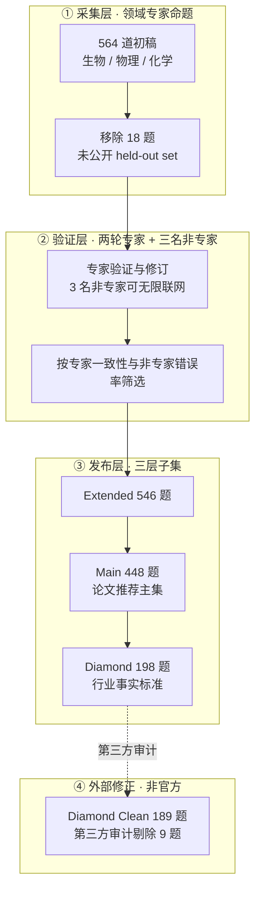

# GPQA：研究生级「抗搜索」科学多选题基准

---

## 1. 一句话定义

**GPQA**（Graduate-Level Google-Proof Q&A，2023-11-20 首发）是由 NYU、Cohere、Anthropic 等机构研究者发布的 **448 道四选一科学多选题**：题目由生物 / 物理 / 化学领域的博士或博士生撰写，经两轮专家验证与三名跨领域「非专家」在**无限制联网**条件下的试答后筛选，目标是让「会搜索但不懂专业」的人也答不出来（论文摘要的 34% 非专家准确率 vs 65% 专家准确率），从而为**可扩展监督**（scalable oversight）实验提供一道连专家监督者都难以独立核验的高难题集。它不维护官方榜单、题目自发布后未换题，今天主要作为前沿模型的科学推理回归检查，其中 198 题的 **Diamond** 子集是行业事实标准。

> **核验说明**：一手资料归档于 `sources/gpqa/`，抓取与核验日期 `2026-11-05`。官方仓库 README（`sources/gpqa/gpqa-repo-README.md`）、EleutherAI 评测任务 README（`sources/gpqa/lm-eval-gpqa-README.md`）与 Hugging Face 数据集 API 元信息（`sources/gpqa/hf-dataset-meta.json`）均为只读副本；`huggingface.co` 官方域名本次直连不通，元信息经 `hf-mirror.com` 同源代理取得，**数据集卡片正文**（gated，HTTP 401）未取到。题目文本按作者防污染要求不入库，边界见 `sources/gpqa/README.md`。

**为何不拆成多版本文档**：Extended / Main / Diamond 是同一份 2023 年题集按筛选强度切出的**三个子集**，题型、判定、计分完全一致，仅题量与筛选条件不同；按 `AGENTS.md` §2.1 属「仅题量增减」，未达拆分门槛。第三方的 Diamond Clean（189 题）是独立修正项目，SuperGPQA / HLE 是另外的基准，均不是 GPQA 的 v2。

---

## 2. 数据与任务构造

### 2.1 三层子集

论文 §2.3：共收集 **564** 题，移除 **18** 题作为未公开的 held-out set，发布 **546** 题；再按专家一致性逐层收紧。

| 子集 | 题量 | 筛选条件（论文 Table 2 口径） | 专家准确率 | 非专家准确率 |
| --- | ---: | --- | ---: | ---: |
| GPQA Extended | 546 | 全部已发布题目，不筛选 | 64.8% | 34.1% |
| GPQA（Main，论文推荐主集） | 448 | ≥1/2 专家认可 且 ≤2/3 非专家答对 | 71.9%\* | 30.4%\* |
| GPQA Diamond | 198 | 2/2 专家答对 且 ≤1/3 非专家答对 | 81.3%\* | 22.1%\* |

\* 论文明确标注 main / diamond 的人类准确率受**选择效应**影响（题正是按「专家对、非专家错」挑出来的），不能与 Extended 的 64.8% / 34.1% 当作同一实验测量比较。四选一随机基线为 **25%**。

> ⚠️ **不要跨口径比较**：本表是人类专家 / 非专家验证者在三种 split 上的**答题准确率**，来自论文 Table 2 的同一套验证流程但**不同题集**，不是模型分数；Main 与 Diamond 带选择效应星号，由论文作者自测并自报，未附重复运行。此后任何「专家 65% 对模型 96%」的对比都混用了 Extended 的人类数字与 Diamond 的模型数字，不成立。



### 2.2 出题与验证流程

- **专家命题**：由持有或正在攻读该领域博士学位者出题，附一个正确选项、三个干扰项与详细解释。
- **三步验证**（论文 §2.1、Figure 1）：第一位同领域专家试答并给修订意见 → 命题人修订 → 第二位同领域专家试答并反馈（此后不再修订）；同时由 **3 名其他领域的专家**担任「非专家」验证者，可用任意网络资源但**不得使用 LLM**，每题至少投入 15 分钟。
- **非专家投入**：平均 **37 分钟**、中位 **30 分钟**，90% 的验证超过 15 分钟、最慢的 20% ≥ 45 分钟，仍只有 34.1% 准确率（论文 §3.2）。这就是 "Google-proof" 的经验依据。
- **客观性估计**（论文 §3.1）：以专家准确率为下界，保守估计 Extended 中有 **74%** 的题目具备无可争议的正确答案；人工复核第二位专家答错的 **191** 例后，剔除明显专家失误得到 **73.6%**，再纳入「虽未明说失误但展示理解了命题人解释」的案例得 **76.4%**。Table 4 中「答案错误」23 例（12.0%）、「答案有争议」15 例（7.9%）、「题干缺前提」16 例（8.4%）。
- **勘误通道**：官方仓库提供题目更正表单（`sources/gpqa/gpqa-repo-README.md:54`）。

### 2.3 学科分布与防污染

三个领域覆盖不均：论文 §3.1 记录 Extended 上有机化学专家准确率 **81%**，而化学其余子领域平均仅 **55%**；有机化学在 Diamond 中占比约 **36%**（Epoch AI 2025 复核）。数据集附带 **canary string**（BIG-bench canary 的超集，`sources/gpqa/gpqa-repo-README.md:4`），作者请求不要以纯文本或图片形式在网上复现题目；官方仓库的 `dataset.zip` 用密码保护（密码见 `sources/gpqa/gpqa-repo-README.md:7`），Hugging Face 数据集为 **gated**（`sources/gpqa/lm-eval-gpqa-README.md:26`，需接受条款并 `huggingface-cli login`）。官方 API 元信息（`sources/gpqa/hf-dataset-meta.json`）记为 `gated: auto`、`license: cc-by-4.0`、4 个 config（`gpqa_extended` / `gpqa_main` / `gpqa_diamond` / `gpqa_experts`），上游末次修改 `2026-09-21`；额外 gated 条款要求不得公开题目。

---

## 3. 评测方式与计分

### 3.1 计分口径

每题四选一，指标为 **accuracy**（答对题数 / 题数），无部分分、无 LLM 裁判、无需工具。论文原始 baseline 用 4 组 prompt：`zero_shot`、`few_shot`、`zero_shot_chain_of_thought`、`chain_of_thought`，另有依赖 Bing Search API 的 `retrieval` / `retrieval_content` 开卷变体（参数见 `sources/gpqa/gpqa-repo-README.md:21-26`）；`seed` 用于打乱选项顺序、结果按 prompt + 模型组合缓存。官方仓库**只实现了** `gpt-3.5-turbo-16k-0613` 与 `gpt-4`（`sources/gpqa/gpqa-repo-README.md:17`）。

> ⚠️ **不要跨口径比较**：论文表格的分数绑定 `Extended 546 / Main 448 / Diamond 198` 三种 split、6 种 prompt 与作者自测的 GPT-4 / GPT-3.5 / Llama-2 harness；属**论文作者自报**，非第三方复测。开卷变体含高弃答率（`retrieval` 在 Main 上弃答 **37.2%**，Table 5 的 41.0% 是对弃答回退到 few-shot CoT 后的结果），与闭卷数字不可比。

### 3.2 论文基线（一手，2023-11）

论文 Table 6，单位 %：

| 协议 / 模型 | Extended 546 | Main 448 | Diamond 198 |
| --- | ---: | ---: | ---: |
| Zero-Shot GPT-4 | 31.3 | 32.1 | 34.2 |
| Few-Shot GPT-4 | 38.1 | 38.1 | 39.3 |
| Zero-Shot CoT GPT-4 | 38.1 | 39.5 | 35.7 |
| Few-Shot CoT GPT-4 | 38.7 | **39.7** | 38.8 |
| Few-Shot CoT GPT-3.5-turbo-16k | 28.2 | 28.0 | 29.6 |
| Few-Shot CoT Llama-2-70B-chat | 30.4 | 29.1 | 28.1 |
| GPT-4 with search（无回退） | 28.2 | 28.7 | 27.6 |

论文摘要的「GPT-4 基线 39%」对应 Main + few-shot CoT 的 **39.7%**；常见二手转述把它写成「Diamond 39%」，与 Table 6 的 Diamond 38.8% 不是同一格。

> ⚠️ **不要跨口径比较**：本表全部来自论文 Table 6（一手，2023-11-20 v1），三种 split 的题集**彼此嵌套但不等价**；模型、prompt、是否联网各不相同；数字为论文作者自测，未附重复运行的标准误。与第 4 节任何厂商自报或第三方榜单数字均不可直接相减。

### 3.3 第三方 harness 的口径分叉

同一份题集在不同 harness 下并非同一把尺子：

- **EleutherAI lm-evaluation-harness**：提供 3 子集 × 5 类共 **15** 个任务变体（`gpqa_{main,diamond,extended}_{zeroshot,n_shot,generative_n_shot,cot_zeroshot,cot_n_shot}`，`sources/gpqa/lm-eval-gpqa-README.md:40-44`）。其 changelog 记录过两处改动答案文本的 bug：v2.1（PR #3735）把 `\[.*?\]` 收窄为 `\[\w+\]`，v2.2（PR #3691）彻底移除该括号正则，因为它会破坏 IUPAC 稠环命名、`[NeV]` 天体物理记号与 Diamond Q171 的数学表达式（`sources/gpqa/lm-eval-gpqa-README.md:48-49`）——**旧版本 harness 的分数可能建立在被损坏的选项文本上**。
- **OpenAI simple-evals**：`gpqa_eval.py` 用「Think step by step / 末行 `ANSWER: LETTER`」模板；仓库脚注自述对 GPQA 做了答案正则调整。**Epoch AI** 沿用该模板并严格判分：输出不符合 `ANSWER: LETTER` 一律记 0 分，因而部分模型分数会**低于 25% 随机基线**；Epoch 在 2026-02-20 把答案格式从 `ANSWER: $LETTER` 统一为 `ANSWER: LETTER`，benchmark 版本升至 1.0.6。
- **重复次数与 effort**：Epoch AI 对多数模型每题重复 **16** 次并报告 ±1 标准误；厂商发布页常用 `pass@1` 或 64 样本 `cons@64`；聚合平台的 `mean@1 / mean@8 / xhigh / max` 又各不相同。

---

## 4. 榜单结果与演进

### 4.1 无官方榜单

GPQA 作者**未维护官方 leaderboard**：官方发布物只有论文、GitHub 仓库与 gated 数据集。网上以 `gpqa.ai` 为域名的 [GPQA Diamond Clean leaderboard](https://gpqa.ai/) 是 **Allcock 2026 的第三方独立修正项目**（198 → 189 题），其页面自己声明 "not an official update from the GPQA authors"。因此下文所有分数均为**厂商自报、第三方独立复测或二手聚合**，不存在「官方榜首」。

### 4.2 分数演进（不同口径，仅作时间线）

| 时间 | 来源 / 性质 | 子集与协议 | 分数 |
| --- | --- | --- | ---: |
| 2023-11 | 论文 Table 6（作者自测，一手） | Main 448 · GPT-4 few-shot CoT | 39.7 |
| 2023-11 | 论文 Table 6（作者自测，一手） | Diamond 198 · GPT-4 few-shot CoT | 38.8 |
| 2024-09 | [OpenAI o1 发布页](https://openai.com/index/learning-to-reason-with-llms)（厂商自报） | Diamond 198 · o1 `pass@1` | 77.3 |
| 2024-09 | 同上（厂商自报） | Diamond 198 · o1 `cons@64` | 78.0 |
| 2025 | [Epoch AI 独立复测](https://epoch.ai/data-insights/self-reported-gpqa)（第三方） | Diamond 198 · GPT-5 high · 多次重复 | 84.5（自报 85.7） |
| 2025 | Epoch AI 独立复测（第三方） | Diamond 198 · Grok 4 · 多次重复 | 87.0（自报 87.5） |
| 2026-09 | LLMLearner / DataLearner（二手聚合） | Main 448 · 无工具 · 厂商自报 | 87.0 |
| 2026-11-04 | [BenchLM](https://benchlm.ai/benchmarks/gpqa)（二手聚合） | 混合（多数 Diamond）· 146 行中 128 行自报 | 96.0 |
| 2026-11 | [gpqa.ai Clean](https://gpqa.ai/)（第三方修正集） | Diamond Clean 189 · `mean@1` | 98.9 |

> ⚠️ **不要跨口径比较**：本表九行分属 **Main 448 / Diamond 198 / Diamond Clean 189** 三种题集与至少六种评测 harness（论文脚本、OpenAI 内部评测、Epoch inspect_ai、厂商自报、聚合平台账本、Clean 重跑）；2024 与 2025 行是厂商自报或第三方独立复测，2026 行是二手聚合账本（BenchLM 明示 **0/146** 行来自 benchmark owner 或独立运行）。BenchLM 自己也承认底层报告「多数标 Diamond、部分只写 GPQA」，整表排序只具方向性。任何两行相减都无意义。

### 4.3 三个聚合平台的口径分裂

调研先查的三个平台（`AGENTS.md` §6.1）在同一「GPQA」名下给出**相差 9 个百分点**的榜首，原因是子集与来源不同：

| 平台 | 条目 | 口径 | 榜首 | 规模 / 更新 |
| --- | --- | --- | ---: | --- |
| BenchLM | [benchlm.ai/benchmarks/gpqa](https://benchlm.ai/benchmarks/gpqa) | 混合（多数 Diamond），448 题为元数据 | GPT-6 Astra 96% | 146 行，数据核验 2026-11-04；标注 Saturation Crowded |
| LLMLearner | [llmlearner.com/rankings/gpqa](https://llmlearner.com/rankings/gpqa) | Main 448，全部无工具，逐行标 setting / 是否自报 | Nemotron 3 Ultra 87.0 | 14 个模型，末次结果 2026-09-02；另设独立 `gpqa-diamond` 榜 |
| DataLearner | [datalearner.com/benchmarks/gpqa](https://www.datalearner.com/benchmarks/gpqa) | Main 448，中文条目「科学知识与推理」 | Nemotron 3 Ultra 87.00 | 14 个模型，页面更新 2026-10-11、解析截至 2026-10-25 |

> ⚠️ **不要跨口径比较**：三家均为**二手整理**，LLMLearner / DataLearner 的 87.0 是 Main 448 上的厂商自报成绩，BenchLM 的 96% 是混合 Diamond 口径的供应商自报账本；平台分数不作为一手事实引用，本文已回论文、官方仓库与 Epoch AI 核验。DataLearner 与 LLMLearner 的榜单构成高度重合，本文按各自页面口径并列写出，不静默合并。

### 4.4 独立复测的价值

Epoch AI 2025 年的自报核验是少有的带误差棒的第三方工作：对 GPT-5、Opus 4.1、DeepSeek R1、Llama 4 Maverick、Grok 4、Gemini 2.5 Pro、Qwen 3、Mistral Large 2407 八组自报值逐一复测，**所有 p 值均 > 0.05**，未发现系统性高报；但 198 题的样本量使 90% 置信区间宽达 **4–6 个百分点**。换言之，「厂商自报大体诚实」与「榜单前两名 0.5 分之差无统计意义」是同时成立的两件事。Epoch 对 Grok 4 的评测另注明 7/1584 次 API 错误按错误计入，并披露 xAI 提供了算力补偿与编辑独立声明。

> ⚠️ **不要跨口径比较**：本节的 84.5 / 87.0 / 85.7 / 87.5 均为 **Diamond 198** 上「Epoch inspect_ai 多次重复」与「厂商单次自报」两种 harness 的成对结果，只可成对看差值；p 值 > 0.05 表示**未发现**系统性偏差，不等于两者相等。「4–6 个百分点」是 90% 置信区间宽度，不是标准差。

---

## 5. 已知缺陷

> ⚠️ **不要跨口径比较**：下表引用的 39.7%、38.8%、77.3%、65%、94–96% 分别来自 Main 448、Diamond 198、Extended 546 与不同年份的厂商自报 / 独立复测 / 聚合账本，仅作为各自论据出现，**不构成可相减的分数序列**；逐条口径见第 3、4 节对应表格。

| # | 问题 | 依据 |
| --- | --- | --- |
| 1 | **统计功效低、已饱和**：论文自述 448 题「requires large effect sizes」（50%→60% 才有 >80% power）；Diamond 198 题每题约 0.505 个百分点；Epoch AI 给出 90% 置信 4–6 个百分点的估计宽度 | 论文 Limitations；[Epoch AI 自报核验](https://epoch.ai/data-insights/self-reported-gpqa)（一手）；`0.505` 为 1/198 的算术换算 |
| 2 | **子集口径混用**：常见的「专家 65% / 非专家 34%」是 Extended 546 的数字，Main 是 71.9% / 30.4%，Diamond 是 81.3% / 22.1%（且带选择效应）；OpenAI 另行招募的 PhD 专家在 Diamond 上是 69.7%。四个数字常被互换成「GPQA 人类基线」 | 论文 Table 2（一手）；Epoch AI benchmark 页转述 OpenAI 专家实验；附加载体混用现象见二手条目 |
| 3 | **答案键与题目质量**：论文保守估计 Extended 仅 74%（复核后 73.6–76.4%）具备无争议答案；Table 4 中 191 个专家错例里 12.0% 判为答案错误、7.9% 答案有争议 | 论文 §3.1 / Table 4（一手） |
| 4 | **后续审计结论不一**：Epoch AI（2025-05-30）审查 6 道最难、估 2.25 道无效，外推 15/198 ≈ 8%，结论是「至少 90% 有效」；Allcock 2026 的独立审计判 9/198（4.5%）有问题（1 错键、1 结构损坏、7 多解），剔除后成 189 题 Clean 集，并声明「198 题仍不足以区分今天的前沿模型」 | [Epoch AI What's left?](https://epoch.ai/gradient-updates/gpqa-diamond-whats-left)（一手）；[gpqa-diamond-clean](https://github.com/adamallcock/gpqa-diamond-clean)（一手，审计论文 arXiv forthcoming）。两份结论口径不同，并列保留 |
| 5 | **四选一格式捷径**：Chandak et al.（2025）证明部分多选题不看题干也能作答，并提出 free-form + answer matching；改用自由作答后多个模型排名显著变化 | [arXiv:2507.02856](https://arxiv.org/abs/2507.02856)（一手论文）；「准确率下降 20+ 个百分点、126/198 题可自由作答」等细节来自二手转述，**未逐项核验** |
| 6 | **污染防护可被绕过**：canary string 与 `dataset.zip` 密码随官方 README 一起公开，Hugging Face 为 gated 而非保密；题目在博客、论文、论坛被广泛转述 | 官方仓库 README（一手，`sources/gpqa/gpqa-repo-README.md:4`、`:7`）；search-time contamination 与「答案被检索到」的量化结论属二手研究，本次未核验 |
| 7 | **harness 差异改变分数**：lm-evaluation-harness 的括号正则曾损坏选项文本（v2.1 / v2.2 修复）；Epoch 严格格式判分使格式不佳的模型可低于 25% 随机基线；重复次数、reasoning effort、工具、`mean@N` 各异 | `sources/gpqa/lm-eval-gpqa-README.md:48-49`（一手）；[Epoch AI methodology](https://epoch.ai/benchmarks/gpqa-diamond)（一手） |
| 8 | **构念窄**：仅 3 个学科、四选一、闭卷、无实验设计 / 开放式研究；超过专家基线不等于具备科研能力 | 论文定位（scalable oversight 实验材料，非通用智能测量） |
| 9 | **已被综合指数淘汰**：Artificial Analysis Intelligence Index 在 v4.2（2026-09）移除 GPQA Diamond，v5.0 改用 HLE-Diamond 等 | 本仓库 [aa-intelligence-index-v5.md](aa-intelligence-index-v5.md) 表 1（该文档第 41 行 v4.2 记录） |

---

## 6. 复现 / 快速上手

本地快照只含两份上游 README，可直接离线核对命令与变更：

```bash
cd /path/to/llm-benchmarks
sed -n '17,26p' sources/gpqa/gpqa-repo-README.md      # 官方 baseline 参数
sed -n '40,49p' sources/gpqa/lm-eval-gpqa-README.md   # harness 变体与 changelog
python3 -c "import json;d=json.load(open('sources/gpqa/hf-dataset-meta.json'));print(d['gated'], d['cardData']['license'], [c['config_name'] for c in d['cardData']['configs']])"
```

论文原始 baseline（需 OpenAI key；开卷变体另需 `BING_SEARCH_V7_SUBSCRIPTION_KEY`）：

```bash
git clone https://github.com/idavidrein/gpqa && cd gpqa
conda create -n gpqa python=3.9 && pip install -r requirements.txt
for e in zero_shot 5_shot zero_shot_chain_of_thought chain_of_thought; do \
  python baselines/run_baseline.py main --model_name gpt-4 \
    --data_filename dataset/gpqa_main.csv --prompt_type $e --verbose; done
```

现代 harness（数据集 gated，必须先接受条款并登录，见 `sources/gpqa/lm-eval-gpqa-README.md:26`）：

```bash
huggingface-cli login
pip install lm_eval
lm_eval --model hf --model_args pretrained=<model> \
  --tasks gpqa_diamond_cot_zeroshot --batch_size auto --output_path ./gpqa_out
```

另有 [OpenAI simple-evals](https://github.com/openai/simple-evals/blob/main/gpqa_eval.py) 的 `gpqa_eval.py`（`ANSWER: LETTER` 模板）与 [Epoch AI](https://epoch.ai/benchmarks/gpqa-diamond) 公开每题日志的 inspect 实现。报告结果时请同时记录：子集、模型版本、prompt、工具、重复次数、评分规则、harness 版本与日期。

| 快照文件 | 用途 |
| --- | --- |
| `sources/gpqa/gpqa-repo-README.md` | 官方发布物清单：canary string、数据下载方式、baseline 命令、勘误表单、COLM 2024 bibtex |
| `sources/gpqa/lm-eval-gpqa-README.md` | 15 个评测变体、gated 访问要求、v2.1 / v2.2 答案预处理 bug 的一手记录 |
| `sources/gpqa/hf-dataset-meta.json` | 官方 API 元信息：gated 方式、CC BY 4.0 许可、4 个 config 与上游末次修改日期 |

---

## 7. 结论

GPQA 的真正贡献不是「一份更难的考卷」，而是把**客观性、难度、可扩展监督**三件事同时写进了构造流程：两轮同领域专家验证、三名跨领域专家在无限联网下试答、按专家一致性分层切出 Main / Diamond，并主动附上 canary string 与勘误通道。它让 2023 年的 GPT-4 只有 39.7%，并在 2024-09 成为 o1 首次超过受招募 PhD 专家的公开标尺。

代价是固定小样本：448 题（业界常用的 Diamond 仅 198 题）在三年内从 39.7% 被推到 94–96%，头部差距落在噪声内；同时「GPQA」被同时用来指 Main、Diamond、第三方 Clean 189，厂商自报、独立复测与聚合账本混在同一张表里。今天引用 GPQA，必须把 **子集 + prompt + 工具 + 重复次数 + harness 版本 + 评测日期 + 是否自报** 七项一起写清；低于约 3 个百分点的头部差距应视为并列。若目的是区分前沿模型，请看本仓库 [aa-intelligence-index-v5.md](aa-intelligence-index-v5.md) 记录的 v4.2 移除 GPQA Diamond、v5.0 换用 HLE-Diamond 等更难评测的沿革。

---

## 附：口径差异与未核验项

| 项 | 一手口径 | 其他口径 | 处理 |
| --- | --- | --- | --- |
| 题集 | 论文 §2.3：564 采集 / 18 未公开 / 546 Extended / 448 Main / 198 Diamond | gpqa.ai Clean：189 题 | Clean 为第三方修正集，非官方版本，单列于 2.1 图与 4.2 表 |
| 专家基线 | Extended 65%（摘要）/ 64.8%（Table 2）；Main 71.9%；Diamond 81.3% | OpenAI 招募专家 69.7%（Epoch AI 转述）；二手平台常把 65% 挂到 Diamond | 四个数字并列保留，不静默取其一；65% 与 74% 分别为「原始」与「剔除专家事后确认的明显失误」口径 |
| 官方榜单 | 论文 + 官方仓库 + gated 数据集，无 leaderboard | `gpqa.ai` 的 Clean 榜、各聚合平台榜 | 明确「官方榜单未找到」；gpqa.ai 标注为第三方 |
| 发表版本 | arXiv:2311.12022 v1（2023-11-20）；官方仓库 bibtex 为 COLM 2024（First Conference on Language Modeling） | 部分二手条目误写 ICLR 2024 | 以官方仓库 `sources/gpqa/gpqa-repo-README.md:60-66` 的 bibtex 为准 |
| 数据集状态 | 官方 API 元信息：`gated: auto`、`license: cc-by-4.0`、4 个 config（`gpqa_extended` / `gpqa_main` / `gpqa_diamond` / `gpqa_experts`）、末次修改 `2026-09-21`；harness README 亦明确 gated | LLMLearner / DataLearner 写「CohereAI 发布 / MIT」；AI Wiki（2026-07-31 更新）转述仓库代码 MIT、数据集 CC BY 4.0 | **并列保留**：MIT 与 CC BY 4.0 可能分别指仓库代码与数据集两个对象，本次未逐项核验；卡片正文 401 未取到，正文以官方 API 元信息的 `cc-by-4.0` 为准 |

**未取到 / 未按同样深度核验**：Hugging Face 数据集**卡片正文**（官方域名直连不通，镜像代理返回 HTTP 401，字段结构与各 config 行数未核对；许可与 config 名称取自官方 API 元信息）；OpenReview 正式页 `https://openreview.net/forum?id=Ti67584b98`（访问受浏览器校验，URL 据官方仓库 bibtex）；LLMLearner 的独立 `gpqa-diamond` 榜逐行数据；Chandak 2025 论文正文中的 126/198 与「下降 20+ 个百分点」；Allcock 2026 审计论文（arXiv forthcoming，本次只有仓库 README）；2026 年答案键独立审计的 95% Wilson 区间；各家 2026 榜单的模型逐行评测配置；三个聚合平台的分数是否经一手报告逐条复核。

---

## 8. 参考来源

1. **一手 · 原始论文**：Rein et al., *GPQA: A Graduate-Level Google-Proof Q&A Benchmark*（arXiv:2311.12022，v1 提交 2023-11-20；COLM 2024）：https://arxiv.org/abs/2311.12022
2. **一手 · 论文全文表格**（§2.1–3.2、Table 2 / 4 / 5 / 6、Limitations）：https://arxiv.org/html/2311.12022v1
3. **一手 · 正式发表出处**（COLM 2024 OpenReview，URL 取自官方仓库 bibtex；页面访问受浏览器校验，内容未直接取到）：https://openreview.net/forum?id=Ti67584b98
4. **一手 · 官方仓库**（数据集下载、canary string、baseline 命令、勘误表单、COLM bibtex；本地快照 `sources/gpqa/gpqa-repo-README.md`）：https://github.com/idavidrein/gpqa
5. **一手 · 数据集**（Hugging Face；官方域名本次不可达，经 `hf-mirror.com` 同源代理读取官方 API 元信息，本地快照 `sources/gpqa/hf-dataset-meta.json`；卡片正文 gated 返回 401，**未取到**）：https://huggingface.co/datasets/Idavidrein/gpqa
6. **一手 · 评测工具包**（EleutherAI lm-evaluation-harness 的 gpqa 任务，15 个变体与 v2.1/v2.2 changelog；本地快照 `sources/gpqa/lm-eval-gpqa-README.md`）：https://github.com/EleutherAI/lm-evaluation-harness/tree/main/lm_eval/tasks/gpqa
7. **一手 · 评测工具包**（OpenAI simple-evals，`gpqa_eval.py`）：https://github.com/openai/simple-evals
8. **一手 · 厂商发布页**（2024-09-12，o1 在 GPQA Diamond 的 `pass@1` / `cons@64` 与专家对比表述）：https://openai.com/index/learning-to-reason-with-llms
9. **一手 · 第三方独立复测**（Epoch AI GPQA Diamond benchmark 页：198 题、25% 随机基线、simple-evals 模板、严格判分、2026-02-20 版本 1.0.6、Grok 4 的 API 错误与算力补偿披露）：https://epoch.ai/benchmarks/gpqa-diamond
10. **一手 · 第三方分析**（Jaeho Lee & Yafah Edelman, 2025，厂商自报 vs 独立复测，4–6 个百分点置信宽度，数据更新 2025-11-17）：https://epoch.ai/data-insights/self-reported-gpqa
11. **一手 · 第三方分析**（Greg Burnham, 2025-05-30，*GPQA Diamond: What's left?*，40 道难题审计与「至少 90% 有效」）：https://epoch.ai/gradient-updates/gpqa-diamond-whats-left
12. **一手 · 第三方修正项目**（Allcock 2026，GPQA-Diamond-Clean v1.2.2，198 → 189、9 题剔除分类、非官方声明）：https://github.com/adamallcock/gpqa-diamond-clean ；其榜单：https://gpqa.ai/
13. **一手 · 后续研究论文**（Chandak et al., 2025-07-03，*Answer Matching Outperforms Multiple Choice for Language Model Evaluation*, arXiv:2507.02856）：https://arxiv.org/abs/2507.02856
14. **二手聚合 · BenchLM**（GPQA 条目，146 行 / 0 行独立复测 / 数据核验 2026-11-04）：https://benchlm.ai/benchmarks/gpqa
15. **二手聚合 · LLMLearner**（GPQA Main 榜与独立 Diamond 榜；访问 2026-11-05）：https://llmlearner.com/rankings/gpqa
16. **二手聚合 · DataLearner**（中文条目，页面更新 2026-10-11）：https://www.datalearner.com/benchmarks/gpqa
17. **二手 · 缺陷与口径归纳**（用于交叉检查，不作为一手分数来源）：https://aiwiki.ai/wiki/gpqa 、https://iqmetrics.org/news/gpqa-diamond-score-what-it-measures-and-how-far-ai-has-come/
18. 同仓库交叉引用：[aa-intelligence-index-v5.md](aa-intelligence-index-v5.md)（v4.2 移除 GPQA Diamond）、`AGENTS.md`（§2.1 版本拆分规则、§6 调研流程）
