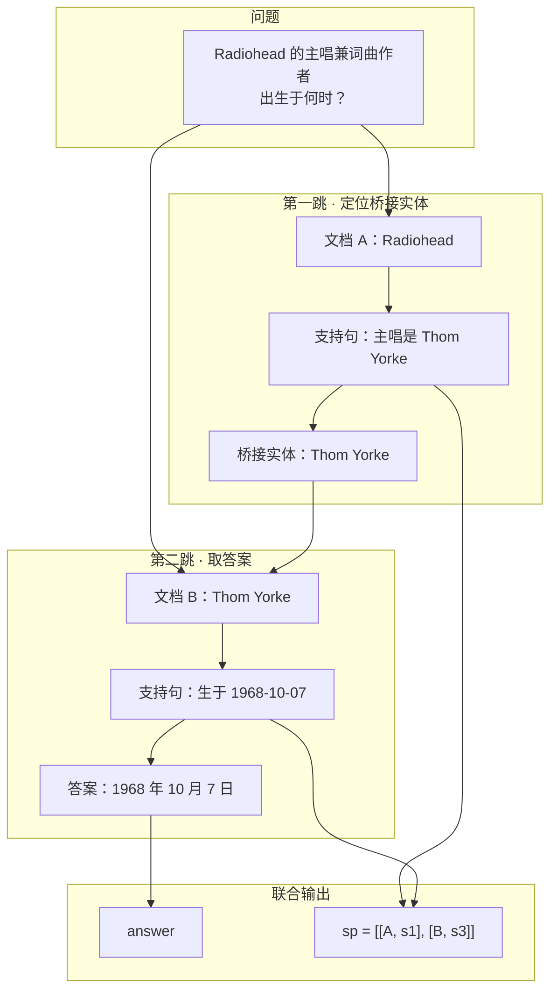
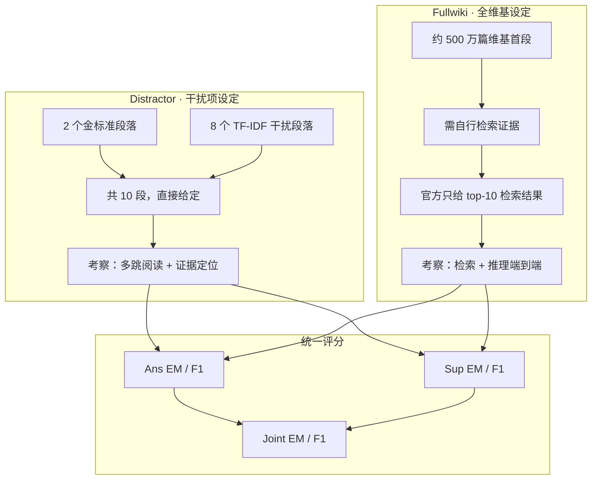
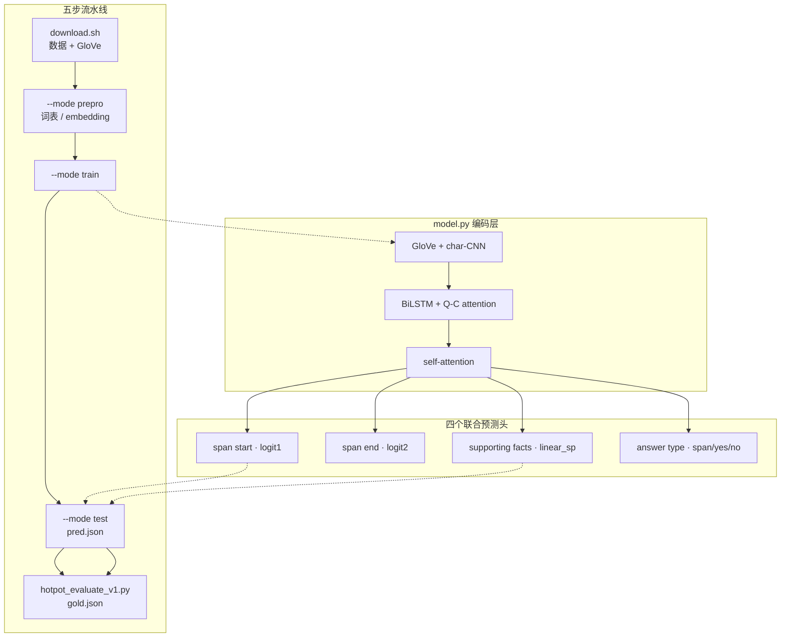

# HotpotQA：多跳问答与证据链归因

---

## 1. 一句话定义

**HotpotQA** 是 CMU、Stanford、Université de Montréal 联合发布的**多跳问答（multi-hop QA）**基准，含 112,779 个基于英文维基百科的问答对，EMNLP 2018 发布，CC BY-SA 4.0 许可。

它与 SQuAD 的根本差别有两点：

1. **必须跨文档**：一个问题无法由任意单篇文档回答，需要先定位中间实体或同时比对两篇文档的信息。
2. **证据链可评分**：每条数据标注了**句子级支持事实（supporting facts）**，模型不光要答对，还得指出哪些句子支撑了答案。

第二点是它标题里 "explainable" 的由来，也是它在方法论上最重要的贡献——**把「答案正确」和「推理依据正确」绑成一次联合评分**，堵住了纯靠词汇匹配猜答案的路。作为对照，仓库内 [SQuAD 1.1 文档](squad-v1-1.md) 第 5 节把「每题只对应单个段落」列为 SQuAD 的局限之一，HotpotQA 正是为补上这一环而设计的。

---

## 2. 数据是怎么造出来的

1. **建超链接图**：抽取维基百科文章**首段**中的超链接，构成有向图。首段信息密度最高，且超链接天然指向已消歧的实体关系。
2. **桥接题（bridge，约 75% 采样）**：对边 `A → B`，把 B 当作「桥接实体」，让众包者写出必须先找到 B、才能回答的问题。例如「Radiohead 的主唱兼词曲作者出生于何时？」——第一跳找出 Thom Yorke，第二跳查他的生日。桥接实体限定在人工筛选的页面集合内，排除国家、技术术语等被过度链接、难以提问的实体。
3. **比较题（comparison，约 25% 采样）**：从 42 个人工整理的「同类实体列表」（最高山峰、NBA 球员等）中抽两个实体，让众包者写比较性问题，如「Michael Jordan 和 Kobe Bryant 谁效力过更多 NBA 球队？」。其中约一半是 yes/no 题，天然无法由单篇文档回答。
4. **标注支持事实**：众包者逐题圈出得出答案所必需的句子，形成 `supporting_facts`，平均每题 2–3 句。
5. **难度划分**：先用 baseline 模型做三折交叉验证，把当时模型能轻松答对的 56,814 题划入 `train-medium`；把高贡献者写的大量单跳题 18,089 条划入 `train-easy`；剩下**模型答不出的硬题**才切成 `train-hard` / dev / test。因此 dev 与 test 是刻意筛选过的对抗集。



### 数据规模

| split | 题数 | 说明 |
|---|---:|---|
| train-easy | 18,089 | 多为单跳题 |
| train-medium | 56,814 | baseline 可解的多跳题 |
| train-hard | 15,661 | baseline 无法解的多跳题 |
| **训练集合计** | **90,564** | 与 HuggingFace `distractor` config 的 90,447 略有出入 |
| dev（distractor） | 7,405 | 全为 hard 题 |
| test-distractor | 7,405 | 隐藏答案，需提交代码 + Docker |
| test-fullwiki | 7,405 | 隐藏答案，只需提交预测文件 |
| **总计** | **112,779** | 论文口径 |

> **口径说明**：官网首页只列出四个下载文件体积（train 535 MB、dev-distractor 44 MB、dev-fullwiki 45 MB、test-fullwiki 46 MB），不写题数；112,779 与各 split 数字来自论文。HuggingFace 的 `distractor` config 标为 train 90.4k / validation 7.41k / test 7.41k，与论文划分存在小差，跨来源引用时须注明。

### 单条 JSON 结构

```json
{
  "_id": "5a8b57f25542995896e6f56c",
  "question": "When was the singer and songwriter of Radiohead born?",
  "answer": "7 October 1968",
  "supporting_facts": [["Radiohead", 1], ["Thom Yorke", 0]],
  "context": [
    ["Radiohead", ["Radiohead are an English rock band ...", "The band's singer and songwriter is Thom Yorke ..."]],
    ["Thom Yorke", ["Thomas Edward Yorke was born on 7 October 1968 ..."]],
    ["Some Distractor Title", ["...", "..."]]
  ],
  "type": "bridge",
  "level": "hard"
}
```

- `supporting_facts` 是 `[title, sent_id]` 二元组列表，`sent_id` 为段内 0-based 句序号。
- `context` 是 `[title, sentences]` 列表，distractor 设定下共 10 段。
- `type`（bridge / comparison）与 `level`（easy / medium / hard）**仅存在于训练集与 dev**，测试集不含，模型不得依赖。
- 答案为原文 span 或 `yes` / `no`；test 集不含 `answer` 与 `supporting_facts`。

预测文件格式同样简洁：`{"answer": {id: str}, "sp": {id: [[title, sent_id]]}}`。

---

## 3. 两种评测设定



- **Distractor**：2 个金标准段落 + 8 个以问题为 query、用 bigram TF-IDF 检索出的干扰段落，混洗后共 10 段。上下文直接给定，模型专注推理。
- **Fullwiki**：上下文是整部维基百科的首段。官方提供的 dev/test 文件里放的是其基础检索系统的 top-10 结果，**金标准段落可能在也可能不在其中**；官方明确鼓励替换为自己的 IR 结果。
- 两种设定使用**不同的测试集**，避免金标准段落从一个设定的文件泄漏到另一个。distractor 需在 Codalab 提交代码和 Docker 环境由官方运行；fullwiki 只交预测文件。

---

## 4. 评测方式

官方 `hotpot_evaluate_v1.py`（改自 SQuAD 评测脚本）先做归一化：

```
normalize(s) = white_space_fix(remove_punc(remove_articles(lower(s))))
```

| 指标组 | 定义 |
|---|---|
| **Ans** | 答案的 EM 与 token 袋 F1。特别地，若预测或标答属于 `yes` / `no` / `noanswer` 且两者不等，直接记 (EM, P, R) = (0, 0, 0)，不给部分分 |
| **Sup** | 把 `[title, sent_id]` 当作集合，算集合级 P / R / F1；`sp_em` 要求预测集合与标答集合完全一致（fp + fn = 0） |
| **Joint** | `P_joint = P_ans × P_sp`，`R_joint = R_ans × R_sp`，再按 `2·P·R/(P+R)` 合成 F1；`Joint EM = EM_ans × EM_sp` |

脚本共输出 12 个字段：`em / f1 / prec / recall`、`sp_*` 四项、`joint_*` 四项，均为全 dev 集上的均值。

**Joint 是核心设计**：答案蒙对但证据链找错，Joint 会明显掉分。这也是为什么 HotpotQA 的成绩必须成对看——单报 Ans F1 会高估模型的真实推理能力。

```bash
python hotpot_evaluate_v1.py dev_distractor_pred.json hotpot_dev_distractor_v1.json
```

---

## 5. 榜单结果与成绩演进

| 时间 | 系统 | 设定 / split | Ans EM | Ans F1 | Sup F1 | Joint F1 | 来源口径 |
|---|---|---|---:|---:|---:|---:|---|
| 2018 | BiDAF++ baseline | distractor **test** | 45.46 | 58.99 | 66.62 | 41.37 | 论文，官方 Codalab 隐藏集 |
| 2018 | 同上 | fullwiki **test** | — | ≈34 | — | 17.85 | 论文，官方隐藏集 |
| 2018 | 官方 baseline 仓库实现 | distractor **dev** | — | >58 | — | — | 本地 `README.md` 自述，非榜单 |
| 2021-05 | AISO (single model) | fullwiki **test** | 67.46 | 80.52 | 86.02 | 72.00 | 官网 leaderboard 第 1 名（截至 2026-11） |
| 2023-01 | Chain-of-Skills (single) | fullwiki **test** | 67.38 | 80.14 | 85.31 | 71.65 | 官网榜单第 2 名，Joint EM 45.65 为该设定最优 |
| 2023-08 | Beam Retrieval (single) | distractor **test** | 72.69 | 85.04 | 90.09 | 77.54 | 官网榜单第 1 名，六项指标均为该设定最优 |
| 2018 | 人类 | dev（论文标注） | — | ≈91.4 | ≈90 | — | **论文 / 二手汇总，官网榜单未列人类基线** |
| 2025–2026 | RAG / LLM 分解式方案 | 第三方论文自报 | 66–70 | 79–81 | — | — | 非官方榜单，协议各异 |

> ⚠️ **不要跨口径比较**：distractor 与 fullwiki 是不同测试集，彼此不可比；官网数字来自隐藏测试集 + Codalab 提交，而 2025 年后流传的 LLM 分数多来自 dev 集零样本/少样本测试、第三方 harness 或厂商自报，不进官方榜，不能直接与榜单排序。

方法演进大致三条线：**实体图推理**（DFGN、HGN 等构建跨文档实体图并做多跳 GAT）、**多跳检索**（MDR 迭代式稠密检索、Beam Retrieval 束搜索）、**端到端 / LLM 时代**（联合排序句子与段落、问题分解 + CoT 证据链、RAG 动态检索）。值得注意的是，官方 distractor 榜首仍停留在 2023-08，fullwiki 榜首停留在 2021-05——榜单已不再是前沿难度的主要战场。

---

## 6. 已知缺陷

| 局限 | 后果 |
|---|---|
| **推理捷径** | 部分题目靠单句词匹配或实体共现即可答对，并未真正多跳；对抗式评测下强模型分数显著下滑 |
| **只用维基首段** | 领域与文体单一，且维基持续更新，静态语料与当下事实脱节 |
| **二跳为主** | 绝大多数题目恰好 2 跳，难以检验更长链的组合推理 → 2WikiMultihopQA、MuSiQue 等后续基准 |
| **污染与饱和** | 2018 年发布、dev 公开且被广泛用作训练/调参数据，LLM 预训练极可能见过；distractor 榜首 Ans F1 85.04 / Sup F1 90.09，区分度大幅下降 |
| **Joint 仍非万能** | 联合指标只校验证据句子集合，不校验推理链的顺序与因果有效性 |
| **答案形式受限** | 仍是 span / yes-no，不覆盖生成式、数值计算型答案 → DROP 等 |

**今天的定位**：HotpotQA 不再是前沿难度的标尺，但依然是检验「检索 + 多 hop 证据归因」的最小完整闭环，适合做 RAG 系统的可解释性 sanity check；严谨评估应搭配 2WikiMultihopQA、MuSiQue 等抗捷径基准，并明确标注评测协议。

---

## 7. 官方 baseline 仓库实操

本地 `/Users/admin/work/hotpot` 即论文配套的 baseline 代码仓库（Apache 2.0），流程是固定的五步：

```bash
./download.sh                                              # 数据 + GloVe + spaCy 模型
python main.py --mode prepro --data_file hotpot_train_v1.1.json --para_limit 2250 --data_split train
python main.py --mode prepro --data_file hotpot_dev_distractor_v1.json --para_limit 2250 --data_split dev
CUDA_VISIBLE_DEVICES=0 python main.py --mode train --para_limit 2250 --batch_size 24 \
  --init_lr 0.1 --keep_prob 1.0 --sp_lambda 1.0
CUDA_VISIBLE_DEVICES=0 python main.py --mode test --data_split dev --para_limit 2250 \
  --batch_size 24 --init_lr 0.1 --keep_prob 1.0 --sp_lambda 1.0 \
  --save HOTPOT-20180924-160521 --prediction_file dev_distractor_pred.json
python hotpot_evaluate_v1.py dev_distractor_pred.json hotpot_dev_distractor_v1.json
```

**训练集必须先预处理**，词表与 embedding 文件由这一步生成。fullwiki dev 需额外加 `--fullwiki`。`sp_lambda` 控制支持事实损失的权重，是「答案」与「证据」两个目标的平衡点。



⚠️ **环境提示**：该仓库依赖 Python 3 / **PyTorch 0.3.0** / spaCy，代码中仍是 `Variable`、手写 `cache_mask` 等旧式写法，现代 PyTorch 直接运行会报错，需迁移后使用。想快速取数可走 HuggingFace：

```python
from datasets import load_dataset
ds = load_dataset("hotpotqa/hotpot_qa", "distractor")   # 或 "fullwiki"
print(ds["validation"][0]["question"])
```

---

## 8. 参考来源

1. 官网、数据下载、两个 leaderboard（本文榜单数字的一手来源，核对于 2026-11-05）：https://hotpotqa.github.io/
2. Yang, Qi, Zhang, Bengio, Cohen, Salakhutdinov, Manning, *HotpotQA: A Dataset for Diverse, Explainable Multi-hop Question Answering*, EMNLP 2018：https://arxiv.org/abs/1809.09600
3. 官方 baseline 仓库本地一手代码：`README.md`（数据格式、流程、提交方式）、`hotpot_evaluate_v1.py`（评测逻辑）、`model.py`（模型结构）
4. 官方测试集提交指南（Codalab）：https://worksheets.codalab.org/worksheets/0xa8718c1a5e9e470e84a7d5fb3ab1dde2/
5. Hugging Face 数据集卡：`hotpotqa/hotpot_qa`（`distractor` / `fullwiki` 两个 configuration）
6. 相关后续基准：2WikiMultihopQA、MuSiQue、BeerQA（将 HotpotQA 纳入的变跳数开放域多跳数据集）
