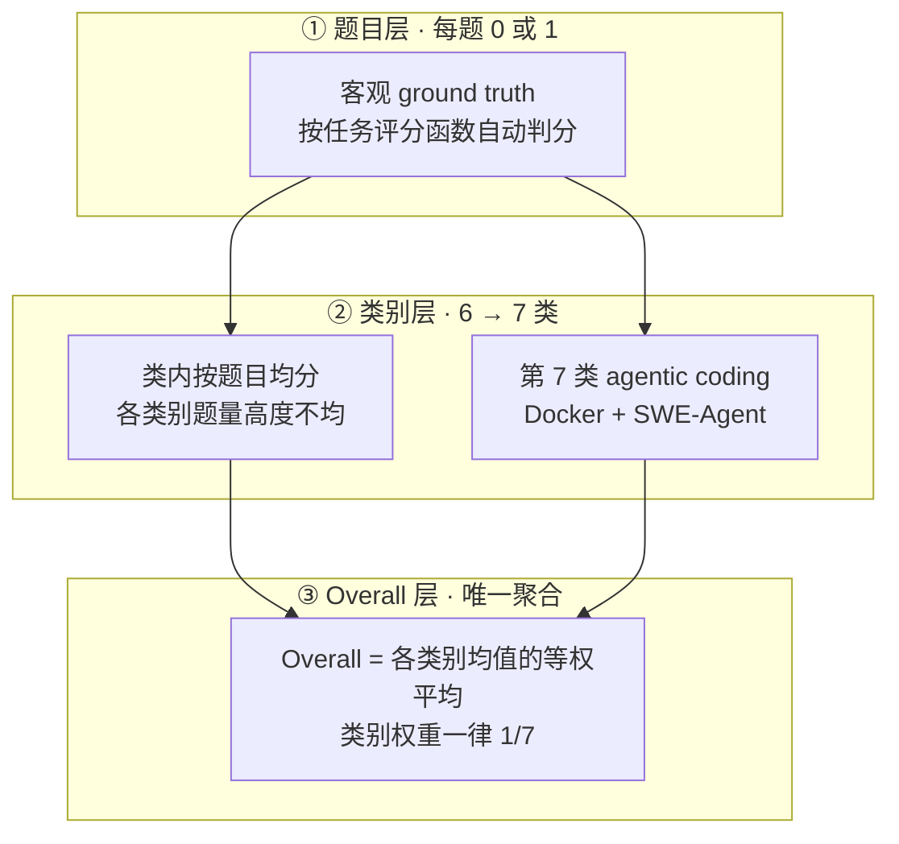

# LiveBench v1：持续换题的抗污染客观题基准

---

## 1. 一句话定义

**LiveBench v1** 是 2024-06-12 由 Abacus.AI、NYU 等机构发布的抗污染评测榜：题目取自训练截止后发布的新材料并定期换新，每题有**可验证的唯一 ground truth**、自动评分、**不使用 LLM 裁判**。论文版为 18 任务 / 6 类的短问答，2025-05-30 加入第 7 类 agentic coding 后变为 23 任务 / 7 类；Overall 取**各类别均值的等权平均**。2026-06-25 末次 release 后冻结，官网已改版为 [LiveBench 2.0](livebench-v2.md)——两者共用品牌但题集、判定与计分全部重做，分数不可跨版本比较。

> **核验说明**：一手 release 记录归档于 `sources/livebench-v1/changelog.md`，抓取与核验日期 `2026-11-05`。官网 v1 时代的 `table_<release>.csv` / `categories_<release>.json` 端点在本次核验中均返回 HTTP 404，故**未取到**官网榜单原始表；下文榜单数字来自二手来源，已逐条标注。入库边界见 `sources/livebench-v1/README.md`。

---

## 2. 数据与任务构造

论文与仓库 README 记为 **18 diverse tasks across 6 categories**；官网 v1 末期快照记为 **23 任务 / 7 类**。两者是不同时间点的口径，并列保留，见附录。

### 2.1 六类短问答与题源

| 类别 | 典型任务 | 题目来源 |
| --- | --- | --- |
| Mathematics | AMC / IMO / USAMO 竞赛题、AMPS_Hard、olympiad、integrals with game | 当年新发布的数学竞赛题（如 2024 AMC 替换 2023 AMC） |
| Coding | code_completion、code_generation（LCB generation） | 早期取自 LiveCodeBench，2025-04-25 起改为真实库使用场景、不再取自 LiveCodeBench |
| Reasoning | web_of_lies_v2 / v3、zebra_puzzle、spatial、theory_of_mind、logic with navigation | Big-Bench Hard / BIG-Bench Extra Hard 的加难变体 |
| Language | connections、typos、plot_unscrambling | NYT Connections 谜题、arXiv 新论文、Wikipedia 电影梗概 |
| Data Analysis | tablejoin、tablereformat、cta（已退役）、consecutive events | 新发布的表格与数据集 |
| Instruction Following | 带可验证约束的指令题 | Guardian 新文章、IFEval 加难版 |

题源设计要点是**全部晚于模型训练截止**：近期数学竞赛、arXiv 论文、新闻文章、电影梗概与新发布数据集；并复用 BBH、AMPS、IFEval 的**更难版本**。首发 changelog 记为 17 任务 / 960 题（2024-06-12），2024-07-26 新增 spatial 后记为「总量 1,000，此后增一减一保持不变」。

### 2.2 第七类：agentic coding

一手 changelog `### 2025-05-30` 条目：新增 agentic coding 类别，在真实 GitHub 仓库里多轮解决 issue，覆盖 Python / JavaScript / TypeScript；推理用 SWE-Agent（**50 步上限**），评测用 Multi-SWE-Bench harness。`### 2025-10-03` 条目：改用 Mini-SWE-Agent、步数上限提到 **250**，并**用新 harness 对所有模型重跑**、回填 2025-05-30 榜单。仓库 README 说明此类任务需按任务构建 Docker 镜像，全部镜像可达 **150 GB**。

这一类是 v1 里唯一的工具型任务，却被折进与其余六类相同的等权平均，是第 4 节权重失衡与第 6 节构造效度问题的根源。

---

## 3. 抗污染机制与版本沿革

### 3.1 三条设计原则

- **持续换题**：changelog 首发条目承诺「releasing new questions monthly」，题目基于 recently-released datasets / arXiv papers / news articles / IMDb synopses；饱和或被污染的任务直接退役或加难（如 2024-06-24 移除 house traversal，因修正解析歧义后有模型拿到 100%）。
- **客观判定**：每题有可验证的客观 ground truth，自动评分、无 LLM judge。论文给出的对照是：对高难度推理与数学题，GPT-4-Turbo 的 pass/fail 判定错误率最高达 **46%**。
- **防刷分**：随模型能力提升持续发布更难任务与更难题（如 2024-11-25 针对 o1 刷新 Connections 与 Zebra Puzzles），目标是始终让最好的模型也拿不到接近满分。论文发表时最好的模型 Overall **低于 70%**。

### 3.2 11 个 release 的一手沿革

官网 v1 release 下拉列出 11 个日期，起于 `2024-06-24 · v1`、止于 `2026-06-25 · latest`；下表变更内容取自一手 changelog 对应条目。

| release | 一手 changelog 记录的变更 |
| --- | --- |
| 2024-06-24 | 移除 house traversal（答案解析歧义，修正后有模型达 100%，不再具备区分度） |
| 2024-07-26 | 新增 coding completion / LCB generation 题；新增 spatial reasoning；题量达 1,000 并承诺此后保持不变 |
| 2024-08-31 | 刷新三个数学任务：AMPS_Hard 部分换题、olympiad 全量换为 IMO/USAMO 2024、50 道 AMC 2023 重排选项与改写 |
| 2024-11-25 | Guardian 新文章刷新 IF（每任务平均 3 条约束）、NYT Connections 换新、Zebra Puzzles 加难、答案统一改为 `<solution></solution>` 标签 |
| 2025-04-02 | LiveCodeBench 更新更难的 coding 题；typos / plot_unscrambling 换新；AMC 换 2024；web_of_lies 混入 BIG-Bench Extra Hard；全部题要求 `<solution></solution>` |
| 2025-04-25 | coding 全量换新、聚焦真实库使用且脱离 LiveCodeBench；tablejoin / tablereformat 刷新；`cta` 退役 |
| 2025-05-30 | **新增第 7 类 agentic coding**（SWE-Agent 50 步 + Multi-SWE-Bench） |
| 2025-11-25 | 刷新 connections / math_comp / olympiad / IF / zebra_puzzle；`web_of_lies_v3` 被 `theory_of_mind` 替换 |
| 2025-12-23 | 新增 reasoning 任务 `logic with navigation` |
| 2026-01-08 | 新增 `integrals with game` 与 `consecutive events` |
| 2026-06-25 | **changelog 无对应条目**（末次 release 日期仅见于官网下拉与二手记录） |

changelog 另有两条**不计入 release** 的记录：`2024-06-12` 是首发公告（17 任务 / 960 题），`2025-10-03` 是 harness 变更补丁（Mini-SWE-Agent、250 步、全量重跑）。GitHub `livebench/common.py` 的 `LIVE_BENCH_RELEASES` 列表（二手记录，第 79 行）与上表 11 个日期一致。

---

## 4. 评测方式与计分

### 4.1 客观 ground truth 判分

每题有唯一可验证答案，由 `process_results/` 下**按任务编写的评分函数**自动判分，不使用 LLM 裁判；新增任务需自行补评分函数并注册到 `gen_ground_truth_judgment.py`。答案格式在 2025-04-02 后统一为 `<solution></solution>`。API 调用默认重试 **3 次**，多次重试后仍为 `$ERROR$`（常见于 Gemini 的 `RECITATION` 内容过滤）**按错误计入**，不剔除。结果在终端展示，并可按类别 / 任务导出 `all_groups.csv` / `all_tasks.csv`。

### 4.2 类别等权 Overall 与单题权重失衡

v1 的 Overall 是**七个类别均值的等权平均**（mean of the seven category averages），类别内再按任务 / 题目均分。只要各类别题量不等，单道题对 Overall 的边际贡献就不等。



按二手来源给出的 2026-06-25 题量分布（Mathematics 379、Reasoning 202、Instruction Following 200、Data Analysis 150、Language 150、Coding 117、Agentic Coding 72，合计 1,270），一道 agentic coding 题的边际权重约为一道 mathematics 题的 **5.3 倍**——尽管两者在 Overall 里被当作「同一类的一票」。

> ⚠️ **不要跨口径比较**：本节的类别等权规则来自官网 v1 旧文案与二手转述，**题量分布与 5.3 倍为二手推算、未按一手数据核验**（官网 v1 端点已 404）；v1 官方 harness 按 release 固定题目集，不同 release 题目不同、分数不可比较，2025-10-03 harness 变更后又对全量模型重跑。属评测方自报整理，非第三方复测。与 [LiveBench 2.0](livebench-v2.md) 的 suite 加权 Overall（Σw = 9）**完全不可比**。

---

## 5. 榜单结果与演进

二手来源整理的「各 question set 上的历史最好成绩」。注意 v1 会把**旧题目集持续拿给新模型重跑**，所以表中数字是「该题目集截至当时的最好成绩」，不是发布当月的能力快照。

| 时间 | question set | 当时最好模型 | Overall |
| --- | --- | --- | ---: |
| 2024-06 | 2024-06-24（首发） | Claude 3.5 Sonnet | 61.2 |
| 2025-03 | 2024-11-25 | Gemini 2.5 Pro | 82.4 |
| 2025-04 | 2025-04-25 | o3 (high) | 80.7 |
| 2025-11 | 2025-05-30 | Claude Opus 4.5 | 80.1 |
| 2026-04 | 2026-01-08 | GPT-5.5 (xhigh) | 80.7 |
| 2026-06 | 2026-06-25 | Claude Fable 5 (Max Effort) | 83.0 |

> ⚠️ **不要跨口径比较**：本表全部为**二手来源**整理（第 9 节标注），未取到官网一手榜单 CSV 佐证；每一行是不同 question set、不同时间点的最好成绩，非同一 harness 下的同期横评；模型均以各自最高 effort 档产生，无标准差、无误差棒。由评测方 Abacus.AI 发布、属自报结果。与 [LiveBench 2.0](livebench-v2.md) 的 85.7 等数字**不可比较**。

---

## 6. 已知缺陷

| # | 问题 | 一手依据 |
| --- | --- | --- |
| 1 | **抗污染无法外部验证**：题库公开性中断。README 自述最新**全部公开**的题目只到 release `2024-11-25`，评测所有类别须显式传 `--livebench-release-option 2024-11-25`；2025 年后 release 的题目未完整公开，第三方称 2026-06-25 榜单基于外界看不到的题目 | GitHub README 的 release 注释；该说法为二手，**未取到一手佐证** |
| 2 | **换题节奏与承诺不符**：论文 / README 写「monthly」，官网首页写「每 6 个月刷新」，实际 26 个月仅 11 个 release、最长间隔约 6 个月 | changelog 日期序列与论文 / README 表述对照 |
| 3 | **类别等权掩盖单题权重失衡**：题量最多的类与最少的类相差约 5 倍，却各占 Overall 的 1/7 | 4.2 节推算（二手题量） |
| 4 | **harness 变更导致历史分数断裂**：2025-10-03 换 agent、步数 50→250、全量模型重跑并回填旧榜单 | changelog `### 2025-10-03` |
| 5 | **构造效度混合**：6 类是无工具单轮 API 调用，第 7 类是多轮 agent + Docker，两种测量被折进同一个平均分 | changelog `### 2025-05-30`；仓库 README |
| 6 | **release 与 changelog 不同步**：末次 release `2026-06-25` 在 changelog 中无条目；另有非 release 的 harness 补丁 | 官网 release 下拉与 `sources/livebench-v1/changelog.md` 对照 |
| 7 | **无误差棒、单次运行、部分分不透明**：每个模型一个数字，部分评分函数按公式给部分分，引用者通常未读公式 | 二手条目归纳；仓库 README 的 failures 处理段 |

---

## 7. 复现与快速上手

本地已有 changelog 快照，逐次 release 的变更可离线核对：

```bash
cd /path/to/llm-benchmarks
grep -n '^### ' sources/livebench-v1/changelog.md
```

从上游复现评测（注意公开题目只到 `2024-11-25`）：

```bash
git clone https://github.com/LiveBench/LiveBench && cd LiveBench
pip install -r requirements.txt
python run_livebench.py --model gpt-4o --bench-name live_bench/coding \
  --livebench-release-option 2024-11-25
python download_questions.py       # 题目落到 livebench/data/<category>/question.jsonl
python download_leaderboard.py    # 模型答案与判定文件
```

`agentic coding` 需 Docker 且镜像合计可达 150 GB；`--question-source` 默认 `huggingface`，须与评测时一致。官网 v1 时代的 `table_<release>.csv` / `categories_<release>.json` 端点本次核验均 404，**无法复现榜单原始宽表**；完整边界见 `sources/livebench-v1/README.md`。

| 快照文件 | 用途 |
| --- | --- |
| `sources/livebench-v1/changelog.md` | 12 条日期记录（含首发公告与 harness 补丁），是 3.2 节与 4.2 节的直接依据 |

---

## 8. 结论

v1 的历史价值在于把**持续换题 + 客观 ground truth + 无 LLM 裁判**三条同时落地，并给出了可操作的抗污染工程范式（按日期发题、退役饱和任务、加难变体）。但它的软肋也正落在「持续」二字上：题库公开性在 2025 年后中断，换题节奏从月度漂移为半年，末次 release 连 changelog 都没留条目——**抗污染承诺本身变得不可外部审计**。加上类别等权把题量差 5 倍的类别等权平均、agent harness 变更全量重跑，任何 v1 分数都必须绑定 `release + question set + harness` 三重口径才有意义。

需要长程 Agent 交付能力或成本口径的选型，请直接看 [LiveBench 2.0](livebench-v2.md)；两者只是同名，不是同一把尺子。

---

## 附：口径差异与未核验项

| 项 | 一手 / 官网口径 | 其他来源口径 | 处理 |
| --- | --- | --- | --- |
| 首发任务数 | changelog `2024-06-12`：17 任务 / 960 题 | 仓库 README / 论文：18 任务 / 6 类 | 不同时间点（首发公告 vs 论文版），并列写出 |
| 末期规模 | 官网 v1 release 下拉止于 `2026-06-25` | 二手：23 任务 / 7 类 / 1,270 题 | 并列写出；题量分布属二手推算 |
| 题目总量 | changelog `2024-07-26`：「总量 1,000，此后增一减一保持不变」 | 二手：2026-06-25 为 1,270 题 | **相互矛盾**，并列保留，不静默取其一 |
| release 数 | 官网下拉 11 个日期 | changelog 12 条日期记录 | `2024-06-12` 为首发公告、`2025-10-03` 为 harness 补丁，均非 release；`2026-06-25` changelog 无条目 |
| 换题节奏 | 论文 / README：monthly | 官网首页：每 6 个月；实际 11 次 / 26 个月 | 三口径并列，见 6 节第 2 条 |

**未取到 / 未按同样深度核验**：官网 v1 榜单 CSV 与 `categories_*.json`（多种命名均 404）；2025 年后各 release 的完整题库；论文补充材料中的污染实验细节；二手榜单数字与 1,270 题量分布的一手佐证；`livebench/common.py:79` 的 release 列表未直接读取源码，仅据二手记录。

---

## 9. 参考来源

1. **一手**：v1 release 变更记录 `changelog.md`（本地快照 `sources/livebench-v1/changelog.md`）：https://github.com/LiveBench/LiveBench/blob/main/changelog.md
2. **一手**：原始论文 *LiveBench: A Challenging, Contamination-Limited LLM Benchmark*（arXiv:2406.19314，v1 2024-06-27 提交 / v2 2025-04-18 修订，ICLR 2025 Spotlight）：https://arxiv.org/abs/2406.19314
3. **一手**：评测框架仓库 README（6 类、18 任务、公开题目 release、Docker 体积、运行参数）：https://github.com/LiveBench/LiveBench
4. **一手**：题目与模型答案数据集：https://huggingface.co/datasets/livebench
5. **一手**：官网 v1 release 下拉（`2024-06-24 · v1` 至 `2026-06-25 · latest`）：https://livebench.ai/
6. **二手**：itdoeswhatnow「The LiveBench AI benchmark, explained」（各 question set 历史最好成绩、类别等权口径）：http://itdoeswhatnow.com/benchmarks/livebench
7. **二手**：codepress「LiveBench」（1,270 题分布、5.3 倍单题权重、缺陷归纳）：https://codepress.dev/benchmarks/livebench
8. **二手**：bit-cook/ai-model-world《AI 编程能力数据源调研》（11 个 release 列表、`common.py:79` 端点记录、Apache-2.0）：https://github.com/bit-cook/ai-model-world/blob/main/docs/research/coding-benchmarks-2026.md
9. **二手**：Belgavi.AI Lab「LiveBench, in depth」（changelog 摘要与本地复现配置）：http://aicassindra.com/blogs/gpu/gpu_benchmark_livebench.html
10. 同基准另一版本文档：[livebench-v2.md](livebench-v2.md)
