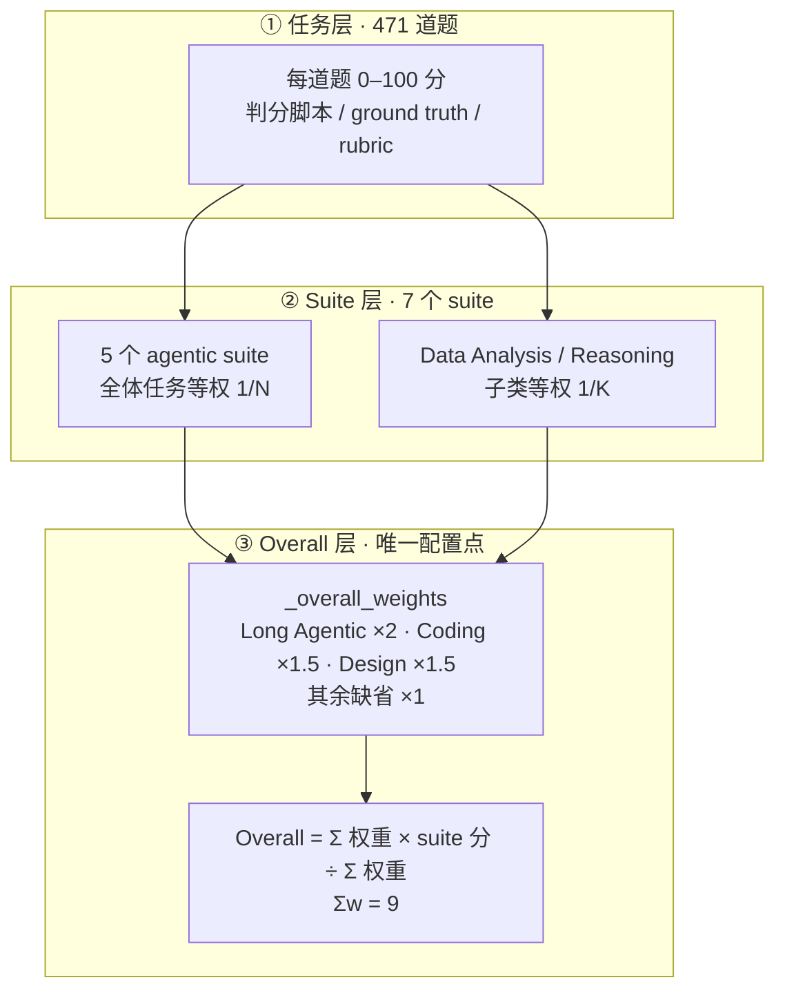

# LiveBench 2.0：长程 Agent 评测与计分权重核验

---

## 1. 一句话定义

**LiveBench 2.0** 是 Abacus.AI 赞助的评测榜，2026-10 从 v1 的短问答客观题彻底改版为长程 Agent 端到端完成真实工作（演示文稿、研究报告、bug 修复、可运行数小时的应用）并自动判分，同时把**每成功任务成本**摆上榜单。本文重点不在榜单名次，而在**计分权重定在哪一层、由谁设定、每道题实际值多少分**——这一层官网只给了规则，没给依据。前代 v1（2024-06 至 2026-06，持续换题的客观题榜）见 [livebench-v1.md](livebench-v1.md)，两者共用品牌但构念、题集与计分全部重做，**分数不可跨版本比较**。

> **核验说明**：release `20261025`（官网标注最后更新 2026-10-25），抓取与核验日期 2026-11-05。权重配置、原始分数表与子类明细已归档至 `sources/livebench-v2/`，可离线复算；入库边界见 `sources/livebench-v2/README.md`。官网前端为 hash 路由 SPA，方法页文字所述 `public/table_<date>.csv` 并非实际 URL，真实路径由其 bundle 的 `./data/${release}/` 取文件逻辑确认。

---

## 2. 版本定位与发布沿革

2.0 目前只有两个 release，`20261025` 是当前版；两版计分口径不同，**同一榜名下的分数须绑定 release**。

| release | 日期 | Overall 口径 | 说明 |
| --- | --- | --- | --- |
| `20261014` | 2026-10-14 | 7 个 suite 等权（Σw = 7） | 2.0 首发版，55 个模型 7 列全有分 |
| `20261025` | 2026-10-25 | 加权（Σw = 9） | 本文核验对象；`categories.json` 新增 `_overall_weights` |

### 2.1 从「答题」到「交活」

官网自述「给模型真实工作——演示文稿、研究报告、bug 修复、能跑几小时的应用——然后给它交回来的东西打分」。7 个 suite 中 5 个是 agentic（模型用工具规划、改文件、驱动应用、跑代码），另 2 个仍是单选短答题。抗污染手段从 v1 的「换新题」换成隐藏参考数据、隐藏测试程序、冻结的生产代码快照与延迟公开的 rubric。



### 2.2 与前代 v1 的关系

共用品牌、发布方与「抗污染」主张，但**方法论上是两个不同评测**：v1 测抗污染静态客观题、类别等权、无 LLM 裁判、按日期换题；2.0 测长程交付物、suite 加权、Research / Design 已引入 rubric 与视觉检查，并新增成本维度。官网明示**两代分数不可跨版本比较**。v1 的完整构成与 11 个 release 沿革见 [livebench-v1.md](livebench-v1.md)，本文以下各节只描述 2.0。

---

## 3. 数据与任务构造

`sources/livebench-v2/20261025/cost.csv` 的 `nq_*` 列与 `sources/livebench-v2/20261025/breakdown.json` 的 `parts[].tasks` 相互印证，合计 **471**。官网榜单列头用 `Browser Use`，而配置 key 为 `Browser`，下表并列标注。

| Suite | 任务数 | 模型做什么 | 判分方式 |
| --- | ---: | --- | --- |
| Long Agentic | 18 | 接管薪酬 / 票务等应用、模拟数月运维、写编译器、性能调优；早期决策要在后续轮次站得住 | 脚本对隐藏参考数据 / 隐藏测试程序 / 模拟结果 |
| Coding | 29 | 在冻结的生产代码库里修真实已合并 PR 修过的 bug | 隐藏测试；破坏原有行为直接记 0 |
| Browser Use（配置 key `Browser`） | 25 | 靠截图操作真实 Web 应用（商店、看板、预约、报销、工单、wiki）完成多步任务 | 比对应用最终数据；不能接收截图记 0 |
| Research | 22 | 开放式简报 → 带出处的可决策报告（法规、法律、税务、战略、科学证据） | 任务专属 rubric |
| Design | 25 | 产出 / 改造成品交付物：PPT 12 / PDF 8 / DOCX 5 | 渲染文件后做视觉与结构检查 |
| Data Analysis | 150 | Consecutive events 47 / Table join 52 / Table reformat 51 | 对 ground truth |
| Reasoning | 202 | 心智理论 52 / Zebra puzzles 50 / Spatial 50 / Logic with navigation 50 | 对 ground truth |

题量高度不均：352 道短答题（Data Analysis + Reasoning）占 **74.7%**，18 道 Long Agentic 只占 **3.8%**。这个失衡是理解 4.2 节加权的前提。

---

## 4. 评测方式与计分链路

核心结论：**官网没有「每任务权重」这个可调参数**。权重只在 suite 层显式配置一次，任务层是两层派生的结果。

### 4.1 任务 → suite 分：两种聚合口径

- **5 个 agentic suite**：suite 分 = 该 suite 全体任务均分，即每任务 `1/N`；官网明确「suite 分在全部任务上计算，不是子类分数的均值」。
- **Data Analysis / Reasoning**：官网明确为**例外**——suite 分 = 各子类分数的**等权均值**，子类内再按任务均分，即每任务 `1/(K × n_k)`。

第二种口径已用一手数据验证，非推测：`sources/livebench-v2/20261025/breakdown.json` 中 `claude-fable-5.1` 的 Data Analysis 三个子类为 90.6 / 56.2 / 94.1，等权均值 **80.3**，与 `sources/livebench-v2/20261025/table.csv` 的 `data_analysis=80.3` 完全一致；若按题数加权应为 79.9。Reasoning 四子类 80.8 / 100.0 / 100.0 / 86.0 等权均值 **91.7**，同样与 `reasoning=91.7` 一致，按题数加权则为 91.6。

其余规则：每格为**单次运行**的任务均分（0–100）；未测出的任务（harness 或供应商故障、一次重跑仍失败）记 **0**，等同失败、不从均值中剔除；模型一律以其**最高 effort 档**运行。

### 4.2 suite → Overall：唯一的显式权重配置

`sources/livebench-v2/20261025/categories.json` 的全部权重就是一个字典：

```json
"_overall_weights": { "Long Agentic": 2.0, "Coding": 1.5, "Design": 1.5 }
```

`sources/livebench-v2/20261014/categories.json` **不含该字段**，即 7 个 suite 全部 ×1 等权。两版配置的列映射完全相同（7 个 suite），`sources/livebench-v2/20261014/table.csv` 中 55 个模型 × 7 列全部有分，**因此不是「因为新增 suite 才加权」**。

官网前端 bundle `static/js/main.1e1ce12d.js` 为单行压缩产物、无行号可锚定，以下按函数名精确引用：

| 函数 | 职责 |
| --- | --- |
| `Nn` | 解析 `categories.json`，取出特殊键 `_overall_weights`；值须 `Number(...)` 为有限正数且键名必须是已存在的 suite，否则**静默丢弃** |
| `Sn` | 取权重，缺省返回 `1` |
| `En` | 计算 `Σ(score × w) / Σw`；`null` 分数（空列 / `n/a`）**不进入分子也不进入分母** |
| `Cn` | 由配置动态拼出榜单脚注「weighted mean of the suites with a score (Long Agentic ×2, Coding ×1.5, Design ×1.5, the rest ×1)」 |

`sources/livebench-v2/20261025/table.csv` 表头为 `model,long_agentic,reasoning,coding,browser,data_analysis,research,design`，**没有 overall 列**；Overall 与所有派生量在浏览器端现算、从不落盘。这也意味着榜单正文（代码生成）与静态发布说明（人工维护）可能不同步，见 6 节。

权重治理：**由官方团队每个 release 手工写入 JSON**，无社区参数、无投票、无自动推导；发布时冻结（官网原文 "a published release's values never change"）。官网**未公开取值依据**，唯一的变更是 `20261014` 等权 → `20261025` 加权。合理推断是等权会让 352 道廉价短答题主导 Overall、稀释 2.0 的「长程真实工作」定位：加权后两个短答题 suite 的分数占比从 28.6%（2/7）降到 22.2%（2/9），Long Agentic 从 14.3%（1/7）抬到 22.2%（2/9）。**这是推断，不是官方说明。**

### 4.3 每任务的实际权重

Σw = 2 + 1.5 + 1.5 + 1×4 = **9**（7 项齐全时）。下表为「一道题从 0 打到 100 时，Overall 变动多少分」，即该任务的实际边际权重。

| Suite | 题数 | 权重 w | 分数占比 | 单题边际贡献（分） |
| --- | ---: | ---: | ---: | ---: |
| Long Agentic | 18 | 2.0 | 22.22% | 1.2346 |
| Design | 25 | 1.5 | 16.67% | 0.6667 |
| Coding | 29 | 1.5 | 16.67% | 0.5747 |
| Research | 22 | 1.0 | 11.11% | 0.5051 |
| Browser Use | 25 | 1.0 | 11.11% | 0.4444 |
| Data Analysis | 150 | 1.0 | 11.11% | 0.0712–0.0788 |
| Reasoning | 202 | 1.0 | 11.11% | 0.0534–0.0556 |

最大与最小相差约 **23.1 倍**。后两行的区间来自 4.1 节的子类等权：Data Analysis 中 `Consecutive events`（47 题）的单题贡献为 0.0788，`Table join`（52 题）为 0.0712；Reasoning 中 `Theory of mind`（52 题）为 0.0534，其余三个 50 题子类为 0.0556。**这两个 suite 内部单题权重并不严格相等**，取决于所属子类的题数。

相对 `20261014` 等权版（Σw = 7），Long Agentic 的单题权重放大 14/9 ≈ 1.56 倍，Coding / Design 放大 1.17 倍，其余四个 suite 降为 7/9 ≈ 0.78 倍。

> ⚠️ **不要跨口径比较**：本表按 release `20261025`、7 个 suite 全部有分（Σw = 9）、官方 harness 单次运行推算，数值由本仓库用 `sources/livebench-v2/20261025/table.csv` 与 `categories.json` 复算得出，**非厂商自报**；release `20261014` 为等权（Σw = 7），两版单题权重与 Overall 均不可直接比较。若某模型缺一个 suite，`En` 的分母随之缩小，其余 suite 的实际权重还会再变。

---

## 5. 榜单现状与成本口径

官网 `20261025` 榜单头部（Overall 及各 suite 分见 `sources/livebench-v2/20261025/table.csv`）：

| 模型 | Overall | Long Agentic | Coding | 每成功任务成本 |
| --- | ---: | ---: | ---: | ---: |
| Claude Fable 5.1 | 85.7 | 77.9 | 97.7 | $7.406 |
| GPT-6 Astra | 85.6 | 77.5 | 93.7 | $4.828 |
| Claude Opus 5.5 | 85.1 | 72.8 | 96.3 | $4.820 |
| GPT-6.1 Sol | 84.1 | 68.7 | 96.0 | $0.819 |
| Claude Sonnet 5.5 | 80.0 | 63.4 | 94.7 | $4.140 |
| Gemini 4 Argon | 79.3 | 61.2 | 89.7 | $1.916 |
| DeepSeek V4.1 Flash 1017（开源） | 72.9 | 35.7 | 96.0 | $0.185 |
| GPT-6 Luna | 64.6 | 30.9 | 84.5 | $0.124 |

**复算校验**：以 Claude Fable 5.1 为例，`(77.9×2 + 91.7 + 97.7×1.5 + 89.8 + 80.3 + 82.0 + 83.4×1.5) ÷ 9 = 771.25 ÷ 9 = 85.69`，官网显示 85.7；抽查 6 个模型全部吻合。

成本口径：`每任务成本 = 被测模型本次运行全部调用按 provider 挂牌价折算（缓存输入按缓存价）÷ 选范围内题数`，不计任务自带初始状态与 harness 辅助调用；`每成功任务成本 = (每任务成本 ÷ 得分) × 100`，失败与部分得分都会推高它。Insights 页用对数横轴画 Overall vs 成本，**value frontier** 为每个成本水平上的最佳分数，点选模型可灰显其 **kill zone**（分数更低且成本更高的全部模型）。

> ⚠️ **不要跨口径比较**：本表为官网 release `20261025`、官方 harness **单次运行**（无标准差）、模型均以其最高 effort 档产生的结果，由 Abacus.AI 以**评测方身份自行发布**，属评测方自报而非第三方复测；成本列按 provider 挂牌价计算且随榜单实例刷新变动（同日两次抓取 Claude Fable 5.1 分别为 `$7.406` 与 `$6.904`，第三方缓存快照另记 DeepSeek V4.1 Flash 1017 为 74.0 / `$0.181`）。与 [livebench-v1.md](livebench-v1.md)（2024-06 至 2026-06，11 个 release）分数不可跨版本比较；官方自述大量廉价短答题会摊薄长程任务开销，跨模型比成本应切到单个 suite 而非 Overall。

---

## 6. 已知缺陷

| # | 问题 | 一手依据 |
| --- | --- | --- |
| 1 | **权重取值无公开依据、无版本化说明**：只发生一次等权→加权变更，官网未给 rationale，也未承诺改权重必升版本 | `20261014` / `20261025` 两份 `categories.json` 对比；方法页仅述规则 |
| 2 | **静态发布说明与动态配置冲突**：两版 `notes.json` 第 10 条都还写着 "Every suite counts equally"，与 `20261025` 的加权配置相悖 | `sources/livebench-v2/20261025/notes.json`；方法页「Reading a row」段落由 `Cn` 从配置生成、内容正确，`notes.json` 是未同步的旧文案 |
| 3 | **分母随模型变化**：空列 / `n/a` 不进入 `Σw`，某模型缺一项时其余 suite 实际权重自动抬升，两个模型的 Overall 严格说不是同一把尺子 | `En` 实现；官网「blank / n/a」说明 |
| 4 | **判分可靠性与权重不匹配**：Research 用 rubric、Design 用渲染后视觉 / 结构检查，主观性最高，Design 却拿 ×1.5；纯 ground truth 类反而 ×1。官网未说明 rubric 由脚本还是模型执行，前代 v1「无需 LLM 裁判」的承诺在 2.0 已部分放宽（见 `livebench-v1.md`） | 方法页各 suite 的 Grading 段 |
| 5 | **单次运行、无误差棒**：未测出的任务记 0 等同失败，对 API / harness 不稳定的模型不友好；最高 effort 档使 Overall 更接近能力上界而非默认使用体验 | 方法页「How a cell is computed」 |
| 6 | **成本口径被廉价短题稀释**：352 道短答题摊薄 Agentic 长任务开销，官网自己明确承认这一点 | 方法页「Across suites」段 |
| 7 | **非法权重静默回落 ×1，无告警**：配置写错（键名拼错、值为 0 或非数）不会报错，只会悄悄变成等权 | `Nn` 的校验分支 |
| 8 | **评测方与产品方同源**：官网明示这些结果用于驱动 Abacus.AI 自家的 agent / supercomputer 订阅服务 | 官网首页导语 |

---

## 7. 复现与快速上手

本仓库已归档全部一手数据快照，离线复算无需联网：

```bash
cd /path/to/llm-benchmarks
python3 - <<'PY'
import csv, json
cat = json.load(open('sources/livebench-v2/20261025/categories.json'))
w = cat.get('_overall_weights', {})
suites = [k for k in cat if k != '_overall_weights']
col = {'Long Agentic':'long_agentic','Reasoning':'reasoning','Coding':'coding',
       'Browser':'browser','Data Analysis':'data_analysis','Research':'research','Design':'design'}
for r in csv.DictReader(open('sources/livebench-v2/20261025/table.csv')):
    scored = [s for s in suites if r[col[s]].strip() != '']
    num = sum(float(r[col[s]]) * w.get(s, 1) for s in scored)
    den = sum(w.get(s, 1) for s in scored)
    print(f"{r['model']:34s} {num/den:.2f}")
PY
```

重新抓取上游（官网静态数据实际在 `data/<release>/`，带 `?v=` 缓存串）：

```bash
BASE=https://livebench.ai/data/20261025
for f in categories.json table.csv cost.csv breakdown.json notes.json; do
  curl -sS "$BASE/$f?v=1793398874" -o "$f"
done
```

| 快照文件 | 用途 |
| --- | --- |
| `sources/livebench-v2/20261014/categories.json` | 等权基线（无 `_overall_weights`） |
| `sources/livebench-v2/20261014/table.csv` | 首发版 55 行 × 8 列原始分，7 列全有分 |
| `sources/livebench-v2/20261014/notes.json` | 首发版发布说明 |
| `sources/livebench-v2/20261025/categories.json` | 加权配置原文 |
| `sources/livebench-v2/20261025/table.csv` | 55 行 × 8 列原始 suite 分 |
| `sources/livebench-v2/20261025/breakdown.json` | 子类题数与分数，验证两种聚合 |
| `sources/livebench-v2/20261025/cost.csv` | `nq_*` 题数、成本与 token 用量 |
| `sources/livebench-v2/20261025/notes.json` | 文档冲突的一手证据 |

完整的来源版本、抓取日期与未入库边界见 `sources/livebench-v2/README.md`。

---

## 8. 结论

LiveBench 2.0 的真正价值不在 Overall 那个数字，而在**把「长程交付物 / 抗污染 / 成本」三条约束同时摆上台面**。但它的计分结构是**三层派生、仅一层可配**：任务层无权重参数，suite 层由 `1/N`（或子类等权 `1/(K×n_k)`）隐式决定，只有 suite→Overall 这一层由官方每个 release 手填乘数。权重取值无公开依据、发布说明与配置不同步、分母随模型缺项浮动，都是引用 Overall 时必须带上的口径限定。

用它做选型时，建议直接从 `table.csv` 的 7 列原始分按自己的权重重算（官网不存 Overall，重算零成本），并按单个 suite 看成本；把官网 Overall 当作「官方给定偏好下的一个视图」，而不是可跨 release 追踪的能力指标。若需要抗污染静态客观题的历史口径，见 [livebench-v1.md](livebench-v1.md)。

---

## 附：口径差异与未核验项

| 项 | 官网当前口径 | 其他来源口径 | 处理 |
| --- | --- | --- | --- |
| Overall 权重 | `20261025` 加权（方法页正文 + 榜单脚注 + `categories.json`） | 方法页同页 release notes 第 10 条、DataLearner / llmlearner 条目均写「7 个 suite 等权」 | 后两者对应 `20261014` 首发版或为未同步旧文案；以所选 release 的 `categories.json` 为准 |
| 2.0 首发日期 | 官网时间轴 `2026-10-14`，最新 `2026-10-25` | 第三方条目记「2026-10-14 首发、471 任务」 | 一致；两者为不同 release |
| 与 v1 的关系 | 官网明示两代分数不可跨版本比较 | 第三方条目常把两代混作同一榜单的不同版本 | 本仓库按两个独立评测拆为 [livebench-v1.md](livebench-v1.md) 与本文 |
| 榜单成本 | 本次抓取 `$7.406` | 同日另一缓存快照 `$6.904` | 并列写出，不静默取其一 |

**未取到 / 未按同样深度核验**：2.0 的论文或技术报告（官网未给出）；完整题库、隐藏测试程序、隐藏参考数据与任务专属 rubric（官网不公开）；前端 bundle 未逐字反混淆，仅按函数名锚定关键逻辑。v1 的题库、榜单与论文核验边界见 `sources/livebench-v1/README.md`。

---

## 9. 参考来源

1. 官网榜单（release `20261025`，含 Overall 与成本列）：https://livebench.ai/#/
2. 方法说明「What the numbers mean」（7 个 suite、子类题数、Grading、计分与成本口径）：https://livebench.ai/#/details
3. Insights（value frontier / kill zone / 成本排序）：https://livebench.ai/#/insights
4. 一手数据目录（`<release>` 取 `20261014` 或 `20261025`）：https://livebench.ai/data/20261025/categories.json ，同目录另有 `table.csv`、`cost.csv`、`breakdown.json`、`notes.json`
5. 官网前端 bundle（单行压缩，用于确认数据路径与权重解析逻辑）：https://livebench.ai/static/js/main.1e1ce12d.js
6. **二手**：DataLearner「LiveBench 2.0」条目（471 任务拆解，等权口径，对应 `20261014`）：https://www.datalearner.com/benchmarks/livebench-2-0
7. **二手**：llmlearner「LiveBench 2.0 Leaderboard (Oct 2026)」（版本沿革与等权口径）：https://llmlearner.com/rankings/livebench-2-0
8. **二手**：llm-index methodology（公开每一项权重理由并承诺改权重升版本，用作第 6 节可审计性对照）：https://llm-index.com/zh/methodology
9. 同基准前代文档（v1 的论文、代码与数据集来源列于其中）：[livebench-v1.md](livebench-v1.md)
