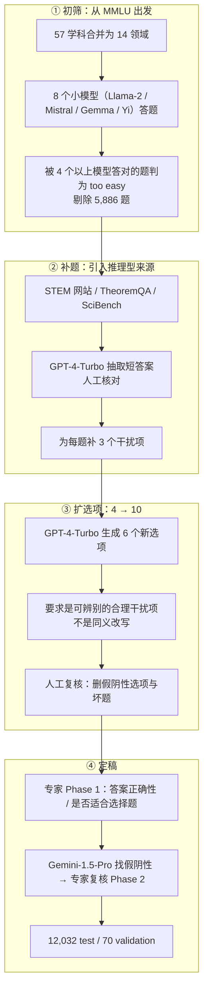

# MMLU-Pro：10 选项 + 推理题的知识考试升级版

---

## 1. 一句话定义

**MMLU-Pro** 是 Waterloo / Toronto / CMU 的 TIGER-Lab 于 2024 年 6 月发布的**多学科知识考试升级版**：把 [MMLU](mmlu.md) 的 4 选项扩到最多 **10 选项**，把 57 个学科合并为 **14 个领域**，剔除原版中「太简单」和「有噪声」的题，并补入 STEM 网站、TheoremQA、SciBench 的推理型题目。论文 2024-06-03 首发，NeurIPS 2024 Datasets & Benchmarks Track（Spotlight）。

它的设计目标不是「再考一遍知识」，而是把 MMLU 已经挤在 90–95 的分数重新拉开：名义猜测下限从 25% 降到 10%，CoT 相对直接作答的提升从 MMLU 的约 1.5 分扩大到约 19 分，24 种 prompt 下的分数波动从 4–5% 降到约 2%。这三项是它区别于原版的核心，也是它被 2025–2026 年模型发布沿用为「知识 + 推理」默认科目的原因。

> **与 MMLU 的关系**：MMLU-Pro 由另一组作者发布，题集、选项数、判定与分数口径都已改变，**不是 MMLU 的 2.0 版本**。按 `AGENTS.md` §2.1 的判据，二者在题集重做、计分口径与评测构念上均不同，因此各自独立成篇；**两篇的分数不可直接比较**。原版见 [mmlu.md](mmlu.md)，标注质量诊断见 [mmlu-redux.md](mmlu-redux.md)。

---

## 2. 数据与任务构造

### 2.1 规模与划分

| 口径 | 题数 | 说明 |
| --- | ---: | --- |
| test | 12,032 | 唯一计分 split |
| validation | 70 | 官方 5-shot 示例池 |
| 合计 | 12,102 | 不含任何训练 split |
| 选项数 | 最多 10 | 83% 题目满 10 项，17% 因人工复核删去不合理选项而少于 10 项；平均 **9.47** 项 |

> **口径说明**：12,032 是 HF 发布版与论文一致的 test 题数；`validation` 仅 70 题，是官方 5-shot 示例池（论文 §4 与附录 A.2 明确示例取自 validation）。HF 数据集卡未说明这 70 题的具体书目来源，引用时不要把它当作独立的开发集。名义随机基线是 **10%**（满 10 选项时），但因 17% 题目选项更少，实际盲猜期望略高于 10%。与本仓库其他知识类基准相比，MMLU-Pro 的 test 规模约为原版 MMLU（14,042）的 86%，但选项空间从 4 扩到 10，单题信息量更高。

### 2.2 14 个领域与题目来源

| 领域 | 题数 | 来自原 MMLU | 新增 | 新增来源 |
| --- | ---: | ---: | ---: | --- |
| Math | 1,351 | 846 | 505 | STEM 网站 / TheoremQA / SciBench |
| Physics | 1,299 | 411 | 888 | 同上 |
| Chemistry | 1,132 | 178 | 954 | 同上 |
| Law | 1,101 | 1,101 | 0 | — |
| Engineering | 969 | 67 | 902 | 同上 |
| Other | 924 | 924 | 0 | — |
| Economics | 844 | 444 | 400 | 同上 |
| Health | 818 | 818 | 0 | — |
| Psychology | 798 | 493 | 305 | 同上 |
| Business | 789 | 155 | 634 | 同上 |
| Biology | 717 | 219 | 498 | 同上 |
| Philosophy | 499 | 499 | 0 | — |
| Computer Science | 410 | 274 | 136 | 同上 |
| History | 381 | 381 | 0 | — |
| **合计** | **12,032** | **6,810** | **5,222** | — |

两类来源的性格差异很大：**Law / Health / Philosophy / History / Other 几乎全部沿用 MMLU**，只做了筛选与选项扩充；**Physics / Chemistry / Engineering / Business** 则以新增题为主。这解释了为什么同一模型在不同领域的分数不可互相外推——工程与物理更接近「多步计算」，法律与健康仍偏「知识回忆」。

### 2.3 构造流程



人工复核阶段记录的问题量级如下（论文 Table 1）：仅来自原 MMLU 的部分就有 **350 道答案错误**、**1,953 个假阴性选项**、**385 道坏题**；STEM 网站来源另有 **483 道答案错误**。这些数字说明 MMLU-Pro 的清洗是实质性的，但也意味着最终题集的质量依赖 GPT-4-Turbo 生成干扰项 + 人工复核的组合，而不是从头人工命题。

数据许可为 **MIT**；HF 仓库最后修改 2026-05-02，`test` 12,032 题 / `validation` 70 题。

---

## 3. 评测方式

### 3.1 官方提示与作答机制

论文与官方脚本的默认口径是 **5-shot Chain-of-Thought**：

| 环节 | 官方设定 | 常见偏离 |
| --- | --- | --- |
| Few-shot | 5 个示例，按领域选代表性题，带 CoT 推理过程 | 改成 0-shot；或不给 CoT 示例 |
| 作答 | 模型生成推理 + 最终答案，正则抽取 `answer is (X)` | 直接答（Direct Answering）；或只算选项概率 |
| 答案抽取 | 先匹配 `answer is \(?([A-J])\)?`，失败再匹配 `[aA]nswer:\s*\([A-J]\)`；两次都失败则**随机选一个选项** | 改成正则更宽松 / 更严格；失败时记为错 |
| 例外 | 官方说明：大多数模型 5-shot，Gemini 系列部分行用 0-shot | 把 0-shot 与 5-shot 混在同一列 |

最后一条「失败则随机选一个选项」是官方实现里的兜底逻辑，不是论文的方法论主张，但它确实会进入公开分数：抽取失败越多，分数越接近 10% 的盲猜线。引用厂商数字时，如果对方没有说明答案抽取方式，这 1–2 分就可能来自实现差异。

### 3.2 指标

唯一指标是 **accuracy**。与 MMLU 的「57 科等权 → 4 大类平均」不同，MMLU-Pro 的 **Overall 是全部 12,032 题的 micro 平均**（总正确数 / 总题数），14 个领域不按等权再做一次平均；领域分只作为诊断列。官方在 2025-10-25 的 Health 类修订说明里也明确写了「不改变 overall micro-averaged score，只可能轻微影响单领域指标」，可作为这一口径的旁证。

因此：**领域题量差异会直接影响 Overall**。Math（1,351）与 Physics（1,299）合计占 22%，而 History（381）只占 3.2%；一个模型在 History 上掉 10 分，对总分的拖累远小于在 Math 上掉 10 分。这也意味着「Overall 相同」不代表领域结构相同，做模型对比时应同时看领域分。

### 3.3 榜单机制：官方榜 + 自报混排

官方榜单在 Hugging Face Space（`TIGER-Lab/MMLU-Pro`），数据存在独立仓库 `TIGER-Lab/mmlu_pro_leaderboard_submission` 的 `results.csv`。截至 **2026-03-11**（数据仓最后修改），共 **262 行**：

| 行类型 | 行数 | 含义 |
| --- | ---: | --- |
| `TIGER-Lab` | 124 | 官方团队自己跑的结果（多为 2024–2026 的模型，含少量新模型） |
| `Self-Reported` | 136 | 厂商 / 提交者自报，通常只有 Overall，没有领域分 |
| 标签拼写异常 | 2 | `TIGER-LAb` 与 `Sefl-Reported` 各 1 行，按对应类别处理 |

榜单页面没有独立的复现审核：`Self-Reported` 行在 CSV 中通常只有 Overall，不标注 harness、few-shot 数、CoT 设置或答案抽取方式；是否附预测文件无法从榜单判断。官方页面另有一句「提交需提供证据证明是真实语言模型」，但这只是防伪声明，不是分数核验。

---

## 4. 榜单结果与演进

### 4.1 论文基线（2024-06，5-shot CoT）

| 模型 | Overall | Math | Physics | Engineering | Law |
| --- | ---: | ---: | ---: | ---: | ---: |
| GPT-4o | **72.6** | 76.1 | 74.7 | 55.0 | 51.0 |
| Gemini-1.5-Pro（0-shot） | 69.0 | 72.8 | 70.4 | 48.7 | 50.8 |
| Claude-3-Opus | 68.5 | 69.6 | 69.7 | 48.4 | 53.5 |
| GPT-4-Turbo | 63.7 | 62.8 | 61.0 | 35.9 | 51.2 |
| Gemini-1.5-Flash（0-shot） | 59.1 | 59.6 | 61.2 | 44.2 | 37.3 |
| Llama-3-70B-Instruct | 56.2 | 54.0 | 49.6 | 43.6 | 39.9 |

论文同时给出与 MMLU 的对照：GPT-4o 从 88.7 掉到 72.6（−16.1），Claude-3-Opus 从 86.8 掉到 68.5（−18.4），Claude-3-Sonnet 从 81.5 掉到 55.1（−26.4），Llama-3-70B 从 82.0 掉到 56.2（−25.8）。整体降幅 **16%–33%**，这就是「MMLU-Pro 更难」的原始证据。

> ⚠️ **不要跨口径比较**：本表是论文 2024-06 的 5-shot CoT 结果（Gemini 两行为 0-shot），不是当前榜单；与第 4.2 节的 2026 年数字、以及厂商自报的「MMLU-Pro 90+」**不能直接相减**。模型代际、CoT 设置、答案抽取与 test 版本的修订都会改变分数。

### 4.2 当前官方榜（2026-03-11）

| 排名 | 模型 | 数据来源 | Overall |
| ---: | --- | --- | ---: |
| 1 | Gemini-3.1-Pro | TIGER-Lab 自跑 | **91.16** |
| 2 | Gemini-3-Pro(11/25) | Self-Reported | 90.10 |
| 3 | GPT-o1 | Self-Reported | 89.30 |
| 4 | Claude-4.6-Opus(Thinking) | Self-Reported | 89.10 |
| 5 | Gemini-3-Flash(12/25) | Self-Reported | 88.60 |
| 6 | MiniMax-M2.1 | Self-Reported | 88.00 |
| 7 | Qwen3.5-397B-A17B | Self-Reported | 87.80 |
| 8 | Seed2.0-Lite | Self-Reported | 87.70 |
| 9 | GPT-5.4 | Self-Reported | 87.50 |
| 10 | GPT-5.2 | Self-Reported | 87.40 |

官方自跑行里，第二名是 Gemini-2.5-Pro-Exp-03-25 的 **84.52**，与头名差 6.6 分；也就是说，**91.16 是官方团队唯一跑到 90 以上的行，其余 90+ 全部是自报**。这张榜的头部因此不能被读成「统一 harness 下的模型排序」，只能读成「官方收录了哪些数字」。

> ⚠️ **不要跨口径比较**：第 4.1 节的论文基线、本节官方榜、第 4.3 节的三个聚合平台，四套数字的模型 cohort、shot 数、CoT 设置、答案抽取与是否自报都不同。官方榜内部也只有 `TIGER-Lab` 行有统一脚本；`Self-Reported` 行彼此之间、以及与 `TIGER-Lab` 行之间都不能直接比。

### 4.3 三个聚合平台的口径对照

| 平台 | 模型数 | 榜首 | 前 5 名 | 备注 |
| --- | ---: | --- | --- | --- |
| BenchLM（2026-11-04 核验） | 81 | Qwen3.7 Max 89.6 | Claude Opus 4.5 89.5 / Qwen3.7 Plus 88.5 / Qwen3.6 Plus 88.5 / Qwen3.5 397B 87.8 | 72 行自报、9 行二手、0 行官方或独立复现；页面标 `Crowded`、`not marked current` |
| LLMLearner（2026-10 页，末条结果 2026-10-23） | 153 | OpenAI o1 91.0 | Gemini 3.0 Pro 90.0 / Opus 4.5 90.0 / Intern-S2-397B 89.8 / Qwen3.7 Max 89.6 | 页面称 87 个「independently measured」、52 个仅自报、14 个来源未记录 |
| DataLearner（2026-10-25 更新） | — | OpenAI o1 91.04 | Gemini 3.0 Pro 90.00 / Opus 4.5 90.00 / Intern-S2-397B 89.77 / Qwen3.7 Max 89.60 | 中文条目，规模写 12,032，指标 Accuracy |

同一模型在不同平台可以差出 2–3 分，例如 **Claude Opus 4.5**：官方 CSV 的 `Claude-4.5-Opus(Thinking)` 为 **87.3**（自报），BenchLM 为 **89.5**，LLMLearner / DataLearner 为 **90.0**。这不是模型变了，而是评测设置（thinking / extended thinking、max tokens、答案抽取、shot 数）不同。**没有 harness 说明的 MMLU-Pro 分数，跨平台不可比。**

另一个信号是**平台收录的模型集合不一致**：官方榜的 91.16（Gemini-3.1-Pro，TIGER-Lab 自跑）没有出现在三家的前 5；三家共同的头部是 o1 / Gemini 3.0 Pro / Opus 4.5。引用「MMLU-Pro 最高分」时必须说明是哪一家的哪一行。

> ⚠️ **不要跨口径比较**：本表三列分别来自 BenchLM / LLMLearner / DataLearner，模型收录范围、shot 数、CoT 设置与是否自报均不同；同一模型差 2–3 分是常态，不能据此判断谁更强，也不能与第 4.2 节的官方 CSV 混排。

### 4.4 演进时间线

| 时间 | 事件 |
| --- | --- |
| 2024-05-08 | HF 数据集仓库建立 |
| 2024-06-03 | arXiv v1 发布；GPT-4o 72.6，比 MMLU 低 16.1 分 |
| 2024-07 ~ 2024-09 | 连续修正答案与题面错误：ID 143、6392、5457 等；修正 `\nrac → \n\frac` 一类转义；补充 GPT-4o-mini、Grok-2 等榜单行 |
| 2024-10-10 | 论文的 24 种 prompt 模板加入仓库 |
| 2024-10-16 | 榜单补充 Gemini-1.5-Flash-002、Jamba-1.5-Large、Ministral-8B 等 |
| 2024-12 | NeurIPS 2024 D&B（Spotlight）正式发表 |
| 2025-04-06 | 依据 Mayo Clinic / INOVA 医学专家意见修正 15 道医学题答案 |
| 2025-10-25 | 发布 Health 类问题汇总说明；官方称不改变 overall micro 平均，只轻微影响单领域 |
| 2026-01-18 | 修正选项前导空格问题（影响 chemistry / physics 等 STEM 子集），该问题可被当作捷径利用 |
| 2026-03-11 | 榜单补充 Claude-4.6、Seed2.0、Qwen3.5、Gemini-3.1-Pro 等前沿模型 |
| 2026-05-02 | HF 数据集最后修改（当前快照） |

时间线里最值得注意的不是「又加了哪些模型」，而是**修正从未停止**：答案、题面、选项格式在发布后的两年里持续被改。这意味着 2024 年论文里的单题结果与 2026 年的 test 集并非完全同一批数据；跨年比较必须带版本。

> ⚠️ **不要跨口径比较**：时间线里的 72.6 是 2024-06 论文的 5-shot CoT 基线，只用于标记「MMLU-Pro 首发时的水平」，不是当前分数；2026-03 的 91.16 是另一套模型 cohort 与 harness，二者不可相减。

---

## 5. 已知缺陷

| 缺陷 | 关键证据 | 后果 |
| --- | --- | --- |
| **标注与结构错误仍在** | 2026-07-24 的独立审计（Allcock）用统一 taxonomy 审计 12,032 题，判定 **11.2%**（95% CI 10.6–11.7）的题「无法公平给模型计分」，并发布移除 1,343 题后的 `MMLU-Pro-Clean`（12,032 → 10,689） | 头部模型的 1–2 分差距可能小于题集本身的噪声；不同题集上的排名会变 |
| **4 → 10 选项的增广引入缺陷族** | 同一审计把缺陷分为 5 类：正确选项缺失（S1）、两个同义/重复的正确选项（S2）、题干被拼进选项（S3）、字母-答案映射错乱（S4）、渲染损坏（S5）；并指出这是 MMLU-Pro 与 MMMU-Pro 共享的增广缺陷 | 模型可能「答对」一个坏题，或「答错」一个实际正确的选项；错误不随机 |
| **历史修正记录本身就是证据** | 2024-07 至 2026-01 的修正涉及答案、题面、转义、选项前导空格；2025-04 一次就改了 15 道医学题答案 | 2024–2025 年引用过的单题分数不一定可复现；旧版 harness 的分数带已知偏差 |
| **自报与官方自跑混排** | 262 行中 136 行自报，通常只给 Overall；官方自跑里只有 1 行 ≥ 90 | 「MMLU-Pro 90+」可能来自完全不同的 harness；无法用榜单做严格横评 |
| **提示 / 答案抽取敏感** | 论文自己报告 24 种 prompt 下仍有约 2% 波动（峰值 3.74%）；官方脚本在抽取失败时随机选选项 | 2–3 分的平台差异可以完全由 harness 解释；低分不一定是模型差 |
| **污染风险** | test 集自 2024-05 起在 HF 公开，含 6,810 道原 MMLU 题；没有闭源 held-out 版本 | 无法排除训练集包含题目；分数中的「记忆成分」没有像 MMLU-CF 那样的去污染重测 |
| **接近饱和** | 官方榜首 91.16，前三 90.1 / 89.3；BenchLM 前三在 1.1 分内并标 `Crowded`；LLMLearner 前二在 1 分内 | 头部名次差异常落在题集噪声与 harness 差异内，选模型时不宜只看 1–2 分 |
| **英语 + 选择题的边界** | 论文 §7 自述：只测语言模型、不测多模态；选择题格式不能替代开放式作答 | 非英语、多模态、长程生成能力不可由此外推 |

> ⚠️ **不要跨口径比较**：审计的 11.2% 是**模型裁决**（model-adjudicated）的估计，作者明确说不是人工认证，且 `MMLU-Pro-Clean` 的移除是「可审计的逐题删除」，不是官方修订；它不能与官方 2025-04 的 15 题修正、2026-01 的格式修正相加或相减。第 4 节的分数也不能用这个 11.2% 直接「折算」成真实能力——审计只说明题集里有这么多题无法公平计分，不提供修正后的模型分数。

---

## 6. 复现与快速上手

```python
from datasets import load_dataset
from collections import Counter

ds = load_dataset("TIGER-Lab/MMLU-Pro")
test = ds["test"]
print(len(test), len(ds["validation"]))          # 12032 70

# 选项数分布：验证「最多 10 项、平均 9.47」
counts = Counter(len(x) for x in test["options"])
print(sorted(counts.items()))                    # [(4, ...), ..., (10, ...)]
print(sum(len(x) for x in test["options"]) / len(test))

q = test[0]
print(q["category"], "|", q["question"])
print(q["options"], "| answer:", q["answer"], "| index:", q["answer_index"])
print(q["src"])                                  # 题目来源标记
```

用 `lm-evaluation-harness` 跑统一口径（任务版本 3.1，2026-05-04；默认 5-shot CoT）：

```bash
lm_eval --model hf \
  --model_args pretrained=<model> \
  --tasks mmlu_pro \
  --num_fewshot 5 \
  --batch_size auto
```

harness 的关键实现：`dataset_path: TIGER-Lab/MMLU-Pro`、`test_split: test`、`fewshot_split: validation`、`output_type: generate_until`、正则 `answer is \(?([ABCDEFGHIJ])\)?`、`max_gen_toks: 2048`、`until: ["Question:"]`。若用 chat 模板，注意 2026-05-04 的 3.1 版才修正了 few-shot 答案被渲染进 user turn 的问题；更早版本的结果不可直接混用。

| 资源 | 链接 / 说明 |
| --- | --- |
| 论文 | https://arxiv.org/abs/2406.01574（NeurIPS 2024 D&B Spotlight） |
| 官方仓库 + 评测脚本 | https://github.com/TIGER-AI-Lab/MMLU-Pro |
| 数据集（MIT） | https://huggingface.co/datasets/TIGER-Lab/MMLU-Pro |
| 官方榜单 | https://huggingface.co/spaces/TIGER-Lab/MMLU-Pro |
| 榜单数据仓 | https://huggingface.co/datasets/TIGER-Lab/mmlu_pro_leaderboard_submission |
| 独立 harness | https://www.kaggle.com/benchmarks/open-benchmarks/mmlu-pro（2026-11-05 可访问；页面服务端渲染，逐行数据未取到） |
| 2026 审计与 Clean 版 | https://github.com/adamallcock/answer-key-audit · DOI 10.5281/zenodo.21613590 |

按 `AGENTS.md` §1，题库本体与官方评测脚本不入库；本仓库只保留数据集元数据与官方榜单 CSV，见 `sources/mmlu-pro/README.md`。

---

## 7. 结论

MMLU-Pro 解决的是 MMLU 的**区分度**问题，而不是 MMLU 的**标注质量**问题：它把猜测下限压到 10%、把 CoT 变成有效手段、把题集往推理侧推，因此在 2024–2025 年确实重新拉开了头部模型；但它没有换掉「公开题库 + 选择题 + 单一 accuracy」这套结构，所以到 2026 年又走到了同一条饱和曲线——官方榜首 91.16，第 2–3 名 90.1 / 89.3，且 90+ 大多来自自报。

今天用它，建议把问题拆成三个：

| 你要回答的问题 | 建议用法 |
| --- | --- |
| 模型的知识面 + 推理是否够用 | 看 **同一 harness**（官方脚本或 lm-eval 3.1）下的 Overall 与 14 领域分，不看跨平台混排 |
| 两个模型差 1–2 分，谁更强 | 不要下结论；先看题集噪声（2026 审计 11.2%）、答案抽取与 CoT 设置是否一致 |
| 分数里有没有「错题税」 | 用 `MMLU-Pro-Clean` 重跑一遍，比较原版与 Clean 的排序变化；这是目前唯一公开的逐题修正版 |

如果需要一个**比 MMLU-Pro 更干净**的知识基准，MMLU-Redux 提供的是「错题诊断」而不是「更难的新题」；如果需要一个**真正超出知识回忆**的难题梯度，应转向 GPQA Diamond、HLE 或 Agent / 代码类基准。MMLU-Pro 的合理定位是：**2024–2026 年间最常用的「知识 + 轻推理」横评尺，但已不是前沿模型的上限测试。**

---

## 8. 参考来源

1. **一手（论文）**：Wang et al., *MMLU-Pro: A More Robust and Challenging Multi-Task Language Understanding Benchmark*, NeurIPS 2024 D&B Spotlight，arXiv:2406.01574（v5，2024-10-07）：https://arxiv.org/abs/2406.01574 —— §2.1、§2.3、§3.1、§3.2、§4、§5、§6、§7 的数字与提示设置均出自此文。
2. **一手（数据集）**：https://huggingface.co/datasets/TIGER-Lab/MMLU-Pro —— MIT；`test` 12,032 / `validation` 70；SHA `b189ec7`，最后修改 2026-05-02；快照见 `sources/mmlu-pro/dataset_info.json`。
3. **一手（官方仓库）**：https://github.com/TIGER-AI-Lab/MMLU-Pro —— 评测脚本、`eval_results` 预测缓存、24 种 prompt 模板；README 的 Mini-Leaderboard 是 2024 年旧表。
4. **一手（官方榜单）**：https://huggingface.co/spaces/TIGER-Lab/MMLU-Pro ；数据仓 https://huggingface.co/datasets/TIGER-Lab/mmlu_pro_leaderboard_submission —— `results.csv` 262 行，最后修改 2026-03-11；快照见 `sources/mmlu-pro/leaderboard-results-2026-03-11.csv`。
5. **一手（harness）**：EleutherAI `lm-evaluation-harness` 的 `mmlu_pro` 任务，版本 3.1（2026-05-04）：https://github.com/EleutherAI/lm-evaluation-harness/tree/main/lm_eval/tasks/mmlu_pro
6. **一手（独立审计，预印本）**：Allcock, *When the Answer Key Is Wrong: A Calibrated Audit of GPQA, MMLU-Pro, and MMMU-Pro, with Corrected Releases*, 2026-07-24，Zenodo DOI 10.5281/zenodo.21613590（arXiv forthcoming）；仓库 https://github.com/adamallcock/answer-key-audit —— 11.2%（95% CI 10.6–11.7）、1,343 题移除、S1–S5 缺陷分类出自此文；作者明确标注为 model-adjudicated，非人工认证。
7. **二手（聚合，BenchLM）**：https://benchlm.ai/benchmarks/mmlu-pro（2026-11-04 核验；81 行，榜首 Qwen3.7 Max 89.6；页面标 `Crowded`、`not marked current`）。
8. **二手（聚合，LLMLearner）**：https://llmlearner.com/rankings/mmlu-pro（2026-10 页，末条结果 2026-10-23；153 个模型，榜首 o1 91.0）。
9. **二手（聚合，DataLearner）**：https://www.datalearner.com/benchmarks/mmlu-pro（2026-10-25 更新；榜首 o1 91.04，规模 12,032）。
10. **二手（独立 harness 入口）**：https://www.kaggle.com/benchmarks/open-benchmarks/mmlu-pro（2026-11-05 可访问，页面标题 “MMLU-Pro Leaderboard”；逐行数据未取到）。
11. **本仓库快照**：`sources/mmlu-pro/README.md` —— 来源版本、抓取日期、未入库边界与复现命令。
