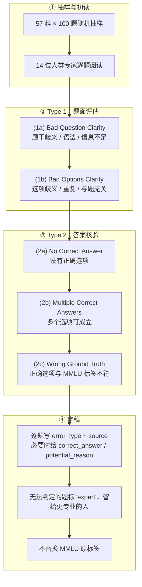

# MMLU-Redux：MMLU 标注错误的 5,700 题诊断子集

---

## 1. 一句话定义

**MMLU-Redux** 是 Gema 等人（Edinburgh / Sapienza / UCL 等）对 [MMLU](mmlu.md) 做的一次**人工重标注审计**：从 57 个学科各随机抽 100 题，由 14 位人类专家按一套错误 taxonomy 逐题复核，最终形成 **5,700 题**的子集。论文 2024-06-06 首发（v1 为 3,000 题 / 30 科），v3 于 2025-01-10 定稿，NAACL 2025 长文。

它的用途不是「更难的新基准」，而是**量化 MMLU 里有多少题本身是错的**：作者估计原 MMLU 有 **6.49%** 的题存在标注或题面错误，`Virology` 子集被分析的题里 **57%** 有错；并用同一批模型的预测证明，去掉错题后**排名会变**。

> **与 MMLU 的关系**：MMLU-Redux 不替换 MMLU 的标签，也不提供新的评分协议；它是在同一批题上叠了一层「这题是否可信」的元数据。按 `AGENTS.md` §2.1，它是独立的诊断型数据集，不与 [MMLU](mmlu.md) 或 [MMLU-Pro](mmlu-pro.md) 共用分数口径；**三者的分数不可直接比较**。

---

## 2. 数据与任务构造

### 2.1 规模与划分

| 口径 | 数量 | 说明 |
| --- | ---: | --- |
| 学科数 | 57 | 覆盖 MMLU 全部学科 |
| 每科抽样 | 100 | 随机抽取，不是按难度分层 |
| 合计 | **5,700** | 单一 `test` split，无 train / dev |
| 原 MMLU test 总量 | 14,042 | 抽样覆盖约 **40.6%** |
| 字段 | 7 列 | `question` / `choices` / `answer` / `error_type` / `source` / `correct_answer` / `potential_reason` |

`answer` 仍是 **MMLU 原标签（0–3）**，不是修正后的答案；`correct_answer` 只是标注者建议的替代答案，**没有回写**。这一点决定了使用方式：想分析「错题税」就要按 `error_type` 过滤，想复现 MMLU 就保留全部题。

> **版本说明**：论文 v1（2024-06）只覆盖 3,000 题 / 30 科；v3（2025-01）与 HF 上的 `mmlu-redux-2.0` 扩到 5,700 题 / 57 科。GitHub 仓库 README 至今仍写「30 subjects」，是未同步的旧说明；以 HF 数据集与论文 v3 为准。

### 2.2 错误 taxonomy 与标注流程



标注者被要求先用搜索引擎找题目的原始出处（教材、政府网站、WHO 等）；找到原题就按来源核对答案，找不到就按自身专业判断。五位错误最多的学科另做了三人交叉标注，Cohen's Kappa 在 **0.64–1.0** 之间（Virology 0.67、Logical Fallacies 0.73、College Chemistry 0.92、Formal Logic 0.96、Human Sexuality 0.64）。

`error_type` 的取值共有 7 种：`ok`、`bad_question_clarity`、`bad_options_clarity`、`no_correct_answer`、`multiple_correct_answers`、`wrong_groundtruth`、`expert`。其中 `expert` 表示「标注者仍不确定、需要更专业判断」，**不是**一种已确认的错误，统计错误率时通常与 `ok` 分开处理。

### 2.3 错误分布

论文 Table 5 的 57 科汇总（百分比为**按原学科题量分层加权**后的全 MMLU 估计）：

| error_type | 占全部 MMLU 估计 | 含义 |
| --- | ---: | --- |
| `ok` | 93.51% | 题面与答案均无问题 |
| `bad_question_clarity` | 2.47% | 题干本身不清晰 |
| `bad_options_clarity` | 0.44% | 选项不清晰 / 重复 / 无关 |
| `no_correct_answer` | 0.62% | 没有一个选项正确 |
| `multiple_correct_answers` | 1.54% | 多个选项可成立 |
| `wrong_groundtruth` | 1.42% | 正确选项与 MMLU 标签不符 |
| **合计错误** | **6.49%** | 2.47 + 0.44 + 0.62 + 1.54 + 1.42 |

> ⚠️ **两个错误率不要混用**：5,700 题样本里的原始错误数是 **338 题（5.93%）**；**6.49%** 是按 57 科原题量分层加权后对**完整 MMLU** 的估计。差异来自题量大的学科错误率更高（如 `Professional Law` 原题 1,534 道、抽样错误率 18%）。引用时必须写明是「样本原始比例」还是「分层加权估计」。

错误最集中的学科（同一张表，按抽样 100 题计）：

| 学科 | 原题数 | OK | 主要错误类型 | 错误率 |
| --- | ---: | ---: | --- | ---: |
| Virology | 166 | 43 | Wrong GT 33 / BQC 14 | **57%** |
| Logical fallacies | 163 | 74 | BQC 14 / NCA 4 / MCA 3 / WGT 3 | 26% |
| College chemistry | 100 | 75 | Wrong GT 21 | 25% |
| Professional law | 1,534 | 82 | MCA 11 / BQC 4 | 18% |
| Human sexuality | 131 | 83 | BQC 11 | 17% |
| Business ethics | 100 | 86 | BQC 14 | 14% |
| Formal logic | 126 | 87 | MCA 9 / NCA 2 | 13% |
| Human aging | 223 | 88 | BQC 12 | 12% |
| Global facts | 100 | 88 | NCA 4 / WGT 5 | 12% |
| Machine learning | 112 | 89 | BOC 5 / BQC 3 | 11% |

反过来，`Management`、`Philosophy`、`Medical genetics`、`High school US history`、`High school government and politics`、`High school geography`、`High school computer science`、`College physics`、`Prehistory` 这 9 科的抽样 100 题**全部为 `ok`**。错误不是均匀分布的，这也是「平均 6.49%」不能直接套到某个学科上的原因。

### 2.4 版本与维护

| 时间 | 事件 |
| --- | --- |
| 2024-06-06 | arXiv v1：3,000 题 / 30 科 |
| 2024-08-17 | HF 数据集仓库建立 |
| 2025-01-10 | arXiv v3：扩到 5,700 题 / 57 科；估算 6.49% |
| 2025-01-23 | 被 NAACL 2025 接收 |
| 2025-02-08 | 修正 `High school mathematics` 的一条标注（PlatinumBench 指出） |
| 2025-02-25 | 修正 `Abstract algebra` 的一条标注（Issue #2）；HF 最后修改 |

数据许可 **CC-BY-4.0**；另有一份 Zenodo 镜像（`11624987`）。因为标注会继续被社区纠错，引用时必须带数据集版本（`mmlu-redux-2.0`）或论文版本（v3）。

---

## 3. 评测方式

### 3.1 没有官方指标，也没有官方榜单

MMLU-Redux 本身不定义新的 leaderboard，也没有官方评分协议。它是一份**带错误标签的 MMLU 子集**，因此「在 MMLU-Redux 上得多少分」取决于三件事：

| 选择 | 选项 | 影响 |
| --- | --- | --- |
| 用哪些题 | 全部 5,700 题 / 只保留 `ok` / 按错误类型排除 | 只保留 `ok` 会改变题集难度与学科构成 |
| 用什么预测 | 重新跑模型 / 复用 HELM v1.3.0 的预测 | 论文的排名变化基于 HELM 预测，不是新跑 |
| 用什么指标 | exact match / accuracy / 其他 | 论文用 exact match，与 MMLU 的 harness 也不完全相同 |

论文自己的做法是：取 **HELM leaderboard v1.3.0（2024-05-15 发布）** 的模型预测，在错误最多的 5 个学科（Virology、Logical Fallacies、College Chemistry、Professional Law、Human Sexuality）上，比较「全部题」与「只保留 `ok` 题」两种口径下的 exact match 与排名。

### 3.2 论文的评分口径

| 口径 | 含义 | 用途 |
| --- | --- | --- |
| Original EM | 全部抽样题上的 exact match（含错题） | 复现 MMLU 式分数 |
| Correct EM | 只保留 `error_type == ok` 的题 | 看「去掉错题后」的分数 |
| Erroneous EM | 只看错题 | 诊断模型是否在错题上「答对」了错误标签 |

论文的关键发现不是「Correct EM 一定更高」，而是**排名会变**：有的模型在错题上反而更准（Professional Law、Formal Logic），作者把这当作**记忆化**的旁证——模型可能记住了 MMLU 的错误标签，而不是真的推理出答案。

### 3.3 主流 harness 的接入方式

`lm-evaluation-harness` 有 `mmlu_redux_generative` 任务，但它的实现与论文口径不同，引用时要注意：

| 项 | harness 实现 |
| --- | --- |
| 任务名 | `mmlu_redux_generative`（分组 `mmlu_redux`） |
| 数据集 | `fxmarty/mmlu-redux-2.0-ok`——**社区重排副本**，不是官方 `edinburgh-dawg/mmlu-redux-2.0` |
| shot | **0-shot** |
| 提示 | 题干 + 四个选项 + `Please respond with the correct letter (A, B, C or D) without any additional comments, only the correct letter:` |
| 指标 | `exact_match`，按题加权 |
| 版本 | 4.0 |

也就是说，harness 的 `mmlu_redux` 分数是一个**0-shot 生成式、只接受单字母**的口径；它既不是论文的 HELM 口径，也不是 MMLU 的 5-shot 受限选项口径。用它做横评时，必须在同一 harness 内比较。

---

## 4. 榜单结果与演进

### 4.1 论文的排名变化证据

下表摘自论文 Table 2，括号内为在该学科内的排名；箭头表示「全部题 → 只保留 `ok` 题」：

| 模型 | 学科 | 全部题 EM（排名） | 只保留 ok（排名） |
| --- | --- | ---: | ---: |
| Llama 3.1 Instruct Turbo (405B) | Virology | 0.57（16） | **0.93（1）** |
| Claude 3.5 Sonnet (20240620) | Virology | 0.60（1） | 0.91（5） |
| GPT-4 Turbo (2024-04-09) | Logical Fallacies | 0.87（11） | **1.00（1）** |
| GPT-4 (0613) | Human Sexuality | 0.91（5） | **0.43（10）** |
| Gemini 1.5 Pro (001) | Human Sexuality | 0.37（55） | **0.94（6）** |
| Llama 3.1 Instruct Turbo (405B) | College Chemistry | 0.60（5） | **0.76（1）** |

> ⚠️ **不要跨口径比较**：本表是论文用 HELM v1.3.0 预测、在 5 个错误最多的学科上做的**重评分**，不是当前任何榜单；`0.93` 与 `0.57` 的差异来自题集过滤，不是模型能力变化。它也不能与第 4.2 节第三方展示的 95–96% 相加或相减——后者的题集、模型 cohort 与评分协议都不同。

这些数字说明两件事：第一，错题足以让**同一模型在同一学科内从第 16 名跳到第 1 名**；第二，过滤错题后分数不一定上升（GPT-4 在 Human Sexuality 上从 0.91 掉到 0.43），因为它在错题上「答对」的其实是 MMLU 的错误标签。

### 4.2 第三方展示：没有官方榜，只有二手汇总

MMLU-Redux 没有官方托管的 leaderboard。三个聚合平台的核验结果：

| 平台 | 是否有条目 | 内容 | 可信度 |
| --- | --- | --- | --- |
| BenchLM | 有（`benchlm.ai/benchmarks/mmluredux`） | 21 行，榜首 Claude Opus 4.5 **96.6%**，其后 Qwen3.7 Max 95.0、Qwen3.5 397B 94.9；页面标 `Display only`、`0 of 21` 行为官方或独立复现 | 二手；**条目标注有明显事实错误**（见下） |
| LLMLearner | **未取到**（`/rankings/mmlu-redux` 返回 404，2026-11-05） | — | — |
| DataLearner | **未取到**（`/benchmarks/mmlu-redux` 返回 404，2026-11-05） | — | — |

BenchLM 的页面把 MMLU-Redux 描述为「**A harder refresh of MMLU**」「Year 2026」「Refresh cadence: Quarterly」，并称其用于「fresher or harder questions」；但 MMLU-Redux 实际是 **2024 年对 MMLU 子集的重标注**，题目没有变难、也没有季度刷新。这是把 MMLU-Pro 的定位错安到了 MMLU-Redux 上。因此本文**不采信该页的 96.6% 等分数**，只把它当作「聚合平台会混淆两个基准」的证据。

另一个二手源 llm-stats 显示 50 个模型、榜首 Qwen3.7 Max 95.0、平均 0.866，并注明全部为 self-reported；这与 BenchLM 的 96.6 也不一致。**在没有官方评分协议的情况下，这些 95–96% 不能读成「MMLU-Redux 很难」**——它们只是「在 5,700 题子集上、按某种未披露的过滤与 harness 得到的准确率」，而 95–96% 已经和原版 MMLU 的头部（Kaggle 95.2）同一水平，恰恰说明它不是更难的基准。

> ⚠️ **不要跨口径比较**：BenchLM 与 llm-stats 的 95–96% 都是二手展示分，既没有官方评分协议，也未说明是否过滤错题；它们不能与第 4.1 节的论文 EM、[MMLU](mmlu.md) 的 Kaggle 95.2 或 [MMLU-Pro](mmlu-pro.md) 的 91.2 相比。

### 4.3 演进时间线

| 时间 | 事件 |
| --- | --- |
| 2024-06-06 | 论文 v1：3,000 题 / 30 科；Virology 57% 错误率成为标志性数字 |
| 2024-08-17 | HF 数据集仓库建立 |
| 2025-01-10 | 论文 v3：5,700 题 / 57 科；6.49% 分层估计定稿 |
| 2025-01-23 | NAACL 2025 接收 |
| 2025-02 | 数据集 2.0 两次标注修正（HS Math、Abstract Algebra） |
| 2026 | BenchLM（2026-11-04）与 llm-stats 等第三方页面以 95–96% 展示 MMLU-Redux，均未给出官方协议 |

---

## 5. 已知缺陷与使用限制

| 限制 | 关键证据 | 后果 |
| --- | --- | --- |
| **不是「更难的基准」** | 题目全部来自 2020 年公开的 MMLU test；MMLU-Redux 只是 2024 年对其中 5,700 题的重标注；第三方展示的 95–96% 与原版 MMLU 头部同级 | 不能用它区分前沿模型；它测的是「原题 + 重标注」，不是新难度 |
| **没有官方评分协议** | 无官方 leaderboard；论文只做 5 学科重评分；harness 用 0-shot 社区副本 | 「MMLU-Redux 分数」在不同来源之间不可比；95% 可能来自「全部题」也可能来自「只保留 ok」 |
| **不修复 MMLU** | `answer` 仍是原标签；`correct_answer` 只是建议，未回写 | 直接跑全部 5,700 题会复现 MMLU 的错题问题；必须显式过滤 `error_type` |
| **6.49% 是估计，不是普查** | 5,700 / 14,042 抽样；原始样本错误率 5.93%，分层加权后 6.49%；`expert` 类未计入已确认错误 | 学科级错误率不能直接外推到全 MMLU；`expert` 题的去留会改变分母 |
| **人工标注的主观性** | 仅 5 个学科做了三人交叉标注，Kappa 0.64–1.0；作者承认 taxonomy 可能带 annotator bias | 边界题（尤其 Human Sexuality、Virology）可能被不同标注者分到不同类 |
| **学科样本量小** | 每科固定 100 题；95% 置信区间约 ±6–10 个百分点 | 学科级排名波动大，不适合做细粒度比较 |
| **错题不一定压低分数** | Professional Law、Formal Logic 上错题准确率不低于正确题；作者解释为记忆化 | 「去掉错题 → 分数上升」不成立；不能用 Redux 简单「校正」MMLU 分数 |
| **污染仍在** | 子集来自公开 MMLU test，模型可能已见过题与错标签 | 无法用它做去污染评估；需要闭源重测应使用 MMLU-CF 一类 |
| **聚合平台误标** | BenchLM 把 MMLU-Redux 写成 2026 年的「harder refresh」并给出季度刷新 | 二手分数不可信；引用前必须回论文 / HF 数据集核对 |

> ⚠️ **不要跨口径比较**：第 4.1 节的 EM 是 HELM v1.3.0 预测、5 学科、exact match；第 4.2 节的 95–96% 是第三方未披露协议的展示分；`lm-eval` 的 `mmlu_redux_generative` 又是 0-shot 生成式。三者题集、过滤条件、shot 数与答案抽取都不同，不能互相换算，也不能与 [MMLU](mmlu.md) 或 [MMLU-Pro](mmlu-pro.md) 的分数比较。

---

## 6. 复现与快速上手

```python
from datasets import load_dataset
from collections import Counter

# 官方 2.0 数据集：57 个 config，每个 100 题
ds = load_dataset("edinburgh-dawg/mmlu-redux-2.0", "virology", split="test")
print(len(ds))                                   # 100
print(ds.features)                               # question / choices / answer / error_type / source / correct_answer / potential_reason

row = ds[0]
print(row["question"], row["choices"], row["answer"])
print(row["error_type"], "|", row["correct_answer"], "|", row["potential_reason"])

# 统计某个 config 的错误类型
print(Counter(ds["error_type"]))                 # ok / bad_question_clarity / ... / expert

# 只保留可信题（最简单的用法）
ok = ds.filter(lambda x: x["error_type"] == "ok")
print(len(ok))
```

批量加载 57 个 config 时，注意每个 config 的 split 都是 `test`，且题数与学科原题量无关（统一 100）：

```python
from datasets import get_dataset_config_names
configs = get_dataset_config_names("edinburgh-dawg/mmlu-redux-2.0")
print(len(configs))                              # 57
total = sum(len(load_dataset("edinburgh-dawg/mmlu-redux-2.0", c, split="test")) for c in configs)
print(total)                                     # 5700
```

用 `lm-evaluation-harness` 跑统一口径（注意：0-shot、社区副本、生成式）：

```bash
lm_eval --model hf \
  --model_args pretrained=<model> \
  --tasks mmlu_redux_generative \
  --batch_size auto
```

| 资源 | 链接 / 说明 |
| --- | --- |
| 论文 | https://arxiv.org/abs/2406.04127（NAACL 2025；v3 2025-01-10） |
| ACL Anthology | https://aclanthology.org/2025.naacl-long.262/（pp. 5069–5096） |
| 数据集（CC-BY-4.0） | https://huggingface.co/datasets/edinburgh-dawg/mmlu-redux-2.0 |
| 官方代码 / 标注脚本 | https://github.com/aryopg/mmlu-redux |
| Zenodo 镜像 | https://zenodo.org/records/11624987 |
| harness 任务 | https://github.com/EleutherAI/lm-evaluation-harness/tree/main/lm_eval/tasks/mmlu-redux |

按 `AGENTS.md` §1，5,700 题正文与标注脚本不入库；本仓库保留数据集元数据与论文 Table 5 的逐科错误统计，见 `sources/mmlu-redux/README.md`。

---

## 7. 结论

MMLU-Redux 的价值在于把「MMLU 分数里有多少是错题税」变成了可逐题复核的数据，而不是提供了一个新的排行榜。它最硬的结论有三个：**6.49%** 的题有错（`Virology` 57%）；错题足以让同一学科内的排名从第 16 跳到第 1；以及过滤错题后分数**不一定**上升（记忆化）。

今天正确的用法是：

| 目的 | 用法 |
| --- | --- |
| 审计某个 MMLU 分数 | 在 5,700 题上分别报「全部题」与「只保留 `ok`」两个数，并说明版本 |
| 挑一个更干净的知识基准 | 用 `error_type == ok` 的子集重跑；不要直接用第三方 95–96% 的展示分 |
| 需要更高难度 | 换 [MMLU-Pro](mmlu-pro.md)、GPQA Diamond、HLE；MMLU-Redux 不是难题集 |
| 做去污染评估 | 换 MMLU-CF 一类闭源 test；MMLU-Redux 仍是公开题 |

一句话：**MMLU-Redux 是一把尺子的校准报告，不是一把新尺子。** 引用它时，请把它当「MMLU 的标注质量证据」，而不是「MMLU 的升级版分数」。

---

## 8. 参考来源

1. **一手（论文）**：Gema et al., *Are We Done with MMLU?*, NAACL 2025（pp. 5069–5096），arXiv:2406.04127（v3，2025-01-10）：https://arxiv.org/abs/2406.04127 —— 5,700 题 / 57 科、6.49% 估计、taxonomy、Table 2 排名变化、Table 5 逐科统计均出自此文。
2. **一手（数据集）**：https://huggingface.co/datasets/edinburgh-dawg/mmlu-redux-2.0 —— CC-BY-4.0；57 个 config × 100 题；SHA `372ea42`，最后修改 2025-02-25；快照见 `sources/mmlu-redux/dataset_info.json` 与 `sources/mmlu-redux/paper-table5-errors.csv`。
3. **一手（代码）**：https://github.com/aryopg/mmlu-redux —— 标注与错误检测实验脚本；README 仍写 30 科，为 v1 旧说明。
4. **一手（正式发表）**：https://aclanthology.org/2025.naacl-long.262/ —— NAACL 2025 Volume 1: Long Papers。
5. **一手（镜像）**：https://zenodo.org/records/11624987 —— 数据集替代下载。
6. **一手（harness）**：EleutherAI `lm-evaluation-harness` 的 `mmlu_redux_generative` 任务，版本 4.0：https://github.com/EleutherAI/lm-evaluation-harness/tree/main/lm_eval/tasks/mmlu-redux —— 数据集为社区副本 `fxmarty/mmlu-redux-2.0-ok`，0-shot。
7. **二手（聚合，BenchLM）**：https://benchlm.ai/benchmarks/mmluredux（2026-11-04 核验；21 行，榜首 Claude Opus 4.5 96.6%；页面标 `Display only`、`0 of 21` 官方/独立；其「harder refresh / 2026 / Quarterly」描述与事实不符）。
8. **二手（聚合，llm-stats）**：https://llm-stats.com/benchmarks/mmlu-redux（50 个模型，榜首 Qwen3.7 Max 95.0，全部 self-reported；非本仓库三个主聚合平台之一，仅作交叉参考）。
9. **未取到**：LLMLearner `https://llmlearner.com/rankings/mmlu-redux` 与 DataLearner `https://www.datalearner.com/benchmarks/mmlu-redux` 于 2026-11-05 均返回 404，未找到对应条目。
10. **本仓库快照**：`sources/mmlu-redux/README.md` —— 来源版本、抓取日期、未入库边界与复现命令。
