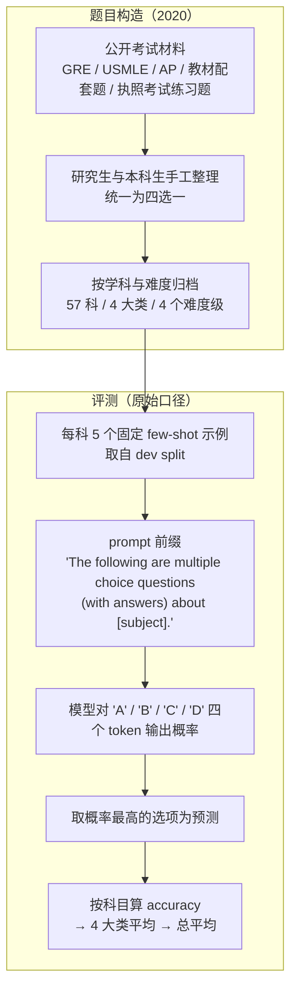

# MMLU：57 学科四选一的知识考试基准

---

## 1. 一句话定义

**MMLU**（**M**assive **M**ultitask **L**anguage **U**nderstanding）是 Hendrycks 等人 2020 年 9 月发布、ICLR 2021 发表的**多学科知识考试**：57 个学科、全部四选一，从「小学数学」一直排到「专业医学」「专业法律」，要求模型**不做任务微调**、只看少量示例就把题答对。

它的设计意图写在标题里——测的不是某一项技能，而是**预训练灌进去的世界知识有多宽**。正因为「学科多 + 格式统一 + 自动判分」，它在 2023–2024 年成了模型发布会的默认科目，也因此在 2025 年后被自己的成功拖垮：前沿模型挤在 92–95 的窄带里，题目本身的标注错误与污染问题又被逐条挖出来，今天的定位已经从「能力标尺」退化为「知识覆盖的粗筛」。

---

## 2. 数据与任务构造

### 2.1 规模与划分

| 口径 | 合计 | test | validation | dev |
| --- | ---: | ---: | ---: | ---: |
| 论文（arXiv v3，§2.1） | 15,908 | 14,079 | 1,540 | 每科 5 题（57 × 5 = 285） |
| HF 发布版 `cais/mmlu`（`all` 配置） | — | 14,042 | 1,531 | 285 |
| `auxiliary_train`（辅助训练池，非考题） | 99,842 | — | — | — |

> **口径说明**：论文自述 15,908 题，但 14,079 + 1,540 + 285 = 15,904，原文自身差 4 题；发布版 test 比论文少 37 题、validation 少 9 题。引用时须写明用哪一套，**不要混用**。第三方平台常把规模统一写成「15,000 题」（LLMLearner、DataLearner 均如此），属取整，不精确。`auxiliary_train` 来自 AGIEval / RACE / 高中考试等外部数据，是训练池而非考题，统计规模时不得计入。
>
> 论文另有一条硬约束：**每个学科至少 100 道测试题**——单科样本量比总题数更能说明为什么 MMLU 的科目级分数在 100–200 题的量级上波动很大（100 题时 1 题 = 1 个百分点）。

### 2.2 学科构成

57 个学科，分属 4 个超级类别。论文正文只给总数，下表按附录 Table 2 的 `Supercategory` 标注逐条清点：

| 类别 | 学科数（按 Table 2 清点） | 代表学科 |
| --- | ---: | --- |
| STEM | 19 | 抽象代数、解剖学、天文、大学物理、计算机安全、机器学习、高中数学 |
| Humanities | 13 | 形式逻辑、美国史、国际法、法理学、逻辑谬误、哲学、世界宗教 |
| Social Sciences | 12 | 计量经济、高中地理、宏观 / 微观经济、心理学、社会学、美国外交政策 |
| Other | 13 | 商业伦理、临床知识、医学遗传、营养学、专业会计、病毒学 |

难度分四级：**Elementary / High School / College / Professional**，同一学科可有多个难度档（如 `High School Psychology` 对应 AP 水平，`Professional Psychology` 对应心理学专业实践考试 EPPP 的公开练习题）。

### 2.3 题目来源与构造流程

题目由**研究生与本科生手工收集**，全部来自**网上公开材料**：GRE、USMLE（美国医师执照考试）、AP 考试、Oxford University Press 教材的配套习题、各类专业执照考试的公开练习题等。整理成统一格式后，按学科与难度归档。



「全部取自公开材料」这件事在当时是优点（可复现、可审计），到 2023 年就变成了结构性缺陷：**测试集从发布之日起就是公开的**，任何在 2020 年 9 月之后抓取网页训练的模型，都无法自证没见过题（见第 5 节）。

数据许可为 **MIT**，可自由使用与再分发。

---

## 3. 评测方式

### 3.1 提示与作答机制

原始口径只有两个关键动作，但两者都极易被后来的复现实现改掉：

| 环节 | 原始设定 | 常见偏离 |
| --- | --- | --- |
| Few-shot | 每科**固定 5 个**示例，取自 dev split，示例顺序固定 | 改成 0-shot，或按题随机抽示例 |
| Prompt 前缀 | `The following are multiple choice questions (with answers) about [subject].`，末尾固定 `Answer: ` | 换成中文模板、加「请一步步思考」、加选项说明 |
| 作答 | 计算 `A` / `B` / `C` / `D` **四个 token 的概率**，取最大者 | 让模型自由生成再正则抽字母；允许 CoT 后再给答案 |

第三条是口径漂移的主因：**受限选项打分**（loglikelihood over A–D）与**自由生成 + 解析**在 MMLU 上能差出数个百分点，而且前者对 CoT 天然不友好——这正是论文发现「CoT 在 MMLU 上往往不如直接作答」的原因，也是 MMLU-Pro 反过来「CoT 更强」的对照点（第 5 节）。

### 3.2 指标

唯一指标是 **accuracy**，聚合顺序为「科目内 accuracy → 4 大类平均 → 总平均」，即 57 科**等权**，不按题量加权。因此样本少的科目（100 题）与样本多的科目（如 `Professional Law` 超 1,500 题）对总分的影响相同，单科分数的小数位波动会被放大到总分上。

随机基线 **25.0%**（四选一），论文给出的**人类专家估算 89.8%** 取各来源考试「人类考生第 95 百分位」推算，另有 Mechanical Turk 非专业标注者 **34.5%** 作对照——后者说明这批题并不靠常识就能蒙对。

### 3.3 榜单机制：没有官方榜

这是引用 MMLU 分数时最容易踩的坑：**MMLU 从来没有官方托管的 leaderboard**。

| 来源类型 | 具体形态 | 可信度定位 |
| --- | --- | --- |
| 官方仓库榜 | `hendrycks/test` README 的 "Test Leaderboard"，接受 PR 提交 | 末条可见条目是 Chinchilla（2022），此后实质停更 |
| 厂商自报 | 技术报告 / model card / 发布博客里的单点数字 | 数量最多，但 harness 各行其是，**不可互相比较** |
| 第三方聚合 | BenchLM、LLMLearner、DataLearner 汇总的表格 | 二手整理，逐行标注「provider-reported」；不产生新测量 |
| 独立 harness | Kaggle Benchmarks 的 MMLU 任务（API 跑分、带误差范围） | 目前唯一有统一 harness + 误差范围的口径，页面已标 **Deprecated** |

---

## 4. 榜单结果与演进

### 4.1 关键成绩

| 口径 | 时间 | 模型 | 分数 |
| --- | --- | --- | ---: |
| 论文基线（5-shot） | 2020-09 | 随机基线 | 25.0 |
| 论文基线（5-shot） | 2020-09 | GPT-3 175B | 43.9 |
| 论文基线 | 2020-09 | UnifiedQA 11B | 48.9 |
| 人类参照（估算） | 2020-09 | 专家第 95 百分位推算 | 89.8 |
| 官方仓库榜（few-shot） | 2022 | Chinchilla 70B | 67.5 |
| 厂商自报 | 2023-03 | GPT-4 | 86.4 |
| 厂商自报 | 2023-12 | Gemini Ultra | 90.0 |
| 厂商自报 | 2024-12 | OpenAI o1 | 91.8 |
| 厂商自报 | 2025-04 | OpenAI o4-mini | 93.0 |
| 厂商自报 | 2025-08 | DeepSeek-V3.1（thinking） | 93.4 |
| Kaggle 独立口径 | 2026-10-21 | Gemini 4 Argon | **95.2** ±0.4 |
| Kaggle 独立口径 | 2026-10-21 | Grok 4.5 | 94.5 ±0.4 |
| Kaggle 独立口径 | 2026-10-21 | Gemini 3.8 Flash | 94.4 ±0.4 |
| Kaggle 独立口径 | 2026-10-21 | Claude Opus 5 | 94.2 ±0.4 |
| Kaggle 独立口径 | 2026-10-21 | 第 15 名 Gemini 2.5 Pro Preview | 92.4 ±0.4 |

> ⚠️ **不要跨口径比较**：本表混排了四种口径——论文的 5-shot 受限选项打分、官方仓库榜的 PR 提交、厂商自报的单点数字（多数未说明 few-shot 数与答案抽取方式）、Kaggle 统一 harness 的 API 跑分（±0.4 为页面标注的误差范围，置信水平未说明）。**只有同一口径内可以看排序**；跨行比较（例如拿 93.4 的厂商自报去压 92.4 的 Kaggle 行）没有意义。此外 Kaggle 的 95.2% 与 2020 年的人类参照 89.8% 也**不能直接相减**，后者是对各来源考试第 95 百分位的估算，不是同一批题上的实测。

### 4.2 演进时间线

| 时间 | 事件 |
| --- | --- |
| 2020-09-07 | arXiv v1 发布；57 科、15,908 题、GPT-3 few-shot 43.9，与专家 89.8 差距 46 个点 |
| 2021 | ICLR 2021 正式发表；成为「模型发布必报」的科目，`hendrycks/test` 榜开始接受 PR |
| 2022 | Chinchilla 70B few-shot 67.5 登官方仓库榜首，也是该榜最后一条被广泛引用的条目 |
| 2023-03 | GPT-4 报 86.4，首次逼近专家线；同年 MMLU 进入几乎所有开源模型的评测标配 |
| 2023-12 | Gemini Ultra 报 90.0，**首次越过 89.8 的专家估算线**，此后「超过人类」的说法开始失去区分意义 |
| 2024-06 | 两篇论文同时发难：MMLU-Redux 指出 6.49% 题目有标注错误，MMLU-Pro 用 10 选项 + 推理题重建难度 |
| 2024-12 | MMLU-CF 去污染重测，GPT-4o 只剩 73.4（5-shot），把「分数里有多少是记忆」摆上台面；同月 o1 报 91.8 |
| 2025-08 | DeepSeek-V3.1 thinking 报 93.4，厂商自报榜的天花板就此停住（此后新模型基本不再报 MMLU） |
| 2026-10 | Kaggle 独立 harness 更新至 61 个模型、头名 95.2 ±0.4，**页面同时标注 Deprecated**；BenchLM 将 MMLU 移出计分、仅作展示 |

### 4.3 三种口径已经断裂

2023 年之后，MMLU 的分数不再是「一个基准上的多个观测」，而是三条互不相通的管线：

| 管线 | 现状 | 问题 |
| --- | --- | --- |
| 官方仓库榜 | 冻结在 2022（Chinchilla 67.5） | 与今天的模型完全不重叠，只能当历史刻度 |
| 厂商自报 | 天花板 93.4（2025-08），此后基本停报 | 无人说明 few-shot 数与抽取方式；「停止报分」本身就是饱和信号 |
| 独立 harness | Kaggle 头名 95.2，第 15 名仍 92.4 | 分布整体上移，与厂商自报错位 2 个点左右 |

一个直接的证据是**分布错位**：厂商自报榜的头名只有 93.4，而 Kaggle 榜第 15 名已经是 92.4、头名 95.2。同一批模型不可能同时「在自报里封顶 93、在独立跑分里普遍 94+」，差异只能来自 harness——few-shot 数、是否允许 thinking/CoT、答案抽取方式、是否给选项字母以外的提示。**没有 harness 说明的 MMLU 分数，今天不携带信息。**

> ⚠️ **补充：一处自相矛盾的二手说法**。BenchLM 的 MMLU 主表（36 行，2026-11-04 核验）最高只有 91.8%（o1，2024-12），显然没有收录 2025 年后的新模型；同一站的博客却称「前沿模型已达 97–99%」。两个数字无法同时成立，本文**两者都不采信**，只把它们当作「该站 MMLU 页未持续维护」的证据。

---

## 5. 已知缺陷

| 缺陷 | 关键证据 | 后果 |
| --- | --- | --- |
| **标注错误** | MMLU-Redux 人工重标 5,700 题（覆盖全部 57 科），估计 **6.49%** 的题目标注有误；`Virology` 子集被分析题目中 **57%** 有错 | 分数上限被压低，模型「答错」有时是题错了；错题在 4 选 1 下还会奖励错误推理 |
| **数据污染** | 测试集自 2020-09 起完全公开；MMLU-CF 去污染重测，GPT-4o 5-shot **73.4** / 0-shot **71.9**，远低于其在原版 MMLU 上的约 88 | 分数中有一部分是记忆而非理解；无法用事后清洗完全排除 |
| **区分度耗尽** | 4 选 1 的猜测下限 25%；前沿集群挤在 92–95，Kaggle 误差范围 ±0.4；BenchLM 标 Saturated + Display only，Kaggle 标 Deprecated | 头部名次差异落在误差范围内，不能用来选模型 |
| **提示敏感 / 捷径** | MMLU-Pro 用 24 种 prompt 模板测同一批模型，MMLU 分数波动 **4–5%**（MMLU-Pro 降至 2%）；且大量 trivial / noisy 题被 MMLU-Pro 剔除 | 换一个模板就能改排名；「答对」可能靠选项长度、词面匹配等表层线索 |
| **知识而非推理** | 原版上 CoT 往往**不如**直接作答；计算密集的 STEM 科目是 GPT-3 最差的一档（最低 10 科里 9 科是数学/计算类） | 高分不等于会推理；推理能力要看 GPQA / MMLU-Pro / HLE 一类 |
| **语境单一** | 全英文，且大量美国本土题材（US History、US Foreign Policy、美国执照考试） | 非英语、非美语境的能力不可直接外推 |

> ⚠️ **不要跨口径比较**：第 2 行的 73.4 是 MMLU-CF 闭源 test 集、5-shot 口径；「约 88」是 GPT-4o 在**原版 MMLU** 上的厂商自报值。两者题集不同、污染状态不同，这个落差只能说明「原版分数含记忆成分」，**不能当作 GPT-4o 的真实知识水平是 73.4%**。

---

## 6. 复现与快速上手

```python
from datasets import load_dataset
from collections import Counter

# 只取考试用的三个 split；不要加载 auxiliary_train（161 MB 的训练池，非考题）
ds = load_dataset("cais/mmlu", "all")
test = ds["test"]
print(len(test), len(ds["validation"]), len(ds["dev"]))   # 14042 1531 285
print(Counter(test["subject"]).most_common(3))            # 题量最大的三个学科
q = test[0]
print(q["subject"], "|", q["question"], "|", q["choices"], "|", "ABCD"[q["answer"]])
```

用 `lm-evaluation-harness` 跑统一口径（任务名与默认 few-shot 以本机安装版本为准，先 `lm_eval --tasks list | grep mmlu` 确认）：

```bash
lm_eval --model hf \
  --model_args pretrained=<model> \
  --tasks mmlu \
  --num_fewshot 5 \
  --batch_size auto
```

| 资源 | 链接 / 说明 |
| --- | --- |
| 论文 | https://arxiv.org/abs/2009.03300（ICLR 2021） |
| 官方仓库 + 历史榜 | https://github.com/hendrycks/test |
| 原始数据包 | https://people.eecs.berkeley.edu/~hendrycks/data.tar |
| 数据集 | https://huggingface.co/datasets/cais/mmlu（MIT） |
| 独立跑分 | https://www.kaggle.com/benchmarks/open-benchmarks/mmlu（已标 Deprecated） |

按 `AGENTS.md` §1，题目与 `auxiliary_train` 语料不入库；本仓库只保留 split 计数快照，见 `sources/mmlu/README.md`。

---

## 7. 结论

MMLU 的历史价值不在于题目有多难，而在于它把「**多学科、统一格式、自动判分**」做成了一个可复用的评测接口。2023 年前后，「MMLU 多少分」几乎是模型能力的同义词；也正因为所有模型都在同一把尺子上量，它的天花板才被如此快地顶到——从 GPT-3 的 43.9 到 95.2，用了六年，但从 86.4 到 93.4 只用了两年半。

今天它还剩两个用途：**知识覆盖的粗筛**（低于 90 基本说明知识面不够，高于 93 则几乎不再区分），以及**历史刻度**（比较 2020–2023 的模型时，它是唯一贯穿全期的科目）。要用它做正经横评，必须满足三个条件：同一 harness、同一 few-shot 数、同一答案抽取方式——缺一项，差距就可以被 harness 差异吃掉。

需要更强区分度时，按问题类型换尺子：

| 变体 / 继任者 | 年份 | 相对 MMLU 改了什么 | 什么时候用 |
| --- | --- | --- | --- |
| MMLU-Pro | 2024 | 选项 4 → 10（猜测下限 25% → 10%），换推理型题目、剔除 trivial / noisy 题；12,000+ 题 / 14 领域 | 要区分前沿模型的知识 + 推理 |
| MMLU-Redux | 2024 | 5,700 题人工重标，用于量化标签噪声而非排名 | 分析 MMLU 分数里的「错题税」 |
| MMLU-CF | 2024 | 去污染重建，test 闭源、validation 开源 | 怀疑分数含记忆成分时复测 |
| 跨出知识类 | — | GPQA / HLE / MMLU-Pro 取代 MMLU 的「难题位」 | 需要真正的难题梯度 |

一句话：**MMLU 已经完成了它的使命，继续引用它的分数时，请把它当成一条带日期的历史记录，而不是当前能力的证据。**

---

## 8. 参考来源

1. **一手（论文）**：Hendrycks et al., *Measuring Massive Multitask Language Understanding*, ICLR 2021：https://arxiv.org/abs/2009.03300（v3，2021-01-12；第 2.1、2.3、3.1、3.2 节的数字与提示模板均出自此文）
2. **一手（官方仓库）**：https://github.com/hendrycks/test —— 评测代码、历史 Test Leaderboard、MIT 许可
3. **一手（数据集）**：https://huggingface.co/datasets/cais/mmlu —— split 计数与字段结构，快照见 `sources/mmlu/dataset_info.json`
4. **一手（独立 harness）**：Kaggle Benchmarks — MMLU：https://www.kaggle.com/benchmarks/open-benchmarks/mmlu（2026-10-21 更新，61 个模型，页面标注 Deprecated）
5. **一手（缺陷研究）**：Gema et al., *Are We Done with MMLU?*（MMLU-Redux），arXiv:2406.04127：https://arxiv.org/abs/2406.04127
6. **一手（继任者）**：Wang et al., *MMLU-Pro*, NeurIPS 2024 D&B Spotlight，arXiv:2406.01574：https://arxiv.org/abs/2406.01574
7. **一手（污染研究）**：Zhao et al., *MMLU-CF: A Contamination-free Multi-task Language Understanding Benchmark*, arXiv:2412.15194：https://arxiv.org/abs/2412.15194 · 仓库 https://github.com/microsoft/MMLU-CF
8. **二手（聚合，BenchLM）**：https://benchlm.ai/benchmarks/mmlu（2026-11-04 核验；主表最高 91.8，与其博客所称 97–99% 矛盾，本文不采信其分数，仅用于定位链接与饱和判定）
9. **二手（聚合，LLMLearner）**：https://llmlearner.com/rankings/mmlu（113 个模型，头名 DeepSeek-V3.1 thinking 93.4，逐行标注 provider-reported）
10. **二手（聚合，DataLearner）**：https://www.datalearner.com/benchmarks/mmlu（中文条目，头名同为 93.40；规模写「15,000 题」系取整）
11. **本仓库快照**：`sources/mmlu/README.md` —— 来源版本、抓取日期、未入库边界与复现命令
