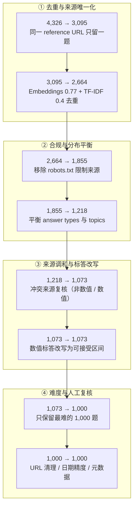

# SimpleQA Verified：参数化事实知识的 1,000 题清洗版

---

## 1. 一句话定义

**SimpleQA Verified** 是 Google DeepMind / Google Research 基于 OpenAI [SimpleQA](simpleqa.md) 重构的短形式事实性基准：从原版 4,326 题经去重、来源调和、主题与答案类型平衡后保留 **1,000 道最难的题**，并改写 autorater prompt，用于**在不启用任何工具（含搜索）的前提下**度量模型从参数中召回事实的能力。论文 2025-09-09 首发（v1），2026-03-10 修订为 v2，CC BY 4.0。

它不是原版的「2.0 版」，而是由另一机构发布的**衍生独立基准**：论文明确列出原版存在 noisy / incorrect labels、topical biases、question redundancy 三类问题，并指出这些噪声会让研究者分不清分数提升究竟来自真实事实召回，还是来自对 benchmark quirks 的过拟合。

> **范围与命名说明**：原版见 [simpleqa.md](simpleqa.md)。按 `AGENTS.md` §2.1 的五项判据，二者在题集重做、判定方式（autorater 与 prompt 全改）、评测构念（校准 → 参数化知识）、证据链与更新节奏（冻结的 GitHub 参考实现 → 持续更新的 Kaggle 榜单）上均已不同，远超「任意 2 项」门槛；但发布方不同、官方名称也不是数字版本，故按**两个独立基准**落库，不采用 `<slug>-v<N>` 命名。拆分约定中的交叉引用与「分数不可比」警示仍按 §2.1 保留。

---

## 2. 从 SimpleQA 到 Verified：九阶段筛选

> ⚠️ **不要跨口径比较**：下表最后一列是论文 Table 2 用 **Gemini 2.5 Pro + 同一 autorater** 在**各中间题集**上跑出的 F1-Score，用于诊断筛选过程对难度的影响，不是榜单；既不能与第 4 节的模型榜单混读，也不能与 [原版 SimpleQA](simpleqa.md) 第 4 节的 4,326 题口径比较。各阶段题集不同、规模不同，百分号只表示「该阶段题集上的 F1」。

| # | 处理阶段 | 题集规模 | 累计移除 | Gemini 2.5 Pro F1 |
| ---: | --- | ---: | ---: | ---: |
| 0 | SimpleQA（起点） | 4,326 | 0 | 55.1% |
| 1 | Ensuring Unique Source Documents | 3,095 | 1,231 | 54.3% |
| 2 | Removing Highly Similar Questions（Embeddings） | 2,871 | 1,455 | 54.4% |
| 3 | Removing Highly Similar Questions（TF-IDF） | 2,664 | 1,662 | 54.4% |
| 4 | Respecting Web Publisher Choices | 1,855 | 2,471 | 55.0% |
| 5 | Ensuring Diversity Across Answer Types and Topics | 1,218 | 3,108 | 54.0% |
| 6 | Reconciliation of Conflicting Sources（Non-Numeric） | 1,117 | 3,209 | 56.1% |
| 7 | Reconciliation of Conflicting Sources（Numeric） | 1,073 | 3,253 | 56.5% |
| 8 | Rewriting Numeric Ground Truths with Acceptable Ranges | 1,073 | 3,253 | 58.4% |
| 9 | SimpleQA Verified（Increasing Benchmark Headroom 后） | **1,000** | **3,326（−76.9%）** | 55.6% |

各阶段要点：

- **① 来源唯一化**：不允许两题共享同一个 reference URL（原版每题至少 2 个 URL，由两名 rater 分别给出）；同 URL 的一组优先保留 GPT-4o、Gemini 2.0 Flash、Claude 3.7 Sonnet 都答错的那题，以保住难度。`4,326 → 3,095`。
- **②③ 去重**：先用 Gemini Embeddings、cosine 阈值 `0.77` 做语义去重，再用 TF-IDF、cosine `> 0.4` 人工复核词汇重叠题。论文举例原版有 **119 题（2.7%）**在问不同哥伦比亚市镇的建城年份。`3,095 → 2,664`。
- **④ 出版方合规**：移除 reference URL 所属站点采用 `robots.txt` / `Google-Extended` 等 publisher controls 的题。`2,664 → 1,855`，是单步移除最多的一阶段。
- **⑤ 分布平衡**：主要平衡 answer types（原版 Date 32.8%、Person 24.1%），次要平衡 topics（Science & technology 过密）。`1,855 → 1,218`。
- **⑥⑦ 来源调和**：用带搜索的模型 ensemble 复核冲突来源；非数值题删除歧义/多答案，数值题要求所有来源落在 ground truth 的 **5%** 误差内。`1,218 → 1,073`。
- **⑧ 数值标答改写**：题量不变，但把 numeric ground truth 写成显式可接受区间，如 `8,282 (acceptable range: anything between 8199 and 8365)`。仅此一步就让 F1 从 56.5% 升到 58.4%，说明原 grader 对近似数值答案的误判相当可观。
- **⑨ 恢复 headroom**：清洗本身会让题集变易，故从 1,073 题中保留领先模型最难答的 1,000 题，F1 回落到 55.6%。



最终 1,000 题还经作者人工复核（清理无效 URL、修正 Date 标答精度）并用分类器补齐元数据：需 reasoning 的题占 **3.7%**、multi-step 占 **7.3%**。

---

## 3. 评测方式

### 3.1 沿用与改动

三类判定（`correct` / `incorrect` / `not attempted`）与 F1 定义沿用 [原版](simpleqa.md)，但 autorater 从「prompted ChatGPT classifier」明确固定为 **`gpt-4.1-2025-04-14`**；论文 Table 7 注记说明原版与 Verified 的结果**都用同一个 autorater** 重跑，以便计算 `Δ SimpleQA`。

作者先用高温（N=10、T=2.0）重复评分找出原 grader 分歧最大的回答，归纳出四类高不确定场景：答案正确但补充了额外信息或纠正题设、数值近似答案、声称信息不存在/难找、soft refusal / hedge / pushback。对应四处 prompt 改动：

| 改动 | 具体内容 |
| --- | --- |
| 数值规则 | 删除「精确到最后有效数字」，改为在 ground truth 中写明可接受区间；配合 Table 6 的 margin taxonomy（Exact Match Required 89 条 44%、±1% 84 条 42%、±5% 12 条 6%、排除 16 条 8%） |
| 只看直接回答 | 只计直接回答问题的部分，额外信息或纠正题设只要不与标答矛盾就忽略 |
| 防止罗列猜测 | 允许 hedging，但必须最终承诺**一个**答案；列多个候选而不承诺的一律 `NOT_ATTEMPTED` |
| 扩充弃答样例 | few-shot 中加入更多 punting 风格，使 soft refusal 判定一致 |

完整 prompt 词数 **963 → 1,124（+15%）**，论文 Appendix A 以红色标出差异。

### 3.2 指标

| 指标 | 定义 |
| --- | --- |
| Accuracy / overall correct | 全部 1,000 题中判为 correct 的比例 |
| Acc.\|Attempted | 在 attempted（correct + incorrect）中 correct 的比例 |
| **F1-Score** | 上两者的调和平均 `2·A·B/(A+B)` |
| Attempted | 未被判 `NOT_ATTEMPTED` 的比例 |
| Hedged | `100% − Attempted`；对应 soft refusal / hedge / pushback |

`Δ SimpleQA` 列是「Verified 的 F1 减去同一模型在原版 SimpleQA 上的 F1」，单位 **%pt**，`*` 表示 p<0.05。Table 7 全部行均为 standard API parameters、**without tools**。

### 3.3 硬性边界：禁用工具

论文与 Kaggle 页面都明确写：**启用搜索工具后该基准近乎满分**（"Enabling tools on SimpleQA Verified results in near perfect performance"），因此它只适合测参数化事实知识，不适合测带检索 / grounding 的系统。这是与原版相比最关键的协议约束——原版的 Kaggle 榜单头部分数显著高于论文口径，而页面并未披露工具设置。

---

## 4. 榜单结果与演进

> ⚠️ **不要跨口径比较**：4.1 是论文 arXiv:2509.07968**v2**（2026-03-10）Table 7 的 13 行，1,000 题、无工具、`gpt-4.1-2025-04-14` autorater、standard API parameters，且论文未披露被测模型的 API 快照与 reasoning effort；4.2 是 Kaggle 官方榜单（2026-10-20 更新，58 个模型行中页面显示 48 行，附 ±置信区间，页面未逐行标注工具设置与 effort）；4.3 是二手平台转述。三者**同为 1,000 题但评测配置与模型代际不同**，不可直接比较；与 [原版 SimpleQA](simpleqa.md) 的 4,326 题分数更不可比。所有分数均为厂商/作者报分，非本仓库复跑。

### 4.1 论文 Table 7（v2，2026-03-10）

| # | Model | F1-Score | Δ SimpleQA | Accuracy | Acc.\|Attempted | Attempted | Hedged |
| ---: | --- | ---: | ---: | ---: | ---: | ---: | ---: |
| 1 | Gemini 2.5 Pro | **55.6** | 0.5 | 55.3 | 55.9 | 98.9 | 1.1 |
| 2 | GPT 5 | 52.3 | 1.8 | 50.9 | 53.8 | 94.6 | 5.4 |
| 3 | o3 | 51.9 | 1.9 | 51.6 | 52.0 | 99.3 | 0.7 |
| 4 | GPT 4.1 | 39.9 | −1.0 | 39.8 | 40.1 | 99.3 | 0.7 |
| 5 | GPT 4o | 34.9 | −3.5* | 34.4 | 35.5 | 97.0 | 3.0 |
| 6 | DeepSeek R1 (0528) | 33.3 | 1.4 | 32.7 | 33.9 | 96.4 | 3.6 |
| 7 | Claude Opus 4 | 28.3 | −4.0* | 19.2 | 54.1 | 35.5 | 64.5 |
| 8 | Gemini 2.5 Flash | 28.2 | −1.4 | 27.8 | 28.7 | 96.9 | 3.1 |
| 9 | GPT 5 Mini | 24.6 | 1.1 | 17.3 | 42.8 | 40.4 | 59.6 |
| 10 | o4-mini | 23.4 | 2.9* | 23.0 | 23.8 | 96.5 | 3.5 |
| 11 | Claude Sonnet 4 | 18.7 | −4.4* | 12.5 | 36.9 | 33.9 | 66.1 |
| 12 | GPT 5 Nano | 14.4 | 0.7 | 10.2 | 24.2 | 42.2 | 57.8 |
| 13 | Gemini 2.5 Flash Lite | 11.1 | −0.4 | 10.2 | 12.1 | 84.0 | 16.0 |

单位 %（Δ 为 %pt）。最值得读的是 **Attempted / Hedged 两列**：Claude Opus 4 的 `Acc.|Attempted` 高达 54.1，但只尝试了 35.5% 的题（Hedged 64.5%），Accuracy 掉到 19.2，F1 仅 28.3；Claude Sonnet 4 更极端（33.9% attempted）。这正说明只看「答对的题里有多准」会严重高估模型，F1 把覆盖率压回来。GPT 4o、Claude Opus 4、Claude Sonnet 4 在 Verified 上相对原版显著变差，o4-mini 显著变好，其余多数模型 `Δ` 在 ±2 内——作者的解释是「清洗使题集变易」与「只保留最难 1,000 题」相互抵消。

### 4.2 Kaggle 官方榜单（2026-10-20）

页面标注 `Updated October 20, 2026`、`Showing 48 of 58 models`，按显示顺序取前 14：

| # | 模型 | 机构 | 分数 | 置信区间 |
| ---: | --- | --- | ---: | ---: |
| 1 | Gemini 3.1 Pro Preview | Google | 77.5% | ±2.6% |
| 2 | GPT-6 Astra | OpenAI | 75.8% | ±2.6% |
| 3 | Gemini 4 Argon | Google | 75.6% | ±2.6% |
| 4 | Gemini 3.8 Flash | Google | 74.6% | ±2.7% |
| 5 | GPT-6.1 Sol | OpenAI | 73.8% | ±2.8% |
| 6 | Gemini 3 Pro Preview | Google | 72.1% | ±2.9% |
| 7 | GPT-5.6 Sol | OpenAI | 69.2% | ±2.9% |
| 8 | GPT-6 Sol | OpenAI | 64.4% | ±3.0% |
| 9 | Claude Opus 5 | Anthropic | 63.3% | ±3.2% |
| 10 | Grok 4.7 | xAI | 59.4% | ±3.2% |
| 11 | Grok 4.5 | xAI | 53.8% | ±3.2% |
| 12 | Qwen 3 235B A22B Thinking | QwenLM | 53.7% | ±3.4% |
| 13 | Grok 4.6 | xAI | 52.9% | ±3.1% |
| 14 | Claude Opus 4.6 | Anthropic | 45.2% | ±3.1% |

注意 1,000 题的置信区间（±2.6%～±3.4%）明显宽于 [原版 4,326 题榜单](simpleqa.md)（±1.3%～±1.7%），这是样本量缩到约 1/4 的直接后果。转录见 `sources/simpleqa-verified/kaggle-leaderboard-2026-10-20.csv`。

### 4.3 二手聚合平台（仅作定位与交叉检查）

| 平台 | 条目 | 平台自述 | 本仓库采信程度 |
| --- | --- | --- | --- |
| BenchLM | [SimpleQA Verified](https://benchlm.ai/benchmarks/simpleqa-verified) | 转录论文 v2 Table 7 全部 13 行，标 `Display only` / `Dated paper cohort`；指出论文未披露 API 快照、reasoning effort 与生成参数 | 交叉检查，数字回到 4.1 |
| DataLearner | [SimpleQA Verified](https://www.datalearner.com/benchmarks/simpleqa-verified) | 7 行，榜首 DeepSeek-V4-Pro（思考水平·Max）57.90，更新于 2026-10-03 | 二手，且为同一模型的三个 effort 档，不与 4.1 混读 |
| LLMLearner | 目录页与 `site:` 检索均未见 SimpleQA / SimpleQA Verified 条目 | — | **未取到** |

---

## 5. 已知缺陷

| 局限 | 后果 |
| --- | --- |
| **1,000 题的统计功效** | 置信区间约 ±2.6–3.4%，头部 2–3 名常落在彼此区间内；比 4,326 题原版更不适合做小分数差的排名 |
| **一开工具即近乎满分** | 官方明确限定无工具；任何带搜索 / RAG 的系统必须先声明协议，否则分数没有意义 |
| **autorater 仍是单点依赖** | 判定依赖 `gpt-4.1-2025-04-14` + 人工定义的数值 margin taxonomy；换 grader 版本就是换口径 |
| **清洗会让题集变易** | 论文自述，靠「只保留最难 1,000 题」抵消；该难度筛选本身以一批 2025 年 frontier models 为参照，可能引入新的模型偏好 |
| **`Δ SimpleQA` 的原文笔误** | v2 正文有一句「on average, model performance on SimpleQA Verified is almost exactly the same as on SimpleQA Verified」，按上下文应指原版 SimpleQA；引用该结论时须回看 Table 7 |
| **构念仍窄** | 英文、单跳短事实、单一标答；不覆盖长文本、带引用事实性、多语与推理链（需 reasoning 的题仅 3.7%） |
| **证据链单薄** | 无独立 GitHub 仓库、无正式会议 / 期刊出处；数据集、评测代码与榜单全部集中在 Kaggle 一个页面，Appendix A 的 prompt 以 base64 data URL 形式附在论文里 |

---

## 6. 复现 / 快速上手

官方把**数据集、评测 Notebook、公开榜单**三件事放在同一个 Kaggle benchmark 页面，论文与页面均未给出独立 GitHub 仓库：

```text
https://www.kaggle.com/benchmarks/deepmind/simpleqa-verified
```

页面说明自带的 Notebook 演示如何基于自有模型回答计算全部指标（Accuracy、Acc.|Attempted、F1、Attempted、Hedged）。复现时必须固定三件事，否则结果不可比：

1. **禁用所有工具**（含搜索），只测参数化知识；
2. **固定 autorater** 为 `gpt-4.1-2025-04-14` 并使用论文 Appendix A 的 v2 prompt（含数值可接受区间规则）；
3. **全量 1,000 题**，报告时同时给出 Attempted / Hedged，不要只报 F1。

论文许可 CC BY 4.0，arXiv:2509.07968v2（2026-03-10）为当前定稿版本；v1 为 2025-09-09。按 `AGENTS.md` §1，1,000 题题库本体、Kaggle Notebook 与榜单全量 58 行**不入库**，本仓库只保留 `sources/simpleqa-verified/` 下两张小体积转录表。

---

## 7. 结论

SimpleQA Verified 修的是**测量工具本身**，而不是把题出得更难：去重、来源调和、分布平衡、数值标答改写，加上强制直接作答的 autorater prompt，目标是把「真实事实召回」从 benchmark artifacts 里分离出来。它保留并强化了原版最有价值的设计——把弃答率摆到台面上（Attempted / Hedged 两列），使「答得少但答得准」的模型不会被 F1 误判为强模型。

代价也很清楚：题量缩到 1,000 让统计功效下降约一倍，禁用工具的协议一旦被破坏分数即失去意义，且所有判定仍系于一个商用 autorater。实际使用时建议把它与 [原版 SimpleQA](simpleqa.md) 作为互补信号——原版看历史基线与校准研究，Verified 看当前无工具参数化知识，但**两篇的分数绝不并列比较**。

---

## 附：口径差异与未核验项

| 项目 | 状态 |
| --- | --- |
| 论文 Table 7 未披露的 API 快照 / reasoning effort / 生成参数 | **未核验到**；BenchLM 条目亦明确指出这一点 |
| Kaggle 榜单 58 行中未显示的 10 行、逐行工具与 effort 设置 | 页面仅显示 48 行，**未核验到** |
| Kaggle 榜单分数（77.5%）与论文 Table 7（55.6%）差距的成因 | 除模型代际更替外，官方未给出口径说明，**未核验到** |
| 独立 GitHub 仓库 | **未找到**；论文与 Kaggle 页面均未给出，评测代码以 Kaggle Notebook 形式发布 |
| 正式会议 / 期刊出处 | **未找到**；仅 arXiv 预印本 v1 / v2 |
| 中文别名 | 三个聚合平台均以英文名收录，**未取到**统一中文译名 |
| LLMLearner 条目 | 目录页与 `site:` 检索均**未取到** |
| 论文 v2 正文「…same as on SimpleQA Verified」疑似笔误 | 已在第 5 节标注，未擅自改写原文 |

---

## 8. 参考来源

1. 官方榜单 / 数据集 / 评测代码（Kaggle，`deepmind/simpleqa-verified`，2026-10-20 更新，显示 48/58 模型）：https://www.kaggle.com/benchmarks/deepmind/simpleqa-verified
2. 原始论文（arXiv:2509.07968，cs.CL；v1 2025-09-09、v2 2026-03-10；CC BY 4.0；本文第 2、3 节与 4.1 节数字的一手来源）：https://arxiv.org/abs/2509.07968
3. 上游原版论文（arXiv:2411.04368，OpenAI，2024-11-07）：https://arxiv.org/abs/2411.04368
4. 上游原版官方榜单（Kaggle，`openai/simpleqa`，2026-10-20 更新，标 Deprecated）：https://www.kaggle.com/benchmarks/openai/simpleqa
5. 二手聚合条目（BenchLM，转录论文 v2 Table 7 全部 13 行，标注 display only）：https://benchlm.ai/benchmarks/simpleqa-verified
6. 二手聚合条目（DataLearner，更新于 2026-10-03，7 行）：https://www.datalearner.com/benchmarks/simpleqa-verified
7. 二手聚合条目（LLMLearner）：目录页 https://llmlearner.com/benchmarks 与 `site:` 检索均**未取到** SimpleQA Verified 条目
8. 独立 GitHub 仓库：**未找到**。论文 Appendix A 的完整 autorater prompt 以 `data:text/plain;base64,...` 形式嵌在 arXiv HTML 中，不构成独立代码仓库
