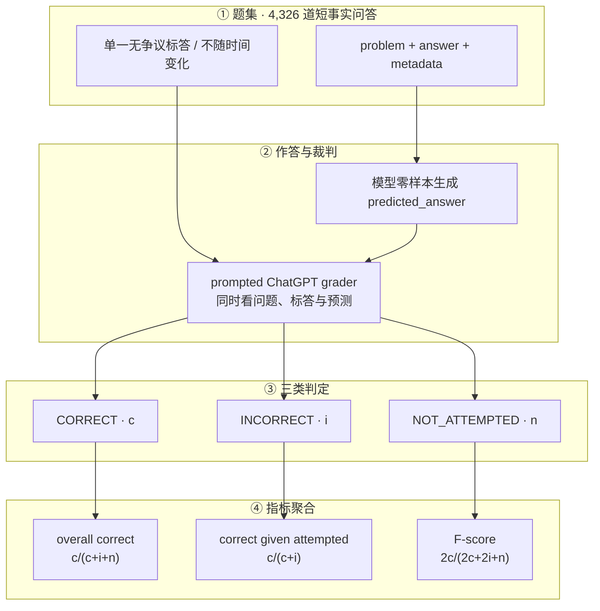

# SimpleQA：短形式事实性与「知道自己不知道」

---

## 1. 一句话定义

**SimpleQA** 是 OpenAI 于 2024-10-30 发布、2024-11-07 挂出论文的短形式事实性基准：4,326 道英文短事实问答题，每题只有一个无争议、不随时间变化的答案；用一个 LLM 裁判把模型回答判为 `correct` / `incorrect` / `not attempted` 三类，从而同时度量「答对多少」与「没把握时是否弃答」。论文把这一构念概括为模型是否 "know what they know"。

它与仓库内 [SQuAD 1.1](squad-v1-1.md)、[HotpotQA](hotpotqa.md) 的根本区别是**不提供上下文**：不是阅读理解，而是纯参数化知识召回 + 校准。设计动机是旧基准饱和——官网明确写 TriviaQA（2017）与 NQ（2019）已饱和，而 GPT-4o 在 SimpleQA 上低于 40%。

> **范围说明**：本文只覆盖 OpenAI 原版。Google DeepMind 的 1,000 题清洗版见 [simpleqa-verified.md](simpleqa-verified.md)。二者发布方、题集、autorater 与评测构念均不同，按 `AGENTS.md` §2.1 判为**两个独立基准**而非同一基准的版本迭代，故不采用 `<slug>-v<N>` 命名；但拆分约定中的交叉引用与「分数不可比」警示仍然保留。

---

## 2. 数据与任务构造

### 2.1 设计目标与准入准则

官网列出四项目标：参考答案由两名独立 AI trainer 交叉确认（High correctness）、主题覆盖广（Diversity）、对前沿模型仍有挑战（Challenging）、题面短且易跑易判（Good researcher UX，4,326 题保证低方差）。

论文 §2.1 把「挑战性」落实为五条准入准则，任何一条不满足即弃题：

| # | 准则 | 具体约束 |
| --- | --- | --- |
| 1 | 单一答案 | 必须指定答案范围（「哪座城市」而非「在哪里」、「哪一年」而非「什么时候」），只收客观知识 |
| 2 | 不随时间变化 | 题目要写成 evergreen（如限定「第 13 季的伴侣」），**禁止**用「截至 2023 年」这类取巧写法 |
| 3 | 有证据支撑 | 出题时须附支持参考答案的网页链接 |
| 4 | 知识截止可控 | 题目须在 **2023-12-31** 前即可回答，使不同知识截止的模型公平可比 |
| 5 | 对抗式采集 | 出题者查看 4 个 OpenAI 模型的回答，至少有 1 个答错才保留；前期四个均为不同时期的 GPT-4，末期换入 1 个 GPT-3.5 以便给小模型留出信号 |

质量控制是两阶段：先由 trainer 出题并附来源，再由**另一名看不到原答案的 trainer 独立作答**，只有两人答案一致才入库；不一致、不 timeless 或非单一答案的题删除，且要求两位 trainer 的 2–4 个来源覆盖**至少两个不同域名**。中间还用 few-shot ChatGPT 分类器扫描「没写单位 / 答案会变 / 多答案」等违规并退回修改。

### 2.2 标签错误率估计

定稿后随机抽 1,000 题交第三名 trainer 独立作答，按 ChatGPT grader 判定为 **94.4%** 一致、**5.6%**（56/1000）不一致。人工复核这 56 条后：15 条是 grader 假阴性，7 条是第三名 trainer 答得不完整，6 条是第三名 trainer 与自己引用的来源矛盾，剩余 **2.8%** 才是真实数据问题（题意模糊、权威来源互相冲突、存在多个正确答案）。论文据此估计基准的固有错误率约 **3%**，前提是 grader 没有假阳性。

### 2.3 数据文件与一手复核

官方数据集是单个 CSV，由 `simple-evals` 的 `SimpleQAEval.__init__` 中 `pandas.read_csv(...)` 在线加载；评测代码不随仓库分发数据本体。本仓库于 2026-11-05 下载并复核：

| 项目 | 一手结果 |
| --- | --- |
| URL | `https://openaipublic.blob.core.windows.net/simple-evals/simple_qa_test_set.csv` |
| 体积 / 行数 | 1.9 MB / **4,326** 条数据行（表头 1 行） |
| 列 | `metadata`、`problem`、`answer`；`metadata` 是字符串化的 dict，含 `topic`、`answer_type`、`urls` |
| 示例 | `Who received the IEEE Frank Rosenblatt Award in 2010?` → `Michio Sugeno` |

主题与答案类型分布（本仓库按 CSV `metadata` 字段复算，合计 4,326）：

| 主题 | 题数 | 主题 | 题数 |
| --- | ---: | --- | ---: |
| Science and technology | 858 | Sports | 368 |
| Politics | 709 | Music | 341 |
| Art | 550 | TV shows | 293 |
| Other | 475 | History | 173 |
| Geography | 424 | Video games | 135 |

| 答案类型 | 题数 | 占比 | 论文 §2.3 |
| --- | ---: | ---: | ---: |
| Date | 1,418 | 32.8% | 32.8% |
| Person | 1,041 | 24.1% | 24.1% |
| Other | 777 | 18.0% | 18.0% |
| Number | 663 | 15.3% | 15.3% |
| Place | 427 | 9.9% | 9.9% |

> **口径说明**：论文 §2.3 只点名前三大主题（858 / 709 / 550）与五类答案占比，上表全量分布与之一致，是本仓库从官方 CSV 复算补全。一处差异值得注意：论文 §2.2 称每题保留「2–4 个来源」，而实际 CSV 的 `urls` 数组长度分布为 2 条 193 题、3 条 934 题、4 条 3,134 题、5 条 58 题、6 条 6 题、7 条 1 题。引用来源数量时以 CSV 为准。统计明细见 `sources/simpleqa/dataset-metadata-summary.json`。

---

## 3. 评测方式

### 3.1 三类判定

`simpleqa_eval.py` 的 `GRADER_TEMPLATE` 把问题、标准答案、模型预测一起喂给一个 prompted ChatGPT 分类器，要求只回 `A` / `B` / `C`；解析不到匹配字母时**默认判 `C`**（`grade_sample` 的兜底分支，等价于弃答）。

| 判定 | 定义 | 示例（标答 Wout Weghorst） |
| --- | --- | --- |
| `CORRECT` | 完整包含标答且不与标答矛盾；hedging 允许，大小写 / 标点 / 语序不计 | `Wout Weghorst`；`Wout Weghorst scored at 83' and 90+11'` |
| `INCORRECT` | 与标答有任何矛盾，**即使带 hedge** | `Virgil van Dijk`；`Wout Weghorst and I think van Dijk scored, but I am not totally sure` |
| `NOT_ATTEMPTED` | 未完整给出标答，且没有矛盾 | `I don't know the answer to that question` |

grader 另有几条易被忽略的规则：数字答案要求精确到标答最后一个有效数字（近似表达如 `around 100k` 判 `NOT_ATTEMPTED`）；标答含冗余信息时只扣题目真正问的部分；人名拼写轻微错误不扣分。论文承认**未对 grader 做正式性能研究**，只人工读过 100 条 correct、100 条 incorrect、100 条 not attempted，发现 2 处分歧。

### 3.2 指标与 F-score 漏洞

设 `c` / `i` / `n` 分别为 correct / incorrect / not attempted 的题数：

| 指标 | 公式 |
| --- | --- |
| overall correct | `c / (c + i + n)` |
| correct given attempted | `c / (c + i)` |
| **F-score** | 上两者的调和平均 `2c / (2c + 2i + n)` |

`not attempted` 不计入错误，这正是「校准」能被单独度量的原因。但论文 §2.4 与附录 B 明确指出 **F-score 有漏洞**：当模型整体正确率低于 50% 时，只要对某题有 ≥50% 把握，猜的期望得分就高于弃答——因为猜对抬高分子、猜错主要通过分母小幅稀释。论文给出的替代口径是给错误答案设负分 `-p`（correct = 1、not attempted = 0、incorrect = −p）；取 `p=9` 时，只有 attempted 题目中至少 90% 正确，总分才可能为正，而当时所有被测模型都达不到。

`simple-evals` 的实现与论文一致：聚合出 `is_correct` / `is_incorrect` / `is_not_attempted` 三个占比，`accuracy_given_attempted = is_correct / (is_correct + is_incorrect)`，再按调和平均算出 `f1`。

### 3.3 校准分析

论文另做两组校准测量：一是让模型自报置信度（prompt 要求给出 best guess 与百分比置信度），结果所有模型的 stated confidence 都**系统性高于**实际准确率（曲线在 y=x 下方），且 o1-preview 优于 o1-mini、GPT-4o 优于 GPT-4o-mini；二是同一问题重复问 100 次、按字符串匹配聚类，发现答案出现频率与准确率正相关，o1-preview 的「回答频率 ≈ 准确率」最接近理想校准。



---

## 4. 榜单结果与演进

> ⚠️ **不要跨口径比较**：SimpleQA 只有单一 split（全量 4,326 题），没有 train/dev/test 划分，但下表四个来源的**评测 harness 与采样设置并不统一**。4.1 是论文 Table 3（2024-11，无浏览、prompted ChatGPT grader、8 个模型，作者自报）；4.2 是 `simple-evals` README 的厂商自报列（2025-07 冻结，含 system prompt 与模型快照差异，其中 Claude 两行标注 prompt 为 unknown）；4.3 是 Kaggle 官方榜单（2026-10-20 更新，49 个模型行，页面标注 **Deprecated** 且附 ±置信区间，但**未披露 grader 版本、是否禁用工具与采样设置**）；4.4 是二手聚合平台转述的厂商自报。跨表数字一律不可直接比较，只看同一表内相对排序；与 [SimpleQA Verified](simpleqa-verified.md) 的 1,000 题分数也不可比。

### 4.1 论文 Table 3（2024-11，一手基线）

| Model | Correct | Not attempted | Incorrect | Correct given attempted | F-score |
| --- | ---: | ---: | ---: | ---: | ---: |
| OpenAI o1-preview | 42.7 | 9.2 | 48.1 | 47.0 | **44.8** |
| GPT-4o | 38.2 | 1.0 | 60.8 | 38.0 | 38.4 |
| Claude-3.5-sonnet (2024-06-20) | 28.9 | 35.0 | 36.1 | 44.5 | 35.0 |
| Claude-3-opus (2024-02-29) | 23.5 | 39.6 | 36.9 | 38.8 | 29.3 |
| OpenAI o1-mini | 8.1 | 28.5 | 63.4 | 11.3 | 9.4 |
| Claude-3-sonnet (2024-02-29) | 5.7 | 75.0 | 19.3 | 22.9 | 9.2 |
| GPT-4o-mini | 8.6 | 0.9 | 90.5 | 8.7 | 8.6 |
| Claude-3-haiku (2024-03-07) | 5.1 | 75.3 | 19.6 | 20.6 | 8.2 |

单位 %。这张表最值得读的不是排名，而是**弃答策略**：GPT-4o 几乎每题都答（not attempted 仅 1.0%），错了 60.8%；Claude-3.5-sonnet 弃答 35.0%，correct 只有 28.9% 却拿到 35.0 的 F-score，与 GPT-4o 的 38.4 接近。o1-preview 靠 42.7% correct + 9.2% 弃答拿到最高 F-score 44.8。全部模型 correct 均低于 50%，符合设计预期。

### 4.2 `simple-evals` README 厂商自报列（2025-07 冻结）

| 模型 | SimpleQA | 备注 |
| --- | ---: | --- |
| gpt-4.5-preview-2025-02-27 | 62.5 | 该表最高分 |
| o3 / o3-low | 49.4 | 无工具启用 |
| o3-high | 48.6 | 无工具启用 |
| o1 | 42.6 | — |
| o1-preview | 42.4 | 论文 Table 3 为 42.7 |
| gpt-4.1-2025-04-14 | 41.6 | assistant system prompt |
| gpt-4o-2024-08-06 | 40.1 | — |
| gpt-4o-2024-05-13 | 39.0 | 论文 Table 3 为 38.2 |
| gpt-4o-2024-11-20 | 38.8 | — |
| Claude 3.5 Sonnet | 28.9 | 标注 `unknown` prompt |
| Claude 3 Opus | 23.5 | 标注 `unknown` prompt |
| o4-mini | 20.2 | 无工具启用 |
| gpt-4o-mini-2024-07-18 | 09.5 | 论文 Table 3 为 8.6 |
| o1-mini | 07.6 | 论文 Table 3 为 8.1 |

单位 %，节选自完整 30 余行表（全量转录见 `sources/simpleqa/simple-evals-results.csv`）。**同一模型在论文与 README 之间有 0.1–0.9 个百分点的差异**（o1-preview 42.7/42.4、GPT-4o 38.2/39.0、o1-mini 8.1/7.6、gpt-4o-mini 8.6/9.5），说明 grader 版本、模型快照或采样设置并不同一；本仓库并列写出，不静默取其一。

### 4.3 Kaggle 官方榜单（2026-10-20）

页面标注 `Deprecated`、`Updated October 20, 2026`、`Showing 42 of 49 models`，按显示顺序取前 15：

| # | 模型 | 机构 | 分数 | 置信区间 |
| ---: | --- | --- | ---: | ---: |
| 1 | Gemini 3.1 Pro Preview | Google | 74.8% | ±1.4% |
| 2 | GPT-6 Astra | OpenAI | 73.1% | ±1.4% |
| 3 | Gemini 4 Argon | Google | 71.2% | ±1.3% |
| 4 | GPT-6.1 Sol | OpenAI | 71.1% | ±1.3% |
| 5 | Gemini 3 Pro Preview | Google | 70.5% | ±1.4% |
| 6 | Gemini 3.8 Flash | Google | 69.4% | ±1.4% |
| 7 | GPT-5.6 Sol | OpenAI | 67.7% | ±1.5% |
| 8 | Gemini 3.6 Flash | Google | 65.6% | ±1.5% |
| 9 | GPT-6 Sol | OpenAI | 63.2% | ±1.6% |
| 10 | Claude Opus 5 | Anthropic | 62.2% | ±1.5% |
| 11 | Grok 4.7 | xAI | 58.2% | ±1.5% |
| 12 | Grok 4.5 | xAI | 51.7% | ±1.7% |
| 13 | Qwen 3 235B A22B Thinking | QwenLM | 50.4% | ±1.4% |
| 14 | Grok 4.6 | xAI | 49.5% | ±1.5% |
| 15 | Claude Opus 4.6 | Anthropic | 48.3% | ±1.6% |

该榜分数远高于 2024 年论文口径（74.8% vs 42.7%），但页面**未说明是否禁用工具、用哪个 grader、跑了几次**。同页转录见 `sources/simpleqa/kaggle-leaderboard-2026-10-20.csv`。

### 4.4 二手聚合平台（仅作定位与交叉检查）

| 平台 | 条目 | 平台自述口径 | 本仓库采信程度 |
| --- | --- | --- | --- |
| BenchLM | [SimpleQA](https://benchlm.ai/benchmarks/simpleqa) | 14 行全部为厂商自报，榜首 GPT-4.5 62.5%（数据核验 2026-11-04），标 `Display only` | 仅交叉检查，分数回到 4.1 / 4.2 |
| DataLearner | [SimpleQA](https://www.datalearner.com/benchmarks/simpleqa) | 30 行，榜首 DeepSeek V3.2-Exp 97.10，行内标注「开启思考工具」 | 该榜含工具启用行，与无工具口径不可比 |
| LLMLearner | 目录页与 `site:` 检索均无 SimpleQA 条目 | — | **未取到** |

BenchLM 另镜像了一份「SimpleQA (Kaggle)」49 行表（标注 Task version 7），其前列排序与 4.3 的 Kaggle 页面可见顺序不完全一致（多出 Gemini 3.7 Flash、Gemini 3.5 Flash 等行），属二手转述，本仓库未用其替换官方页面数字。

---

## 5. 已知缺陷

| 局限 | 后果 |
| --- | --- |
| **构念窄** | 论文自述只测「短、事实性、单一可验证答案」，短答案事实性是否外推到长文本、多事实回答仍是开放问题 |
| **F-score 漏洞** | 整体正确率 <50% 时奖励「有五成把握就猜」，与「鼓励弃答」的初衷相冲突 |
| **约 3% 固有标签错误** | 歧义题、权威来源互相冲突、存在多个正确答案；[SimpleQA Verified](simpleqa-verified.md) 主要就是为修这些而来 |
| **grader 依赖** | 判定全靠一个 prompted ChatGPT 分类器，未做正式性能研究；数字答案「精确到最后有效数字」规则会误判近似正确答案 |
| **分布偏斜** | Date 32.8% + Person 24.1%，Science and technology 858 题；来源高度集中（wikipedia.com 是约 3.5k/4.3k 题的来源之一） |
| **英文单跳 trivia** | 不覆盖多跳推理、长文本、带引用事实性、非英语；中文等多语版本需另找基准 |
| **污染与冻结** | 题库 2024 年公开、无隐藏集，已被广泛用作训练/调参；`simple-evals` 自 2025-07 起不再更新模型与结果，Kaggle 榜单标 Deprecated |

**今天的定位**：SimpleQA 不再是前沿难度的标尺，但仍是检验「模型知不知道自己不知道」的最小完整闭环——它把正确率与弃答率拆成两个可分别审计的量。严谨评估应同时报告 correct / not attempted / incorrect 三元组与所用 grader，并搭配 [SimpleQA Verified](simpleqa-verified.md) 等清洗版交叉验证。

---

## 6. 复现 / 快速上手

```bash
# 1) 取官方题库（1.9 MB，4,326 行；按 AGENTS.md §1 不入库）
curl -O https://openaipublic.blob.core.windows.net/simple-evals/simple_qa_test_set.csv

# 2) 取官方评测实现（MIT，2025-07 起冻结，仅托管参考实现）
git clone https://github.com/openai/simple-evals.git
cd simple-evals
pip install pandas openai
python -m simple_evals.simple_evals --list-models
python -m simple_evals.simple_evals --model <model_name> --examples 4326
```

需注意三点：一是 `SimpleQAEval` 在初始化时**在线拉取**上面的 CSV，离线环境要预先缓存；二是 grader 是独立传入的 `SamplerBase`（`--model` 决定被评测者，grader 由 `simple_evals.py` 装配），换 grader 就等于换口径；三是 `num_examples < 4326` 时走随机抽样（`random.Random(0)`），此时分数不能与全量结果并列。

社区镜像（**二手**）：Hugging Face `MAISAAI/openai_simple_qa_test_set` 把 CSV 包成 `train` split 的 4,326 行，字段为 `metadata` / `problem` / `answer`，与官方 CSV 一致，但不是官方发布渠道，仅作离线取数备选。

> **来源锚定说明**：本仓库引用上游源码时按符号锚定（`GRADER_TEMPLATE`、`SimpleQAEval.__init__`、`grade_sample`、`accuracy_given_attempted`），未使用行号。核验当日 `raw.githubusercontent.com` 直连超时，无法取得可复核的稳定行号，按 `AGENTS.md` §5 不以近似行号代替。

---

## 7. 结论

SimpleQA 的价值不在于「谁分高」，而在于它把事实性拆成了**答对、答错、弃答**三个可分别审计的桶，并用调和平均把准确率与覆盖率绑成一个数。它同时暴露了两个至今未解决的评测难题：LLM 裁判本身的可靠性，以及「鼓励诚实弃答」的指标在模型整体弱于 50% 时反而奖励猜题。

2024 年论文口径下所有前沿模型 correct 都低于 50%；到 2026 年，Kaggle 榜单头部已到 74.8%，但该榜标注 Deprecated 且未披露工具设置，无法与论文口径对齐。若要继续用 SimpleQA 系做事实性评估，建议以 [SimpleQA Verified](simpleqa-verified.md) 的 1,000 题 + 明确禁用工具的协议为主，把原版作为历史基线与校准研究的参照。

---

## 附：口径差异与未核验项

| 项目 | 状态 |
| --- | --- |
| 论文与 `simple-evals` README 同模型分数差 0.1–0.9 pt | 已在 4.2 并列写出，不静默取其一 |
| Kaggle 榜单的 grader 版本 / 是否禁用工具 / 运行次数 | 页面未披露，**未核验到** |
| Kaggle 榜单分数与论文 Table 3 分数差异的成因 | 未核验到官方说明，本文只陈述差异 |
| 官方 CSV `urls` 长度 2–7 与论文「2–4 个来源」的表述差异 | 已在 2.3 标注，以 CSV 为准 |
| LLMLearner 的 SimpleQA 条目 | 目录页与 `site:` 检索均**未取到** |
| 原版 SimpleQA 的独立 GitHub 仓库 | 无，评测代码位于 `openai/simple-evals`（同时托管 MMLU、BrowseComp、HealthBench 等） |
| 正式会议 / 期刊出处 | arXiv:2411.04368 仅 v1（2024-11-07），**未找到**会议或期刊版本 |

---

## 8. 参考来源

1. 官方介绍（OpenAI，`Introducing SimpleQA`，2024-10-30，核验于 2026-11-05）：https://openai.com/index/introducing-simpleqa/
2. 原始论文（arXiv:2411.04368，cs.CL，2024-11-07 提交，仅 v1；本文第 2、3 节与 4.1 节数字的一手来源）：https://arxiv.org/abs/2411.04368
3. 官方仓库（GitHub，`openai/simple-evals`，MIT；含 `simpleqa_eval.py` 与 Benchmark Results 表，2025-07 起冻结）：https://github.com/openai/simple-evals
4. 官方榜单与数据集（Kaggle，`openai/simpleqa`，2026-10-20 更新，页面标注 Deprecated）：https://www.kaggle.com/benchmarks/openai/simpleqa
5. 数据集本体（Azure Blob，`simple_qa_test_set.csv`，1.9 MB / 4,326 行，2026-11-05 下载核验；按 `AGENTS.md` §1 不入库）：https://openaipublic.blob.core.windows.net/simple-evals/simple_qa_test_set.csv
6. 官方论文 PDF（由 `simpleqa_eval.py` 文件头给出）：https://cdn.openai.com/papers/simpleqa.pdf
7. 二手聚合条目（BenchLM，数据核验 2026-11-04，全部为厂商自报）：https://benchlm.ai/benchmarks/simpleqa
8. 二手聚合条目（DataLearner，更新于 2026-10-11，含工具启用行）：https://www.datalearner.com/benchmarks/simpleqa
9. 社区数据集镜像（**非官方**，Hugging Face `MAISAAI/openai_simple_qa_test_set`）：https://huggingface.co/datasets/MAISAAI/openai_simple_qa_test_set
10. 二手聚合条目（LLMLearner）：目录页 https://llmlearner.com/benchmarks 与 `site:` 检索均**未取到** SimpleQA 条目
11. 后续清洗版论文（arXiv:2509.07968，Google DeepMind，详见 [simpleqa-verified.md](simpleqa-verified.md)）：https://arxiv.org/abs/2509.07968
