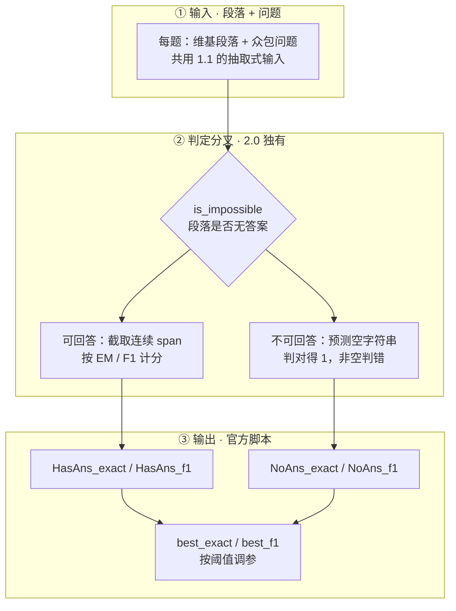

# SQuAD 2.0：带对抗式不可回答题的抽取式阅读理解基准

---

## 1. 一句话定义

**SQuAD 2.0**（2018，ACL 2018 最佳短论文 *Know What You Don't Know: Unanswerable Questions for SQuAD*）在 [SQuAD 1.1](squad-v1-1.md) 的 10 万道可回答问题之外，加入 5 万余条**对抗式不可回答题**：问题针对同一段落撰写、看起来很像能回答，但段落里其实没有答案，模型必须**弃答**。因此它测的不再只是「找 span」，而是「知道自己不知道」。

> **共用背景说明**：SQuAD 的品牌沿革、众包构造流程、EM / F1 定义与隐藏测试集榜单机制在 [SQuAD 1.1](squad-v1-1.md) 第 1、2.2、3 节完整叙述，本文不复制；以下各节只描述 2.0 相对 1.1 新增的部分。两版题集与判定规则不同，**分数不可跨版本比较**。

---

## 2. 数据与任务构造

### 2.1 规模与划分

论文为 Rajpurkar / Jia / Liang, *Know What You Don't Know: Unanswerable Questions for SQuAD*, ACL 2018（最佳短论文）；官网口径是「1.1 的 10 万题 + 5 万余条对抗式不可回答题」，论文统计约 150K 题、其中 53,775 条不可回答，训练 / 开发 / 测试文章数为 442 / 35 / 28。按论文 Table 2 的划分：

| 划分 | 可回答 | 不可回答 | 合计 |
| --- | ---: | ---: | ---: |
| 训练集 `train-v2.0.json` | 86,821 | 43,498 | 130,319 |
| 开发集 `dev-v2.0.json` | 5,928 | 5,945 | 11,873 |
| 测试集（隐藏） | 4,530 | 4,332 | 8,862 |

开发集的可答 / 不可答题约 1:1。数据文件为 `train-v2.0.json`（40 MB）/ `dev-v2.0.json`（4 MB），许可 **CC BY-SA 4.0**（商用需遵守署名与相同方式共享）。按文章（而非按题目）切分 train/dev/test、隐藏测试集由官方跑分的机制与 [SQuAD 1.1](squad-v1-1.md) 第 2.2 节相同。

### 2.2 对抗式不可回答题的构造

在 [SQuAD 1.1](squad-v1-1.md) 第 2.2 节的流程里，2.0 在「校验」与「划分」之间插入一步：众包者被要求针对同一段落**对抗式地**写出「看起来很像能回答、但段落里其实没有答案」的问题（例如替换实体、改动数量或时态），并附一个 `plausible_answers` 作为干扰项。目的是防止模型靠「问题与段落词汇重叠」这一捷径作答。

论文里最直观的一组对比：一个在 SQuAD 1.1 上拿到 **86% F1** 的强神经模型（DocQA + ELMo），直接搬到 SQuAD 2.0 只有 **66% F1**，说明「知道自己不知道」比「找答案」难得多。

> ⚠️ **不要跨口径比较**：86% / 66% F1 出自 2.0 论文同一组对照实验（DocQA + ELMo 分别在两版上评测，**论文自报**），用于说明任务难度跃迁；所用 split 与评测 harness **未取到 / 未按同样深度核验**，**不是两版榜单成绩的可比换算**。与 [SQuAD 1.1](squad-v1-1.md) 官网隐藏 test 集 leaderboard 的 F1 分数不可比。

### 2.3 JSON 结构与关键字段

```json
{
  "version": "v2.0",
  "data": [{
    "title": "Normans",
    "paragraphs": [{
      "context": "The Normans were the people who ...",
      "qas": [{
        "id": "56be...",
        "question": "In what country is Normandy located?",
        "answers": [{"text": "France", "answer_start": 159}],
        "is_impossible": false
      }, {
        "id": "5a8d...",
        "question": "Who was the first Norman king of England?",
        "answers": [],
        "is_impossible": true,
        "plausible_answers": [{"text": "William the Conqueror", "answer_start": 42}]
      }]
    }]
  }]
}
```

关键字段：`is_impossible` 决定是答题还是弃答；`answer_start` 是字符级偏移，用于定位 span；不可回答题的 `answers` 为空数组，`plausible_answers` 是构造时留下的干扰答案。

---

## 3. 评测方式

### 3.1 与 1.1 共用的部分

EM / F1 的归一化规则、token 袋 F1、多参考答案取 max、隐藏 test 集百分制，以及「微调 + 提交预测由官方跑分」的榜单机制，全部沿用 [SQuAD 1.1](squad-v1-1.md) 第 3 节的定义，本文不重复。

### 3.2 无答案题判定与分组指标

| 规则 | 说明 |
| --- | --- |
| 无答案题计分 | 预测空字符串即视为正确（EM/F1 = 1），任何非空答案判错 |
| 分组指标 | 官方 `evaluate-v2.0.py` 输出 `HasAns_exact` / `HasAns_f1` / `NoAns_exact` / `NoAns_f1` |
| 阈值调参 | 同一脚本另输出按阈值调参后的 `best_exact` / `best_f1` |

```bash
python evaluate-v2.0.py dev-v2.0.json predictions.json
```



分析 2.0 模型时务必把「答题能力」与「弃答能力」拆开看，只看总分容易被某一类掩盖。

---

## 4. 榜单结果与演进

### 4.1 关键成绩

| 项 | 模型 / 说明 | EM | F1 |
| --- | --- | ---: | ---: |
| 人类表现（官网，test） | 人类标注参考值 | 86.831 | 89.452 |
| 官网榜首（test） | IE-Net（ensemble，RICOH_SRCB_DML，2021-06） | **90.939** | **93.214** |

> ⚠️ **不要跨口径比较**：本表为 SQuAD **2.0 隐藏 test 集**、官方 leaderboard「微调 + 隐藏集」口径，由官网以评测方身份发布（**评测方自报**，非第三方复测），单次提交、无标准差；榜首 IE-Net 为 **ensemble**，与单模型成绩不同口径。与 dev 集、`best_exact` / `best_f1` 阈值调参结果、第三方零样本 / 少样本或厂商自测数字均不可直接比较。与 [SQuAD 1.1](squad-v1-1.md) 的 EM / F1 虽然同名，但 2.0 题集含 53,775 条不可回答题、判定规则不同，**两代分数不可比**。

### 4.2 演进时间线

| 时间 | 事件 |
| --- | --- |
| 2018-06 | SQuAD 2.0 发布（ACL 2018 最佳短论文），引入弃答任务，重新拉开人机差距 |
| 2020–2022 | Retro-Reader、SA-Net、FPNet、IE-Net 等「抽取器 + 验证器 + 集成」方案把 v2.0 推到 EM 90.939 / F1 93.214；榜单最后的新条目约在 2022-05 |
| 2023 至今 | 官方榜鲜有新提交；LLM 时代转为 zero- / few-shot 评测与 RAG 场景下的拒答评估 |

> ⚠️ **不要跨口径比较**：本表分数为官网隐藏 test 集、微调口径的榜单成绩（**评测方自报**、不同年份的独立提交），不是同期横评；网络上流传的 2024–2026 年 LLM「SQuAD 2.0 得分」多来自第三方零样本 / 少样本测试或厂商自测，与本表口径不同。与 [SQuAD 1.1](squad-v1-1.md) 的榜单分数**不可比**。

---

## 5. 已知缺陷

| # | 局限 | 后果 / 说明 |
| --- | --- | --- |
| 1 | 「无答案」是与**给定段落**不匹配 | 属于**弃答判定**，不等于真正的推理或不确定性校准 |
| 2 | 1.1 的四类构造局限全部继承 | 答案须为连续 span、单段落、词汇重叠捷径、领域与语言单一，详见 [SQuAD 1.1](squad-v1-1.md) 第 5 节 |
| 3 | 只看总分会掩盖答题 / 弃答能力差异 | 须拆看 `HasAns_*` / `NoAns_*` 分组指标（见 3.2 节） |

---

## 6. 复现与快速上手

```python
from datasets import load_dataset

squad = load_dataset("rajpurkar/squad_v2")
print(squad)
# DatasetDict: train 130319, validation 11873
print(squad["train"][0]["context"][:120], squad["train"][0]["question"])
```

```bash
python evaluate-v2.0.py dev-v2.0.json predictions.json
```

官方资源（均来自 SQuAD Explorer 首页）：

| 资源 | 链接 / 说明 |
| --- | --- |
| 训练集 / 开发集 | https://rajpurkar.github.io/SQuAD-explorer/dataset/train-v2.0.json · dev-v2.0.json（40 MB / 4 MB） |
| 2.0 论文 | https://arxiv.org/abs/1806.03822 |
| 评测脚本与提交教程 | 首页 `Evaluation Script v2.0` 与 CodaLab `Submission Tutorial` |
| 题目可视化探索 | https://rajpurkar.github.io/SQuAD-explorer/explore/v2.0/dev/ |
| 许可 | CC BY-SA 4.0（商用需遵守署名与相同方式共享） |

按 `AGENTS.md` §1，任务数据集不入库；来源版本、体积与未入库边界见 `sources/squad-v2-0/README.md`。

---

## 7. 结论

2.0 的真正价值是把「拒答」变成可大规模自动判定的任务：不可回答题与可回答题共用同一段落、刻意制造词汇重叠，逼模型在「找答案」之外再学一层「段落是否支持回答」。但必须记住，「无答案」是相对给定段落定义的，弃答正确不等于模型具备不确定性校准；引用榜单总分而不拆 `HasAns_*` / `NoAns_*`，也容易把两类能力混为一谈。

今天它是检验抽取式 QA 基本功、以及 RAG 系统「无依据时是否敢拒答」最方便的起点。需要纯抽取式 QA 的历史基线，见 [SQuAD 1.1](squad-v1-1.md)；两版只是同名，不是同一把尺子。

---

## 8. 参考来源

1. **一手**：SQuAD Explorer 官方首页与 2.0 leaderboard：https://rajpurkar.github.io/SQuAD-explorer/
2. **一手**：Rajpurkar, Jia, Liang, *Know What You Don't Know: Unanswerable Questions for SQuAD*, ACL 2018：https://arxiv.org/abs/1806.03822（Table 2 / Table 3 为划分与基线数据来源）
3. **一手**：Rajpurkar et al., *SQuAD: 100,000+ Questions for Machine Comprehension of Text*, EMNLP 2016：https://arxiv.org/abs/1606.05250（1.1 基线论文，用于第 2.2 节的 F1 对照）
4. **二手**：数据划分与字段结构的交叉核验——公开数据集统计与解析实现（GitHub）、Hugging Face `rajpurkar/squad_v2` 数据集卡
5. 同基准前代文档（品牌、构造与 EM / F1 定义来源列于其中）：[squad-v1-1.md](squad-v1-1.md)
