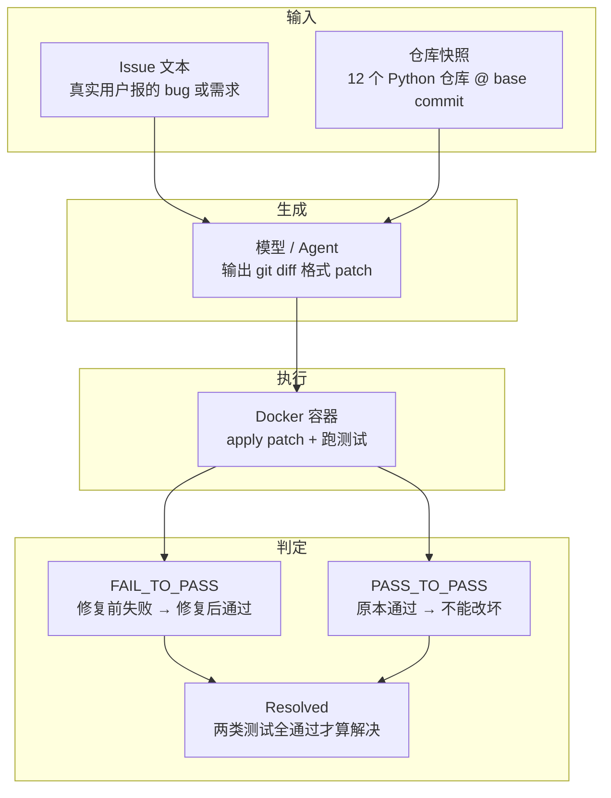

# SWE-bench

> 用真实 GitHub issue 检验语言模型能否端到端修复一个代码仓库。
> 发布：Princeton NLP，2023-10（ICLR 2024）

## 一句话定位

它不考算法题，而是把真实 issue 丢给模型，让它自己读仓库、改代码、跑测试。判分不靠人看、不靠文本相似度，**只靠仓库原本的单元测试是否通过**。

## 评测机制

每条实例 = 一段真实 GitHub issue 文本 + 该仓库在某个历史 commit 上的完整快照。原始集 2,294 条，取自 django、scikit-learn、sympy、matplotlib、pytest 等 12 个流行 Python 仓库。



核心指标 **% Resolved**：两类测试（`FAIL_TO_PASS` + `PASS_TO_PASS`）全部通过的实例占比。容器化执行是它可信度的来源，也是它成本高的原因——每条实例都要拉镜像、建环境。

## 家族成员

| 变体 | 规模 | 定位 | 现状 |
| --- | --- | --- | --- |
| SWE-bench (Full) | 2,294 | 原始集，噪声较多 | 少用 |
| Lite | 300 | 低成本快速评测子集 | 常用 |
| Verified | 500 | OpenAI 与原作者人工复核，剔除描述不清 / 测试有问题的实例 | 已饱和 |
| Multimodal | 480 | JS 前端题，issue 中含截图、UI 稿 | 未饱和 |
| Multilingual | 300 | 9 种语言、42 个仓库 | 未饱和 |
| SWE-bench Pro | 1,865 | 企业级长链路、跨文件任务 | 当前主信号 |
| SWE-bench-Live | 持续更新 | 微软维护，每月新增 50 道新 issue，抗污染 | 最强污染审计 |
| SWE-Bench Pro Verified | 731 | 2026-09，在 Pro 之上加反作弊机制 | 新 |

## 成绩演进

| 时间 | 系统 | 解决率 | 口径 |
| --- | --- | --- | --- |
| 2023-10 | Claude 2 | 1.96% | Full，论文基线 |
| 2024 | SWE-agent + GPT-4 | 12.47% | Full |
| 2025 | 前沿 SOTA | 74.9% | Verified，厂商自报 |
| 2026-02 | Claude 4.5 Opus | 76.8% | Verified，官方 mini-SWE-agent harness |
| 2026-07 | Claude Opus 5 | 96.0% | Verified，厂商自报 |

⚠️ **不要跨口径比较。** 官方榜单（swebench.com）强制所有模型跑同一套极简 harness（mini-SWE-agent，纯 bash、约 100 行 Python），因此官方数字显著低于厂商自报。换一套文件检索策略、多给几次重试，同一模型可相差 10–20 个百分点。脱离 harness 谈分数没有意义。

## 已知问题

- **数据污染**：OpenAI 审计发现所有前沿模型都能复现部分 gold patch 原文。第三方分析更具体——仅凭 issue 文本、不看代码，模型在 Verified 上命中正确文件的概率为 76%，而在同类但不在榜内的仓库上不到 53%；gold 函数的 5-gram 重叠 34.9% vs 18.2%，是典型的记忆特征。
- **测试本身有错**：OpenAI 让工程师逐题复核 138 道 o3 表现不稳的题，至少 59.4% 存在"会拒绝正确解"的错误测试（占全集的 27.6%）。
- **饱和**：头部分数挤在 95%+，区分度归零。OpenAI 已停止报告 Verified，转向 Pro。
- **指标单一**：只测"能不能跑通"，不看代码质量、性能、安全；原始集仅覆盖 Python。
- **Pro 也非净土**：SWE-Bench Pro Verified 论文发现 gold solution 泄漏导致 reward hacking，部分模型的真实能力低于已公布数字。

## 复现

```bash
pip install swebench
python -m swebench.harness.run_evaluation \
  --dataset_name princeton-nlp/SWE-bench_Verified \
  --predictions_path preds.json \
  --max_workers 8 \
  --run_id myrun
```

需要 Docker。500 条全量跑一次成本不低，日常迭代建议先用 Lite。

配套资源：

- 训练数据合成：SWE-smith
- 开源脚手架：SWE-agent / mini-SWE-agent
- 邻近基准：SWE-bench-Live、SWE-Bench Pro、SWE-bench Multimodal

## 结论

SWE-bench 是过去三年 agentic coding 最重要的公共标尺，但已从"能力度量"退化为"sanity check"。评估模型真实工程水平，应看 Pro / Live / Multimodal，且必须把评测脚手架一起看。

## 参考

- 官网与榜单：https://www.swebench.com/
- 原始论文：*SWE-bench: Can Language Models Resolve Real-World GitHub Issues?* (ICLR 2024)
- Verified 说明：https://openai.com/index/introducing-swe-bench-verified/
- SWE-bench-Live：https://swe-bench-live.github.io/
- 仓库：https://github.com/SWE-bench/SWE-bench
